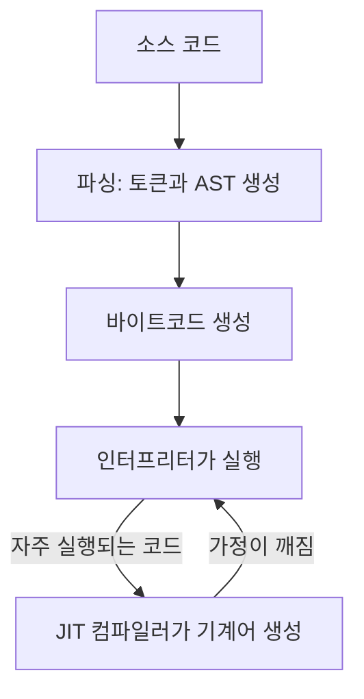

<Callout type="info">
  **이번 문서의 목표:** 어떤 기능이 ECMAScript에 속하고 어떤 기능이 실행 환경에 속하는지 구분하고, 새 문법이 표준이 되어 엔진에서 실행되기까지의 과정을 설명할 수 있습니다.
</Callout>

## 프로그래밍과 컴퓨팅 사고

프로그래밍은 컴퓨터가 수행할 작업을 빠짐없이 정확한 명령으로 적는 일입니다. 컴퓨터는 모호한 지시를 스스로 해석하지 못하므로, 문제를 명령으로 옮기기 전에 사람이 먼저 정리해야 합니다. 이 정리 방식을 컴퓨팅 사고(computational thinking)라고 합니다.

| 요소 | 하는 일 | 로그인 기능의 예 |
|------|---------|------------------|
| 분해 | 큰 문제를 작은 문제로 나눈다 | 입력 받기, 검증, 서버 요청, 결과 표시 |
| 패턴 인식 | 반복되는 구조를 찾는다 | 아이디 검증과 비밀번호 검증은 같은 형태 |
| 추상화 | 필요한 정보만 남긴다 | 사용자를 아이디와 비밀번호 두 값으로 표현 |
| 알고리즘 | 해결 절차를 순서대로 정한다 | 빈 값 확인 → 형식 확인 → 요청 → 응답 처리 |

## 구문과 의미

구문(syntax)은 코드를 적는 형식 규칙이고, 의미(semantics)는 그 코드가 실행되면 일어나는 일입니다. 구문이 맞아도 의미가 틀릴 수 있습니다.

```js
const price = 1000 * 'won' // 구문은 맞다. 결과는 NaN
const = 1000               // 구문 오류: SyntaxError
```

두 오류는 발견되는 시점이 다릅니다.

| 오류 | 발견 시점 | 결과 |
|------|-----------|------|
| 구문 오류 | 실행 전, 코드를 파싱할 때 | 그 스크립트는 한 줄도 실행되지 않는다 |
| 의미 오류 | 실행 중 | 해당 줄에서 에러가 나거나, 에러 없이 틀린 값이 나온다 |

```js
console.log('start') // 출력되지 않는다
const = 1            // 파일 전체가 파싱 단계에서 거부된다
```

에러 없이 틀린 값(`NaN`, `undefined`)이 나오는 의미 오류가 가장 찾기 어렵습니다. JavaScript는 이런 경우가 많은 언어입니다.

## JavaScript의 탄생과 역사

| 시기 | 사건 | 의미 |
|------|------|------|
| 1995년 5월 | Netscape의 Brendan Eich가 열흘 만에 시제품 작성 | 이름은 Mocha, 이후 LiveScript |
| 1995년 12월 | JavaScript로 개명 | Java의 인기를 빌린 이름. Java와는 다른 언어 |
| 1996년 8월 | Microsoft가 IE 3.0에 JScript 탑재 | 브라우저마다 동작이 달라지기 시작 |
| 1996년 11월 | Netscape가 Ecma International에 표준화 요청 | 표준 이름은 ECMAScript |
| 1997년 6월 | ECMA-262 1판(ES1) 공개 | 첫 표준 |
| 1999년 12월 | ES3 | 정규 표현식, try...catch |
| 2005년 | Ajax 용어 등장 | 페이지 새로고침 없는 웹 앱 확산 |
| 2006년 | jQuery | 브라우저 차이를 라이브러리로 흡수 |
| 2008년 | Chrome과 V8 엔진, ES4 폐기 | JIT 컴파일로 실행 속도 급상승 |
| 2009년 | ES5, Node.js | strict mode, JSON. 서버에서도 실행 |
| 2015년 6월 | ES2015(ES6) | let, const, class, 모듈, 프로미스 |
| 2016년 이후 | 매년 6월 새 판 | 소규모 연간 릴리스 |

열흘 만에 만든 초기 설계의 흔적이 지금도 남아 있습니다. `typeof null`이 `'object'`인 것이 대표적입니다. 기존 웹 페이지가 깨지면 안 되므로 이런 동작은 고치지 않습니다.

## JavaScript와 ECMAScript

**ECMAScript**는 Ecma International의 표준 문서 ECMA-262가 정의하는 언어 명세입니다. 값과 타입, 문법, 연산 규칙, `Array`·`Promise` 같은 내장 객체를 정의합니다. 화면을 그리거나 파일을 읽는 기능은 정의하지 않습니다.

**JavaScript**는 ECMAScript를 구현한 언어이고, 보통은 실행 환경이 제공하는 API까지 합쳐서 부르는 이름입니다.

```text
JavaScript = ECMAScript(언어) + 호스트 API(실행 환경이 제공)
```

- 표준 이름이 ECMAScript인 이유: JavaScript는 상표(현재 Oracle 소유)라서 표준 기구가 쓸 수 없었습니다.
- 국제화 API인 `Intl`은 별도 표준 ECMA-402가 정의합니다. 같은 위원회가 관리하고 모든 주요 엔진이 구현하므로 언어의 일부로 취급합니다.

## TC39와 표준화 과정

TC39는 ECMA-262를 관리하는 Ecma International의 39번 기술 위원회입니다. 브라우저 제조사와 기업, 학계의 대표가 두 달에 한 번 모이고, 표결이 아니라 합의로 결정합니다. 반대하는 위원이 있으면 제안은 다음 단계로 가지 못합니다.

새 기능은 제안(proposal)으로 시작해 단계(stage)를 올라갑니다.

| 단계 | 이름 | 상태 | 사용 판단 |
|------|------|------|-----------|
| 0 | Strawperson | 아이디어 제출 | 쓰지 않는다 |
| 1 | Proposal | 위원회가 문제를 검토하기로 함 | 쓰지 않는다 |
| 2 | Draft | 해결 방식 선택, 명세 초안 작성 | 문법이 바뀔 수 있다 |
| 2.7 | (이름 없음) | 명세 문안 확정, 테스트 작성 대기 | 설계는 사실상 확정 |
| 3 | Candidate | 엔진 구현 권장 | 트랜스파일러로 쓸 수 있다 |
| 4 | Finished | 다음 연도 판에 포함 확정 | 지원 엔진을 확인하고 쓴다 |

- 2.7단계는 2023년 11월에 생겼습니다. 3단계에 오른 뒤 설계가 바뀌는 일을 줄이려는 목적입니다.
- 4단계 조건: 공식 테스트 모음인 test262를 통과하는 호환 구현이 2개 이상 있고, 명세 편집자가 병합을 승인해야 합니다.
- 4단계가 곧 "어디서나 사용 가능"은 아닙니다. 엔진마다 출시 시점이 다르므로 MDN의 지원 표를 확인합니다.

## ECMAScript 버전

ECMA-262는 판(edition) 번호와 연도 이름을 함께 가집니다. 6판이 ES6이자 ES2015이고, 그 뒤로는 연도 이름이 공식 표기입니다. ES7이라고 쓰면 ES2016을 뜻합니다.

| 구분 | 뜻 | 대표 기능 |
|------|----|-----------|
| ES5 (2009) | 구형 브라우저의 기준선 | strict mode, JSON, `forEach`·`map` |
| ES6 = ES2015 | 역대 최대 개편 | let, const, 화살표 함수, class, 모듈, 프로미스 |
| ES2016 이후 | 매년 소규모 추가 | 아래 표 |

| 판 | 대표 기능 |
|----|-----------|
| ES2016 | `**` 연산자, `Array.prototype.includes` |
| ES2017 | async/await, `Object.entries` |
| ES2018 | 객체 스프레드, `for await...of` |
| ES2019 | `flat`, `Object.fromEntries` |
| ES2020 | `?.`, `??`, BigInt, `globalThis` |
| ES2021 | `replaceAll`, `Promise.any`, `??=` |
| ES2022 | 클래스 필드와 `#private`, 최상위 await, `at` |
| ES2023 | `toSorted`, `findLast` |
| ES2024 | `Object.groupBy`, `Promise.withResolvers` |
| ES2025 | 이터레이터 헬퍼, Set 집합 메서드, `Promise.try` |
| ES2026 | `Array.fromAsync`, `Error.isError`, `Math.sumPrecise` |

- 새 판은 매년 6월 Ecma 총회에서 승인됩니다. 그해 초까지 4단계에 오른 제안이 들어갑니다.
- ES.Next는 특정 판이 아니라 "다음 판에 들어갈 기능"을 가리키는 말입니다.
- 판별 전체 목록은 52편에서 다룹니다.

## JavaScript 엔진

엔진은 ECMAScript 코드를 읽어 실행하는 프로그램입니다. 명세가 정한 동작은 엔진이 달라도 같아야 합니다.

| 엔진 | 만든 곳 | 쓰는 곳 |
|------|---------|---------|
| V8 | Google | Chrome, Edge, Node.js, Deno |
| SpiderMonkey | Mozilla | Firefox |
| JavaScriptCore | Apple | Safari, Bun |
| Hermes | Meta | React Native |

엔진마다 다른 것은 실행 속도, 새 기능을 지원하는 시점, 에러 메시지 문구, 재귀 호출 깊이 한도입니다.

iOS에서는 Chrome과 Firefox도 Safari와 같은 JavaScriptCore를 씁니다(EU 지역은 iOS 17.4부터 다른 엔진 허용). Safari가 지원하지 않는 기능은 iOS 브라우저 전체에서 동작하지 않는다고 보면 됩니다.

엔진이 코드를 실행하는 순서는 다음과 같습니다.



AST(Abstract Syntax Tree)는 코드의 구조를 나무 형태로 표현한 자료 구조입니다. 구문 오류는 이 파싱 단계에서 발견됩니다.

## 컴파일러와 인터프리터

| 방식 | 번역 시점 | 장점 | 단점 |
|------|-----------|------|------|
| 컴파일러 | 실행 전에 전체를 기계어로 | 실행이 빠르다 | 시작 전에 번역 시간이 든다 |
| 인터프리터 | 실행하면서 조금씩 해석 | 바로 시작한다 | 같은 코드를 반복하면 느리다 |
| JIT 컴파일러 | 실행 중에 자주 쓰는 부분만 기계어로 | 둘의 장점을 합친다 | 구현이 복잡하고 메모리를 더 쓴다 |

"JavaScript는 인터프리터 언어"라는 말은 절반만 맞습니다. 현대 엔진은 인터프리터로 시작하고 JIT 컴파일러로 최적화합니다. V8은 네 단계를 씁니다.

| 단계 | 종류 | 역할 |
|------|------|------|
| Ignition | 인터프리터 | 바이트코드를 실행하며 타입 정보를 수집 |
| Sparkplug | 기본 컴파일러 | 최적화 없이 바이트코드를 기계어로 빠르게 변환 |
| Maglev | 중간 최적화 컴파일러 | 짧은 시간에 적당히 최적화 (2023년 추가) |
| TurboFan | 최적화 컴파일러 | 시간을 들여 가장 빠른 기계어 생성 |

JIT 컴파일러는 "이 함수에는 계속 같은 타입이 들어온다"는 가정으로 최적화합니다. 가정이 깨지면 최적화한 코드를 버리고 인터프리터로 돌아갑니다. 이것을 역최적화(deoptimization)라고 합니다.

```js
function add(a, b) { return a + b }

add(1, 2)     // 숫자만 들어온다 → 숫자 덧셈으로 최적화
add('a', 'b') // 가정이 깨진다 → 역최적화
```

함수에 항상 같은 타입을 넘기고 객체의 프로퍼티를 같은 순서로 만들면 최적화가 유지됩니다. 다만 이런 조정은 성능 문제를 측정으로 확인한 뒤에만 합니다.

## 런타임 환경

런타임 환경은 엔진에 호스트 API와 이벤트 루프를 더한 실행 환경입니다. 엔진만으로는 화면 출력도 네트워크 요청도 할 수 없습니다.

| 런타임 | 엔진 | 제공하는 API | 전역 객체 |
|--------|------|--------------|-----------|
| 브라우저 | 브라우저별 | DOM, `fetch`, `localStorage` | `window` |
| Node.js (2009) | V8 | `fs`, `http`, `process` | `global` |
| Deno (2020) | V8 | 웹 표준 API 중심, 권한 모델 | `globalThis` |
| Bun (2023) | JavaScriptCore | Node.js 호환 API, 번들러 내장 | `globalThis` |

- `globalThis`(ES2020)는 어느 런타임에서나 전역 객체를 가리킵니다.
- 이름이 같아도 구현이 다를 수 있습니다. `setTimeout`의 반환값은 브라우저에서 숫자이고 Node.js에서 `Timeout` 객체입니다.
- 서버 런타임끼리 공통으로 제공할 API는 Ecma의 TC55 위원회(WinterTC)가 표준화하고 있습니다.

## ECMAScript와 호스트 API의 구분

호스트(host)는 엔진을 품고 있는 실행 환경이고, 호스트 API는 그 환경이 추가로 제공하는 기능입니다.

| 출처 | 예 |
|------|----|
| ECMAScript | 문법 전체, `Array`, `Map`, `Promise`, `JSON`, `Math`, `Date`, `RegExp`, `Proxy`, `globalThis` |
| 웹 표준(WHATWG·W3C) | `document`, `window`, `fetch`, `setTimeout`, `console`, `localStorage`, `URL`, `structuredClone`, `queueMicrotask` |
| Node.js 전용 | `process`, `fs`, `Buffer`, `require`, `__dirname` |

`console`, `setTimeout`, `structuredClone`, `URL`은 ECMAScript가 아닙니다. Node.js가 같은 이름으로 따로 구현했기 때문에 양쪽에서 쓸 수 있을 뿐입니다.

이벤트 루프도 호스트가 정의합니다. 브라우저의 이벤트 루프는 HTML 표준에 있습니다. ECMAScript는 프로미스의 후속 처리를 작업(Job)으로 등록한다는 것까지만 정하고, 그 작업을 언제 실행할지는 호스트에 맡깁니다(자세히는 40편).

```js
typeof Promise  // 'function' — 어디서나 (ECMAScript)
typeof document // 브라우저 'object', Node.js 'undefined'
typeof process  // 브라우저 'undefined', Node.js 'object'
```

구분해야 하는 이유는 세 가지입니다.

- **문서 위치**: MDN에서 언어 기능은 JavaScript 항목에, 호스트 API는 Web APIs 항목에 있습니다.
- **이식성**: 호스트 API를 쓴 코드는 다른 런타임에서 동작하지 않을 수 있습니다.
- **구형 환경 대응**: 새 문법은 트랜스파일러가 변환하고, 새 내장 객체와 API는 폴리필이 채웁니다(자세히는 51편).

## JavaScript의 특징

| 특징 | 내용 | 자세히 |
|------|------|--------|
| 동적 타입 | 타입은 변수가 아니라 값에 있다. 변수에 다른 타입을 다시 넣을 수 있다 | 05편 |
| 암묵적 타입 변환 | 타입이 안 맞으면 에러 대신 변환한다. `'1' + 1`은 `'11'` | 08편 |
| 프로토타입 기반 | 객체가 다른 객체를 직접 상속한다. class는 그 위의 문법이다 | 17편 |
| 일급 함수 | 함수를 값처럼 변수에 담고, 인수로 넘기고, 반환한다 | 16편 |
| 다중 패러다임 | 명령형, 객체지향, 함수형 방식을 섞어 쓴다 | 50편 |
| 싱글 스레드 | 코드를 한 번에 하나씩 실행한다. 기다리는 작업은 이벤트 루프로 넘긴다 | 40편 |
| 가비지 컬렉션 | 쓰지 않는 메모리를 엔진이 자동으로 회수한다 | 49편 |
| 하위 호환 | 한번 표준이 된 동작은 제거하지 않는다 | 19편 |

하위 호환 원칙 때문에 잘못된 초기 설계도 그대로 남습니다. 대신 새 규칙은 strict mode나 모듈처럼 선택해서 켜는 방식으로 추가됩니다.

## 핵심 정리

- JavaScript는 ECMAScript(언어)에 호스트 API(실행 환경 제공)를 더한 것입니다. `console`, `setTimeout`, `fetch`는 ECMAScript가 아닙니다.
- 새 기능은 TC39에서 0단계부터 4단계까지 올라가며, 4단계에 오르면 다음 연도 판에 포함됩니다.
- ES6과 ES2015는 같은 판이고, 2016년부터는 매년 6월에 새 판이 나옵니다.
- 엔진은 인터프리터로 시작해 자주 실행되는 코드를 JIT 컴파일러로 최적화합니다.
- 구문 오류는 실행 전에 스크립트 전체를 막고, 의미 오류는 실행 중에 드러납니다.

## 마무리 복습

<Quiz
  questionNumber={1}
  question="다음 중 ECMAScript 명세가 정의하는 것은?"
  options={['setTimeout', 'console.log', 'Promise', 'document.querySelector']}
  correctAnswer={3}
  explanation="Promise는 ECMA-262가 정의하는 내장 객체입니다. setTimeout과 document는 HTML·DOM 표준, console은 Console 표준이 정의하는 호스트 API입니다."
/>

<Quiz
  questionNumber={2}
  question="TC39 제안이 4단계(Finished)에 오르기 위한 조건은?"
  options={['모든 브라우저가 기능을 출시해야 한다', 'test262를 통과하는 호환 구현이 2개 이상 있어야 한다', '위원 과반수가 찬성 투표해야 한다', 'Ecma 총회의 승인을 받아야 한다']}
  correctAnswer={2}
  explanation="4단계는 test262를 통과하는 호환 구현 2개 이상과 명세 편집자의 승인을 요구합니다. TC39는 표결이 아니라 합의로 결정하고, 총회 승인은 연도 판 전체에 대한 절차입니다."
/>

<Quiz
  questionNumber={3}
  question="스크립트 첫 줄에 console.log가 있고 둘째 줄에 구문 오류가 있을 때 일어나는 일은?"
  options={['첫 줄이 실행된 뒤 둘째 줄에서 멈춘다', '둘째 줄만 건너뛰고 나머지가 실행된다', '스크립트 전체가 실행되지 않는다', '첫 줄은 실행되고 경고만 출력된다']}
  correctAnswer={3}
  explanation="구문 오류는 실행 전 파싱 단계에서 발견되므로 그 스크립트는 한 줄도 실행되지 않습니다. 실행 중에 드러나는 의미 오류와 다른 점입니다."
/>

## 참고 자료

- [ECMA-262 — ECMAScript Language Specification](https://tc39.es/ecma262/)
- [The TC39 Process](https://tc39.es/process-document/)
- [TC39 Finished Proposals](https://github.com/tc39/proposals/blob/main/finished-proposals.md)
- [MDN — JavaScript technologies overview](https://developer.mozilla.org/en-US/docs/Web/JavaScript/Reference/JavaScript_technologies_overview)
- [V8 Blog — Maglev: V8's Fastest Optimizing JIT](https://v8.dev/blog/maglev)
- [WinterTC (Ecma TC55)](https://wintertc.org/)
