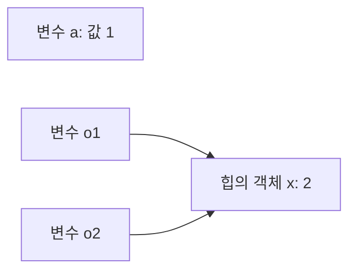

<Callout type="info">
  **이번 문서의 목표:** 8가지 데이터 타입 각각의 값 범위와 동작 규칙을 설명하고, 원시 값과 객체가 메모리에서 어떻게 다르게 다뤄지는지 구분할 수 있습니다.
</Callout>

## 원시 타입과 객체 타입

ECMAScript의 데이터 타입은 8가지입니다. 7개는 원시 타입(primitive type)이고, 나머지 하나가 객체 타입(object type)입니다.

| 구분 | 타입 | 값의 예 |
|------|------|---------|
| 원시 | Undefined | `undefined` (값이 하나뿐) |
| 원시 | Null | `null` (값이 하나뿐) |
| 원시 | Boolean | `true`, `false` |
| 원시 | Number | `1`, `3.14`, `NaN`, `Infinity` |
| 원시 | BigInt | `10n` |
| 원시 | String | `'abc'` |
| 원시 | Symbol | `Symbol('id')` |
| 객체 | Object | `{}`, `[]`, 함수, `Date` 등 |

원시 값과 객체는 다음 네 가지가 다릅니다(자세히는 10편).

| 구분 | 원시 값 | 객체 |
|------|---------|------|
| 변경 | 불가능(immutable) | 가능(mutable) |
| 변수에 담기는 것 | 값 자체 | 객체를 가리키는 참조 |
| 복사 | 값이 복사된다 | 참조가 복사된다 |
| 비교 | 값이 같으면 같다 | 같은 객체일 때만 같다 |

원시 값은 변경할 수 없습니다. 값을 바꾸는 연산은 없고, 변수에 다른 값을 다시 대입할 수 있을 뿐입니다. 원시 값에 대한 변경 시도는 조용히 무시되고, strict mode에서는 TypeError입니다(자세히는 19편).

```js
const s = 'abc'
s[0] = 'X'     // 무시됨 (strict mode: TypeError)
s.foo = 1      // 무시됨 (strict mode: TypeError)
s              // 'abc'
```

### 래퍼 객체

원시 값의 프로퍼티나 메서드에 접근하면 엔진이 대응하는 래퍼 객체(String, Number, Boolean, Symbol, BigInt)를 임시로 만들어 접근하고 곧 버립니다. 그래서 원시 값이 메서드를 가진 것처럼 보입니다. `undefined`와 `null`은 래퍼가 없어 접근하면 TypeError입니다.

```js
'abc'.toUpperCase()      // 'ABC'
typeof new String('a')   // 'object' (래퍼를 직접 만든 경우)
new Number(1) === 1      // false
new Number(1) + 1        // 2 (연산 시 원시 값으로 변환)
```

- `String(x)`, `Number(x)`처럼 `new` 없이 호출하면 변환 함수로 동작하고 원시 값을 반환합니다. `new`를 붙이면 래퍼 객체가 만들어집니다.
- 래퍼 객체를 직접 만들 일은 없습니다. 객체이므로 `new Boolean(false)`도 truthy라서 조건문에서 오동작합니다.

### typeof 연산자

`typeof`는 피연산자의 타입을 나타내는 문자열을 반환합니다(자세히는 06편).

| 값 | typeof 결과 |
|----|-------------|
| `undefined` | `'undefined'` |
| `null` | `'object'` (역사적 오류) |
| `true` | `'boolean'` |
| `1`, `NaN` | `'number'` |
| `1n` | `'bigint'` |
| `'a'` | `'string'` |
| `Symbol()` | `'symbol'` |
| `{}`, `[]`, `new Date()`, `/a/` | `'object'` |
| 함수, 클래스 | `'function'` |

- `'function'`은 별도 타입이 아니라 호출 가능한 객체를 구분하는 결과입니다.
- 선언하지 않은 식별자에 `typeof`를 쓰면 ReferenceError 없이 `'undefined'`를 반환합니다.

## number

Number는 IEEE 754 배정밀도 64비트 부동소수점 값입니다. 정수와 실수를 구분하는 타입이 따로 없어서 `1`과 `1.0`은 같은 값입니다. 정수 전용 타입은 BigInt이며 Number와 별개입니다.

| 표기 | 예 | 값 |
|------|----|----|
| 10진 | `255` | 255 |
| 2진 (ES2015) | `0b11111111` | 255 |
| 8진 (ES2015) | `0o377` | 255 |
| 16진 | `0xff` | 255 |
| 지수 | `2.55e2` | 255 |
| 숫자 구분자 (ES2021) | `1_000_000` | 1000000 |

- 숫자 구분자 `_`는 숫자와 숫자 사이에만 둘 수 있습니다. `1_`, `1__0`, `1._5`, `0_1`은 SyntaxError입니다.
- 구분자는 소스 코드에서만 인식됩니다. `Number('1_000')`은 `NaN`입니다.
- 맨 앞이 0인 `017`은 레거시 8진수입니다. strict mode에서는 SyntaxError이고, 일반 모드에서 `089`처럼 8이나 9가 있으면 10진수 89로 읽힙니다. 8진수는 `0o`로 씁니다.
- 정수 리터럴 바로 뒤의 `.`은 소수점으로 읽힙니다. `5.toFixed()`는 SyntaxError이므로 `(5).toFixed()` 또는 `5..toFixed()`로 씁니다.
- `5 / 2`는 `2.5`입니다. 정수 나눗셈 연산자는 없습니다.

### 범위 상수

| 상수 | 값 | 의미 |
|------|----|------|
| `Number.MAX_SAFE_INTEGER` | 9007199254740991 | 정확히 다룰 수 있는 최대 정수 (2의 53제곱 - 1) |
| `Number.MIN_SAFE_INTEGER` | -9007199254740991 | 정확히 다룰 수 있는 최소 정수 |
| `Number.MAX_VALUE` | 약 1.7976931348623157e+308 | 표현 가능한 최대 유한 값 |
| `Number.MIN_VALUE` | 5e-324 | 0보다 큰 최소 값 |
| `Number.EPSILON` | 약 2.22e-16 (2의 -52제곱) | 1과 1 다음으로 큰 수의 차이 |

`Number.MIN_VALUE`는 가장 작은 양수이지 가장 작은 음수가 아닙니다. 가장 작은 음수는 `-Number.MAX_VALUE`입니다.

### 특수 값

`Infinity`, `-Infinity`, `NaN`도 Number 타입의 값입니다. 숫자를 0으로 나눠도 예외가 나지 않습니다.

```js
-1 / 0                // -Infinity
1 / 0                 // Infinity
0 / 0                 // NaN
Number.MAX_VALUE * 2  // Infinity (오버플로)
Number.MIN_VALUE / 2  // 0 (언더플로)
```

### 부동소수점 오차

2진수로 딱 떨어지지 않는 소수는 가장 가까운 근삿값으로 저장되므로 계산에 오차가 생깁니다. IEEE 754를 쓰는 모든 언어에서 같은 현상이 일어납니다.

```js
0.1 + 0.2             // 0.30000000000000004
0.1 + 0.2 === 0.3     // false
0.1.toFixed(20)       // '0.10000000000000000555'
```

- 비교할 때는 허용 오차를 둡니다: `Math.abs(a - b) < Number.EPSILON`. 이 방식은 1 근처의 값에만 맞습니다. 값이 클수록 표현 간격이 커지므로 큰 값에는 상대 오차를 씁니다.
- 금액은 소수 대신 정수 단위(원, 센트)로 저장하고 계산합니다.
- `toFixed`는 숫자가 아니라 문자열을 반환하며, 저장된 근삿값을 기준으로 반올림합니다. `(1.005).toFixed(2)`는 `'1.00'`입니다. 1.005가 실제로는 1.00499999999999989…로 저장되기 때문입니다.

### 안전한 정수

정수는 -(2의 53제곱 - 1)부터 2의 53제곱 - 1까지만 모두 정확히 표현됩니다. 이 범위를 넘으면 표현 간격이 2 이상이 되어 일부 정수는 표현할 수 없습니다.

```js
2 ** 53                        // 9007199254740992
2 ** 53 + 1                    // 9007199254740992 (표현 불가)
Number.isSafeInteger(2 ** 53)  // false
JSON.parse('9007199254740993') // 9007199254740992
```

마지막 줄처럼 64비트 정수 ID가 JSON으로 오면 파싱 단계에서 끝자리가 깨집니다. 안전 범위를 넘는 정수는 BigInt로 다루고, JSON에서는 문자열로 주고받습니다(자세히는 39편).

비트 연산자는 피연산자를 32비트 정수로 변환해 계산합니다(자세히는 06편). `Number.isInteger`, `Number.isFinite`, `Math` 메서드는 30편에서 다룹니다.

## 음의 0

Number에는 `+0`과 `-0` 두 개의 0이 있습니다. IEEE 754가 부호 있는 0을 정의하기 때문입니다. 두 값은 대부분의 연산에서 구분되지 않습니다.

```js
-0                // -0
0 * -1            // -0
0 / -5            // -0
Math.round(-0.4)  // -0
Math.ceil(-0.5)   // -0
```

나머지 연산도 결과의 부호가 피제수(나뉘는 수)를 따르므로 `-5 % 5`는 `-0`입니다.

구분되는 경우는 정해져 있습니다.

```js
0 === -0              // true  (===, ==, <, >는 구분 안 함)
Object.is(0, -0)      // false (구분하는 비교)
1 / -0                // -Infinity
String(-0)            // '0'   (문자열 변환은 부호를 버린다)
JSON.stringify(-0)    // '0'
```

- 판별은 `Object.is(x, -0)` 또는 `1 / x === -Infinity`로 합니다.
- `Math.sign(-0)`은 `-0`, `Math.min(0, -0)`은 `-0`, `Math.max(-0, 0)`은 `0`입니다.
- `Set`과 `Map`은 키로 들어온 `-0`을 `+0`으로 바꿔 저장합니다.
- `console.log(-0)`은 `-0`을 출력하는 환경이 많아서 문자열 변환 결과 `'0'`과 다르게 보입니다.
- 부호가 결과를 바꾸는 계산은 `1 / x`와 `Math.atan2`입니다. `Math.atan2(0, -1)`은 `π`, `Math.atan2(-0, -1)`은 `-π`입니다.

흔한 실수는 `Math.round`나 곱셈 결과가 `-0`일 수 있다는 점을 놓치는 것입니다. `=== 0`은 통과하지만 `Object.is(x, 0)`은 실패합니다.

## NaN의 성질

NaN(Not-a-Number)은 유효한 숫자로 표현할 수 없는 계산 결과를 나타내는 Number 값입니다. `typeof NaN`은 `'number'`입니다.

```js
0 / 0                 // NaN
Math.sqrt(-1)         // NaN
Infinity - Infinity   // NaN
0 * Infinity          // NaN
Number('abc')         // NaN
undefined + 1         // NaN
```

성질은 다섯 가지입니다.

- **자기 자신과도 같지 않다.** `NaN === NaN`은 `false`이고 `NaN !== NaN`은 `true`입니다. 자신과 같지 않은 유일한 값입니다.
- **모든 비교가 false다.** `NaN < 1`, `NaN >= 1`, `NaN == NaN`이 전부 `false`입니다. `!=`와 `!==`만 `true`입니다.
- **계산에 전염된다.** NaN이 섞인 산술 결과는 NaN이고, `Math.max(1, NaN)`도 `NaN`입니다. 중간에 생긴 NaN이 끝까지 전파되므로 발생 지점을 찾기 어렵습니다.
- **falsy다.** 조건문에서 `false`로 취급됩니다.
- **읽기 전용이다.** 전역 `NaN`에 대입하면 무시되고 strict mode에서는 TypeError입니다.

예외로 `NaN ** 0`은 `1`입니다. 0제곱은 어떤 값이든 1로 정의되어 있습니다.

### 판별

| 방법 | 동작 |
|------|------|
| `Number.isNaN(x)` | Number 타입이고 NaN일 때만 `true` (권장, ES2015) |
| `Object.is(x, NaN)` | 같은 결과 |
| `x !== x` | 같은 결과 (NaN의 성질을 이용한 방식) |
| `isNaN(x)` | 숫자로 변환한 뒤 NaN이면 `true` (비권장) |

```js
isNaN('abc')          // true  (Number('abc')가 NaN이라서)
Number.isNaN('abc')   // false (문자열은 NaN이 아니다)
isNaN('')             // false ('' → 0)
isNaN({})             // true  ({} → NaN)
```

전역 `isNaN`은 NaN이 아닌 값도 `true`로 만들 수 있으므로 `Number.isNaN`을 씁니다(자세히는 30편).

`switch`의 `case NaN`은 `===`로 비교하므로 절대 일치하지 않습니다. 배열에서 NaN을 찾을 때 `indexOf(NaN)`은 `-1`이고 `includes(NaN)`은 `true`입니다.

### 세 가지 동등 비교

`Object.is(a, b)`는 NaN끼리 같고 0과 -0은 다르다고 판정하는 비교 함수입니다. 언어에는 동등 비교가 세 종류 있습니다.

| 비교 | NaN과 NaN | 0과 -0 | 쓰이는 곳 |
|------|-----------|--------|-----------|
| `===` | false | true | 일반 비교, `indexOf`, `switch` |
| `Object.is` | true | false | 값을 엄밀히 구별할 때 |
| SameValueZero | true | true | `includes`, `Set`, `Map` |

## string

String은 UTF-16 코드 유닛의 나열이며 변경할 수 없는 원시 값입니다. 문자 하나를 나타내는 별도 타입은 없고, `s[0]`은 길이 1인 문자열을 반환합니다.

```js
const s = 'hello'
s.length    // 5
s[0]        // 'h'
s.at(-1)    // 'o' (ES2022, 음수는 뒤에서부터)
s[10]       // undefined (범위 밖 인덱스는 에러가 아니다)
```

- 작은따옴표와 큰따옴표는 완전히 같습니다. 프로젝트에서 한쪽으로 통일합니다.
- 따옴표 리터럴 안에 줄바꿈(LF, CR)을 직접 쓸 수 없습니다. U+2028과 U+2029는 ES2019부터 허용됩니다.
- 변경이 불가능하므로 문자열 메서드는 모두 새 문자열을 반환하고 원본은 그대로입니다.
- 명세가 정한 최대 길이는 2의 53제곱 - 1이지만, 실제 한도는 엔진이 더 작게 제한합니다.
- 메서드는 33편에서 다룹니다.

`===`는 코드 유닛 순서까지 같을 때만 `true`입니다. `<`와 `>`는 코드 유닛 값을 앞에서부터 비교합니다.

```js
'a' < 'B'            // false ('a'는 97, 'B'는 66)
'10' < '9'           // true  ('1'은 49, '9'는 57)
'apple' < 'apples'   // true  (앞부분이 같으면 짧은 쪽이 작다)
'a'.localeCompare('B') // -1  (로케일 순서로 비교)
```

흔한 실수는 `s[0] = 'X'`로 문자를 바꾸려는 것과 `length`를 글자 수로 믿는 것입니다. 후자는 다음 절에서 다룹니다.

## UTF-16 코드 유닛

JavaScript 문자열의 원소는 16비트 코드 유닛(code unit)입니다. `length`, 인덱스 접근, `charCodeAt`, `slice`는 모두 코드 유닛 기준으로 동작합니다.

유니코드는 문자마다 코드 포인트(code point, U+0000부터 U+10FFFF)를 부여하고, UTF-16은 코드 포인트를 코드 유닛 1개 또는 2개로 인코딩합니다.

| 코드 포인트 범위 | 코드 유닛 수 | 예 |
|------------------|--------------|----|
| U+0000–U+FFFF (BMP) | 1 | `'A'`, `'가'`, `'€'` |
| U+10000–U+10FFFF | 2 (서로게이트 쌍) | `'😀'`, `'𠮷'` |

BMP는 기본 다국어 평면(Basic Multilingual Plane)입니다. 서로게이트 쌍은 상위 서로게이트(D800–DBFF)와 하위 서로게이트(DC00–DFFF) 한 쌍입니다.

```js
const e = '😀'          // U+1F600
e.length                // 2
e.charCodeAt(0)         // 55357 (0xD83D, 상위)
e.charCodeAt(1)         // 56832 (0xDE00, 하위)
e.codePointAt(0)        // 128512 (0x1F600)
```

쌍으로 나누는 공식은 다음과 같습니다.

```text
v    = cp - 0x10000
상위 = 0xD800 + (v >> 10)
하위 = 0xDC00 + (v & 0x3FF)
```

- `cp`는 코드 포인트, `v`는 20비트 값입니다.
- U+1F600이면 `v = 0xF600`, 상위 = `0xD800 + 0x3D` = `0xD83D`, 하위 = `0xDC00 + 0x200` = `0xDE00`입니다.

API는 기준에 따라 둘로 갈립니다.

| 기준 | API |
|------|-----|
| 코드 유닛 | `length`, `s[i]`, `charAt`, `charCodeAt`, `slice`, `split('')`, `String.fromCharCode` |
| 코드 포인트 | `codePointAt`, `String.fromCodePoint`, `for...of`, 스프레드 `[...s]`, `Array.from(s)` |

문자열 이터레이터가 코드 포인트 단위로 순회하기 때문에 `for...of`와 스프레드가 코드 포인트 기준입니다(자세히는 35편).

```js
[...'😀'].length              // 1
'😀'.split('')                // ['\ud83d', '\ude00']
String.fromCodePoint(0x1F600) // '😀'
String.fromCharCode(0x1F600)  // 엉뚱한 문자 (하위 16비트만 사용)
```

### 짝 없는 서로게이트

코드 유닛 단위로 자르면 쌍이 깨져 짝 없는 서로게이트(lone surrogate)가 생깁니다.

```js
'😀'.slice(0, 1)                    // '\ud83d' (깨진 문자)
'😀a'.split('').reverse().join('')  // 'a\ude00\ud83d' (파손)
Array.from('😀a').reverse().join('') // 'a😀' (코드 포인트 단위)
```

- 짝 없는 서로게이트는 화면에서 깨진 문자로 보이고, `encodeURIComponent`는 URIError를 던집니다.
- `isWellFormed()`는 짝 없는 서로게이트가 없는지 검사하고, `toWellFormed()`는 그것을 U+FFFD로 바꿉니다(ES2024).
- 정규 표현식의 `.`은 `u` 플래그가 없으면 코드 유닛 하나만 매치합니다(자세히는 32편).

### 코드 포인트도 사용자가 보는 글자는 아니다

사용자가 한 글자로 보는 단위(grapheme cluster)는 여러 코드 포인트로 이루어질 수 있습니다.

```js
'e\u0301'.length             // 2 (e + 결합 악센트)
'\u00e9'.length              // 1 (é 한 코드 포인트)
'e\u0301' === '\u00e9'       // false (둘 다 é로 보인다)
'e\u0301'.normalize() === '\u00e9' // true (NFC 정규화)
'👨‍👩‍👧'.length                // 8
Array.from('👨‍👩‍👧').length    // 5 (사람 3 + 연결 문자 2)
```

- 한글도 완성형(`'가'`, U+AC00, 유닛 1개)과 자모가 분리된 형태(`'가'.normalize('NFD')`, 유닛 2개)가 서로 다른 문자열입니다. 출처가 다른 문자열을 비교하기 전에 `normalize()`를 거칩니다.
- 글자 단위로 세거나 자르려면 `Intl.Segmenter`로 grapheme 단위 분리를 합니다. `[...new Intl.Segmenter().segment(s)].length`가 사용자가 보는 글자 수입니다.

## 이스케이프 시퀀스

이스케이프 시퀀스(escape sequence)는 문자열과 템플릿 리터럴 안에서 백슬래시로 시작해 특수 문자나 임의의 코드 포인트를 적는 표기입니다.

| 표기 | 문자 | 코드 |
|------|------|------|
| `\n` | 줄 바꿈(LF) | U+000A |
| `\r` | 캐리지 리턴(CR) | U+000D |
| `\t` | 탭 | U+0009 |
| `\b` | 백스페이스 | U+0008 |
| `\f` | 폼 피드 | U+000C |
| `\v` | 수직 탭 | U+000B |
| `\0` | NUL (뒤에 숫자가 오면 안 됨) | U+0000 |
| `\'` | 작은따옴표 | U+0027 |
| `\"` | 큰따옴표 | U+0022 |
| `\\` | 백슬래시 | U+005C |

숫자로 코드를 직접 지정하는 표기는 세 가지입니다.

| 표기 | 자리수 | 예 |
|------|--------|----|
| `\xHH` | 16진 2자리 (U+0000–U+00FF) | `'\x41'` → `'A'` |
| `\uHHHH` | 16진 4자리, 코드 유닛 하나 | `'\u0041'` → `'A'` |
| `\u{H…}` | 16진 1–6자리 코드 포인트 (ES2015) | `'\u{1F600}'` → `'😀'` |

`\u{...}`의 값은 `10FFFF`를 넘을 수 없습니다. 서로게이트 쌍은 `'\uD83D\uDE00'`처럼 `\u` 두 개로도 적을 수 있고 `'\u{1F600}'`과 같은 문자열입니다.

규칙은 다음과 같습니다.

- 표에 없는 문자 앞의 백슬래시는 무시됩니다. `'\q'`는 `'q'`입니다.
- 형식이 틀린 `\x`, `\u`는 SyntaxError입니다. `'\xZ'`, `'\u12'`, `'\u{110000}'`이 해당합니다.
- 줄 끝의 백슬래시는 줄바꿈을 지우고 다음 줄을 이어 붙입니다(줄 연속).
- `\251`처럼 8진수로 코드를 적는 이스케이프(`\0` 뒤에 숫자가 오는 경우 포함)는 레거시입니다. strict mode와 템플릿 리터럴에서 SyntaxError이고, `\8`과 `\9`도 strict mode에서 SyntaxError입니다. 대신 `\xA9` 또는 `\u00A9`를 씁니다.

```js
const s = 'ab\
cd'
s                     // 'abcd'
'C:\new'.length       // 5  (\n이 줄바꿈이 된다)
'C:\\new'.length      // 6  (백슬래시를 두 번 쓴다)
```

흔한 실수는 Windows 경로나 정규식 문자열에서 백슬래시를 한 번만 쓰는 것입니다. `'C:\new'`는 `C`, `:`, 줄바꿈, `e`, `w` 다섯 문자입니다. JSON 문자열은 허용하는 이스케이프가 더 적어서 `\'`, `\x`, `\u{}`를 쓸 수 없습니다(자세히는 39편).

## Template Literal

템플릿 리터럴(template literal)은 백틱 문자로 감싼 문자열 리터럴로, 표현식 삽입과 여러 줄 문자열을 지원합니다(ES2015). 별도 타입이 아니라 문자열을 만드는 문법이라서 `typeof`는 `'string'`입니다.

```js
const name = 'Kim'
const age = 20
const msg = `Hi ${name}, ${age + 1}`
msg   // 'Hi Kim, 21'
```

`${}` 안에는 표현식이라면 무엇이든 쓸 수 있고, 템플릿 리터럴을 중첩할 수도 있습니다.

```js
const ok = true
const text = `result: ${ok ? `yes ${1 + 1}` : 'no'}`
text  // 'result: yes 2'
```

삽입된 값은 문자열로 변환됩니다. Symbol은 변환할 수 없어 TypeError입니다.

```js
const f = (v) => `${v}`
f(null)        // 'null'
f([1, 2])      // '1,2'
f({})          // '[object Object]'
f(Symbol())    // TypeError
```

일반 객체는 템플릿 리터럴에서 `toString`을 먼저 호출하고, `+`에서는 `valueOf`를 먼저 호출합니다. 둘이 모두 정의돼 있으면 결과가 갈립니다(자세히는 08편).

```js
const o = {
  valueOf() { return 1 },
  toString() { return 'a' },
}
const t = `${o}`   // 'a'
const p = '' + o   // '1'
```

### 여러 줄과 이스케이프

- 소스의 줄바꿈과 들여쓰기가 문자열에 그대로 들어갑니다. 소스 파일의 줄바꿈이 CRLF여도 `\n` 하나로 정규화됩니다.
- 백틱은 앞에 백슬래시를 붙여 이스케이프합니다. 보간을 막으려면 `\${`로 씁니다. `$` 뒤에 `{`가 없으면 그냥 문자입니다.
- 이스케이프 시퀀스는 일반 문자열과 같지만 8진수 형태는 SyntaxError입니다.
- 객체 리터럴의 키로 직접 쓸 수 없고, 대괄호를 쓴 계산된 키로만 쓸 수 있습니다.

```js
const a = `
    hello`           // '\n    hello' (들여쓰기 4칸 포함)
const b = `\${1}`    // '${1}'
const c = `$${1}`    // '$1'
const d = { `a`: 1 }          // SyntaxError
const e = { [`a${1}`]: 1 }    // { a1: 1 }
```

흔한 실수는 들여쓴 코드 안에서 여러 줄 템플릿을 쓰고 앞쪽 공백이 문자열에 들어간다는 점을 놓치는 것입니다.

### 태그드 템플릿

함수 이름 바로 뒤에 템플릿 리터럴을 붙이면 그 함수가 호출됩니다. 첫 인수는 정적 문자열 조각의 배열이고, 나머지 인수는 삽입된 값입니다.

```js
function tag(strings, ...values) {
  return [strings, values]
}
tag`a${1}b${2}`
// [['a', 'b', ''], [1, 2]]
```

- `strings`의 길이는 `values`의 길이보다 항상 1 큽니다.
- `strings`는 동결된 배열이고, `strings.raw`는 이스케이프를 처리하지 않은 원문 배열입니다.
- 같은 소스 위치의 호출은 매번 같은 `strings` 객체를 받습니다. 다른 위치에서는 다른 객체입니다.
- 태그 함수는 문자열이 아닌 값을 반환해도 됩니다.
- 태그드 템플릿에서는 잘못된 이스케이프가 허용됩니다(ES2018). 해당 조각은 `strings`에서 `undefined`가 되고 `raw`에 원문이 남습니다. 일반 템플릿 리터럴에서는 SyntaxError입니다.

내장 태그 `String.raw`는 이스케이프를 처리하지 않은 원문으로 문자열을 만듭니다.

```js
String.raw`C:\new`    // 'C:\\new' (길이 6, 줄바꿈이 되지 않음)
```

용도는 HTML 이스케이프, SQL 파라미터 바인딩, CSS-in-JS 라이브러리처럼 삽입 값을 가공해서 조립하는 곳입니다.

## boolean

Boolean은 `true`와 `false` 두 값만 가지는 원시 타입입니다. 비교·논리 연산의 결과이고 조건문의 판단 값입니다.

```js
typeof (1 < 2)    // 'boolean'
typeof !'a'       // 'boolean'
```

`&&`와 `||`는 불리언이 아니라 피연산자 중 하나를 반환합니다(자세히는 08편).

### truthy와 falsy

조건 위치(`if`, 삼항 연산자, `!`, 논리 연산자)에서는 값이 불리언으로 변환됩니다. `false`로 변환되는 값(falsy)은 8개뿐이고 나머지는 모두 `true`(truthy)입니다.

| 값 | 타입 |
|----|------|
| `false` | Boolean |
| `0`, `-0`, `NaN` | Number |
| `0n` | BigInt |
| `''` | String |
| `null` | Null |
| `undefined` | Undefined |

브라우저의 `document.all`은 객체인데도 falsy이고 `typeof`가 `'undefined'`입니다. 오래된 웹 페이지와의 호환을 위한 예외입니다.

헷갈리는 truthy 값은 다음과 같습니다.

```js
Boolean('0')                // true  (비어 있지 않은 문자열)
Boolean('false')            // true
Boolean([])                 // true  (빈 배열도 객체)
Boolean({})                 // true
Boolean(new Boolean(false)) // true  (래퍼 객체)
```

- 명시적 변환은 `Boolean(x)` 또는 `!!x`입니다(자세히는 08편).
- `[] == false`는 `true`인데 `[]`는 truthy입니다. `==`가 객체를 원시 값으로 바꿔 비교하기 때문입니다. 조건 판단과 `==` 결과는 다를 수 있으므로 `== false`로 검사하지 않습니다.

흔한 실수는 정상 값 0이나 `''`를 "값 없음"으로 처리하는 것입니다.

```js
const count = 0
count || 10    // 10 (0이 falsy라 기본값으로 대체됨)
count ?? 10    // 0  (null과 undefined만 대체, ES2020)
```

환경 변수나 쿼리 문자열의 `'false'`는 문자열이라 truthy입니다. `value === 'true'`로 비교해서 불리언으로 바꿉니다.

## undefined

`undefined`는 "값이 할당되지 않았다"를 뜻하는 Undefined 타입의 유일한 값입니다. 엔진이 자동으로 채웁니다.

| 상황 | 예 |
|------|----|
| 초기화하지 않은 변수 | `let a` → `a`는 `undefined` |
| 전달되지 않은 인수 | `f()` 안의 매개변수 |
| `return` 없는 함수의 반환값 | `f()`의 결과 |
| 없는 프로퍼티 | `({}).a` |
| 범위 밖 인덱스, 배열의 빈 칸 | `[1, , 3][1]` |
| `void` 연산자 | `void 0` |

- `undefined`는 키워드가 아니라 전역 객체의 읽기 전용 프로퍼티입니다. 재할당은 무시되고 strict mode에서는 TypeError입니다. 함수 안에서는 같은 이름의 지역 변수를 선언할 수 있지만 그런 코드는 쓰지 않습니다.
- 읽기만으로는 "프로퍼티가 없음"과 "값이 `undefined`인 프로퍼티"를 구분할 수 없습니다. `in` 연산자로 구분합니다(자세히는 18편).
- 선언하지 않은 식별자는 `typeof x === 'undefined'`로 검사해야 ReferenceError가 나지 않습니다.

```js
const o = { a: undefined }
o.a === undefined   // true
'a' in o            // true  (프로퍼티는 있다)
'b' in o            // false
```

`undefined`의 프로퍼티에 접근하면 TypeError입니다.

```js
const o = {}
o.a.b     // TypeError: Cannot read properties of undefined
o.a?.b    // undefined (옵셔널 체이닝, ES2020)
```

연산과 직렬화에서는 다음과 같이 동작합니다.

```js
undefined + 1                          // NaN
String(undefined)                      // 'undefined'
JSON.stringify({ a: undefined, b: 1 }) // '{"b":1}'
JSON.stringify([undefined])            // '[null]'
```

기본값 매개변수와 구조 분해의 기본값은 `undefined`일 때만 적용됩니다. 이 차이는 "undefined와 null 사용 기준" 절에서 `null`과 비교합니다.

## null

`null`은 "의도적으로 비어 있다"를 뜻하는 Null 타입의 유일한 값입니다. 개발자가 직접 대입합니다.

```js
let user = { name: 'Kim' }
user = null     // 참조를 비운다
```

- `null`은 리터럴이라 재정의할 수 없습니다. `undefined`와 달리 식별자가 아닙니다.
- `typeof null`은 `'object'`입니다. 최초 구현은 값을 타입 태그와 함께 저장했는데, 객체의 태그가 0이었고 `null`이 널 포인터(0)로 표현되어 객체와 같은 태그를 갖게 된 오류입니다. 고치면 기존 웹이 깨지므로 그대로 둡니다.
- `null`은 객체가 아닙니다. `null instanceof Object`는 `false`이고 프로퍼티가 없습니다. 객체인지 검사하려면 `typeof x === 'object' && x !== null`이어야 합니다.
- `null`의 프로퍼티에 접근하면 TypeError입니다: `null.foo` → "Cannot read properties of null".
- 연산: `null + 1`은 `1`(`Number(null)`이 0), `String(null)`은 `'null'`입니다.

표준에서 `null`이 나타나는 곳은 다음과 같습니다.

```js
Object.getPrototypeOf(Object.prototype) // null (체인의 끝)
Object.create(null)    // 프로토타입이 없는 객체 (17편)
'abc'.match(/z/)       // null (일치 없음)
JSON.parse('null')     // null
```

브라우저 API인 `document.querySelector`도 요소를 찾지 못하면 `null`을 반환합니다.

## undefined와 null 사용 기준

두 값은 모두 "값이 없음"을 나타내지만 의미와 동작이 다릅니다.

| 항목 | undefined | null |
|------|-----------|------|
| 의미 | 값이 할당되지 않음 | 의도적으로 비어 있음 |
| 채우는 쪽 | 엔진 | 개발자 |
| `typeof` | `'undefined'` | `'object'` |
| `Number(x)` | `NaN` | `0` |
| 기본값 매개변수 | 적용됨 | 적용되지 않음 |
| `JSON.stringify` | 프로퍼티 생략 (배열은 `null`) | `null` 유지 |
| `==` 비교 | `null`과 같고 그 외는 모두 다르다 | `undefined`와 같고 그 외는 모두 다르다 |
| `===` 비교 | `null`과 다르다 | `undefined`와 다르다 |

사용 기준은 다음과 같습니다.

- `undefined`는 엔진이 쓰는 값으로 두고, `x = undefined`처럼 직접 대입하지 않습니다. 값을 비울 때는 `null`을 쓰고, 프로퍼티를 없앨 때는 `delete`를 씁니다.
- `null`은 "있어야 하는 자리인데 지금은 값이 없음"을 코드로 밝힐 때 씁니다. 예를 들어 선택하지 않은 항목 `selected: null`이 있습니다.
- 둘을 함께 "없음"으로 취급할 때는 `x == null`(`null`과 `undefined`에만 `true`) 또는 `x ?? fallback`을 씁니다. `x == null`은 `==`를 허용하는 대표적인 경우입니다(자세히는 08편).
- 기본값은 `undefined`에만 적용되므로 `null`을 넘기면 기본값이 쓰이지 않습니다.

```js
function f(a = 10) { return a }
f(undefined)           // 10
f(null)                // null
const { b = 1 } = { b: null }
b                      // null
```

표준 라이브러리는 "찾지 못함"을 일관되게 표현하지 않습니다. 반환값을 외우지 말고 사용하는 API의 문서를 확인합니다.

| 반환값 | API |
|--------|-----|
| `undefined` | `Array.prototype.find`, `Map.prototype.get`, 빈 배열의 `pop` |
| `null` | `String.prototype.match`, `RegExp.prototype.exec` |
| `-1` | `indexOf`, `findIndex`, `search` |

JSON에는 `undefined`가 없습니다. API 응답에서 필드를 생략하는 것과 `null`로 보내는 것을 같은 뜻으로 쓸지 스키마에서 정해 두어야 합니다.

## symbol

Symbol은 고유하고 변경할 수 없는 원시 값입니다. 객체 프로퍼티 키로 쓰면 다른 키와 이름이 충돌하지 않습니다(ES2015).

```js
const a = Symbol('id')
const b = Symbol('id')
a === b          // false (설명이 같아도 다른 값)
a.description    // 'id' (ES2019)
a.toString()     // 'Symbol(id)'
typeof a         // 'symbol'
```

- `Symbol()` 함수 호출로만 만듭니다. `new Symbol()`은 TypeError입니다.
- 설명(description)은 디버깅용 라벨이며 동일성에 영향이 없습니다. 생략하면 `description`이 `undefined`이고, `Symbol('')`이면 빈 문자열입니다.

### 프로퍼티 키로 사용

```js
const id = Symbol('id')
const user = { name: 'Kim', [id]: 1 }
user[id]                           // 1
Object.keys(user)                  // ['name']
JSON.stringify(user)               // '{"name":"Kim"}'
Object.getOwnPropertySymbols(user) // [Symbol(id)]
```

- 심벌 키는 `for...in`, `Object.keys`, `Object.entries`, `JSON.stringify`에서 제외됩니다.
- 스프레드와 `Object.assign`은 열거 가능한 심벌 키 프로퍼티를 복사합니다.
- `Reflect.ownKeys`는 문자열 키와 심벌 키를 모두 반환합니다.
- 키를 알아낼 수 있으므로 완전한 비공개가 아닙니다. 진짜 비공개는 `#` 프라이빗 필드입니다(자세히는 24편).

### 변환 제한

심벌은 문자열이나 숫자로 암묵적 변환이 되지 않습니다. 명시적으로 `String()`을 호출하는 것만 허용됩니다.

```js
`${a}`       // TypeError
'' + a       // TypeError
a * 2        // TypeError
String(a)    // 'Symbol(id)'
!!a          // true
```

### 전역 심벌 레지스트리

`Symbol.for(key)`는 같은 키에 항상 같은 심벌을 반환하고, `Symbol.keyFor(sym)`은 등록된 키를 돌려줍니다.

```js
Symbol.for('k') === Symbol.for('k')  // true
Symbol.keyFor(Symbol.for('k'))       // 'k'
Symbol.keyFor(Symbol('k'))           // undefined (미등록)
```

파일이나 모듈이 달라도 같은 키로 같은 심벌을 공유할 때 씁니다.

### 잘 알려진 심벌

`Symbol.iterator`, `Symbol.toPrimitive`, `Symbol.hasInstance`처럼 언어가 내부 동작의 확장 지점으로 정의한 심벌입니다. 객체에 이 키로 메서드를 정의하면 `for...of`, 타입 변환, `instanceof` 같은 동작이 바뀝니다(자세히는 34편). 이터레이션 프로토콜은 35편에서 다룹니다.

ES2023부터 등록하지 않은 심벌은 `WeakMap`의 키가 될 수 있습니다. `Symbol.for`로 만든 심벌과 잘 알려진 심벌은 TypeError입니다(자세히는 38편).

## bigint

BigInt는 임의 정밀도의 정수를 나타내는 원시 타입입니다. Number의 안전 범위(2의 53제곱 - 1)를 넘는 정수를 정확히 다룹니다(ES2020).

```js
123n                // BigInt 리터럴 (정수 + n)
BigInt('123')       // 123n
2n ** 64n           // 18446744073709551616n
typeof 1n           // 'bigint'
```

- 리터럴은 정수 뒤에 `n`을 붙입니다. `0xffn`, `0b11n`, `1_000n`은 되고 `1.5n`, `01n`은 SyntaxError입니다.
- 크기에 제한이 없고 정밀도를 잃지 않습니다.

```js
Number.MAX_SAFE_INTEGER + 2   // 9007199254740992 (오차)
BigInt(Number.MAX_SAFE_INTEGER) + 2n // 9007199254740993n
```

### Number와의 상호작용

BigInt와 Number는 산술 연산에서 섞을 수 없습니다. 둘 중 하나로 명시적으로 변환합니다.

```js
1n + 1               // TypeError
1n + BigInt(1)       // 2n
Number(1n) + 1       // 2
'a' + 1n             // 'a1' (문자열 연결은 가능)
```

비교는 섞어도 됩니다. `1n < 2`와 `1n == 1`은 `true`이고, 타입이 다르므로 `1n === 1`은 `false`입니다.

### 연산 규칙

| 항목 | 규칙 |
|------|------|
| 나눗셈 | 0 방향으로 소수부를 버린다: `5n / 2n`은 `2n`, `-5n / 2n`은 `-2n` |
| 0으로 나누기 | RangeError |
| 음수 지수 | RangeError (`2n ** -1n`) |
| 단항 `+` | TypeError (`-1n`은 가능) |
| `>>>` | TypeError (부호 없는 시프트가 없다) |
| 비트 연산 | AND, OR, XOR, NOT과 `<<`, `>>`는 가능 |
| `Math` 메서드 | TypeError (`Math.max(1n, 2n)`) |
| `NaN`, `Infinity`, `-0` | 없다. `0n === -0n`은 `true` |
| 불리언 변환 | `0n`만 falsy |

### 변환과 직렬화

- `BigInt(1.5)`는 정수가 아니므로 RangeError이고, `BigInt('abc')`는 SyntaxError, `BigInt(undefined)`는 TypeError입니다. `BigInt('0x1f')`는 `31n`, `BigInt(true)`는 `1n`입니다.
- `Number(2n ** 64n)`은 `18446744073709552000`으로 정밀도를 잃습니다.
- `BigInt.asIntN(8, 255n)`은 `-1n`, `BigInt.asUintN(8, -1n)`은 `255n`으로 고정 비트 폭에 맞춰 자릅니다. 고정 폭 배열 타입은 48편에서 다룹니다.
- `JSON.stringify(1n)`은 TypeError입니다. 전송할 때는 `String(x)`로 문자열로 바꿉니다(자세히는 39편).
- `Number.isInteger(1n)`은 `false`입니다. Number 타입만 검사하기 때문입니다.
- `parseInt`나 `JSON.parse`는 결과가 Number이므로 이미 오차가 있습니다. 큰 ID는 문자열로 받아 `BigInt('9007199254740993')`처럼 변환합니다.

Number보다 연산 비용이 크므로 안전 범위를 넘는 정수가 필요한 곳(64비트 ID, 정확한 큰 정수 계산)에서만 씁니다.

## 객체 타입

Object는 원시 값이 아닌 모든 값의 타입입니다. 프로퍼티(키와 값의 쌍)의 모음이고, 변경할 수 있으며, 변수에는 참조가 담깁니다.

객체 리터럴, 배열, 함수, `Date`, `RegExp`, `Map`, `Set`, `Error`, `Promise`가 모두 Object 타입입니다.

```js
const user = { name: 'Kim' }
user.age = 20         // 프로퍼티 추가
delete user.name      // 프로퍼티 삭제
user                  // { age: 20 }
```

- 키는 문자열 또는 심벌입니다. 다른 값은 문자열로 변환되어 `o[1]`과 `o['1']`은 같은 프로퍼티이고, `o[{}]`의 키는 `'[object Object]'`입니다.
- 정수 형태의 키는 숫자 순으로 먼저, 나머지 문자열 키는 추가한 순서로, 심벌 키는 마지막으로 나열됩니다(자세히는 18편).
- 객체는 참조로 비교합니다. `{} === {}`는 `false`입니다(자세히는 10편).

명세는 객체를 다음과 같이 나눕니다.

| 종류 | 설명 |
|------|------|
| 일반 객체 | 객체 리터럴, `new Object()` 등. 기본 동작을 그대로 따른다 |
| 배열 | `length`와 인덱스 키가 특별하게 동작하는 객체 (28편) |
| 함수 | 호출할 수 있는 객체. `typeof`가 `'function'` (16편) |
| 빌트인 객체 | 명세가 정의하고 엔진이 제공하는 객체 (20편) |
| 호스트 객체 | 실행 환경이 제공하는 객체. `document` 등 |

`typeof`로는 배열, `Date`, `null`이 모두 `'object'`로 나오므로 종류는 별도 방법으로 판별합니다.

```js
Array.isArray([])                    // true
new Date() instanceof Date           // true
Object.prototype.toString.call([])   // '[object Array]'
Object.prototype.toString.call(null) // '[object Null]'
```

객체 리터럴은 09편, 프로퍼티 어트리뷰트는 14편, 프로토타입은 17편에서 다룹니다.

## 데이터 타입과 메모리

변수는 값을 저장한 메모리 공간(주소)에 붙인 이름입니다. 값의 종류에 따라 필요한 공간과 복사 방식이 다릅니다.

명세는 값을 어디에 저장할지 정하지 않습니다. 아래 설명은 동작을 이해하기 위한 모델입니다. 원시 값은 변수에 값 자체가 담기고, 객체는 별도 영역(힙)에 만들어지며 변수에는 그 위치를 가리키는 참조가 담깁니다.



원시 값은 대입할 때 값이 복사됩니다.

```js
let a = 1
let b = a       // 값 1이 복사된다
b = 2
a               // 1
```

객체는 대입할 때 참조가 복사되어 두 변수가 같은 객체를 가리킵니다.

```js
const o1 = { x: 1 }
const o2 = o1   // 참조가 복사된다
o2.x = 2
o1.x            // 2
o1 === o2       // true
```

원시 값은 재할당해도 원래 값이 변하지 않습니다. 새 값을 만들어 변수가 그것을 가리키게 할 뿐입니다.

```js
let s = 'a'
const t = s
s += 'b'        // 새 문자열 'ab'를 만들어 s에 대입
t               // 'a' (원래 문자열은 그대로)
```

- 값의 크기는 타입마다 다릅니다. Number는 64비트로 고정이고, 문자열은 길이에 비례하고, BigInt는 값의 크기에 비례하고, 객체는 프로퍼티 수에 따라 달라집니다.
- 엔진은 작은 정수나 영문 문자열을 더 작게 저장하는 식으로 내부 표현을 최적화할 수 있습니다.
- 클로저에 잡힌 변수는 함수가 끝난 뒤에도 살아 있으므로 "원시 값은 스택에 있다"는 모델이 항상 맞지는 않습니다(자세히는 23편).

### 함수 인수 전달

인수는 값이 복사되어 전달됩니다. 객체의 경우 복사되는 값이 참조이므로, 함수 안에서 객체를 변경하면 호출한 쪽에도 보입니다.

```js
function f(o) { o.x = 2; o = { x: 3 } }
const obj = { x: 1 }
f(obj)
obj.x           // 2
```

`o.x = 2`는 같은 객체를 바꾸고, `o = { x: 3 }`은 매개변수 `o`가 가리키는 대상만 바꾸므로 `obj`에는 영향이 없습니다.

### const와 불변

`const`는 변수에 다시 대입하지 못하게 할 뿐 객체의 내용은 바꿀 수 있습니다.

```js
const o = { x: 1 }
o.x = 2         // 허용
o = {}          // TypeError
```

`Object.freeze`는 1단계 프로퍼티만 동결합니다(자세히는 14편). 중첩 객체는 그대로 변경됩니다.

### 복사

스프레드 `{ ...a }`와 `Object.assign`은 얕은 복사라서 중첩 객체는 참조를 공유합니다. `structuredClone`은 깊은 복사를 하는 호스트 API이고 ECMAScript에는 없습니다(자세히는 10편).

```js
const a = { n: { v: 1 } }
const b = { ...a }
b.n.v = 2
a.n.v           // 2 (n은 같은 객체를 공유)
```

더 이상 참조되지 않는 객체는 가비지 컬렉터가 회수합니다(자세히는 49편). 변수에 `null`을 대입하면 참조가 끊어집니다.

## 정적 타입과 동적 타입

타입 검사가 이루어지는 시점과 타입이 붙는 대상으로 언어를 나눌 수 있습니다.

| 구분 | 정적 타입 | 동적 타입 |
|------|-----------|-----------|
| 타입이 붙는 곳 | 변수 | 값 |
| 검사 시점 | 컴파일할 때(실행 전) | 실행 중 |
| 변수의 타입 변경 | 불가능 | 가능 |
| 대표 언어 | Java, C, Rust, TypeScript | JavaScript, Python, Ruby |

```java
int n = 1;
n = "a";   // 컴파일 오류: 실행 전에 거부된다
```

```js
let v = 1
v = 'a'    // 허용: 타입은 변수가 아니라 값에 있다
v = {}     // 허용
```

- `let`, `const`, `var`는 타입 선언이 아니라 변수 선언 키워드입니다.
- 타입 오류는 해당 코드가 실행될 때 드러납니다. `null.foo`는 그 줄에 도달해야 TypeError가 납니다.
- 정적·동적(검사 시점)과 강·약(타입 불일치 때 암묵적 변환을 허용하는 정도)은 별개의 기준입니다. 엄밀한 정의는 없지만 JavaScript는 동적이면서 암묵적 변환이 많은 쪽입니다. Python은 동적이지만 `'1' + 1`이 TypeError라서 변환이 적은 쪽입니다.

| 구분 | 장점 | 단점 |
|------|------|------|
| 정적 타입 | 실행 전에 오류 발견, 자동 완성 등 도구 지원 | 타입 선언 코드가 늘어난다 |
| 동적 타입 | 코드가 짧고 유연하다 | 오류가 실행 중에 드러난다 |

TypeScript는 JavaScript 위에 정적 타입 검사를 더한 별도 언어입니다. 컴파일하면 타입 정보는 제거되고 JavaScript만 남으므로 실행 시점에는 동적 타입으로 동작합니다. ECMAScript의 범위는 아닙니다.

## 동적 타이핑과 주의점

동적 타이핑(dynamic typing)은 변수, 매개변수, 프로퍼티에 타입 제약이 없고 값의 타입이 실행 중에 정해지는 방식입니다. 함수는 어떤 타입의 인수로든 호출됩니다.

주의할 점은 여섯 가지입니다.

**암묵적 타입 변환**: 연산자는 피연산자 타입이 맞지 않으면 에러 대신 변환합니다(자세히는 08편).

```js
'1' + 1       // '11'
'5' - 2       // 3
'3' * '4'     // 12
true + 1      // 2
```

**입력 값은 대개 문자열**: 폼 입력, URL 쿼리, 환경 변수는 문자열로 들어옵니다.

```js
const v = '10'       // input.value 같은 문자열
v + 5                // '105'
Number(v) + 5        // 15
```

**한 변수에 여러 타입**: 읽기 어렵고 엔진의 최적화를 방해합니다(자세히는 01편). 한 변수에는 한 가지 타입만 담습니다.

**오타는 에러가 아니라 undefined**: 없는 프로퍼티는 읽어도 에러가 아니므로, 문제는 나중에 엉뚱한 곳에서 TypeError로 터집니다.

```js
const user = { name: 'Kim' }
user.nmae           // undefined (에러 없음)
user.nmae.length    // TypeError
```

**인수 타입 보증 없음**: 함수는 인수 타입을 강제하지 않습니다. 함수 안에서 검사하거나 JSDoc, TypeScript로 도구가 검사하게 합니다.

**`typeof`의 한계**: `null`은 `'object'`, 배열도 `'object'`, `NaN`은 `'number'`입니다.

타입 검사 방법을 정리하면 다음과 같습니다.

| 알고 싶은 것 | 검사 방법 |
|--------------|-----------|
| 문자열, 숫자, 불리언, bigint, symbol | `typeof x === 'string'` 등 |
| undefined | `x === undefined` (미선언 가능성이 있으면 `typeof x === 'undefined'`) |
| null | `x === null` |
| null 또는 undefined | `x == null` |
| NaN | `Number.isNaN(x)` |
| 정수 | `Number.isInteger(x)` |
| 배열 | `Array.isArray(x)` |
| 객체(함수 제외) | `typeof x === 'object' && x !== null` |
| 함수 | `typeof x === 'function'` |
| 특정 생성자의 인스턴스 | `x instanceof Foo` |

실무 규칙은 다음과 같습니다.

- 변수는 선언과 동시에 초기화하고 한 가지 타입만 담습니다.
- 변환은 `Number(x)`, `String(x)`처럼 명시적으로 합니다.
- 비교는 `===`를 씁니다.
- 타입 오류 비용이 큰 코드는 TypeScript나 JSDoc 타입 검사로 실행 전에 확인합니다.

## 핵심 정리

- 데이터 타입은 8가지입니다. 원시 7종(Undefined, Null, Boolean, Number, BigInt, String, Symbol)은 불변이고 값으로 복사·비교되며, 객체는 가변이고 참조로 복사·비교됩니다.
- Number는 64비트 부동소수점이라 `0.1 + 0.2 !== 0.3`이고, 안전한 정수 범위는 2의 53제곱 - 1까지이며, 더 큰 정수는 BigInt를 씁니다. `NaN`은 자신과 같지 않고 `-0`은 `0`과 `===`로 구분되지 않습니다.
- 문자열은 UTF-16 코드 유닛의 나열이라 `length`는 글자 수가 아니라 유닛 수이고, 이모지는 유닛 2개입니다.
- falsy는 `false`, `0`, `-0`, `NaN`, `0n`, `''`, `null`, `undefined` 8개뿐입니다.
- `undefined`는 엔진이 채우는 "값 없음", `null`은 개발자가 쓰는 "의도적으로 비움"이고, 기본값 매개변수는 `undefined`에만 적용됩니다.
- JavaScript는 값에 타입이 붙는 동적 타입 언어라서 타입 오류가 실행 중에 드러나며, 타입 검사는 `typeof`, `Array.isArray`, `Number.isNaN` 등을 상황에 맞게 씁니다.

## 마무리 복습

<Quiz
  questionNumber={1}
  question="다음 중 결과가 false인 식은?"
  options={['①0 === -0', '②[NaN].includes(NaN)', '③Object.is(NaN, NaN)', '④Object.is(0, -0)']}
  correctAnswer={4}
  explanation="===는 0과 -0을 같다고 보므로 true이고, includes는 SameValueZero 비교라 NaN을 찾아 true이며, Object.is는 NaN끼리 같다고 판정하므로 true입니다. Object.is는 0과 -0을 다르다고 판정하므로 ④만 false입니다."
/>

<Quiz
  questionNumber={2}
  question="기본값 매개변수를 가진 함수 f(a = 10)에 undefined를 넘길 때와 null을 넘길 때의 반환값은 순서대로 무엇인가?"
  options={['①10, 10', '②10, null', '③undefined, null', '④null, 10']}
  correctAnswer={2}
  explanation="기본값은 인수가 undefined일 때만 적용되므로 f(undefined)는 10입니다. null은 값이 있는 것으로 취급되어 기본값이 적용되지 않고 그대로 반환됩니다."
/>

<Quiz
  questionNumber={3}
  question="obj가 x가 1인 객체일 때, 함수 f(o)가 o.x에 2를 대입한 다음 o에 x가 3인 새 객체를 재할당합니다. f(obj)를 호출한 뒤 obj.x의 값은?"
  options={['①1', '②2', '③3', '④undefined']}
  correctAnswer={2}
  explanation="인수로 복사된 참조가 같은 객체를 가리키므로 o.x = 2는 obj의 객체를 바꿉니다. 이후 o에 새 객체를 재할당하는 것은 매개변수 o가 가리키는 대상만 바꾸고 obj에는 영향을 주지 않으므로 결과는 2입니다."
/>

## 참고 자료

- [ECMA-262 — ECMAScript Language Types](https://tc39.es/ecma262/#sec-ecmascript-language-types)
- [MDN — JavaScript data types and data structures](https://developer.mozilla.org/en-US/docs/Web/JavaScript/Guide/Data_structures)
- [MDN — typeof](https://developer.mozilla.org/en-US/docs/Web/JavaScript/Reference/Operators/typeof)
- [MDN — Number](https://developer.mozilla.org/en-US/docs/Web/JavaScript/Reference/Global_Objects/Number)
- [MDN — BigInt](https://developer.mozilla.org/en-US/docs/Web/JavaScript/Reference/Global_Objects/BigInt)
- [MDN — Symbol](https://developer.mozilla.org/en-US/docs/Web/JavaScript/Reference/Global_Objects/Symbol)
- [MDN — String (UTF-16 문자, 코드 포인트, grapheme cluster)](https://developer.mozilla.org/en-US/docs/Web/JavaScript/Reference/Global_Objects/String)
- [MDN — Template literals](https://developer.mozilla.org/en-US/docs/Web/JavaScript/Reference/Template_literals)
- [MDN — Lexical grammar (이스케이프 시퀀스)](https://developer.mozilla.org/en-US/docs/Web/JavaScript/Reference/Lexical_grammar)
- [MDN — Equality comparisons and sameness](https://developer.mozilla.org/en-US/docs/Web/JavaScript/Guide/Equality_comparisons_and_sameness)
- [MDN — Falsy](https://developer.mozilla.org/en-US/docs/Glossary/Falsy)
- [TC39 Finished Proposals](https://github.com/tc39/proposals/blob/main/finished-proposals.md)
