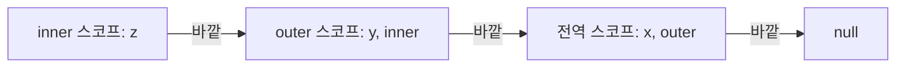

<Callout type="info">
  **이번 문서의 목표:** 코드의 한 지점에서 식별자가 어느 선언을 가리키는지 스코프 규칙으로 판단합니다.
</Callout>

## 스코프의 개념과 식별자 결정

**스코프**(scope)는 식별자(변수·함수·클래스·매개변수의 이름)를 참조할 수 있는 유효 범위입니다. 같은 이름이 여러 곳에 선언되어 있을 때 어느 선언을 가리킬지 정하는 규칙이기도 합니다.

**식별자 결정**(identifier resolution)은 엔진이 식별자를 만났을 때 그것이 가리키는 선언을 찾는 과정입니다. 식별자와 값의 연결을 바인딩(binding)이라고 합니다.

```js
var x = 'global'
function foo() {
  var x = 'local'
  console.log(x) // 'local'
}
foo()
console.log(x)   // 'global'
```

`x`가 두 번 선언되어 있어도 서로 다른 스코프에 있으므로 충돌하지 않습니다. 각 `x`는 자신에게 가장 가까운 스코프의 선언으로 결정됩니다.

스코프는 크게 네 종류입니다.

| 종류 | 만들어지는 때 | 도입 |
|------|---------------|------|
| 전역 | 스크립트 실행을 시작할 때 | ES1 |
| 함수 | 함수를 호출할 때마다 | ES1 |
| 블록 | 블록을 실행할 때마다 | ES2015 |
| 모듈 | 모듈을 평가할 때 한 번 | ES2015 |

명세는 스코프를 환경 레코드(Environment Record)로 구현합니다. 환경 레코드는 식별자와 값의 바인딩을 담는 구조이고, 식별자 결정은 추상 연산 ResolveBinding이 수행합니다(자세히는 22편).

### 같은 스코프의 중복 선언

같은 스코프 안에서 `var`는 같은 이름을 다시 선언해도 오류가 없고, `let`·`const`·`class`는 SyntaxError입니다.

```js
var a = 1
var a = 2   // 허용: 새 변수가 아니라 같은 a에 2를 대입
let b = 1
let b = 2   // SyntaxError: 이미 선언된 식별자
```

`var`의 중복 허용은 모르는 사이에 기존 값을 덮어쓰는 원인이 됩니다.

### 식별자를 찾지 못했을 때

바깥 스코프를 전역까지 모두 찾아도 선언이 없으면 결정에 실패합니다(unresolvable reference). 결과는 사용 방식에 따라 다릅니다.

| 사용 | 비엄격 모드 | strict mode |
|------|-------------|-------------|
| 읽기 `zzz` | ReferenceError | ReferenceError |
| `typeof zzz` | `'undefined'` | `'undefined'` |
| 대입 `zzz = 1` | 전역 객체에 프로퍼티 생성 | ReferenceError |

비엄격 모드의 대입은 선언 없이 전역 변수를 만듭니다(암묵적 전역, 자세히는 20편). strict mode는 19편에서 다룹니다.

## 전역·지역 스코프

**전역 스코프**(global scope)는 코드의 가장 바깥 영역이고, 여기에 선언한 식별자는 전역 변수입니다. **지역 스코프**(local scope)는 함수 몸체 안쪽 영역이고, 여기에 선언한 식별자는 지역 변수입니다. 매개변수도 지역 변수입니다. 블록 안쪽도 지역 스코프에 속합니다(블록 스코프 절).

```js
var g = 'global'     // 전역 변수
function f(p) {      // p는 지역 변수
  var l = 'local'    // 지역 변수
  return [g, p, l]
}
f('arg')             // ['global', 'arg', 'local']
console.log(l)       // ReferenceError: l is not defined
```

참조 방향은 한쪽뿐입니다.

- 안쪽 스코프에서는 자기 스코프와 모든 바깥 스코프의 식별자를 읽고 쓸 수 있습니다.
- 바깥 스코프에서는 안쪽 스코프의 식별자를 참조할 수 없습니다.

두 변수는 생명 주기도 다릅니다.

| 구분 | 전역 변수 | 지역 변수 |
|------|-----------|-----------|
| 생성 | 스크립트 실행을 시작할 때 | 함수를 호출하거나 블록을 실행할 때마다 새로 |
| 소멸 | 프로그램 종료(브라우저는 페이지를 닫을 때) | 스코프가 끝날 때. 클로저가 참조하면 유지(23편) |

```js
function count() {
  var n = 0    // 호출할 때마다 새로 만들어진다
  n++
  return n
}
count() // 1
count() // 1 — 이전 호출의 n은 남아 있지 않다
```

전역 스코프의 특징입니다.

- 하나만 존재합니다. 같은 페이지의 모든 일반 `<script>`가 같은 전역 스코프를 공유하므로, 다른 파일의 전역 변수와 이름이 충돌할 수 있습니다.
- 전역 객체(브라우저의 `window`, 어느 런타임에서나 쓰는 `globalThis`)와 연결되어 있습니다. 스크립트 최상위의 `var`와 함수 선언문은 전역 객체의 프로퍼티가 되고, `let`·`const`·`class`는 되지 않습니다.

```js
var a = 1   // 스크립트 최상위
let b = 2
globalThis.a // 1
globalThis.b // undefined
```

이 동작은 스크립트 최상위에서만 성립합니다. 모듈과 Node.js의 CommonJS 파일은 최상위가 전역이 아닙니다(모듈 스코프 절). 전역 변수의 문제와 억제 방법은 13편에서 다룹니다.

## 스코프 체인

**스코프 체인**(scope chain)은 중첩된 스코프를 안쪽에서 바깥쪽으로 잇는 연결입니다. 식별자 결정은 현재 스코프에서 시작해 이 연결을 따라 올라가며 선언을 찾습니다.

함수 몸체 안에 정의한 함수를 중첩 함수, 중첩 함수를 감싸는 함수를 외부 함수라고 합니다.

```js
var x = 'global'
function outer() {
  var y = 'outer'
  function inner() {
    var z = 'inner'
    console.log(x, y, z) // 'global' 'outer' 'inner'
  }
  inner()
}
outer()
```



`inner` 안에서 `x`는 inner, outer, 전역 순으로 찾고 전역에서 발견합니다. 명세에서 이 연결은 각 환경 레코드의 `[[OuterEnv]]` 슬롯이고, 전역 환경 레코드의 `[[OuterEnv]]`는 null입니다.

규칙은 다음과 같습니다.

- 가장 가까운 스코프에서 시작해, 처음 발견한 선언에서 멈춥니다. 더 바깥에 같은 이름이 있어도 보지 않습니다(섀도잉 절).
- 전역 스코프까지 없으면 ReferenceError입니다.
- 방향은 안쪽에서 바깥쪽 한쪽입니다. 같은 부모를 가진 형제 스코프끼리는 서로 볼 수 없습니다.

```js
function a() { var s = 1 }
function b() { return s }
b() // ReferenceError: s is not defined
```

- 함수 이름도 식별자이므로 같은 방식으로 찾습니다. 중첩 함수 안에서 외부 함수를 호출할 수 있는 것도 이 때문입니다.
- 대입도 식별자 결정을 거칩니다. 안쪽에서 `x = 1`은 새 변수를 만드는 것이 아니라 체인에서 찾은 가장 가까운 `x`를 바꿉니다.

```js
let count = 0
function inc() { count = count + 1 } // 바깥 count를 갱신
inc()
count // 1
```

## 함수 레벨 스코프

**함수 레벨 스코프**(function-level scope)는 `var`로 선언한 변수가 함수 몸체만 지역 스코프로 인정하고, 그 안의 `if`·`for`·`while` 같은 블록은 지역 스코프로 인정하지 않는 규칙입니다. ES2015 이전에는 `var`가 변수를 선언하는 유일한 키워드였으므로 지역 스코프는 사실상 함수뿐이었습니다.

```js
var x = 1
if (true) {
  var x = 10   // 블록은 스코프가 아니므로 같은 전역 x
}
console.log(x) // 10
```

```js
for (var i = 0; i < 3; i++) {}
console.log(i) // 3 — 반복이 끝나도 i가 남는다
```

규칙은 다음과 같습니다.

- `var` 선언은 블록의 위치와 무관하게 가장 가까운 둘러싼 함수(없으면 전역)에 소속됩니다.
- 실행되지 않는 분기 안의 `var`도 스코프에는 등록됩니다. 값은 `undefined`입니다(호이스팅, 자세히는 03편).

```js
function f() {
  if (false) { var v = 1 }
  return v   // undefined — ReferenceError가 아니다
}
```

- 매개변수와 함수 몸체의 `var`는 같은 함수 스코프입니다. `function f(a) { var a }`는 같은 변수의 재선언이고 매개변수 값은 유지됩니다.
- 함수 선언문의 이름은 그 선언을 둘러싼 스코프에 속합니다.
- 기명 함수 표현식의 이름은 그 함수 자신의 스코프에만 존재합니다(자세히는 11편).

```js
const f = function fact(n) {
  return n <= 1 ? 1 : n * fact(n - 1)
}
f(3)        // 6
typeof fact // 'undefined'
```

- 매개변수에 기본값 식이 있으면 매개변수용 스코프가 몸체와 분리됩니다. 기본값 안의 함수는 몸체의 `var`를 보지 못합니다(자세히는 27편).

```js
var x = 1
function f(a = () => x) {
  var x = 2
  return a()
}
f() // 1
```

함수 레벨 스코프의 문제는 블록으로 변수를 가둘 수 없다는 점입니다. 블록 안의 변수가 바깥으로 새고, 같은 이름의 중복 선언도 막지 못합니다. `let`·`const`의 블록 스코프가 이를 해결합니다.

## 렉시컬 스코프

**렉시컬 스코프**(lexical scope)는 함수를 어디서 호출했는지가 아니라 어디에 정의했는지에 따라 상위 스코프가 결정되는 규칙입니다. 정적 스코프(static scope)라고도 합니다. JavaScript는 렉시컬 스코프를 따릅니다.

```js
var x = 1
function foo() {
  var x = 10
  bar()
}
function bar() {
  console.log(x)
}
foo() // 1
bar() // 1
```

`bar`는 전역에 정의되었으므로 상위 스코프가 전역 스코프입니다. `foo` 안에서 호출해도 `foo`의 `x`(10)를 보지 않습니다.

동작 방식은 두 단계입니다.

- 함수 정의가 평가되어 함수 객체가 만들어질 때, 그 시점의 환경 레코드가 함수 객체의 `[[Environment]]` 슬롯에 저장됩니다.
- 함수를 호출하면 새 환경 레코드가 만들어지고, 그 `[[OuterEnv]]`는 호출한 위치가 아니라 함수 객체의 `[[Environment]]`로 설정됩니다.

따라서 같은 함수는 어디서 호출해도 같은 상위 스코프를 가집니다. 상위 스코프를 호출 경로와 무관하게 코드 모양만으로 정할 수 있다는 뜻입니다(자세히는 22편).

함수를 인수로 넘기거나 반환해도 정의 위치의 스코프는 유지됩니다.

```js
function makeLogger() {
  const prefix = '[log]'
  return msg => console.log(prefix, msg)
}
const log = makeLogger()
log('hi') // [log] hi — makeLogger가 끝나도 prefix를 본다
```

이 현상이 클로저입니다(자세히는 23편).

비엄격 모드에는 렉시컬 스코프의 정적 분석을 깨는 두 가지 예외가 있습니다. `with` 문은 객체의 프로퍼티를 식별자처럼 노출하고, 직접 호출한 `eval`은 호출한 스코프에 `var`를 추가할 수 있습니다. 둘 다 실행 시점의 값에 따라 식별자 결정이 달라집니다. strict mode에서 `with`는 SyntaxError이고, `eval`은 자체 `var` 스코프를 가집니다(자세히는 19편).

흔한 오해는 "호출한 곳의 변수를 쓴다"입니다. 위 예에서 `foo()`가 10을 출력하지 않는 것이 반례입니다.

## 동적 스코프와 비교

**동적 스코프**(dynamic scope)는 함수를 정의한 위치가 아니라 호출한 위치, 즉 호출 스택에 따라 상위 스코프가 결정되는 방식입니다. 상위 스코프는 실행 중에 호출 경로가 정해져야 알 수 있습니다.

같은 구조의 코드를 동적 스코프를 쓰는 Bash 함수로 쓰면 결과가 달라집니다.

```bash
x=1
foo() { local x=10; bar; }
bar() { echo $x; }
foo   # 10 — bar를 호출한 foo의 x
bar   # 1  — 전역 x
```

JavaScript에서 같은 구조의 코드는 `foo()`와 `bar()` 모두 1입니다(렉시컬 스코프 절).

| 기준 | 렉시컬(정적) 스코프 | 동적 스코프 |
|------|---------------------|-------------|
| 상위 스코프의 기준 | 함수를 정의한 위치 | 함수를 호출한 위치(호출 스택) |
| 결정 시점 | 코드 모양으로 확정 | 호출할 때마다 |
| 같은 함수의 참조 대상 | 어디서 호출해도 같음 | 호출 경로에 따라 달라짐 |
| 사용하는 언어 | JavaScript, Python, C, Scheme | Bash의 함수 내 `local`, Perl의 `local` |

동적 스코프에서는 함수가 어떤 변수를 쓰는지 호출하는 쪽의 변수 이름에 좌우되어 코드를 읽는 것만으로 예측하기 어렵습니다. 대부분의 현대 언어가 렉시컬 스코프를 택한 이유입니다.

JavaScript에서 호출 방식에 따라 달라지는 것은 식별자가 아니라 `this`입니다. 일반 함수의 `this`는 호출 방식으로 정해지고, 화살표 함수의 `this`만 식별자처럼 정의 위치(렉시컬)로 결정됩니다(자세히는 21편).

## 블록 스코프

**블록 레벨 스코프**(block-level scope)는 `let`·`const`·`class`로 선언한 식별자가 선언된 블록의 중괄호 안에서만 유효한 규칙입니다. ES2015에서 도입되었습니다.

```js
if (true) {
  var v = 1
  let l = 2
  const c = 3
}
v // 1
l // ReferenceError: l is not defined
c // ReferenceError: c is not defined
```

블록 스코프를 만드는 구조는 다음과 같습니다.

| 구조 | `let`·`const`·`class`의 유효 범위 |
|------|----------------------------------|
| 독립 블록, `if`·`else`·`while`·`do...while`의 중괄호 | 그 중괄호 안 |
| `for`·`for...in`·`for...of` | 헤더와 본문 전체. 반복 안쪽에서만 보임 |
| `switch` | 중괄호 전체. 모든 `case`가 하나의 스코프 |
| `try`·`catch`·`finally` | 각 블록. catch 매개변수는 catch 블록 |

- 객체 리터럴의 중괄호는 블록이 아니므로 스코프를 만들지 않습니다.
- 함수 몸체의 중괄호는 블록이 아니라 함수 스코프입니다.
- 독립 블록은 임시 변수를 가두는 데 쓸 수 있습니다.

```js
{
  const tmp = 1 + 1
  console.log(tmp) // 2
}
console.log(typeof tmp) // 'undefined'
```

`var`와 `let`·`const`의 차이는 다음과 같습니다.

| 선언 | 스코프 단위 | 같은 스코프의 중복 선언 |
|------|-------------|--------------------------|
| `var` | 함수 | 허용 |
| `let` | 블록 | SyntaxError |
| `const` | 블록 | SyntaxError |
| `class` | 블록 | SyntaxError |

### for 문과 switch 문

`for` 문 헤더의 `let`은 반복마다 새 바인딩이 만들어집니다. 콜백이 회차별 값을 기억하는 이유입니다(자세히는 13편).

```js
const a = [], b = []
for (let i = 0; i < 3; i++) a.push(() => i)
for (var j = 0; j < 3; j++) b.push(() => j)
a.map(f => f()) // [0, 1, 2]
b.map(f => f()) // [3, 3, 3] — 모든 콜백이 같은 j를 본다
```

`switch`는 중괄호 전체가 하나의 블록이므로 `case`끼리 같은 이름의 `let`을 선언할 수 없습니다. `case`마다 중괄호를 쓰면 해결됩니다.

```js
switch (1) {
  case 1: let q = 1; break
  case 2: let q = 2   // ❌ SyntaxError: 이미 선언된 식별자
}
switch (1) {
  case 1: { let q = 1; break }
  case 2: { let q = 2 }   // ✅ case마다 별도 스코프
}
```

### 선언 이전의 접근

블록 안의 `let`·`const`·`class`는 블록이 시작되는 순간부터 그 스코프에 등록되지만, 선언문이 평가되기 전에는 접근할 수 없습니다. 이 구간을 TDZ(Temporal Dead Zone)라고 합니다(자세히는 13편). 그 결과 블록 안쪽 선언은 선언문 이전 줄에서도 바깥의 같은 이름을 가립니다.

```js
let x = 'outer'
{
  console.log(x) // ReferenceError (선언 전 접근, TDZ)
  let x = 'inner'
}
```

### 블록 안의 함수 선언문

블록 안의 함수 선언문은 strict mode에서 그 블록의 스코프에 속합니다. 비엄격 모드에서는 웹 호환을 위한 예외(명세 부록 B)로 블록 안에서 `let`처럼 동작하는 동시에 둘러싼 함수 스코프에도 `var` 같은 바인딩을 만들어서, 블록이 실행된 뒤에는 블록 밖에서도 보입니다(자세히는 11편).

### 흔한 실수

블록 안에서 `let`으로 선언한 변수를 블록 밖에서 쓰는 경우입니다.

```js
if (true) {
  let result = 1
}
console.log(result) // ❌ ReferenceError

let value           // ✅ 블록 밖에서 선언하고
if (true) value = 1 // 블록 안에서 대입한다
console.log(value)  // 1
```

## 모듈 스코프

**모듈 스코프**(module scope)는 ES 모듈(ES2015) 파일의 최상위에 만들어지는 스코프입니다. 모듈 최상위의 선언은 전역이 아니라 그 모듈 안에서만 보이고, `export`한 것만 다른 모듈이 `import`할 수 있습니다.

```js
// counter.mjs — 모듈
var count = 1                  // 모듈 스코프
export const double = () => count * 2

globalThis.count // undefined — 전역 객체에 붙지 않는다
```

규칙은 다음과 같습니다.

- 모듈 스코프는 명세의 모듈 환경 레코드(Module Environment Record)이고, 바깥 환경은 전역 환경입니다. 모듈 안에서 `Array`, `console` 같은 전역 식별자를 쓸 수 있는 이유입니다.
- 최상위의 `var`, 함수 선언문, `let`, `const`, `class` 모두 모듈 스코프에 속합니다. 전역 객체의 프로퍼티가 되지 않습니다.
- 서로 다른 모듈의 최상위에 같은 이름이 있어도 충돌하지 않습니다.
- `import`한 식별자도 모듈 스코프의 바인딩입니다. 읽기만 가능하고 원본 값의 변화를 반영합니다(라이브 바인딩, 자세히는 45편).
- 같은 모듈은 한 번만 평가되므로 여러 곳에서 `import`해도 하나의 모듈 스코프를 공유합니다(자세히는 46편).

클래식 스크립트와 모듈을 비교하면 다음과 같습니다.

| 항목 | 클래식 스크립트 | ES 모듈 |
|------|-----------------|---------|
| 최상위 스코프 | 전역 스코프(모든 스크립트가 공유) | 모듈마다 독립 |
| 최상위 `var`·함수 선언문 | 전역 객체의 프로퍼티 | 모듈 스코프에만 존재 |
| 최상위 `this` | 전역 객체 | `undefined` |
| strict mode | 선택 | 자동 적용 |

브라우저에서는 `<script type="module">`로, Node.js에서는 `.mjs` 확장자나 `package.json`의 `"type": "module"`로 모듈이 됩니다.

Node.js의 CommonJS(`require`·`module.exports`)는 ECMAScript가 아닌 Node.js 고유 방식입니다. 각 파일이 함수로 감싸져 실행되므로, 파일 최상위의 `var`는 전역 객체가 아니라 그 함수의 지역 변수입니다. `require`, `module`, `exports`, `__dirname`도 전역이 아니라 그 함수의 매개변수이고, 최상위 `this`는 `module.exports`입니다.

흔한 실수는 모듈 파일의 최상위 선언을 다른 파일에서 전역 변수처럼 읽는 것입니다. `window.x`는 `undefined`이고 식별자로 읽으면 ReferenceError입니다. 다른 파일이 쓰려면 `export`와 `import`가 필요합니다.

## 식별자 검색과 프로퍼티 검색의 차이

**식별자 검색**은 변수 이름을 스코프 체인에서 찾는 일이고, **프로퍼티 검색**은 `obj.key`처럼 객체의 프로퍼티를 프로토타입 체인에서 찾는 일입니다. 두 검색은 서로 다른 체인을 따릅니다.

```js
const obj = { a: 1 }
obj.b // undefined — 프로퍼티 검색은 실패해도 undefined
b     // ReferenceError: b is not defined — 식별자 검색은 실패하면 에러
```

| 항목 | 식별자 검색 | 프로퍼티 검색 |
|------|-------------|---------------|
| 대상 | 변수·함수·매개변수 이름 | 객체의 프로퍼티 키 |
| 따라가는 체인 | 스코프 체인(`[[OuterEnv]]`) | 프로토타입 체인(`[[Prototype]]`) |
| 체인이 정해지는 때 | 함수를 정의한 위치로 고정 | 객체를 만든 방식으로 정해지고 실행 중 바뀔 수 있음 |
| 체인의 끝 | 전역 스코프(바깥이 null) | `Object.prototype`(프로토타입이 null) |
| 실패했을 때 | ReferenceError | `undefined` |
| 예 | `x`, `foo()` | `obj.x`, `obj['x']` |

프로토타입 체인은 17편에서 다룹니다.

두 체인은 서로 독립입니다. 객체의 메서드 안에서 `x`를 쓰면 객체의 프로퍼티가 아니라 스코프 체인으로 찾습니다.

```js
const x = 'outer'
const obj = {
  x: 'prop',
  show() { return x }   // 식별자 x: 스코프 체인으로 검색
}
obj.show() // 'outer' — obj.x가 아니다
```

객체의 프로퍼티는 `obj.x`나 `this.x`로만 접근합니다(자세히는 21편). 에러의 종류도 어느 검색이 실패했는지에 따라 갈립니다.

```js
const obj = {}
undeclared.x // ReferenceError: undeclared is not defined
obj.nope.x   // TypeError: undefined의 프로퍼티를 읽음
```

첫 줄은 식별자 `undeclared`를 결정하지 못해 실패하고, 둘째 줄은 `obj.nope`가 `undefined`로 평가된 뒤 `undefined`의 프로퍼티를 읽으려 해서 실패합니다.

### 두 검색이 만나는 곳

식별자 검색이 프로퍼티 검색(HasProperty)을 사용하는 곳은 객체 환경 레코드를 쓰는 두 경우입니다.

**전역 스코프**: 전역 환경 레코드는 선언적 부분(`let`·`const`·`class`)과 전역 객체(`var`·함수 선언문·내장 전역)를 합친 구조입니다. 식별자 검색은 선언적 부분을 먼저 보고, 없으면 전역 객체의 프로퍼티를 찾습니다. 전역 객체에 나중에 프로퍼티를 추가해도 식별자로 읽힙니다.

```js
globalThis.late = 42
late // 42 — 전역 객체의 프로퍼티가 식별자로 검색된다
```

전역 객체의 프로토타입 체인까지 대상이므로 전역에서 `Object.prototype`의 메서드 이름도 식별자로 결정됩니다.

```js
typeof hasOwnProperty // 'function'
```

**with 문**(비엄격 모드): 객체의 프로퍼티를 스코프처럼 씁니다. strict mode에서는 SyntaxError이고 쓰지 않습니다.

```js
with ({ wa: 1 }) { wa } // 1 — wa는 객체의 프로퍼티로 결정
```

### 흔한 실수

객체의 메서드 안에서 같은 객체의 프로퍼티를 `this` 없이 이름만으로 쓰는 경우입니다.

```js
const counter = {
  count: 0,
  inc() { count++ } // ❌ ReferenceError: count
}
// ✅ inc() { this.count++ }
```

클래스의 메서드에서 필드를 쓸 때도 `this.count`로 써야 합니다.

## 섀도잉

**섀도잉**(shadowing)은 안쪽 스코프에 바깥 스코프와 같은 이름을 선언하면 안쪽 선언이 바깥 선언을 가려서, 안쪽에서는 바깥 식별자에 접근할 수 없게 되는 현상입니다. 스코프 체인이 가장 가까운 스코프부터 찾고 처음 발견한 선언에서 멈추기 때문에 일어납니다.

```js
const x = 'outer'
function f() {
  const x = 'inner'   // 바깥 x를 가린다
  return x
}
f() // 'inner'
x   // 'outer' — 덮어쓰이지 않고 가려졌을 뿐이다
```

가려진 선언은 안쪽 스코프를 벗어나면 다시 보입니다. 섀도잉은 다음 위치에서 일어납니다.

- 매개변수가 바깥 변수를 가립니다.
- 블록 안의 `let`·`const`가 바깥 변수를 가립니다.
- 중첩 함수 안의 선언이 외부 함수의 변수를 가립니다.
- 모듈 최상위 선언이 전역 식별자를 가립니다.

```js
const user = { name: 'kim' }
const users = [{ name: 'lee' }]
users.forEach(user => console.log(user.name)) // 'lee'
```

콜백의 매개변수 `user`가 바깥 `user`를 가리므로 바깥 객체에는 접근할 수 없습니다.

### 가려진 변수에 접근하기

일반 식별자로는 가려진 바깥 변수에 접근할 수 없습니다. 바깥 변수가 전역 객체의 프로퍼티일 때만 `globalThis`로 접근할 수 있습니다. 스크립트 최상위의 `var`와 함수 선언문이 여기에 해당하고, 전역 `let`·`const`·`class`와 모듈 스코프 변수는 불가능합니다.

```js
var x = 'global'              // 스크립트 최상위
function f() {
  var x = 'local'
  return [x, globalThis.x]    // ['local', 'global']
}
```

### 섀도잉이 허용되지 않는 경우

안쪽 선언이 항상 바깥 선언을 가릴 수 있는 것은 아닙니다. 같은 스코프로 취급되는 경우는 SyntaxError입니다. `var`는 블록을 뚫고 둘러싼 함수(또는 전역) 스코프에 소속되므로, 그 경로에 같은 이름의 `let`·`const`가 있으면 같은 스코프의 중복 선언이 됩니다.

```js
let a = 1
{ var a = 2 } // ❌ SyntaxError
var b = 1
{ let b = 2 } // ✅ 블록 안에서 b를 가린다
```

매개변수와 함수 몸체의 최상위 선언은 같은 스코프입니다.

```js
function f(p) { let p }       // ❌ SyntaxError
function g(p) { { let p } }   // ✅ 중첩 블록은 새 스코프
function h(p) { var p }       // ✅ 같은 변수를 재선언
```

- `catch (e) { let e }`는 SyntaxError이고, `catch (e) { var e }`는 허용됩니다(명세 부록 B).
- 전역에서 `let undefined`는 SyntaxError입니다. 전역 객체의 `undefined`는 재정의할 수 없는 프로퍼티이기 때문입니다.

### 내장 이름 가리기

함수 안에서는 `undefined`, `NaN` 같은 이름도 가릴 수 있습니다.

```js
function f() {
  var undefined = 1
  return undefined // 1 — 내장 undefined가 아니다
}
```

의도하지 않은 섀도잉은 버그의 원인입니다. ESLint의 `no-shadow` 규칙이 섀도잉을 탐지하고, `no-shadow-restricted-names` 규칙이 `undefined` 같은 이름을 가리는 선언을 탐지합니다.

### 프로퍼티 섀도잉

프로토타입 체인에서도 인스턴스의 프로퍼티가 프로토타입의 같은 이름 프로퍼티를 가리는 현상을 섀도잉이라고 합니다. 스코프 체인의 섀도잉과는 별개입니다(자세히는 17편).

### 흔한 실수

바깥 변수를 갱신하려다 같은 이름으로 선언해 버리는 경우입니다. 안쪽 `total`이 선언문 이전에 읽혀서 TDZ 오류가 납니다.

```js
let total = 0
function add(n) {
  let total = total + n  // ❌ ReferenceError (안쪽 total이 TDZ)
  return total
}
// ✅ total = total + n 처럼 let 없이 대입한다
```

## 핵심 정리

- 스코프는 식별자를 참조할 수 있는 범위이고, 식별자 결정은 현재 스코프에서 스코프 체인을 따라 바깥으로 올라가며 처음 발견한 선언에서 멈춥니다. 끝까지 없으면 ReferenceError입니다.
- `var`는 함수 레벨 스코프이고, `let`·`const`·`class`는 블록 레벨 스코프입니다. ES 모듈의 최상위는 전역이 아니라 모듈마다 독립된 스코프입니다.
- JavaScript는 렉시컬 스코프라서 상위 스코프가 함수를 정의한 위치로 정해집니다. 호출 위치로 정해지는 동적 스코프와 다르고, 호출 방식으로 정해지는 것은 `this`입니다.
- 식별자 검색은 스코프 체인(정의 위치 기준, 실패하면 ReferenceError)을, 프로퍼티 검색은 프로토타입 체인(실패하면 `undefined`)을 따르며 서로 독립입니다.
- 안쪽 스코프의 같은 이름 선언은 바깥 선언을 가립니다(섀도잉). `let`·`const`와 `var`가 같은 스코프에서 충돌하는 경우는 SyntaxError입니다.

## 마무리 복습

<Quiz
  questionNumber={1}
  question="bar 함수는 전역에 정의되어 있고 전역 변수 x는 1입니다. foo 함수 안에는 지역 변수 x가 10으로 선언되어 있고, foo가 bar를 호출하며 bar는 x를 출력합니다. foo()를 호출하면 출력되는 값은?"
  options={['1', '10', 'undefined', 'ReferenceError']}
  correctAnswer={1}
  explanation="JavaScript는 렉시컬 스코프라서 bar의 상위 스코프는 호출 위치가 아니라 정의 위치인 전역 스코프입니다. 따라서 전역 x인 1이 출력됩니다. 10은 동적 스코프에서의 결과이고, x는 전역에 선언되어 있으므로 undefined나 ReferenceError가 아닙니다."
/>

<Quiz
  questionNumber={2}
  question="다음 중 ReferenceError가 발생하는 것은?"
  options={['if 블록 안에서 var로 선언한 변수를 블록 밖에서 읽기', 'for 문 헤더에서 var로 선언한 i를 for 문 밖에서 읽기', 'if 블록 안에서 let으로 선언한 변수를 블록 밖에서 읽기', '함수 안의 if 블록에서 var로 선언한 변수를 같은 함수의 블록 밖에서 읽기']}
  correctAnswer={3}
  explanation="let은 블록 레벨 스코프라서 블록 밖에서는 식별자 결정에 실패해 ReferenceError가 납니다. var는 블록이 아니라 함수(또는 전역)에 소속되므로 1, 2, 4번은 에러 없이 읽힙니다. 선언문이 실행되지 않았다면 값은 undefined입니다."
/>

<Quiz
  questionNumber={3}
  question="객체 obj의 프로퍼티 count가 있고, obj의 메서드 안에서 this 없이 count만 읽습니다. 식별자 count는 어느 스코프에도 선언되어 있지 않을 때 결과는?"
  options={['obj.count의 값', 'undefined', 'ReferenceError', 'TypeError']}
  correctAnswer={3}
  explanation="count는 식별자이므로 프로퍼티 검색이 아니라 스코프 체인을 따라 검색하며, 객체의 프로퍼티는 대상이 아닙니다. 체인 끝까지 선언이 없으면 ReferenceError입니다. 프로퍼티 검색이 실패했을 때의 undefined와 구분해야 하고, TypeError는 undefined나 null의 프로퍼티를 읽을 때 납니다."
/>

## 참고 자료

- [ECMA-262 — Environment Records](https://tc39.es/ecma262/#sec-environment-records)
- [ECMA-262 — ResolveBinding](https://tc39.es/ecma262/#sec-resolvebinding)
- [ECMA-262 — Block-Level Function Declarations Web Legacy Compatibility Semantics](https://tc39.es/ecma262/#sec-block-level-function-declarations-web-legacy-compatibility-semantics)
- [MDN — Scope (Glossary)](https://developer.mozilla.org/en-US/docs/Glossary/Scope)
- [MDN — var](https://developer.mozilla.org/en-US/docs/Web/JavaScript/Reference/Statements/var)
- [MDN — let](https://developer.mozilla.org/en-US/docs/Web/JavaScript/Reference/Statements/let)
- [MDN — Block statement](https://developer.mozilla.org/en-US/docs/Web/JavaScript/Reference/Statements/block)
- [MDN — JavaScript modules](https://developer.mozilla.org/en-US/docs/Web/JavaScript/Guide/Modules)
- [MDN — ReferenceError: x is not defined](https://developer.mozilla.org/en-US/docs/Web/JavaScript/Reference/Errors/Not_defined)
- [ESLint — no-shadow](https://eslint.org/docs/latest/rules/no-shadow)
- [ESLint — no-shadow-restricted-names](https://eslint.org/docs/latest/rules/no-shadow-restricted-names)
