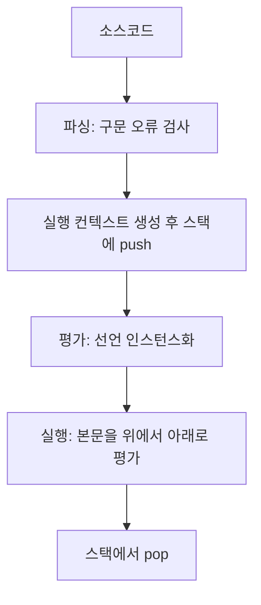
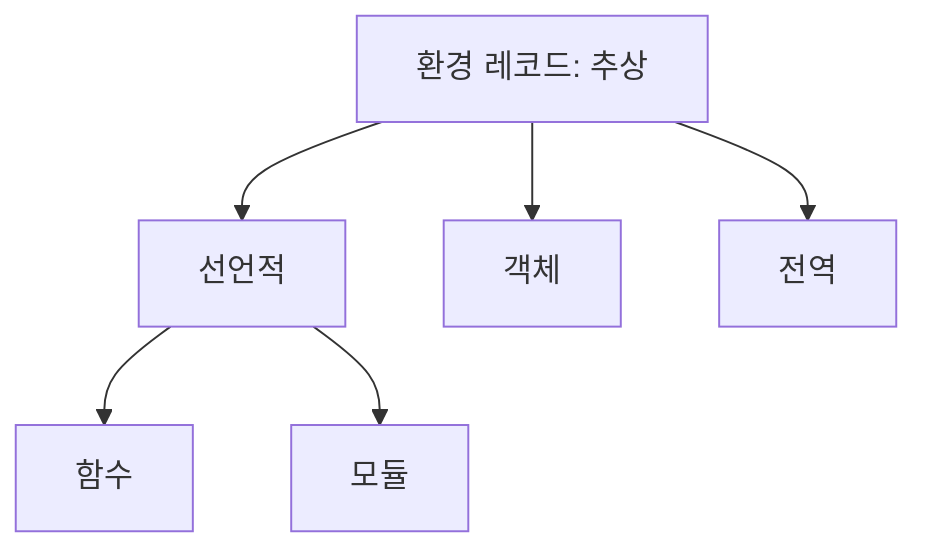
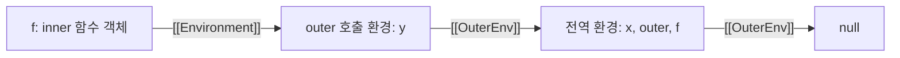

<Callout type="info">
  **이번 문서의 목표:** 코드가 실행될 때 엔진이 만드는 실행 컨텍스트와 환경 레코드의 구조를 알고, 호이스팅·스코프 체인·this 바인딩이 그 구조에서 나오는 과정을 순서대로 설명할 수 있습니다.
</Callout>

## 소스코드의 타입

ECMA-262는 코드를 전역 코드, 함수 코드, eval 코드, 모듈 코드의 네 타입으로 나눕니다. 타입에 따라 만들어지는 실행 컨텍스트와 최상위 환경이 달라집니다.

| 타입 | 해당하는 코드 | 컨텍스트가 만들어지는 때 | 최상위 환경 |
|------|---------------|--------------------------|-------------|
| 전역 코드 | 스크립트 최상위. 함수·클래스 본문은 제외 | 스크립트를 평가할 때 | 전역 환경 |
| 함수 코드 | 함수의 매개변수와 본문. 중첩 함수는 제외 | 함수를 호출할 때마다 | 함수 환경 |
| eval 코드 | `eval`에 넘긴 문자열 | `eval`을 호출할 때마다 | eval 전용 환경 |
| 모듈 코드 | 모듈 본문. 함수·클래스 본문은 제외 | 모듈을 평가할 때 한 번 | 모듈 환경 |

```js
var g = 1                // 전역 코드
function outer(a) {      // outer의 매개변수와 본문: 함수 코드
  var l = 2              // outer의 함수 코드
  return () => a + l     // 화살표 함수의 본문: 별개의 함수 코드
}
```

- 코드 타입은 중첩 깊이가 아니라 함수 경계로 나뉩니다. 중첩 함수의 본문은 바깥 코드에 속하지 않는 독립된 함수 코드입니다.
- 함수 선언문·표현식·화살표 함수·메서드·제너레이터·async 함수의 본문이 모두 함수 코드입니다. `Function` 생성자에 문자열로 넘긴 본문도 함수 코드입니다.
- 같은 `var x`라도 타입에 따라 놓이는 곳이 다릅니다. 전역 코드에서는 전역 객체의 프로퍼티가 되고, 함수 코드와 모듈 코드에서는 각자의 환경 레코드에 바인딩됩니다.
- strict mode 여부는 타입별로 정해집니다. 전역 코드는 스크립트 첫머리의 `'use strict'` 지시어, 함수 코드는 자기 지시어나 바깥 코드의 strict 여부, 모듈 코드는 항상 strict입니다(자세히는 19편).

### eval 코드

`eval`은 문자열을 코드로 평가합니다. 식별자 `eval`을 그대로 호출하면 직접 eval이고, `(0, eval)(code)`나 `const e = eval; e(code)`처럼 다른 경로로 호출하면 간접 eval입니다.

| 구분 | 바깥 환경 | 비엄격 모드의 `var` |
|------|-----------|---------------------|
| 직접 eval | 호출한 위치의 환경 | 호출한 함수(또는 전역)의 var 환경에 추가 |
| 간접 eval | 전역 환경 | 전역 객체의 프로퍼티로 추가 |

```js
function a() { eval('var x = 1'); return typeof x }
function b() {
  'use strict'
  eval('var x = 1')
  return typeof x
}
a() // 'number' — 호출한 함수 환경에 var가 생겼다
b() // 'undefined' — eval 전용 환경에 갇힌다

function c() { var loc = 1; return (0, eval)('typeof loc') }
c() // 'undefined' — 간접 eval은 전역에서 평가된다
```

- eval 코드나 호출한 코드가 strict이면 `var`와 함수 선언도 eval 전용 환경에 만들어집니다. `let`·`const`·`class`는 strict 여부와 무관하게 항상 eval 전용 환경입니다.
- `new Function('return x')`로 만든 함수는 함수 코드지만 바깥 환경이 전역 환경입니다. 호출한 위치의 지역 변수를 보지 못합니다.
- 흔한 실수는 간접 eval이나 `Function` 생성자가 지역 변수를 볼 것이라고 기대하는 것입니다.

## 평가와 실행

엔진은 코드를 파싱한 뒤 컨텍스트를 만들고, 두 단계로 처리합니다. 앞 단계가 평가이고 뒤 단계가 실행입니다.



| 단계 | 명세의 이름 | 하는 일 | 값의 상태 |
|------|-------------|---------|-----------|
| 평가 | 선언 인스턴스화 | 스코프의 모든 선언을 환경 레코드에 바인딩으로 등록 | `var`는 `undefined`, 함수는 함수 객체, `let`·`const`·`class`는 미초기화 |
| 실행 | Evaluation | 문을 순서대로 평가. 대입, 호출, 제어 흐름 | `let`·`const`의 초기화와 모든 대입이 이때 일어남 |

```js
console.log(a) // undefined — 평가 단계에서 a가 이미 등록됨
var a = 1      // 실행 단계: 이 줄에서 1이 대입된다
console.log(a) // 1
```

- 명세는 "평가"를 두 가지로 씁니다. ScriptEvaluation 같은 상위 연산은 두 단계 전체를, Evaluation은 본문을 실행하는 뒤 단계만 가리킵니다. 이 문서는 많은 한국어 자료의 관례대로 앞 단계를 평가, 뒤 단계를 실행이라고 부릅니다.
- 구문 오류와 초기 오류(같은 스코프의 `let` 중복 등)는 평가보다 앞선 파싱 단계에서 발견되어 스크립트가 한 줄도 실행되지 않습니다(자세히는 01편).
- 평가 단계에서도 오류가 날 수 있습니다. 다른 스크립트와의 전역 이름 충돌은 SyntaxError이고, 함수의 매개변수 기본값 식 평가 중 오류는 본문이 시작되기 전에 납니다.
- 평가는 컨텍스트마다 따로 일어납니다. 스크립트는 한 번, 함수는 호출할 때마다 평가합니다. 함수 선언문은 함수 객체를 만들 뿐 본문은 호출될 때까지 평가하지 않습니다.
- 바이트코드 생성이나 지연 파싱 같은 엔진의 구현은 달라도, 관찰되는 동작은 이 두 단계 모델과 같아야 합니다.

## 실행 컨텍스트의 역할

**실행 컨텍스트**(execution context)는 코드 한 덩어리의 실행 진행을 추적하는 명세상의 장치입니다. 역할은 두 가지입니다.

- 식별자 해석: 코드가 쓰는 변수·함수 이름을 환경 레코드의 바인딩으로 연결합니다.
- 실행 흐름 추적: 어디까지 실행했는지 기억해서, 다른 코드로 넘어갔다가 돌아오거나 중단했다가 재개할 수 있게 합니다.

모든 컨텍스트가 갖는 구성요소와, ECMAScript 코드의 컨텍스트가 추가로 갖는 구성요소는 다음과 같습니다.

| 구성요소 | 담는 것 | 갖는 컨텍스트 |
|----------|---------|---------------|
| code evaluation state | 코드를 실행·중단·재개하는 데 필요한 진행 상태 | 모든 컨텍스트 |
| Function | 실행 중인 함수 객체. 스크립트·모듈이면 null | 모든 컨텍스트 |
| Realm | 이 코드가 접근하는 내장 객체와 전역 환경의 묶음 | 모든 컨텍스트 |
| ScriptOrModule | 코드가 나온 스크립트 또는 모듈 | 모든 컨텍스트 |
| LexicalEnvironment | 식별자 검색을 시작하는 환경 레코드 | ECMAScript 코드 |
| VariableEnvironment | `var` 선언의 바인딩이 놓이는 환경 레코드 | ECMAScript 코드 |
| PrivateEnvironment | 클래스의 `#private` 이름을 담는 구조 | ECMAScript 코드 |
| Generator | 이 컨텍스트가 실행 중인 제너레이터 | 제너레이터 컨텍스트 |

- 컨텍스트는 명세의 설명 도구입니다. ECMAScript 코드에서 컨텍스트를 직접 보거나 조작할 수 없고, 엔진은 다른 구조로 구현해도 됩니다.
- 에이전트(실행 스레드) 하나에서 실제로 코드를 실행 중인 컨텍스트는 최대 하나이고, 이것을 running execution context라고 합니다. 한 스레드가 한 번에 코드 하나만 실행한다는 뜻입니다(자세히는 40편).
- `this`는 컨텍스트의 구성요소가 아니라 함수 환경 레코드에 저장됩니다(환경 레코드 종류 절).
- 컨텍스트와 환경은 수명이 다릅니다. 컨텍스트는 실행이 끝나면 사라지지만, 환경 레코드는 클로저가 참조하는 동안 남습니다(자세히는 23편).

## 실행 컨텍스트 스택

**실행 컨텍스트 스택**은 컨텍스트를 쌓는 후입선출 구조이고, 호출 스택이라고도 부릅니다. 맨 위가 실행 중인 컨텍스트입니다.

```js
function a() { b() }
function b() { c() }
function c() {}
a()
```

| 시점 | 스택 (아래에서 위) |
|------|--------------------|
| 스크립트 평가 중 | 전역 |
| `a()` 호출 | 전역, a |
| `a` 안에서 `b()` 호출 | 전역, a, b |
| `b` 안에서 `c()` 호출 | 전역, a, b, c |
| `c` 반환 | 전역, a, b |
| `b`, `a` 반환 | 전역 |
| 스크립트 끝 | (빈 스택) |

- 다른 코드로 제어가 넘어갈 때마다 새 컨텍스트를 만들어 push합니다. 호출자 컨텍스트는 중단되고, 반환하거나 예외로 빠져나가면 pop되어 호출자가 재개됩니다.
- 예외가 던져지면 try/catch를 가진 컨텍스트에 닿을 때까지 컨텍스트가 하나씩 pop됩니다.
- 내장 함수 호출도 컨텍스트를 만듭니다. `[1].map(cb)`에서 `cb`가 던진 에러의 스택 추적에는 V8 기준으로 `cb`, `Array.map`, 호출한 코드가 차례로 나타납니다.
- 에러의 `stack` 문자열은 던질 때의 스택을 엔진이 문자열로 만든 것입니다. ECMA-262에는 정의가 없는 엔진 확장입니다.
- 스택이 비어 있어야 호스트가 다음 작업(Job)을 시작할 수 있고, 시작한 작업은 끝까지 실행됩니다. 콜백과 프로미스 후속 작업이 현재 코드가 모두 끝난 뒤에 실행되는 이유입니다(자세히는 40편).

### 스택 순서를 따르지 않는 컨텍스트

컨텍스트 전환은 보통 후입선출이지만 제너레이터와 async 함수는 예외입니다. 중단된 컨텍스트를 스택에서 제거하되 폐기하지 않고 보관했다가, 재개할 때 다시 push합니다.

```js
function* gen(a = console.log('param')) {
  console.log('body')
  yield 1
}
const it = gen()  // 'param' 출력. 본문은 아직 실행 전
it.next()         // 'body' 출력 후 yield에서 중단
```

`gen()` 호출은 컨텍스트를 만들고 매개변수까지 처리한 뒤 본문 직전에서 중단합니다. `next()`가 같은 컨텍스트를 다시 올려 이어서 실행하고, `yield`에서 다시 중단합니다(자세히는 42편). async 함수의 `await`도 같은 방식이고, 재개는 작업 큐를 통해 이루어집니다(자세히는 43편).

## 렉시컬 환경

**렉시컬 환경**(Lexical Environment)은 식별자와 값의 바인딩을 저장하는 환경 레코드에, 바깥 환경을 가리키는 참조를 더한 구조입니다. lexical은 코드가 적힌 위치를 뜻합니다. 환경의 중첩이 코드의 중첩을 그대로 따릅니다(자세히는 12편).

```text
렉시컬 환경
├─ 환경 레코드     식별자 → 값 (바인딩 목록)
└─ 바깥 환경 참조  상위 렉시컬 환경 또는 null
```

- ES2020까지의 명세는 렉시컬 환경을 별도 명세 타입으로 정의했습니다. ES2021부터는 이 타입이 없고, 환경 레코드가 바깥 환경 참조(`[[OuterEnv]]`)를 직접 가집니다. 현재 명세에서 LexicalEnvironment는 실행 컨텍스트의 구성요소 이름이고 그 값은 환경 레코드입니다.
- 함수, 블록, catch 절 같은 구조를 평가할 때마다 새 환경이 만들어집니다. 같은 함수를 두 번 호출하면 환경이 두 개 생깁니다.

```js
function counter() { let n = 0; return () => ++n }
const a = counter(), b = counter()
a() // 1
a() // 2
b() // 1 — 별개의 환경에 있는 별개의 n
```

- 환경은 컨텍스트가 아닙니다. 컨텍스트는 호출이 끝나면 스택에서 사라지지만, 환경은 참조가 남아 있으면 유지됩니다.
- 환경도 명세 장치입니다. 엔진은 변수를 레지스터나 스택 슬롯에 두거나 환경을 아예 만들지 않을 수 있고, 코드에서 환경에 접근할 수도 없습니다.

## 환경 레코드

**환경 레코드**(Environment Record)는 식별자와 값의 바인딩을 저장하는 명세 타입입니다. 함수, 블록, catch 절 같은 구문 구조를 평가할 때마다 새 환경 레코드가 만들어집니다. 바인딩은 이름과 값에 더해 초기화 여부, 가변·불변, 삭제 가능 여부 같은 상태를 가집니다.

| 메서드 | 하는 일 |
|--------|---------|
| HasBinding | 이름의 바인딩이 있는지 확인. 식별자 검색이 사용 |
| CreateMutableBinding | 가변 바인딩을 미초기화 상태로 생성 |
| CreateImmutableBinding | 불변 바인딩을 미초기화 상태로 생성 |
| InitializeBinding | 미초기화 바인딩에 첫 값을 넣고 초기화됨으로 표시 |
| SetMutableBinding | 값을 변경. 불변 바인딩이면 strict 플래그에 따라 TypeError 또는 무시 |
| GetBindingValue | 값을 읽음. 미초기화면 ReferenceError |
| DeleteBinding | 삭제 가능한 바인딩을 삭제 |

선언 종류마다 평가 단계와 실행 단계에서 호출하는 메서드가 다릅니다.

| 선언 | 평가 단계 | 실행 단계 |
|------|-----------|-----------|
| `var x = 1` | 바인딩 생성 후 `undefined`로 초기화 | `SetMutableBinding`으로 1 대입 |
| `let y = 2` | 가변 바인딩을 미초기화로 생성 | 선언문에서 `InitializeBinding`으로 2 |
| `const z = 3` | 불변 바인딩을 미초기화로 생성 | 선언문에서 `InitializeBinding`으로 3 |
| `function f() {}` | 바인딩 생성 후 함수 객체로 초기화 | 선언문은 아무 일도 하지 않음 |

- 미초기화 바인딩을 읽거나 쓰면 ReferenceError입니다. 이 구간이 TDZ입니다(자세히는 13편).
- `const`는 재할당할 때 항상 TypeError를 던지는 불변 바인딩입니다. strict mode 여부와 무관합니다.
- 기명 함수 표현식의 이름은 함수 자신을 감싸는 환경에 불변 바인딩으로 만들어집니다. 이 바인딩은 strict 플래그 없이 만들어져서, 비엄격 모드의 대입은 조용히 무시되고 strict mode에서는 TypeError입니다.

```js
const f = function g() { g = 1; return typeof g }
f() // 'function' — 비엄격 모드: 대입이 무시된다
// 함수 본문이 strict였다면 g = 1에서 TypeError
```

- 클래스 이름은 두 곳에 바인딩됩니다. 클래스 본문 안에는 불변 내부 바인딩이, 바깥 스코프에는 `let`과 같은 가변 바인딩이 만들어집니다.

```js
class A { static f() { A = 1 } }
A.f()  // TypeError — 본문 안의 A는 불변 내부 바인딩
A = 2  // 정상 — 바깥의 A는 가변 바인딩
```

## 환경 레코드 종류

환경 레코드는 추상 타입이고, 세 가지 구체 종류와 그 하위 종류가 있습니다.



| 종류 | 만들어지는 때 | 바인딩이 저장되는 곳 |
|------|---------------|----------------------|
| 선언적 | 블록, catch 절, switch, 클래스 본문, 기명 함수 표현식, 직접 eval | 레코드 내부 |
| 함수 | 함수를 호출할 때마다. 선언적의 하위 | 레코드 내부 |
| 모듈 | 모듈을 링크할 때 한 번. 선언적의 하위 | 레코드 내부 |
| 객체 | `with` 문, 전역 환경의 객체 부분 | 바인딩 객체의 프로퍼티 |
| 전역 | Realm을 초기화할 때 한 번 | 객체 레코드와 선언적 레코드의 합성 |

### 선언적 환경 레코드

`var`·`let`·`const`·`class`·함수·import 선언의 이름과 값을 레코드 안에 직접 저장합니다. 바인딩의 집합이 코드 모양으로 정해지고 실행 중에 바뀌지 않으므로, 엔진이 식별자의 위치를 미리 정할 수 있습니다.

### 함수 환경 레코드

함수 호출 하나에 대응하며 최상위 선언을 저장합니다. 선언적 레코드에 다음 필드가 더해집니다.

| 필드 | 내용 |
|------|------|
| `[[ThisValue]]` | 이 호출의 this 값 |
| `[[ThisBindingStatus]]` | `lexical`, `initialized`, `uninitialized` 중 하나 |
| `[[FunctionObject]]` | 이 환경을 만든 함수 객체 |
| `[[NewTarget]]` | `new`로 호출됐을 때의 new.target. 아니면 `undefined` |

- 화살표 함수는 `[[ThisBindingStatus]]`가 lexical이라 자기 this가 없습니다. `this`를 만나면 `[[OuterEnv]]`를 따라 올라가며 this 바인딩이 있는 가장 가까운 환경에서 찾습니다.
- 일반 함수는 호출할 때 this가 결정됩니다. 비엄격 모드에서 `undefined`나 `null`은 전역 this로, 원시 값은 래퍼 객체로 바뀌고, strict mode에서는 전달된 값 그대로입니다(자세히는 21편).
- 파생 클래스의 생성자는 `uninitialized`로 시작해 `super()`가 반환될 때 초기화됩니다. 그 전에 `this`를 읽으면 ReferenceError이고, `super()`를 두 번 호출해도 ReferenceError입니다(자세히는 25편).

```js
class P {}
class C extends P {
  constructor() {
    this.x = 1 // ReferenceError — this가 아직 미초기화
    super()
  }
}
```

- 내장 함수의 컨텍스트에는 함수 환경 레코드가 없습니다.

### 모듈 환경 레코드

모듈 최상위 선언을 저장합니다. 바깥 환경은 전역 환경이고, `this`는 `undefined`입니다.

- import 선언은 원본 모듈의 바인딩을 가리키는 불변 간접 바인딩이 됩니다. 원본 값이 바뀌면 그대로 반영됩니다(라이브 바인딩, 자세히는 45편).
- 환경은 평가가 아니라 링크 단계에서 만들어집니다. 이때 `var`는 `undefined`, `let`·`const`·`class`는 미초기화로 등록되고 함수 선언은 함수 객체까지 초기화됩니다. 순환 의존에서 아직 평가되지 않은 모듈의 함수 선언을 호출할 수 있는 이유입니다(자세히는 46편).

### 객체 환경 레코드

바인딩 객체의 프로퍼티를 바인딩으로 취급합니다. 이름 검색(HasBinding)은 객체의 `HasProperty`이므로 프로토타입 체인의 상속 프로퍼티와 열거 불가능한 프로퍼티도 포함됩니다.

```js
const o = { a: 1 }
with (o) {
  a        // 1
  o.b = 2
  b        // 2 — 바인딩 집합이 실행 중에 바뀐다
}
```

- 사용처는 `with` 문(비엄격 모드 전용)과 전역 환경의 객체 부분입니다.
- 불변 바인딩이 없습니다. 프로퍼티가 읽기 전용이어도 바인딩은 가변으로 취급됩니다.
- `with` 환경에서는 `Symbol.unscopables`에 `true`로 등록된 이름이 바인딩에서 제외됩니다. 오래된 코드가 새 메서드 이름 때문에 깨지지 않게 하는 장치입니다.

```js
with ([]) {
  typeof push    // 'function'
  typeof values  // 'undefined' — unscopables로 차단됨
}
```

- `with` 객체의 프로퍼티로 찾은 함수를 식별자로 호출하면 그 객체가 호출의 this가 됩니다.
- strict mode와 모듈에서 `with`는 SyntaxError입니다. 바인딩 집합이 실행 중에 바뀌어 식별자의 위치를 미리 정할 수 없으므로 쓰지 않습니다.

### 전역 환경 레코드

스크립트의 최상위 스코프를 나타내며, 한 Realm에 하나입니다. 객체 레코드와 선언적 레코드를 합친 구조이고 `[[OuterEnv]]`는 null입니다.

| 필드 | 내용 |
|------|------|
| `[[ObjectRecord]]` | 전역 객체를 감싼 객체 레코드. 내장 전역, `var`, 함수 선언문 |
| `[[DeclarativeRecord]]` | 그 밖의 최상위 선언: `let`, `const`, `class` |
| `[[GlobalThisValue]]` | 전역 코드의 this. 호스트가 정함 |

- 식별자를 검색하면 선언적 레코드를 먼저 보고, 없을 때 객체 레코드(전역 객체와 그 프로토타입 체인)를 봅니다.
- ES2024까지의 명세 표에는 var·함수 선언의 이름을 모은 `[[VarNames]]` 필드가 있었고, ES2025 이후 표에는 없습니다. ES2026 명세는 선언으로 만든 var·함수 바인딩이 `configurable: false`인 전역 객체 프로퍼티라는 점으로 구별합니다.
- 전역 변수와 전역 객체의 관계는 13편에서 다룹니다.

## 외부 렉시컬 환경 참조

**외부 렉시컬 환경 참조**는 환경이 자기를 감싸는 바깥 환경을 가리키는 연결이고, 명세에서는 환경 레코드의 `[[OuterEnv]]` 필드입니다. 값은 null이거나 환경 레코드입니다. 이 연결들이 이어진 것이 스코프 체인입니다.

`[[OuterEnv]]`는 환경이 만들어질 때 정해지며 이후 바뀌지 않습니다.

| 환경 | `[[OuterEnv]]` |
|------|----------------|
| 전역 | null |
| 모듈 | 전역 환경 |
| 함수 호출 | 호출한 곳이 아니라 함수 객체의 `[[Environment]]` |
| 블록, catch, with | 진입한 시점의 LexicalEnvironment |
| 직접 eval | 호출한 컨텍스트의 LexicalEnvironment |
| 간접 eval | 전역 환경 |

- 함수 객체의 `[[Environment]]`는 함수 정의가 평가되어 함수 객체가 만들어질 때 그 시점의 LexicalEnvironment로 고정됩니다. 호출 위치와 무관하므로 렉시컬 스코프(12편)가 이 규칙으로 구현됩니다.
- 같은 함수 정의라도 평가될 때마다 새 함수 객체가 만들어지고 각자의 `[[Environment]]`를 가집니다.

```js
const x = 'global'
function outer() {
  const y = 'outer'
  return function inner() { return [x, y] }
}
const f = outer()
f() // ['global', 'outer'] — outer의 컨텍스트는 이미 끝났다
```

`outer()`가 반환되면 outer의 컨텍스트는 스택에서 사라집니다. 그러나 `f`가 가리키는 함수 객체의 `[[Environment]]`가 outer 호출 환경을 참조하므로 그 환경은 남습니다(클로저, 자세히는 23편).



## 전역 실행 컨텍스트 생성 과정

스크립트를 평가하면 다음 순서로 전역 컨텍스트가 만들어집니다.

1. **Realm 준비**: 호스트가 스크립트보다 먼저 Realm을 만듭니다. 내장 객체, 전역 객체, 전역 환경 레코드(`[[OuterEnv]]`는 null)가 생기고, 전역 객체에 내장 전역 프로퍼티와 호스트가 추가하는 프로퍼티(`console`, `document` 등)가 채워집니다.
2. **파싱**: 구문 오류와 초기 오류가 있으면 여기서 중단되고 스크립트는 한 줄도 실행되지 않습니다.
3. **컨텍스트 생성과 push**: Function은 null이고, Realm과 ScriptOrModule은 이 스크립트의 것입니다. LexicalEnvironment와 VariableEnvironment를 둘 다 전역 환경 레코드로 두고 스택에 올립니다.
4. **선언 인스턴스화**(GlobalDeclarationInstantiation): 아래에서 설명합니다.
5. **실행**: 본문을 위에서 아래로 평가합니다.
6. **pop**: 컨텍스트를 스택에서 제거합니다.

선언 인스턴스화는 다음 순서입니다.

- 충돌을 검사합니다. `let`·`const`·`class` 이름이 이미 선언적 레코드에 있거나 전역 객체의 삭제 불가능한(`configurable: false`) 프로퍼티와 같으면, 또는 `var` 이름이 이미 `let`·`const`·`class`로 선언되어 있으면 SyntaxError입니다. 하나라도 걸리면 이 스크립트의 바인딩은 하나도 만들어지지 않습니다. 전역 객체를 확장할 수 없어서 `var`나 함수를 만들 수 없을 때는 TypeError입니다.
- `let`·`const`·`class` 이름마다 선언적 레코드에 미초기화 바인딩을 만듭니다.
- 함수 선언문마다 함수 객체를 만들고(`[[Environment]]`는 전역 환경), 전역 객체의 프로퍼티로 등록합니다.
- `var` 이름마다 전역 객체에 프로퍼티를 `undefined`로 만듭니다. 이미 있으면 그대로 둡니다.

```text
var v = 1
let l = 2
function fn() {}

전역 환경 레코드 (평가 직후, 실행 전)
  객체 레코드(전역 객체) : v = undefined, fn = 함수 객체
  선언적 레코드          : l = 미초기화 (TDZ)
```

- 이 단계에서는 값 대입이 일어나지 않습니다. 호이스팅의 실체입니다(호이스팅 원리 절).
- 전역 환경 레코드는 Realm에 하나뿐이라, 스크립트마다 컨텍스트가 새로 만들어져도 환경은 공유됩니다. 앞 스크립트의 최상위 `let`을 뒤 스크립트가 이름으로 읽을 수 있습니다(자세히는 13편).
- strict 여부는 스크립트 단위로 정해집니다. 한 스크립트의 `'use strict'`는 다른 스크립트에 영향을 주지 않습니다.
- Node.js의 CommonJS 파일은 함수로 감싸져 실행되므로 전역 컨텍스트가 아니라 함수 컨텍스트입니다(자세히는 12편).

### 모듈 코드의 경우

모듈은 환경을 만드는 시점과 컨텍스트가 스택에 오르는 시점이 나뉩니다.

1. **링크**: 모듈 환경 레코드를 만들고(바깥은 전역 환경) import 바인딩을 연결합니다. 모듈 컨텍스트를 잠시 올려 `var`는 `undefined`, `let`·`const`·`class`는 미초기화로 등록하고 함수 선언은 함수 객체까지 초기화한 뒤 제거합니다.
2. **평가**: 모듈 컨텍스트(LexicalEnvironment와 VariableEnvironment가 모두 모듈 환경)를 새로 올려 본문을 실행합니다. 최상위 await가 있으면 비동기로 실행됩니다(자세히는 46편).

## 함수 실행 컨텍스트 생성 과정

함수를 호출하면 다음 순서로 함수 컨텍스트가 만들어집니다.

1. **컨텍스트 생성과 push**: Function은 호출된 함수 객체이고, Realm과 ScriptOrModule은 함수 객체에 저장된 값입니다. 새 함수 환경 레코드를 만들어 `[[OuterEnv]]`를 함수 객체의 `[[Environment]]`로 두고, LexicalEnvironment와 VariableEnvironment를 둘 다 이 환경으로 설정합니다. 호출자 컨텍스트를 중단하고 새 컨텍스트를 스택에 올립니다.
2. **this 바인딩**: 화살표 함수를 제외하고 호출 방식에 따라 this를 정합니다.
3. **선언 인스턴스화**(FunctionDeclarationInstantiation): 아래 순서로 처리합니다.
4. **본문 실행.**
5. **반환**: 컨텍스트를 pop하고 호출자를 재개합니다. 예외로 끝나도 같습니다.

선언 인스턴스화의 순서입니다.

- 매개변수 이름마다 바인딩을 만듭니다.
- 필요하면 `arguments` 객체를 만들어 바인딩합니다. 화살표 함수에는 없고, 매개변수 이름이 `arguments`이면 만들지 않습니다.
- 인수를 매개변수에 바인딩합니다. 기본값 식과 구조 분해가 이때 평가됩니다.
- 본문의 `var` 이름을 `undefined`로 바인딩합니다. 같은 이름의 매개변수가 있으면 건너뛰므로 인수 값이 유지됩니다.
- `let`·`const`·`class` 이름을 미초기화 상태로 바인딩합니다.
- 함수 선언문마다 함수 객체를 만들어 바인딩에 대입합니다. 같은 이름의 `var`나 매개변수는 이 값으로 덮입니다.

```js
function f(a, b) {
  console.log(a, b, c, typeof g) // 1 2 undefined function
  var c = 3
  function g() {}
}
f(1, 2)
```

```text
f 호출의 함수 환경 레코드
  a = 1   b = 2   arguments = 인수 객체
  c = undefined   g = 함수 객체
  this = 호출 방식에 따라 결정
  [[OuterEnv]] = f 함수 객체의 [[Environment]]
```

- 함수 객체와 함수 환경은 만들어지는 때가 다릅니다. 함수 객체는 바깥 코드가 평가될 때(선언문은 선언 인스턴스화, 표현식은 그 식을 실행할 때) 만들어지고 `[[Environment]]`만 저장합니다. 함수 환경은 호출할 때마다 새로 만들어지므로 재귀 호출마다 지역 변수가 독립입니다.
- `arguments`는 비엄격 모드이고 매개변수 목록이 단순할 때(기본값·나머지·구조 분해 없음) 매개변수와 값이 연동되는 객체입니다. 그 외에는 연동되지 않는 사본입니다(자세히는 16편).
- 매개변수에 기본값 식이 있으면 환경이 두 겹이 됩니다. 매개변수와 `arguments`는 함수 환경에, 본문의 `var`는 그 아래 새 환경에 놓입니다. 기본값 안의 함수는 본문의 `var`를 보지 못합니다(자세히는 27편).

```js
function f(a, b = () => a) {
  var a = 2
  return [a, b()]
}
f(1) // [2, 1] — 본문의 a와 b가 보는 a는 별개의 바인딩
```

본문의 `var a`는 매개변수 a의 값 1로 초기화된 새 바인딩이고, 이후 2가 대입됩니다. `b`는 매개변수 환경의 a를 봅니다.

- `new`로 호출하면 일반 함수와 기본 클래스는 this 객체를 미리 만들어 바인딩하고, 파생 클래스는 `super()`가 반환될 때까지 미초기화로 둡니다.
- 제너레이터 함수는 이 과정을 호출 시점에 수행한 뒤 본문 직전에서 중단합니다(실행 컨텍스트 스택 절).

## LexicalEnvironment와 VariableEnvironment

컨텍스트의 두 구성요소는 컨텍스트가 만들어질 때 같은 환경을 가리키지만, 하는 일이 다릅니다.

| 구분 | LexicalEnvironment | VariableEnvironment |
|------|--------------------|---------------------|
| 역할 | 식별자 검색의 시작점 | `var` 선언의 바인딩이 놓이는 환경 |
| 만들어질 때 | 전역·함수·모듈 환경 | LexicalEnvironment와 같은 환경 |
| 바뀌는 때 | 블록·catch·with·for에 들어가면 새 환경으로 교체, 나가면 복구 | 본문을 실행하는 동안은 바뀌지 않음 |

두 값이 달라지는 경우입니다.

- 블록에 들어갈 때: LexicalEnvironment만 블록 환경으로 바뀝니다(블록 레벨 스코프 절).
- 매개변수 기본값 식이 있는 함수: VariableEnvironment가 본문용 새 환경이 됩니다(함수 컨텍스트 절).
- 비엄격 함수: 본문 최상위의 `let`·`const`·`class`가 `var` 환경 아래의 별도 환경에 놓입니다. 직접 eval이 만드는 `var`가 기존 `let`과 충돌하는지 검사하기 위한 명세상의 구조입니다. strict 함수는 둘이 같은 환경입니다.
- 직접 eval: 비엄격이면 eval의 `var`는 호출한 컨텍스트의 VariableEnvironment에, `let`·`const`는 eval용 새 환경에 놓입니다. strict이면 둘 다 eval 전용 환경입니다.

```js
function f() {
  { eval('var z = 1') }  // 블록 안이지만 var는 함수 환경에 생긴다
  return typeof z        // 'number'
}
```

`var`는 블록 안에 써도 함수 단위로 소속됩니다. 블록 안에서 비엄격 직접 eval이 `var`를 만들 때와, 블록 안 함수 선언문을 실행해 같은 이름의 `var` 바인딩에 함수를 복사할 때(비엄격 모드 동작, 자세히는 11편) 명세는 VariableEnvironment를 사용합니다. 블록에 들어가 LexicalEnvironment가 바뀌어도 `var`가 속한 함수 환경을 가리키는 구성요소가 따로 있는 이유입니다.

## 호이스팅 원리

호이스팅은 평가 단계의 선언 인스턴스화가 실행 단계보다 먼저, 스코프의 모든 선언을 환경 레코드에 등록하기 때문에 생기는 현상입니다. 코드가 실제로 위로 옮겨지지 않고, 명세에도 호이스팅이라는 용어가 없습니다(자세히는 03편).

| 선언 | 평가 단계에서 하는 일 | 초기값 | 선언문 앞에서 읽으면 |
|------|----------------------|--------|----------------------|
| `var` | 바인딩 생성 후 초기화 | `undefined` | `undefined` |
| 함수 선언문 | 함수 객체를 만들어 바인딩 | 함수 객체 | 호출 가능 |
| `let` | 가변 바인딩을 미초기화로 생성 | 선언문 실행 때 | ReferenceError |
| `const` | 불변 바인딩을 미초기화로 생성 | 선언문 실행 때 | ReferenceError |
| `class` | `let`처럼 미초기화로 생성 | 선언문 실행 때 | ReferenceError |
| `import` | 링크 단계에서 간접 바인딩 연결 | 원본 모듈의 바인딩 | 원본이 초기화됐다면 사용 가능 |

```js
function demo() {
  console.log(a)   // undefined — var는 undefined로 초기화됨
  console.log(c)   // 함수 객체 — 함수는 객체까지 초기화됨
  console.log(b)   // ReferenceError — let은 미초기화
  var a = 1
  let b = 2
  function c() {}
}
```

- 호이스팅되는 범위는 선언이 속한 스코프의 맨 위입니다. `var`는 함수(전역·모듈)의 VariableEnvironment이고, `let`·`const`·`class`는 가장 가까운 블록 환경입니다.
- 평가는 컨텍스트가 만들어질 때마다 일어나므로, 함수 안의 선언은 호출할 때마다 호이스팅됩니다.
- `let`이 호이스팅되지 않는다고 설명하는 자료도 있지만, 블록에 들어갈 때 바인딩이 이미 만들어져 바깥의 같은 이름을 가린다는 점에서 `var`와 같이 평가 단계에 등록됩니다. 다만 초기화 전이라 접근하면 에러입니다.
- 함수 표현식과 화살표 함수는 선언문이 아니라 변수에 대입되는 값이므로 변수의 규칙을 따릅니다(자세히는 11편).

같은 이름이 겹칠 때의 결과입니다.

| 겹치는 선언 | 결과 | 이유 |
|-------------|------|------|
| `var`와 `var` | 바인딩 하나 | 이미 있으면 재사용 |
| `var`와 함수 선언문 | 함수 객체로 시작. `var x = 1` 대입이 실행되면 덮어씀 | 함수 선언의 초기화가 우선하고 `var` 선언문은 값을 바꾸지 않음 |
| 함수 선언문 둘 | 마지막 선언 | 같은 이름이면 마지막 것만 인스턴스화 |
| 매개변수와 `var` | 인수 값 유지 | 같은 이름의 `var`는 건너뜀 |
| 매개변수와 함수 선언문 | 함수 객체 | 인스턴스화 끝에 함수가 대입 |
| `let`·`const`와 같은 이름의 `var`·매개변수 | SyntaxError | 파싱 단계의 초기 오류 |

## 스코프 체인과 식별자 검색

**스코프 체인**은 현재 LexicalEnvironment에서 `[[OuterEnv]]`를 따라 전역 환경(null)까지 이어진 환경 레코드의 연결입니다. **식별자 검색**(식별자 결정)은 이 체인을 따라 이름의 바인딩을 찾는 과정이고, 명세의 ResolveBinding이 GetIdentifierReference를 호출해 수행합니다.

```js
// GetIdentifierReference의 의사 코드
function lookup(env, name) {
  if (env === null) return 'unresolvable'
  if (env.hasBinding(name)) return env
  return lookup(env.outerEnv, name)
}
// 시작점: 실행 중인 컨텍스트의 LexicalEnvironment
```

```js
const a = 'global'
function outer() {
  const b = 'outer'
  function inner() {
    const c = 'inner'
    return [c, b, a]
  }
  return inner()
}
```

`inner` 안에서 각 식별자를 읽을 때의 검색 경로입니다. `zzz`는 어디에도 선언되지 않은 이름입니다.

| 식별자 | 확인하는 환경 | 결과 |
|--------|---------------|------|
| `c` | inner | 발견 |
| `b` | inner → outer | 발견 |
| `a` | inner → outer → 전역(선언적 → 객체) | 발견 |
| `zzz` | 위 전부 → null | ReferenceError |

- 검색은 가장 가까운 환경에서 시작해 처음 발견한 바인딩에서 멈춥니다. 바깥의 같은 이름은 가려집니다(섀도잉, 자세히는 12편).
- 찾았지만 미초기화 바인딩이면 ReferenceError입니다. 찾지 못했을 때 읽기·`typeof`·대입의 결과는 12편에 표로 있습니다.
- 대입도 같은 검색을 거칩니다. 체인에서 찾은 가장 가까운 바인딩이 갱신됩니다.
- 명세상 검색은 실행할 때마다 체인을 따라가는 동작이지만, 엔진은 보통 파싱 때의 스코프 분석으로 변수의 위치를 미리 정해서 체인을 매번 걷지 않습니다. `with`와 직접 eval은 바인딩 집합을 정적으로 알 수 없게 만들어 이 최적화를 막습니다.

스코프 체인과 호출 스택은 서로 다른 구조입니다.

| 구분 | 호출 스택 | 스코프 체인 |
|------|-----------|-------------|
| 구성 | 실행 컨텍스트 | 환경 레코드 |
| 순서의 기준 | 호출한 순서 | 함수를 정의한 위치(코드의 중첩) |
| 용도 | 실행 위치와 반환 지점 추적 | 식별자 검색 |
| 수명 | 호출이 끝나면 pop | 참조되는 동안 유지 |

전역에 정의된 `bar`를 `foo` 안에서 호출하면 스택은 전역, foo, bar 순이지만, bar 환경의 `[[OuterEnv]]`는 foo가 아니라 전역 환경입니다(자세히는 12편).

## 블록 레벨 스코프와 실행 컨텍스트

블록에 들어가도 새 실행 컨텍스트는 만들어지지 않습니다. 현재 컨텍스트의 LexicalEnvironment만 새 선언적 환경 레코드로 교체됩니다. 블록을 평가하는 순서입니다.

1. 현재 LexicalEnvironment를 저장합니다.
2. 이것을 바깥으로 하는 새 선언적 환경을 만듭니다.
3. 블록 안의 `let`·`const`·`class`·함수 선언을 새 환경에 등록합니다(함수 선언은 함수 객체까지 초기화).
4. LexicalEnvironment를 새 환경으로 교체하고 블록을 실행합니다.
5. 블록을 어떤 경로로 빠져나오든(`break`, `return`, 예외 포함) 저장해 둔 환경으로 되돌립니다.

```js
function f() {
  let a = 1
  {
    let b = 2
    console.log(a, b) // 1 2 — b는 블록 환경, a는 바깥에서 검색
  }
  console.log(typeof b) // 'undefined' — 블록 밖에서는 안 보임
}
```

| 시점 | LexicalEnvironment | VariableEnvironment |
|------|--------------------|---------------------|
| 블록 진입 전 | 함수 최상위 환경 | 함수 환경 |
| 블록 실행 중 | 블록 환경 | 함수 환경 |
| 블록 종료 후 | 함수 최상위 환경 | 함수 환경 |

- 블록 안의 `var`는 블록 환경이 아니라 VariableEnvironment에 속합니다. 블록 스코프가 아닌 이유입니다.
- 블록 환경을 만드는 구조는 독립 블록, `if`·`else`·`while`·`do...while`의 본문, `for` 계열의 헤더(`let`·`const` 선언이 있을 때), `switch` 전체, `try`·`catch`·`finally`의 블록입니다. `catch (e)`의 블록은 매개변수 `e`용 환경 위에 블록 환경이 한 겹 더 쌓여 두 겹입니다.
- `for (let ...)`는 반복마다 환경을 새로 만들어 값을 복사합니다(자세히는 13편).
- 블록 안의 함수가 블록 변수를 참조하면 블록이 끝난 뒤에도 그 블록 환경이 유지됩니다.

```js
let fn
{
  const hidden = 'kept'
  fn = () => hidden
}
fn() // 'kept' — 블록이 끝나도 블록 환경이 남아 있다
```

- 엔진은 블록에 `let`·`const`가 없거나 클로저가 참조하지 않으면 환경을 만들지 않고 스택 슬롯으로 처리할 수 있습니다. 관찰되는 동작은 같습니다.

## Realm

**Realm**은 내장 객체 한 벌, 전역 객체, 전역 환경 레코드, 그 환경에 로드된 코드를 묶은 단위입니다. 모든 ECMAScript 코드는 평가되기 전에 하나의 Realm에 연결됩니다.

| Realm 필드 | 내용 |
|------------|------|
| `[[Intrinsics]]` | 내장 객체 한 벌. `Object`, `Array`, `Promise`와 그 프로토타입 |
| `[[GlobalObject]]` | 이 Realm의 전역 객체 |
| `[[GlobalEnv]]` | 이 Realm의 전역 환경 레코드 |
| 그 밖 | 태그드 템플릿 객체 캐시, 모듈 로딩 결과, 호스트 전용 정보 |

- Realm은 호스트가 InitializeHostDefinedRealm으로 만듭니다. 이 과정은 전역 컨텍스트 생성 절의 1단계와 같습니다.
- 실행 컨텍스트의 Realm 구성요소가 현재 Realm이고, 모든 함수 객체도 만들어진 Realm을 `[[Realm]]`으로 기억합니다. 함수를 호출하면 그 함수의 Realm이 컨텍스트에 설정됩니다.
- 브라우저에서는 `window`마다(iframe 포함), Node.js에서는 `vm.createContext()`로 만든 컨텍스트마다 별도의 Realm이 있습니다.

Realm이 다르면 같은 이름의 내장 객체가 서로 다른 객체입니다.

```js
const vm = require('node:vm')
const arr = vm.runInNewContext('[]')  // 다른 Realm의 배열
arr instanceof Array  // false — Array가 다른 객체
Array.isArray(arr)    // true — Realm과 무관한 검사
Object.getPrototypeOf(arr) === Array.prototype // false
```

- `instanceof`는 프로토타입 체인에 생성자의 `prototype`이 있는지 검사하므로 Realm 경계를 넘으면 실패합니다. 배열은 `Array.isArray`, 에러는 `Error.isError`(ES2026)처럼 Realm과 무관한 검사를 씁니다.
- 다른 Realm의 함수가 던지는 에러는 그 Realm의 `TypeError`입니다. 호출한 쪽의 `e instanceof TypeError`는 `false`입니다.
- 원시 값은 Realm과 무관합니다. `Symbol.for`의 레지스트리와 `Symbol.iterator` 같은 잘 알려진 심볼도 Realm 사이에서 같은 값입니다(자세히는 34편).
- ShadowRealm은 같은 스레드에 격리된 Realm을 만드는 제안으로, Stage 2.7이며 표준이 아닙니다.

## 스택 오버플로

**스택 오버플로**는 실행 컨텍스트 스택이 엔진이 정한 한도를 넘는 것입니다. ECMA-262는 스택 크기를 정의하지 않으므로 한도와 에러 형태는 엔진마다 다릅니다.

| 엔진 | 에러 타입 | 메시지 |
|------|-----------|--------|
| V8 (Chrome, Edge, Node.js) | RangeError | Maximum call stack size exceeded |
| Firefox | InternalError | too much recursion |
| Safari | RangeError | Maximum call stack size exceeded. |

```js
let depth = 0
function recurse() { depth++; recurse() }
try { recurse() } catch (e) {
  e instanceof RangeError // true
  e.message // 'Maximum call stack size exceeded'
  depth     // Node.js 24에서 약 12500
}
```

- 위의 깊이는 Node.js 24에서 측정한 값이고 환경마다 다릅니다. 한도는 호출 횟수가 아니라 스택 메모리의 크기로 정해지므로, 프레임이 큰 함수(인수와 지역 변수가 많은 함수)일수록 도달하는 깊이가 줄어듭니다.
- 예외가 던져지면 컨텍스트가 pop되며 `catch`까지 올라오므로 오버플로도 잡을 수 있습니다. 그러나 RangeError는 `new Array(-1)`, `(1).toFixed(101)`에서도 발생하므로 타입만으로 원인을 단정할 수 없습니다.

원인과 해결입니다.

| 원인 | 예 | 해결 |
|------|----|------|
| 종료 조건이 없거나 도달하지 못하는 재귀 | `function f() { f() }` | 종료 조건 추가 |
| 깊이가 큰 정상 재귀 | 10만 단계 재귀 합산 | 반복문, 명시적 스택, 트램펄린 |
| 접근자가 자기 자신을 호출 | `set x(v) { this.x = v }` | 다른 프로퍼티(`#x`, `_x`)에 저장 |
| 서로를 부르는 상호 재귀 | `isEven`과 `isOdd`가 번갈아 호출 | 반복문으로 변환 |
| 인수가 매우 많은 호출 | `Math.max(...hugeArray)` | `reduce`나 반복문 |
| 깊이 중첩된 값을 재귀로 처리하는 내장 함수 | `JSON.stringify(deepNested)` | 중첩 깊이 제한 |

- Node.js 24에서 인수 20만 개를 펼친 `Math.max(...arr)`는 RangeError였고 10만 개는 통과했습니다. 한도는 엔진과 환경에 따라 다릅니다.

트램펄린은 재귀 호출을 직접 하지 않고 다음 호출을 함수로 반환해, 바깥 반복문이 하나씩 실행하게 하는 방식입니다. 스택이 한 단계만 쌓입니다.

```js
const trampoline = fn => (...args) => {
  let r = fn(...args)
  while (typeof r === 'function') r = r()
  return r
}
const sum = trampoline(function s(n, acc = 0) {
  return n === 0 ? acc : () => s(n - 1, acc + n)
})
sum(100000) // 5000050000
```

- `await`이나 `setTimeout` 뒤에 이어지는 호출은 스택이 빈 뒤 새 작업으로 시작하므로 호출 스택이 쌓이지 않습니다(자세히는 40편).
- ES2015 명세는 strict mode에서 꼬리 위치의 호출이 스택을 쌓지 않도록 정의합니다. 그러나 주요 엔진 중 JavaScriptCore만 구현했으므로 의존하지 않습니다(자세히는 11편).

## 핵심 정리

- 실행 컨텍스트는 코드 실행을 추적하는 명세 장치이고, 스크립트·함수 호출·eval·모듈 평가 때마다 만들어져 스택에 쌓입니다. 맨 위가 실행 중인 컨텍스트입니다.
- 환경 레코드는 식별자 바인딩을 저장하는 구조이고 `[[OuterEnv]]`로 바깥 환경을 가리킵니다. 이 연결이 스코프 체인이며, 함수의 바깥 환경은 호출한 곳이 아니라 함수를 정의한 시점의 환경입니다.
- 컨텍스트 생성 때 평가(선언 인스턴스화)가 실행보다 먼저 일어나므로 `var`는 `undefined`, 함수 선언문은 함수 객체, `let`·`const`·`class`는 미초기화로 등록됩니다. 이것이 호이스팅과 TDZ입니다.
- 블록은 새 컨텍스트가 아니라 LexicalEnvironment의 일시 교체이고, `var`는 VariableEnvironment에 속합니다.
- Realm마다 내장 객체와 전역 환경이 따로 있어 `instanceof`가 Realm 경계에서 실패합니다. 호출 스택은 엔진이 정한 한도를 넘으면 오버플로하므로 깊은 재귀는 반복문으로 바꿉니다.

## 마무리 복습

<Quiz
  questionNumber={1}
  question="다음 함수를 호출할 때 첫 console.log가 출력하는 값은? function f() { console.log(typeof g, typeof v); var v = 1; function g() {} } f()"
  options={['undefined undefined', 'function number', 'ReferenceError', 'function undefined']}
  correctAnswer={4}
  explanation="선언 인스턴스화 단계에서 함수 선언문 g는 함수 객체로 초기화되고 var v는 undefined로 만들어집니다. 따라서 typeof g는 function, typeof v는 undefined 문자열입니다. v = 1은 실행 단계의 대입이라 아직 일어나지 않았고, 두 이름 모두 선언되어 있으므로 ReferenceError도 아닙니다."
/>

<Quiz
  questionNumber={2}
  question="블록 { let b = 2 } 을 실행하는 동안 일어나는 일로 옳은 것은?"
  options={['새 실행 컨텍스트가 스택에 push되고 블록이 끝나면 pop된다', 'VariableEnvironment가 새 선언적 환경으로 교체된다', '현재 컨텍스트의 LexicalEnvironment가 새 선언적 환경으로 교체되고 블록이 끝나면 원래대로 복구된다', 'b가 전역 환경 레코드의 객체 레코드에 추가된다']}
  correctAnswer={3}
  explanation="블록 평가는 실행 컨텍스트를 새로 만들지 않고 현재 컨텍스트의 LexicalEnvironment만 새 선언적 환경 레코드로 바꿨다가, 블록을 어떤 경로로 빠져나오든 이전 환경으로 되돌립니다. VariableEnvironment는 var 선언용이라 바뀌지 않고, let으로 선언한 b는 블록 환경 레코드에 놓이며 전역 객체와 무관합니다."
/>

<Quiz
  questionNumber={3}
  question="다음 중 실행하면 호출 스택 오버플로(RangeError)가 발생하는 코드는?"
  options={['const o = { set x(v) { this.x = v } }; o.x = 1', 'function f() { setTimeout(f, 0) }; f()', 'for (let i = 0; i < 1000000; i++) {}', 'console.log(a); let a = 1']}
  correctAnswer={1}
  explanation="setter 안의 this.x = v가 같은 setter를 다시 호출해 컨텍스트가 끝없이 쌓이므로 오버플로합니다. setTimeout 콜백은 스택이 빈 뒤 새로 시작하므로 쌓이지 않고, for 반복은 컨텍스트를 만들지 않으며, 마지막 코드는 TDZ 때문에 ReferenceError가 납니다."
/>

## 참고 자료

- [ECMA-262 — Executable Code and Execution Contexts](https://tc39.es/ecma262/#sec-executable-code-and-execution-contexts)
- [ECMA-262 — Types of Source Code](https://tc39.es/ecma262/#sec-types-of-source-code)
- [ECMA-262 — FunctionDeclarationInstantiation](https://tc39.es/ecma262/#sec-functiondeclarationinstantiation)
- [ECMA-262 — GlobalDeclarationInstantiation](https://tc39.es/ecma262/#sec-globaldeclarationinstantiation)
- [ECMA-262 — BlockDeclarationInstantiation](https://tc39.es/ecma262/#sec-blockdeclarationinstantiation)
- [ECMA-262 — PerformEval](https://tc39.es/ecma262/#sec-performeval)
- [ECMA-262 — Realms](https://tc39.es/ecma262/#sec-code-realms)
- [ECMA-262 — Tail Position Calls](https://tc39.es/ecma262/#sec-tail-position-calls)
- [MDN — InternalError: too much recursion](https://developer.mozilla.org/en-US/docs/Web/JavaScript/Reference/Errors/Too_much_recursion)
- [MDN — with statement](https://developer.mozilla.org/en-US/docs/Web/JavaScript/Reference/Statements/with)
- [Node.js — vm](https://nodejs.org/api/vm.html)
- [TC39 Proposals — ShadowRealm](https://github.com/tc39/proposals)
