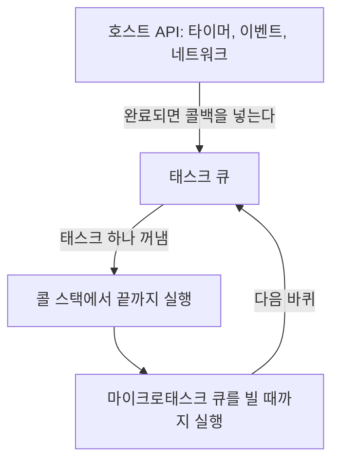
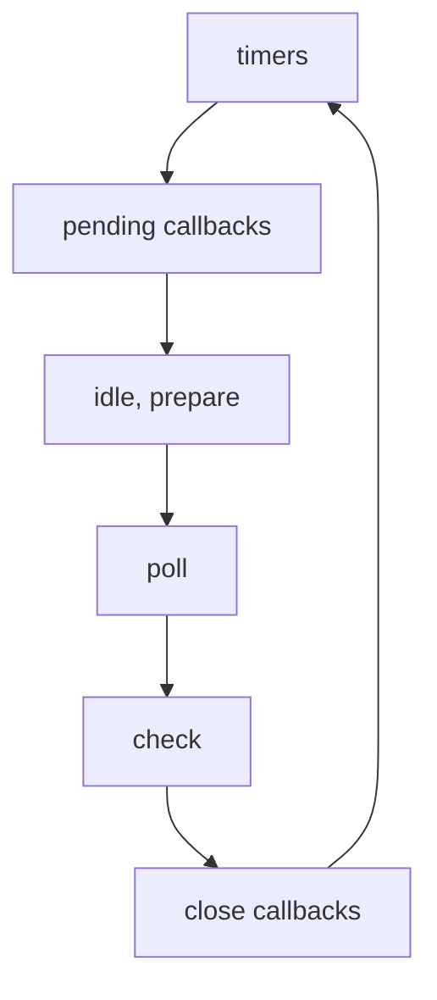

<Callout type="info">
  **이번 문서의 목표:** 비동기 콜백이 실행되는 순서를 이벤트 루프 규칙으로 예측하고, 그 규칙 중 ECMAScript가 정한 것과 호스트가 정한 것을 구분할 수 있습니다.
</Callout>

## 동기와 비동기

**동기**(synchronous) 처리는 한 작업이 끝나야 다음 줄이 실행되는 방식입니다. **비동기**(asynchronous) 처리는 작업을 맡겨 두고 바로 다음 줄로 넘어간 뒤, 결과가 준비되면 후속 코드를 나중에 실행하는 방식입니다.

```js
[1, 2].forEach((n) => console.log('sync', n))
setTimeout(() => console.log('async'), 0)
console.log('end')
// sync 1 → sync 2 → end → async
```

| 구분 | 동기 | 비동기 |
|------|------|--------|
| 다음 줄이 실행되는 때 | 호출이 끝난 뒤 | 호출 직후 |
| 결과를 받는 방법 | 반환값 | 콜백, 프로미스, await |
| 기다리는 동안 | 다른 코드가 실행되지 못한다 | 다른 코드가 실행된다 |
| 예 | 일반 함수 호출, `forEach` | `setTimeout`, 이벤트 핸들러, `fetch` |

비동기 함수는 반환되는 시점에 결과가 없습니다. 그래서 결과를 반환값으로 받을 수 없고, 준비된 뒤에 호출되는 코드로 받아야 합니다.

```js
let result
setTimeout(() => { result = 42 }, 0)
console.log(result) // undefined
```

- **콜백을 받는다고 비동기가 되지는 않습니다.** `forEach`, `map`, `sort`에 넘기는 콜백은 호출 안에서 곧바로 실행되는 동기 콜백입니다(자세히는 29편). 콜백이 동기인지 비동기인지는 그것을 받은 함수가 언제 호출하느냐로 정해집니다.
- **비동기는 병렬이 아닙니다.** 타이머 세 개가 동시에 흐르더라도 콜백은 JavaScript 스레드에서 한 번에 하나씩 실행됩니다. 겹치는 것은 기다리는 시간뿐입니다.
- 비동기로 동작하는 대표 작업은 타이머, DOM 이벤트, 네트워크 요청, 파일 입출력, 프로미스 후속 처리입니다. 이 중 ECMAScript가 정의하는 것은 프로미스와 async 함수 같은 결과 처리 구조이고(자세히는 41편, 43편), 타이머·이벤트·네트워크·파일 입출력은 호스트 API입니다(01편).
- 비동기 결과를 다루는 방식은 콜백(처음부터 있었음), 프로미스(ES2015), async/await(ES2017) 순으로 추가됐습니다.

## 싱글 스레드와 블로킹

JavaScript 코드는 한 실행 환경 안에서 **싱글 스레드**(single thread)로 실행됩니다. 한 번에 한 곳에서만 코드가 실행된다는 뜻입니다. 명세 용어로는 에이전트(agent) 하나가 실행 스레드 하나를 가지며, 작업(Job) 하나가 시작되면 끝까지 실행된 뒤에야 다음 작업이 시작됩니다. 이 성질을 끝까지 실행(run-to-completion)이라고 합니다.

- 실행 중인 함수 사이에 다른 콜백이 끼어들지 않습니다. 한 동기 구간에서는 같은 실행 환경의 변수를 읽고 쓰는 도중에 다른 코드가 끼어들어 값을 바꾸는 일이 없습니다.
- 다만 `await`나 콜백을 사이에 두면 그 틈에 다른 코드가 실행될 수 있습니다. 같은 값을 읽고 나중에 쓰는 코드는 비동기 경계를 넘으면 여전히 결과가 어긋날 수 있습니다.

**블로킹**(blocking)은 코드가 콜 스택을 오래 점유해서, 큐에서 기다리는 콜백과 화면 갱신이 실행되지 못하는 상태입니다.

```js
const start = Date.now()
setTimeout(() => console.log('timer'), 10)
while (Date.now() - start < 100) {} // 100ms 동안 점유
console.log('loop done')
// loop done → (100ms 이상 지난 뒤) timer
```

10ms 타이머는 10ms 뒤에 실행되지 않고, 반복문이 끝난 뒤에야 실행됩니다. 브라우저의 이벤트 루프는 태스크 실행과 렌더링 갱신을 같은 루프에서 처리하므로, JavaScript가 길게 돌면 클릭 반응, 스크롤, 애니메이션이 함께 멈춥니다. 서버(Node.js)에서는 다른 요청의 처리가 멈춥니다.

블로킹을 일으키는 대표 원인은 다음과 같습니다.

- 오래 걸리는 반복문과 깊은 재귀
- 큰 데이터를 한 번에 처리하는 동기 작업(예: 대용량 `JSON.parse`, 자세히는 39편)
- 호스트의 동기 API: 브라우저의 `alert`·`confirm`과 동기 `XMLHttpRequest`, Node.js의 `fs.readFileSync`

"싱글 스레드인데 어떻게 기다리는 일을 동시에 처리하는가"의 답은 기다림을 JavaScript 스레드 밖에서 하기 때문입니다. 타이머, 네트워크, 파일 입출력은 호스트가 JavaScript 스레드 밖에서 기다리다가, 끝나면 콜백을 큐에 넣습니다. 싱글 스레드인 것은 JavaScript 코드의 실행이지 브라우저나 Node.js 전체가 아닙니다.

긴 작업을 다루는 방법은 두 가지입니다.

- **쪼개서 양보하기**: 일을 조각으로 나누고, 조각 사이에 타이머로 다음 조각을 예약해 큐의 다른 작업이 끼어들 틈을 줍니다.
- **별도 스레드 사용**: 웹 워커(브라우저)나 `worker_threads`(Node.js)는 자기만의 이벤트 루프와 메모리를 가지고 메시지로 통신하는 별도 실행 환경입니다. 이 과목의 범위 밖입니다.

```js
function processChunk(items, start = 0) {
  const end = Math.min(start + 1000, items.length)
  for (let i = start; i < end; i++) handle(items[i])
  if (end < items.length) {
    setTimeout(() => processChunk(items, end), 0) // 양보
  }
}
```

흔한 실수는 두 가지입니다.

- `await`가 스레드를 멈춘다고 생각하는 것입니다. `await`는 그 함수의 실행만 일시 중단하고 스레드는 다른 코드를 실행합니다(자세히는 43편).
- 비동기 콜백 안의 계산은 블로킹이 아니라고 생각하는 것입니다. 콜백이 시작되면 그 안의 동기 코드는 끝날 때까지 스레드를 독점합니다.

## 콜백 패턴과 콜백 헬

**콜백 함수**(callback)는 나중에 호출되도록 다른 함수에 넘기는 함수입니다. 함수를 값으로 넘길 수 있는 일급 함수(자세히는 16편) 덕분에 가능한 패턴이고, 비동기 작업이 끝난 뒤 실행할 코드를 콜백으로 전달하는 것이 가장 오래된 비동기 처리 방식입니다.

Node.js는 에러 우선 콜백(error-first callback) 관례를 씁니다. 콜백의 첫 인수가 에러이고, 에러가 없으면 `null`입니다.

```js
const fs = require('node:fs')

fs.readFile('a.txt', 'utf8', (err, text) => {
  if (err) return console.error(err.message)
  console.log(text.length) // 파일을 읽은 뒤 길이를 출력
})
```

비동기 작업을 순서대로 이어 붙이면 콜백 안에 콜백이 계속 중첩됩니다. 이 모양을 **콜백 헬**(callback hell) 또는 파멸의 피라미드(pyramid of doom)라고 합니다.

```js
function load(id, cb) {
  setTimeout(() => cb(null, { id }), 0)
}

load(1, (e1, a) => {
  if (e1) return console.log(e1)
  load(a.id + 1, (e2, b) => {
    if (e2) return console.log(e2)
    load(b.id + 1, (e3, c) => {
      console.log(c) // { id: 3 }
    })
  })
})
```

중첩 깊이만이 문제가 아닙니다. 콜백 방식에는 구조적인 약점이 있습니다.

| 문제 | 내용 |
|------|------|
| 가독성 | 실행 순서가 위에서 아래가 아니라 안쪽으로 흐른다 |
| 에러 처리 | 단계마다 에러 인수를 직접 확인해야 하고, `try`/`catch`로 묶을 수 없다 |
| 제어의 역전 | 콜백을 넘기면 호출 시점과 횟수를 받은 쪽 코드에 맡기게 된다 |
| 동기·비동기 혼용 | 같은 함수가 조건에 따라 콜백을 동기로도 비동기로도 부를 수 있다 |
| 병렬·반복 | 여러 작업을 동시에 시작하고 모두 끝나기를 기다리는 코드를 직접 짜야 한다 |

**에러 처리가 안 되는 이유**는 콜백이 실행될 때 이미 `try` 블록의 호출 스택이 사라졌기 때문입니다.

```js
try {
  setTimeout(() => { throw new Error('late') }, 0)
} catch (e) {
  console.log('caught') // 실행되지 않는다
}
// try 블록은 이미 끝났고, 에러는 처리되지 않은 예외가 된다
```

처리되지 않은 예외는 Node.js에서 프로세스를 종료시키고, 브라우저에서는 콘솔에 보고됩니다(자세히는 44편).

**제어의 역전과 동기·비동기 혼용**은 라이브러리 API를 만들 때 문제가 됩니다. 아래 함수는 호출하는 쪽이 `cb`가 먼저 실행될지 `bar()`가 먼저 실행될지 알 수 없습니다.

```js
function maybeSync(arg, cb) {
  if (arg) { cb(); return }  // 동기로 호출
  setTimeout(cb, 0)          // 비동기로 호출
}
maybeSync(flag, () => foo())
bar() // flag에 따라 foo보다 먼저일 수도, 나중일 수도 있다
```

콜백을 받는 API는 항상 동기이거나 항상 비동기여야 합니다. Node.js 문서도 이 점을 명시합니다.

콜백 헬을 줄이는 방법은 다음과 같습니다.

- **이름 있는 함수로 분리**: 중첩은 사라지지만 흐름이 여러 함수에 흩어집니다.
- **프로미스**: 비동기 결과를 값처럼 다루고 체이닝과 일괄 에러 처리를 제공합니다(자세히는 41편).
- **async/await**: 비동기 코드를 위에서 아래로 읽히는 동기 모양으로 씁니다(자세히는 43편).

```js
function onThird(err, c) { console.log(c) }
function onSecond(err, b) { load(b.id + 1, onThird) }
function onFirst(err, a) { load(a.id + 1, onSecond) }
load(1, onFirst) // { id: 3 }
```

## 콜 스택과 힙

**콜 스택**(call stack)은 지금 실행 중인 함수 호출을 쌓아 두는 후입선출(LIFO) 구조입니다. 함수를 호출하면 그 실행 컨텍스트가 맨 위에 쌓이고, 반환하면 제거됩니다. 맨 위가 지금 실행 중인 함수입니다. 명세에서는 실행 컨텍스트 스택(execution context stack)이라고 부르며, 맨 아래에는 전역 코드의 컨텍스트가 있습니다(자세히는 22편).

```js
function a() { b(); console.log('a end') }
function b() { c(); console.log('b end') }
function c() { console.log('c') }
a() // c → b end → a end
```

| 시점 | 스택(아래에서 위) | 출력 |
|------|-------------------|------|
| `a()` 호출 | 전역, a | |
| `a`가 `b()` 호출 | 전역, a, b | |
| `b`가 `c()` 호출 | 전역, a, b, c | c |
| `c` 반환 | 전역, a, b | b end |
| `b` 반환 | 전역, a | a end |
| `a` 반환 | 전역 | |

스택 깊이에는 한도가 있습니다. 종료 조건 없는 재귀는 스택을 가득 채워 에러를 일으킵니다.

```js
function down(n) { return down(n + 1) + 1 }
try { down(0) } catch (e) { console.log(e.name) }
// RangeError
// V8 메시지: Maximum call stack size exceeded
```

- 한도는 명세가 정하지 않습니다. 엔진, 호출 프레임의 크기, 사용 가능한 메모리에 따라 달라지고, 에러 메시지 문구도 엔진마다 다릅니다(01편). 위 출력은 V8 기준입니다.
- 한도에 닿으면 엔진이 에러를 던지므로 `try`/`catch`로 잡을 수 있습니다. 근본 해결은 종료 조건을 고치거나 반복문으로 바꾸는 것입니다.

**힙**(heap)은 객체, 배열, 함수처럼 크기가 실행 중에 달라지는 값이 놓이는 큰 메모리 영역입니다. 스택처럼 정해진 순서로 쌓이지 않고 구조가 없습니다. 변수에는 힙에 있는 객체를 가리키는 참조가 담기고(자세히는 10편), 어디서도 참조되지 않는 객체는 가비지 컬렉터가 회수합니다(자세히는 49편).

"원시 값은 스택, 객체는 힙"이라는 설명은 개념을 잡기 위한 단순화입니다. 명세는 값이 놓이는 위치를 정하지 않고, 엔진은 최적화를 위해 다르게 배치합니다. 예를 들어 클로저가 붙잡은 변수는 함수가 반환된 뒤에도 살아 있어야 하므로 스택에 둘 수 없습니다(자세히는 23편).

콜 스택은 비동기와 다음 관계가 있습니다.

- 콜백은 스택이 완전히 비어야 실행되기 시작합니다. 스택에 코드가 남아 있으면 큐에서 기다립니다.
- 콜백은 새 스택의 바닥에서 시작합니다. 그래서 콜백을 등록한 함수는 스택에 없고, 콜백 안에서 던진 에러는 등록한 쪽의 `try`/`catch`에 닿지 않으며, 에러의 스택 트레이스에도 등록한 함수가 나타나지 않습니다.

## 이벤트 루프

**이벤트 루프**(event loop)는 콜 스택이 비는 것을 기다렸다가 큐에 쌓인 콜백을 스택으로 꺼내 실행하는 호스트의 반복 구조입니다. 비동기 콜백이 언제 실행되는지는 전부 이 루프가 정합니다.

비동기 처리에 관여하는 요소는 다음과 같습니다.

| 요소 | 역할 | 출처 |
|------|------|------|
| 콜 스택 | 지금 실행 중인 코드를 쌓는다 | 엔진 |
| 힙 | 객체가 놓인다 | 엔진 |
| 호스트 API | 타이머, 이벤트, 네트워크 등 기다림을 처리한다 | 호스트 |
| 큐 | 실행을 기다리는 콜백을 보관한다 | 호스트 |
| 이벤트 루프 | 큐에서 콜백을 꺼내 스택에서 실행시킨다 | 호스트 |

루프의 한 바퀴를 의사 코드로 쓰면 다음과 같습니다.

```js
// 개념을 보이는 의사 코드
while (true) {
  const task = pickTask() // 큐에서 태스크 하나를 꺼낸다
  if (task) run(task)     // 끝까지 실행한다
  runAllMicrotasks()      // 마이크로태스크를 모두 비운다
}
```



브라우저에서는 화면 갱신(렌더링)도 이 루프가 실행하는 태스크의 하나입니다. 렌더링 기회가 오면 갱신 태스크가 큐에 들어옵니다(자세히는 아래 절).

`setTimeout(cb, 1000)`이 처리되는 과정은 다음과 같습니다.

1. `setTimeout`이 호스트에 타이머를 맡기고 즉시 반환합니다. `cb`는 아직 실행되지 않습니다.
2. 나머지 동기 코드가 실행되고 스택이 비면 이벤트 루프가 큐를 확인하지만, 큐는 비어 있습니다.
3. 1초가 지나면 호스트가 `cb`를 실행하는 태스크를 큐에 넣습니다.
4. 이벤트 루프가 그 태스크를 꺼내 스택에서 실행합니다. 이때 다른 코드가 스택에서 실행 중이면 그 코드가 끝날 때까지 큐에서 기다립니다.

규칙은 다음과 같습니다.

- 스크립트 첫 실행도 이벤트 루프가 처리하는 작업 하나입니다. 브라우저에서는 스크립트 실행이 태스크이고, Node.js에서는 메인 모듈을 실행한 뒤 루프가 시작됩니다.
- 한 바퀴에 태스크는 하나만 꺼내지만 마이크로태스크는 큐가 빌 때까지 모두 실행합니다(자세히는 아래 절).
- 지연 시간은 "그 시간 뒤에 큐에 들어간다"는 뜻일 뿐, 그 시간에 실행된다는 보장이 아닙니다.
- 큐와 스택이 모두 비면 호스트는 새 작업이 올 때까지 기다립니다. Node.js는 기다릴 작업이 하나도 없으면 프로세스를 종료합니다.
- 메인 스레드와 워커는 각자 이벤트 루프를 가집니다.

## 태스크 큐와 마이크로태스크 큐

호스트는 대기 중인 콜백을 두 종류의 큐에 나눠 보관합니다.

| 구분 | 태스크(task) | 마이크로태스크(microtask) |
|------|--------------|---------------------------|
| 넣는 것 | 타이머 콜백, 사용자 이벤트(click·input), 네트워크 완료, `postMessage` | 프로미스 `then`·`catch`·`finally` 콜백, `await` 이후 코드, `queueMicrotask`, `MutationObserver` |
| 꺼내는 양 | 한 바퀴에 하나 | 큐가 빌 때까지 전부 |
| 실행 중 새로 추가된 것 | 다음 바퀴로 | 같은 비움 과정에서 이어서 실행 |
| 렌더링 | 태스크와 태스크 사이에 일어날 수 있다 | 큐를 비우는 동안은 일어나지 않는다 |

"매크로태스크"는 태스크를 마이크로태스크와 구분하려고 쓰는 관용 표현이고, HTML 표준의 용어는 그냥 태스크(task)입니다.

- **마이크로태스크 체크포인트**: 태스크 하나가 끝난 뒤, 그리고 콜백 호출이 끝나 JavaScript 실행 컨텍스트 스택이 비는 시점마다 마이크로태스크 큐를 모두 비웁니다.
- **태스크 큐는 하나가 아닙니다.** HTML 표준은 태스크를 태스크 소스(타이머, 사용자 상호작용, 네트워킹 등)별로 구분하고, 브라우저가 소스들을 여러 큐로 묶어 어느 큐에서 꺼낼지 스스로 정합니다. 같은 소스의 태스크는 등록 순서대로 실행되지만, 서로 다른 소스의 태스크 사이 순서는 보장되지 않습니다. 표준의 예시는 마우스·키보드 이벤트 큐를 다른 큐보다 우선해서 화면 반응성을 지키는 구성입니다.
- `queueMicrotask(fn)`은 프로미스 없이 마이크로태스크를 직접 등록하는 호스트 API입니다. 현재 동기 코드가 끝난 직후 `fn`이 실행됩니다.
- 프로미스 `then` 콜백은 이미 이행된 프로미스에 붙여도 항상 마이크로태스크로 실행됩니다. 동기로 실행되지 않습니다(자세히는 41편).
- 마이크로태스크 안에서 등록한 마이크로태스크는 같은 비움 과정에서 이어서 실행됩니다. 태스크 안에서 등록한 태스크는 다음 바퀴로 밀립니다.

```js
Promise.resolve().then(() => {
  console.log(1)
  queueMicrotask(() => console.log(3))
}).then(() => console.log(2))
// 1 → 3 → 2
```

첫 `then` 콜백이 끝나기 전에는 두 번째 `then`이 큐에 들어가지 않습니다. 콜백 안에서 먼저 등록한 `queueMicrotask`가 큐에서 앞서므로 3이 2보다 먼저 나옵니다.

**클릭 이벤트에서의 차이**: 마이크로태스크는 스택이 비어야 실행되므로, 같은 리스너 코드도 이벤트를 발생시킨 방식에 따라 순서가 달라집니다.

```js
button.addEventListener('click', () => {
  Promise.resolve().then(() => console.log('micro'))
  console.log('listener 1')
})
button.addEventListener('click', () => {
  console.log('listener 2')
})
// 사용자가 클릭: listener 1 → micro → listener 2
// button.click() 호출: listener 1 → listener 2 → micro
```

사용자가 클릭하면 리스너 하나가 끝날 때마다 스택이 비어 마이크로태스크가 실행됩니다. 스크립트가 `click()`을 호출하면 그 스크립트가 스택에 남아 있어서 모든 리스너가 끝난 뒤에야 실행됩니다.

**렌더링과의 관계**: 브라우저는 화면 주사율에 맞춰 렌더링 기회를 얻고, 기회가 오면 렌더링 갱신을 태스크로 등록합니다. 갱신 안에서 `requestAnimationFrame` 콜백, 스타일 계산, 레이아웃, 그리기가 순서대로 일어납니다.

- 매 이벤트 루프 바퀴마다 렌더링이 일어나지 않습니다. 렌더링 기회 사이에 태스크가 여러 번 실행될 수 있고, 표준은 타이머 콜백 여러 개를 렌더링 없이 연달아 실행하는 구현도 허용합니다.
- 마이크로태스크는 렌더링 갱신 전에 모두 실행됩니다. 마이크로태스크가 끝나지 않으면 화면이 갱신되지 못합니다.

## 실행 순서

비동기 코드의 출력 순서는 다음 절차로 판정합니다.

1. 현재 실행 중인 동기 코드를 모두 실행합니다. 스크립트 전체, 프로미스 생성자의 executor, async 함수의 첫 `await` 앞까지가 여기에 속합니다.
2. 마이크로태스크 큐를 빌 때까지 실행합니다. 실행 중 추가된 마이크로태스크도 포함합니다.
3. 태스크 큐에서 태스크 하나를 꺼내 실행하고 2번으로 돌아갑니다. 브라우저에서는 화면 갱신 태스크도 여기서 차례가 옵니다.

```js
console.log('start')
setTimeout(() => console.log('timeout'), 0)
Promise.resolve().then(() => console.log('promise'))
console.log('end')
// start → end → promise → timeout
```

동기 코드가 먼저 끝나고, 마이크로태스크인 `promise`가 태스크인 `timeout`보다 먼저 나옵니다. 아래는 프로미스 executor와 async 함수를 섞은 예입니다.

```js
console.log(1)
setTimeout(() => console.log(2), 0)
new Promise((resolve) => {
  console.log(3)          // executor는 동기로 실행된다
  resolve()
}).then(() => console.log(4))
async function run() {
  console.log(5)
  await null
  console.log(6)          // await 뒤는 마이크로태스크
}
run()
console.log(7)
// 1 → 3 → 5 → 7 → 4 → 6 → 2
```

- 1, 3, 5, 7은 동기 구간입니다. executor와 async 함수 본문의 `await` 앞은 호출 즉시 실행됩니다.
- 4와 6은 마이크로태스크입니다. `then` 콜백이 `await` 뒤 코드보다 먼저 큐에 들어갔으므로 4가 6보다 먼저입니다.
- 2는 태스크이므로 마이크로태스크가 모두 끝난 뒤에 실행됩니다.

타이머끼리의 순서는 지연이 짧은 쪽이 먼저이고, 같은 지연이면 등록 순서입니다.

```js
setTimeout(() => console.log('A 0'), 0)
setTimeout(() => console.log('B 0'), 0)
setTimeout(() => console.log('C 5'), 5)
setTimeout(() => console.log('D 2'), 2)
// A 0 → B 0 → D 2 → C 5
```

- 이 규칙은 같은 전역 객체 안의 타이머에 대한 것입니다. HTML 표준은 먼저 시작했고 지연이 같거나 더 짧은 타이머가 먼저 완료돼야 한다고 정합니다. 타이머와 다른 태스크 소스(이벤트, 메시지) 사이의 순서는 보장되지 않습니다.
- 지연은 최소 대기 시간이므로 실제 실행 시각은 더 늦을 수 있습니다(아래 `setTimeout 0의 실제 지연` 절).

흔한 실수는 다음과 같습니다.

- `setTimeout(fn, 0)`이 "바로 다음"에 실행된다고 생각하는 것입니다. 마이크로태스크가 항상 먼저 실행됩니다.
- 프로미스 체인의 단계 수를 세지 않고 `then`끼리의 순서를 단정하는 것입니다. 체인의 다음 `then`은 앞 `then` 콜백이 끝난 뒤에야 큐에 들어가므로, 다른 체인과 번갈아 실행됩니다.
- 브라우저에서 확인한 출력 순서를 Node.js에도 그대로 적용하는 것입니다. 아래 절들에서 다루는 차이가 있습니다.

## 이벤트 루프는 호스트가 정의한다

ECMA-262 본문에는 "이벤트 루프"라는 용어 자체가 나오지 않습니다. 명세는 콜백을 언제 실행할지, 어떤 큐가 있는지를 정의하지 않고, 이를 실행 환경(호스트)에 맡깁니다.

| 호스트 | 이벤트 루프의 정의 | 구성 |
|--------|--------------------|------|
| 브라우저 | HTML 표준의 이벤트 루프 절 | 태스크 소스별 태스크 큐, 마이크로태스크 큐, 렌더링 갱신 |
| Node.js | libuv 기반의 Node.js 구현 | 6개 단계, `nextTick` 큐, 마이크로태스크 큐 |

같은 코드의 결과가 호스트에 따라 갈리는 지점은 다음과 같습니다.

- 타이머 최소 지연: 브라우저는 중첩 5단계 초과 시 4ms 하한이 있고, Node.js는 지연 0을 1ms로 바꿉니다.
- `setImmediate`, `process.nextTick`은 Node.js에만 있고, `requestAnimationFrame`과 렌더링 단계는 브라우저에만 있습니다.
- 태스크 큐의 선택 순서는 브라우저 구현이 정합니다.

호스트와 무관하게 명세가 보장하는 것은 프로미스와 관련된 Job의 규칙입니다. 다음 절에서 다룹니다.

## ECMAScript의 Job

**Job**은 매개변수가 없는 추상 클로저(명세 안에서 쓰는 함수 같은 단위)이며, 다른 ECMAScript 계산이 진행 중이지 않을 때 새 ECMAScript 계산을 시작하는 작업입니다. 명세는 Job을 만들어 호스트에게 예약을 요청하고(호스트 훅), 실제 예약과 실행 시점은 호스트가 정합니다.

| 호스트 훅 | 쓰이는 곳 | 요구 사항 |
|-----------|-----------|-----------|
| `HostEnqueuePromiseJob` | 프로미스 반응(`then` 콜백)과 thenable 해결 | 등록한 순서대로 실행 |
| `HostEnqueueGenericJob` | `Atomics.waitAsync`가 깨워질 때 | 우선순위·순서 제약 없음 |
| `HostEnqueueTimeoutJob` | `Atomics.waitAsync`의 시간 초과 | 지정한 밀리초 이상 지난 뒤 |
| `HostEnqueueFinalizationRegistryCleanupJob` | `FinalizationRegistry` 정리 콜백 | 호스트가 정함(자세히는 49편) |

모든 Job에 공통인 규칙은 다음과 같습니다.

- 한 에이전트에서 한 번에 하나의 Job만 실행됩니다.
- Job은 시작하면 끝까지 실행되며, 다른 Job이 끼어들 수 없습니다.
- Job은 실행 컨텍스트 스택이 비어 있을 때만 시작되고, 끝났을 때도 스택은 비어 있어야 합니다.
- Job은 정상 완료로 끝나야 하며 에러는 Job이 직접 처리합니다.
- 호스트가 Job을 모두 같은 방식으로 다룰 필요는 없습니다. 명세는 브라우저와 Node.js가 프로미스 Job을 다른 작업보다 높은 우선순위로 처리한다고 주석으로 적습니다.

프로미스는 두 종류의 Job을 만듭니다.

- **반응 Job**: 프로미스가 이행·거부되면 등록된 각 `then` 콜백마다 Job이 하나 예약됩니다. 이미 확정된 프로미스에 `then`을 붙이면 그 즉시 예약됩니다.
- **thenable 해결 Job**: `resolve()`에 프로미스(또는 `then` 메서드를 가진 객체)를 넘기면, 그 `then`을 호출하는 Job이 따로 예약됩니다. 이 때문에 `then` 콜백이 늦어집니다.

```js
Promise.resolve().then(() => console.log('a1'))
  .then(() => console.log('a2'))
  .then(() => console.log('a3'))
  .then(() => console.log('a4'))
new Promise((r) => r(Promise.resolve()))
  .then(() => console.log('b'))
// a1 → a2 → a3 → b → a4
// (resolve에 프로미스를 넘기면 2틱 늦다)
```

호스트가 이 훅을 구현하는 방식은 다음과 같습니다.

- HTML 표준은 `HostEnqueuePromiseJob`을 마이크로태스크 큐에 넣는 것으로 구현합니다. 그래서 브라우저에서 "프로미스 Job = 마이크로태스크"입니다.
- 타이머(`setTimeout`), DOM 이벤트, 네트워크 콜백은 Job이 아닙니다. 호스트가 정의한 태스크이며 ECMAScript는 관여하지 않습니다.

## setTimeout 0의 실제 지연

`setTimeout(fn, 0)`은 0ms 뒤에 실행하라는 요청이 아닙니다. 현재 스택과 마이크로태스크가 모두 끝난 뒤, 이후의 이벤트 루프 바퀴에서 `fn`을 실행하는 태스크를 등록하는 것입니다. `setTimeout`은 ECMAScript가 아니라 호스트 API입니다(01편).

```js
setTimeout(() => console.log('timer'), 0)
Promise.resolve().then(() => console.log('micro'))
// micro → timer
```

실제 지연을 만드는 요인은 다음과 같습니다.

| 요인 | 내용 |
|------|------|
| 현재 실행 중인 코드 | 스택이 비어야 하고 마이크로태스크가 먼저 실행된다 |
| 큐에 먼저 있는 태스크 | 앞선 태스크가 끝나야 차례가 온다 |
| 중첩 호출 (브라우저) | 중첩 단계가 5를 넘고 지연이 4ms 미만이면 4ms로 올린다 |
| 최소값 (Node.js) | 지연이 1 미만이거나 숫자가 아니면 1로 바꾼다 |
| 숨겨진 탭 (브라우저) | 타이머 실행 빈도를 제한한다 |
| 렌더링 | 렌더링 갱신이 먼저 끼어들 수 있다 |

- **중첩 4ms 규칙**: HTML 표준은 타이머 콜백 안에서 다시 `setTimeout`을 부르는 식으로 단계가 쌓이면 지연을 올립니다. `setInterval`의 반복도 같은 단계 수에 포함됩니다. MDN의 실험에서는 처음 몇 번은 약 0ms이고 이후에는 약 4ms였습니다.
- **Node.js**: 지연이 `2147483647`보다 크거나 1보다 작거나 `NaN`이면 1로 설정됩니다. 그래서 Node.js에서 `setTimeout(fn, 0)`은 1ms입니다. 소수 지연은 정수로 버려집니다.
- **최대 지연**: 지연은 부호 있는 32비트 정수로 변환되어 최대 2147483647ms(약 24.8일)입니다. 브라우저에서 이보다 크면 정수 오버플로로 음수가 될 수 있고, 그러면 바로 실행됩니다. Node.js는 경고(`TimeoutOverflowWarning`)를 내고 1ms로 바꿉니다.
- **숨겨진 탭**: 보이지 않는 탭의 타이머는 대체로 초당 1회로 제한됩니다. Chrome은 88부터 숨겨진 지 5분이 넘은 페이지 등 조건이 맞으면 분당 1회까지 제한합니다. 구체적인 값은 브라우저마다 다릅니다.
- **정확한 시간이 아니다**: 콜백이 지연 뒤 바로 실행된다는 보장은 없습니다. 시간 측정은 `Date.now()`나 `performance.now()`로 직접 합니다.

`setTimeout`과 관련해 알아 둘 규칙은 다음과 같습니다.

- 지연 뒤에 추가 인수를 적으면 콜백에 전달됩니다: `setTimeout(fn, 100, 'a', 'b')`.
- 반환값은 `clearTimeout`에 넘겨 취소하는 식별자입니다. 브라우저에서는 양의 정수이고 Node.js에서는 `Timeout` 객체입니다.
- 함수를 그대로 넘기면 `this`를 잃습니다. 브라우저에서 비화살표 함수의 `this`는 `window`(전역 객체)이고, Node.js에서는 `Timeout` 객체입니다. 메서드는 화살표 함수나 `bind`로 감쌉니다(자세히는 21편).

```js
// ❌ this를 잃는다
setTimeout(counter.count, 1000)
// ✅ 화살표 함수로 감싼다
setTimeout(() => counter.count('bar'), 1000)
```

"스택 직후에 실행"이 목적이면 `queueMicrotask`가 맞습니다. `setTimeout(fn, 0)`은 렌더링과 다른 태스크가 끼어들 틈을 주는 양보이고, `queueMicrotask`는 그 틈을 주지 않습니다.

## Node.js의 단계와 process.nextTick·setImmediate

Node.js의 이벤트 루프는 한 바퀴를 여섯 단계로 나눠 돕니다. 단계마다 자기 큐(FIFO)를 가지며, 단계에 들어가면 그 큐를 비우거나 시스템 한도에 닿을 때까지 실행한 뒤 다음 단계로 넘어갑니다.



| 단계 | 하는 일 |
|------|---------|
| timers | `setTimeout`·`setInterval`의 만료된 콜백 실행 |
| pending callbacks | 다음 바퀴로 미뤄진 일부 시스템 작업의 콜백(예: 일부 TCP 에러) |
| idle, prepare | Node.js 내부용 |
| poll | 새 I/O 이벤트를 가져오고 I/O 콜백 실행. 필요하면 여기서 대기 |
| check | `setImmediate` 콜백 실행 |
| close callbacks | `socket.on('close', ...)` 같은 닫힘 콜백 |

**poll 단계의 동작**은 다음과 같습니다.

- poll 큐에 콜백이 있으면 큐를 비우거나 시스템 한도에 닿을 때까지 실행합니다.
- poll 큐가 비었을 때 `setImmediate`가 예약돼 있으면 check 단계로 넘어갑니다. 예약돼 있지 않으면 새 콜백이 들어오기를 기다립니다.
- poll 큐가 빈 뒤 시간이 된 타이머가 있으면 timers 단계로 돌아갑니다.

**`setTimeout(fn, 0)`과 `setImmediate(fn)`의 순서**는 어디서 호출하느냐에 따라 다릅니다.

```js
// 메인 모듈에서 호출: 순서가 실행마다 달라질 수 있다
setTimeout(() => console.log('timeout'), 0)
setImmediate(() => console.log('immediate'))

// I/O 콜백 안에서 호출: 항상 immediate → timeout
fs.readFile(__filename, () => {
  setTimeout(() => console.log('timeout'), 0)
  setImmediate(() => console.log('immediate'))
})
```

- 메인 모듈에서는 루프가 시작될 때 1ms가 이미 지났는지에 따라 timers 단계에서 타이머가 실행될 수도, 아닐 수도 있습니다. Node.js 문서는 이 순서가 프로세스의 성능에 좌우되어 비결정적이라고 설명합니다.
- I/O 콜백은 poll 단계에서 실행되고 그 다음이 check 단계이므로, `setImmediate`가 항상 먼저입니다.
- `setImmediate`는 현재 poll 단계가 끝난 직후 실행됩니다. 콜백 안에서 새로 등록한 `setImmediate`는 다음 바퀴에 실행됩니다.

**process.nextTick**은 이벤트 루프의 단계가 아닙니다. 현재 작업이 끝난 직후, 이벤트 루프가 계속되기 전에 nextTick 큐 전체를 비웁니다. 어느 단계에서 호출하든 마찬가지입니다.

- Node.js는 nextTick 큐를 비운 직후 마이크로태스크 큐를 비웁니다. 그래서 CommonJS 모듈에서는 `nextTick` 콜백이 프로미스·`queueMicrotask` 콜백보다 먼저 실행됩니다.
- ES 모듈에서는 모듈 평가 자체가 마이크로태스크 안에서 일어나므로, 이미 마이크로태스크를 비우는 중입니다. 그래서 프로미스·`queueMicrotask` 콜백이 `nextTick`보다 먼저 실행됩니다(자세히는 46편).
- 마이크로태스크 처리 중에 등록한 `nextTick`은 마이크로태스크 큐가 빌 때까지 기다립니다.
- Node.js 11부터 `nextTick`과 마이크로태스크는 단계 사이뿐 아니라 타이머·`setImmediate` 콜백 하나가 끝날 때마다 실행됩니다. 브라우저와 같은 방식에 맞춘 변경입니다.
- Node.js 문서는 `process.nextTick`을 Legacy(v22.7.0, v20.18.0부터)로 분류하며 `queueMicrotask`를 권장합니다. `nextTick`만 되는 용도는 콜백에 인수를 직접 넘기는 것 정도입니다.

```js
Promise.resolve().then(() => console.log('promise'))
queueMicrotask(() => console.log('microtask'))
process.nextTick(() => console.log('nextTick'))
// CommonJS: nextTick → promise → microtask
// ES 모듈: promise → microtask → nextTick
```

```js
setTimeout(() => {
  console.log('T1')
  Promise.resolve().then(() => console.log('P1'))
  process.nextTick(() => console.log('N1'))
}, 0)
setTimeout(() => console.log('T2'), 0)
// T1 → N1 → P1 → T2
```

`nextTick`의 원래 용도는 API를 항상 비동기로 만드는 것입니다. 생성자 안에서 곧바로 작업을 시작하면 사용자가 이벤트 핸들러를 달 틈이 없으므로, 시작을 `nextTick`으로 미뤄 같은 동기 구간에서 핸들러를 달 수 있게 합니다.

| API | 소속 | 실행 시점 |
|-----|------|-----------|
| `process.nextTick` | Node.js | 현재 작업 직후, 마이크로태스크보다 먼저(CommonJS) |
| `queueMicrotask` | 호스트(웹 표준, Node.js) | 현재 작업 직후, nextTick 다음 |
| 프로미스 `then` | ECMAScript | 현재 작업 직후, nextTick 다음 |
| `setTimeout(fn, 0)` | 호스트 | 다음 timers 단계 (최소 1ms) |
| `setImmediate` | Node.js | check 단계 |

흔한 실수는 다음과 같습니다.

- 메인 모듈에서 `setTimeout(0)`과 `setImmediate`의 순서에 기대는 것입니다.
- `nextTick`을 "다음 바퀴"로 이해하는 것입니다. 이름과 달리 현재 작업 직후에 실행됩니다.

## 마이크로태스크 기아

**마이크로태스크 기아**(microtask starvation)는 마이크로태스크가 새 마이크로태스크를 계속 만들어 큐가 영원히 비지 않고, 이벤트 루프가 다음 태스크로 넘어가지 못하는 상태입니다. 마이크로태스크 큐는 빌 때까지 비우는 규칙이므로, 끝나지 않는 연쇄는 스택이 비는 순간이 오지 않는 무한 루프와 같은 효과를 냅니다.

```js
let n = 0
function loop() { if (++n < 5) queueMicrotask(loop) }
setTimeout(() => console.log('timeout', n), 0)
queueMicrotask(loop)
// timeout 5 — 마이크로태스크 5개가 모두 끝난 뒤 타이머 실행
```

위 코드는 5번에서 멈추지만, 멈추는 조건이 없으면 다음과 같습니다.

```js
function spin() { queueMicrotask(spin) }
spin()
setTimeout(() => console.log('never'), 0) // 실행되지 않는다
```

- **브라우저**: 타이머와 사용자 이벤트 콜백이 실행되지 않고, 렌더링 갱신도 일어나지 않아 탭이 멈춥니다. 표준이 마이크로태스크를 렌더링 갱신 전에 모두 비우게 정했기 때문입니다.
- **Node.js**: 프로미스·`queueMicrotask` 연쇄와 `process.nextTick` 재귀 모두 같은 문제를 일으킵니다. 특히 `nextTick`을 재귀로 부르면 이벤트 루프가 poll 단계에 도달하지 못해 I/O 콜백이 실행되지 않습니다. Node.js 문서가 경고하는 내용입니다.
- 의도하지 않게 생기는 대표 사례는 이미 이행된 값을 반복해서 `await`하는 대기 루프입니다.

```js
let done = false
setTimeout(() => { done = true }, 100)

async function waitDone() {
  while (!done) await null // ❌ 마이크로태스크만 이어진다
}
```

`await null`은 매번 마이크로태스크로만 이어지므로, `done`을 바꾸는 타이머 태스크가 실행될 틈이 없습니다. 기다리는 것이 타이머나 I/O 같은 진짜 비동기 이벤트여야 합니다.

```js
function ok() { setTimeout(ok, 0) }
// ✅ 매번 태스크라서 다른 태스크와 번갈아 실행된다
```

`setTimeout` 재귀는 호출할 때마다 태스크이므로 사이에 다른 태스크와 렌더링이 실행되어 기아를 일으키지 않습니다. 대신 이 재귀는 CPU를 계속 소모합니다.

기아를 피하는 방법은 다음과 같습니다.

- 끝나지 않을 수 있는 반복은 마이크로태스크가 아니라 태스크(`setTimeout`, 메시지 이벤트, Node.js의 `setImmediate`)로 이어 붙입니다.
- 마이크로태스크 안에서 같은 마이크로태스크를 다시 등록하는 재귀에는 종료 조건을 둡니다.
- 대기 루프는 `await`가 이미 확정된 값이 아니라 실제로 나중에 이행되는 프로미스를 기다리게 합니다.
- 큰 작업은 조각으로 나눠 조각 사이를 태스크로 연결합니다(앞의 `processChunk` 참고).

## 핵심 정리

- JavaScript는 한 실행 환경에서 한 번에 하나의 작업만 실행하고, 시작한 작업은 끝까지 실행됩니다. 오래 걸리는 동기 코드는 콜백과 화면 갱신을 모두 막습니다(블로킹).
- 기다리는 일은 호스트가 맡고, 끝난 콜백은 큐에 들어갑니다. 이벤트 루프는 콜 스택이 비면 태스크 하나를 꺼내 실행하고 마이크로태스크를 모두 비우는 일을 반복합니다.
- 실행 순서는 동기 코드, 마이크로태스크(프로미스 후속 처리, `await` 이후, `queueMicrotask`), 태스크(타이머, 이벤트) 순입니다. `setTimeout(fn, 0)`도 마이크로태스크보다 늦습니다.
- ECMAScript는 이벤트 루프를 정의하지 않고 프로미스 Job의 규칙(등록 순서, 끝까지 실행)만 정합니다. 큐 구성과 우선순위, 타이머 지연 규칙은 호스트(HTML 표준, Node.js)가 정합니다.
- Node.js는 여섯 단계로 돌며, I/O 콜백 안에서는 `setImmediate`가 `setTimeout(0)`보다 먼저입니다. 메인 모듈에서는 순서가 비결정적입니다. `process.nextTick`은 CommonJS에서 마이크로태스크보다 먼저 실행됩니다.
- 마이크로태스크가 마이크로태스크를 끝없이 만들면 타이머, I/O, 렌더링이 실행되지 못합니다.

## 마무리 복습

<Quiz
  questionNumber={1}
  question="브라우저에서 동기 코드 1 출력, setTimeout(0) 콜백 2 출력, Promise.resolve().then 콜백 3 출력, 동기 코드 4 출력을 이 순서로 작성했을 때 실제 출력 순서는?"
  options={['1, 2, 3, 4', '1, 4, 2, 3', '1, 4, 3, 2', '1, 3, 4, 2']}
  correctAnswer={3}
  explanation="동기 코드 1과 4가 먼저 실행됩니다. 이후 마이크로태스크인 then 콜백 3이 실행되고, 태스크인 setTimeout 콜백 2가 마지막에 실행됩니다. setTimeout(0)도 마이크로태스크보다 늦고, then 콜백은 동기로 실행되지 않습니다."
/>

<Quiz
  questionNumber={2}
  question="Node.js에서 fs.readFile의 콜백 안에서 setTimeout(fn, 0)과 setImmediate(fn)을 차례로 호출했을 때의 실행 순서는?"
  options={['항상 setTimeout 콜백이 먼저 실행된다', '항상 setImmediate 콜백이 먼저 실행된다', '실행할 때마다 순서가 달라질 수 있다', 'process.nextTick이 없으면 둘 다 실행되지 않는다']}
  correctAnswer={2}
  explanation="I/O 콜백은 poll 단계에서 실행되고 바로 다음 단계가 check이므로 setImmediate가 항상 먼저입니다. 순서가 비결정적인 경우는 메인 모듈에서 호출할 때입니다."
/>

<Quiz
  questionNumber={3}
  question="다음 중 타이머 콜백과 화면 렌더링을 영원히 막을 수 있는 코드는?"
  options={['setTimeout이 콜백 안에서 자기 자신을 다시 등록한다', 'queueMicrotask가 콜백 안에서 자기 자신을 다시 등록한다', 'setInterval을 1초 간격으로 등록한다', 'requestAnimationFrame이 콜백 안에서 자기 자신을 다시 등록한다']}
  correctAnswer={2}
  explanation="마이크로태스크 큐는 빌 때까지 모두 실행하므로 자기 자신을 계속 등록하면 큐가 비지 않아 다음 태스크와 렌더링 갱신으로 넘어가지 못합니다. 나머지 셋은 호출마다 새 태스크 또는 렌더링 단계에서 실행되므로 다른 작업과 번갈아 실행됩니다."
/>

## 참고 자료

- [ECMA-262 — Jobs and Host Operations to Enqueue Jobs](https://tc39.es/ecma262/#sec-jobs)
- [HTML Standard — Event loops](https://html.spec.whatwg.org/multipage/webappapis.html#event-loops)
- [HTML Standard — Timers](https://html.spec.whatwg.org/multipage/timers-and-user-prompts.html#timers)
- [HTML Standard — Microtask queuing](https://html.spec.whatwg.org/multipage/timers-and-user-prompts.html#microtask-queuing)
- [MDN — setTimeout()](https://developer.mozilla.org/en-US/docs/Web/API/Window/setTimeout)
- [MDN — JavaScript execution model](https://developer.mozilla.org/en-US/docs/Web/JavaScript/Reference/Execution_model)
- [MDN — Using microtasks in JavaScript with queueMicrotask()](https://developer.mozilla.org/en-US/docs/Web/API/HTML_DOM_API/Microtask_guide)
- [Node.js — The Node.js Event Loop](https://nodejs.org/en/learn/asynchronous-work/event-loop-timers-and-nexttick)
- [Node.js — Timers](https://nodejs.org/api/timers.html)
- [Node.js — process.nextTick()](https://nodejs.org/api/process.html#processnexttickcallback-args)
- [Jake Archibald — Tasks, microtasks, queues and schedules](https://jakearchibald.com/2015/tasks-microtasks-queues-and-schedules/)
