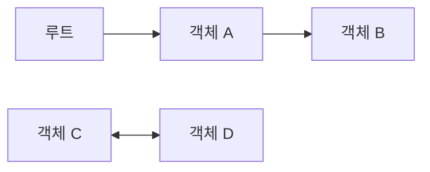

<Callout type="info">
  **이번 문서의 목표:** 엔진이 어떤 기준으로 메모리를 회수하는지 설명하고, 메모리 누수가 생기는 대표 패턴과 Weak 참조·힙 스냅샷으로 대응하는 방법을 구분할 수 있습니다.
</Callout>

## 메모리 생명주기

메모리 생명주기는 할당(allocate), 사용(use), 해제(release) 세 단계입니다. C 같은 저수준 언어는 세 단계를 모두 코드로 적지만, JavaScript는 할당과 해제를 엔진이 암묵적으로 처리합니다.

| 단계 | JavaScript에서 일어나는 일 |
|------|---------------------------|
| 할당 | 변수 선언, 리터럴 평가, `new`, 함수 호출, 클로저 생성 시 엔진이 메모리를 확보한다 |
| 사용 | 값을 읽고 쓴다. 코드가 직접 하는 단계는 이것뿐이다 |
| 해제 | 쓰이지 않는 값을 가비지 컬렉터(garbage collector, GC)가 회수한다 |

```js
const user = { name: 'Kim' }   // 할당: 객체 생성
const label = user.name + '님'  // 할당: 새 문자열 / 사용: 읽기
user.name = 'Lee'              // 사용: 쓰기
// 해제: 이 줄에는 없다. GC가 나중에 판단한다
```

- 해제 시점을 코드로 지정할 방법이 없습니다. 명세(ECMA-262)는 GC 알고리즘과 실행 시점을 정의하지 않으며, 엔진마다 다릅니다.
- 표준 GC 호출 API도 없습니다. Node.js의 `--expose-gc` 옵션을 켜면 `global.gc()`가 생기는데, 비표준이며 진단용입니다.
- `delete obj.key`는 프로퍼티를 제거할 뿐 메모리 해제 명령이 아닙니다. 그 값을 가리키는 참조가 다른 곳에 남아 있으면 값은 회수되지 않습니다.
- 엔진이 "더 이상 필요 없는 값"을 정확히 알아내는 것은 불가능합니다. 그래서 다음 절의 도달 가능성으로 근사합니다.
- 메모리 사용량은 Node.js에서 `process.memoryUsage().heapUsed`, `v8.getHeapStatistics()`로 읽습니다.

시험·면접에서는 "JavaScript는 메모리 관리를 개발자가 하지 않는다"가 반만 맞는 이유를 묻습니다. 할당과 해제는 자동이지만, 참조를 끊지 않아서 생기는 누수는 개발자의 책임입니다.

## Stack과 Heap

스택(stack)은 함수 호출마다 프레임이 쌓이고 반환 시 즉시 사라지는 영역이고, 힙(heap)은 객체처럼 수명이 호출 구조와 무관한 값을 두는 영역입니다.

| 구분 | 스택 | 힙 |
|------|------|-----|
| 저장 | 호출 프레임: 지역 변수 슬롯, 매개변수, 반환 위치 | 객체, 배열, 함수, 문자열, 클로저 환경 |
| 수명 | 함수가 반환되면 프레임째 제거 | GC가 회수할 때까지 |
| 관리 | 호출과 반환으로 자동 | 가비지 컬렉션 |
| 한계 초과 시 | `RangeError` | 프로세스 종료(OOM) |

```js
function outer() {
  const user = { name: 'Kim' } // user 슬롯: 스택. 객체: 힙
  inner(user)                  // 참조(주소)만 복사해 전달
}
function inner(u) { u.name = 'Lee' } // 같은 힙 객체를 수정
```

- 객체를 변수에 대입하거나 인수로 넘기면 힙의 객체가 복사되는 것이 아니라 참조가 복사됩니다(자세히는 10편).
- 스택 한도를 넘기면 `RangeError: Maximum call stack size exceeded`가 발생합니다. 종료 조건 없는 재귀가 대표 원인이며, 한도 깊이는 엔진과 프레임 크기에 따라 다릅니다.
- 힙 한도를 넘기면 Node.js는 `JavaScript heap out of memory` 오류로 종료됩니다. 한도는 `--max-old-space-size`로 조정합니다.
- 함수가 반환되어도 클로저가 붙잡은 변수는 사라지지 않습니다. V8은 이런 변수를 스택이 아니라 힙의 컨텍스트(Context) 객체에 둡니다(자세히는 23편).

흔한 오해가 세 가지 있습니다.

- "원시 값은 스택, 객체는 힙"은 단순화한 설명입니다. 명세는 스택과 힙을 정의하지 않고, 배치는 엔진 구현입니다. V8에서 문자열은 힙 객체이고, 작은 정수(Smi)만 슬롯에 직접 담깁니다.
- 명세의 실행 컨텍스트 스택(자세히는 22편)은 실행 순서를 추적하는 개념이고, 메모리 영역으로서의 스택과 별개입니다.
- Typed Array의 버퍼처럼 큰 이진 데이터는 힙 밖에 둘 수 있으며, V8은 이를 `external_memory`로 따로 집계합니다(자세히는 48편).

## Reachability

도달 가능성(reachability)은 루트(root)에서 참조를 따라가 닿을 수 있는 값을 "살아 있다"고 보는 기준입니다. GC는 닿을 수 없는 값만 회수합니다.

루트는 코드가 어떤 경로로든 접근할 수 있는 출발점입니다.

- 전역 객체(`globalThis`)와 그 프로퍼티
- 현재 호출 스택에 있는 함수의 지역 변수와 매개변수
- 실행 대기 중인 콜백과 프로미스 반응 작업(자세히는 40편)
- 호스트가 붙잡고 있는 값: 등록된 타이머 콜백, DOM 이벤트 리스너
- 로드된 모듈의 최상위 변수

```js
let user = { name: 'Kim' } // 루트(user)에서 도달 가능
let admin = user           // 참조 2개
user = null                // admin이 있으므로 여전히 도달 가능
admin = null               // 도달 불가 → 회수 대상
```

- 참조를 따라가는 경로는 객체의 프로퍼티, 배열 요소, 함수의 클로저 환경, 프로토타입 체인, `Map`·`Set`의 키와 값입니다.
- 서로 참조하는 객체 묶음도 루트에서 닿지 않으면 한꺼번에 회수됩니다.
- "회수 대상"이 되었다고 즉시 회수되는 것은 아닙니다. 회수 시점은 엔진이 정합니다.
- 도달 가능하지만 앞으로 쓰이지 않는 값은 회수되지 않습니다. 엔진은 코드가 그 값을 다시 쓸지 알 수 없기 때문이며, 이것이 메모리 누수의 정의입니다.

## 참조 카운팅과 순환 참조

참조 카운팅(reference counting)은 값마다 자신을 가리키는 참조 수를 세어 두고, 0이 되면 바로 회수하는 방식입니다. 현대 JavaScript 엔진은 쓰지 않습니다.

```js
function f() {
  const x = {}
  const y = {}
  x.a = y // y의 참조 수 2 (변수 y, x.a)
  y.a = x // x의 참조 수 2 (변수 x, y.a)
}
f() // 반환 후 변수는 사라지지만 서로를 가리켜 각각 1이 남는다
```

- 장점은 쓰이지 않는 순간 바로 회수된다는 점입니다.
- 단점은 순환 참조(circular reference)입니다. 위 코드에서 `x`와 `y`는 함수 밖에서 닿을 수 없는데도 서로의 참조 때문에 수가 0이 되지 않아 영원히 남습니다.
- 참조 수를 갱신하는 비용이 모든 대입에 붙습니다.
- 과거에는 구형 Internet Explorer의 DOM 객체가 참조 카운팅이어서, JavaScript 객체와 DOM 노드가 서로 참조하면 누수가 생겼습니다.
- 도달 가능성 방식은 위 코드의 `x`, `y`를 루트에서 닿지 않는다는 이유로 회수합니다. 참조의 개수가 아니라 루트로부터의 경로를 보기 때문입니다.
- CPython과 Swift는 참조 카운팅 기반이고, CPython은 순환 참조를 처리하는 별도 수집기를 함께 씁니다.

시험에서는 "순환 참조가 누수를 일으키는가"를 묻습니다. 참조 카운팅에서는 그렇고, Mark and Sweep을 쓰는 JavaScript에서는 순환만으로는 누수가 아닙니다.

## Mark and Sweep

Mark and Sweep은 루트에서 출발해 닿는 값에 표시(mark)하고, 표시되지 않은 값의 메모리를 거두는(sweep) 방식입니다. 현대 JavaScript 엔진이 사용하는 알고리즘의 기본형입니다.



위 그림에서 A와 B는 표시되어 남고, C와 D는 서로 가리켜도 루트에서 닿지 않아 회수됩니다.

V8의 주요(major) GC는 세 단계를 순서대로 진행합니다.

| 단계 | 하는 일 |
|------|---------|
| 마킹(marking) | 루트(스택, 전역)에서 출발해 도달 가능한 객체를 전부 찾아 표시한다 |
| 스위핑(sweeping) | 표시되지 않은 객체가 있던 빈틈을 빈 목록(free list)에 등록해 재사용하게 한다 |
| 컴팩션(compaction) | 단편화(fragmentation)가 심한 페이지의 살아 있는 객체를 한곳으로 모은다 |

마킹은 삼색(tri-color) 표시로 진행합니다. 객체마다 두 비트로 세 색을 구분합니다.

| 색 | 의미 |
|----|------|
| 흰색 | 아직 발견하지 못함 |
| 회색 | 발견했지만 이 객체가 가리키는 대상은 아직 처리하지 않음 |
| 검은색 | 발견했고 가리키는 대상까지 처리를 마침 |

- 처음에는 모두 흰색이고, 루트가 가리키는 객체를 회색으로 만든 뒤 회색 객체를 하나씩 꺼내 처리하며 검은색으로 바꿉니다.
- 회색 객체가 없어지면 마킹이 끝나고, 남은 흰색 객체가 도달 불가이므로 회수합니다.
- 컴팩션은 객체를 옮기므로 그 객체를 가리키던 참조를 모두 갱신합니다. 코드는 객체의 주소를 볼 수 없으므로 영향을 받지 않습니다.
- 가장 단순한 형태는 마킹 동안 JavaScript 실행을 멈춥니다(stop-the-world). 힙이 클수록 멈추는 시간이 길어져 화면 끊김으로 이어지며, 아래 절의 기법은 이 정지를 줄이기 위한 것입니다.
- GC는 할당이 쌓이는 등 엔진의 판단으로 시작됩니다. 코드에서 시작 시점을 정할 수 없습니다.

## 세대별 GC

세대별 GC(generational GC)는 힙을 나이로 나누어, 젊은 객체 영역을 자주 가볍게 청소하고 오래된 객체 영역은 드물게 청소하는 방식입니다. 대부분의 객체는 만들어지자마자 곧 쓰이지 않게 된다는 관찰(세대 가설)에 근거합니다. 이 절은 V8 기준이며 세부 구현은 엔진마다 다릅니다.

| 영역 | 알고리즘 | 대상 | 특징 |
|------|----------|------|------|
| 새 세대(young) | Scavenger (복사 방식, minor GC) | 갓 만든 객체 | 영역이 작고 자주 실행한다 |
| 옛 세대(old) | Mark-Compact (major GC) | 오래 살아남은 객체 | 영역이 크고 드물게 실행한다 |

- 새 세대는 반공간(semi-space) 두 개로 구성되어 항상 절반이 비어 있습니다. Scavenger는 살아 있는 객체만 비어 있는 쪽(To-Space)으로 복사하고, 두 공간의 역할을 맞바꿉니다. 죽은 객체는 복사하지 않으므로 비용이 살아 있는 객체 수에 비례합니다.
- 승격(promotion): 객체는 새로 만들어진 상태(nursery)에서 GC를 한 번 살아남으면 중간 상태(intermediate)가 되고, 한 번 더 살아남으면 옛 세대로 옮겨집니다.
- 옛 세대의 객체가 새 세대 객체를 가리키는 참조를 쓰기 장벽(write barrier)이 기록해 둡니다. 덕분에 minor GC가 옛 세대 전체를 훑지 않고도 그 참조를 루트로 취급할 수 있습니다.
- V8은 Scavenger를 병렬화해 정지 시간을 작업 부하에 따라 약 20–50퍼센트 줄였다고 보고했습니다.

실무에서 읽을 점은 두 가지입니다.

- 함수 안에서 잠깐 쓰고 버리는 임시 객체는 새 세대에서 싸게 회수됩니다. 성능 때문에 객체를 재사용하는 풀링은 측정으로 문제가 확인된 뒤에만 합니다.
- 누수된 객체는 결국 옛 세대로 승격되어 major GC가 계속 훑어야 하는 대상이 됩니다. 누수는 메모리 사용량뿐 아니라 GC 시간도 늘립니다.

## 증분·동시 GC

증분·동시 GC는 마킹을 JavaScript 실행과 섞거나 다른 스레드에서 진행해 메인 스레드의 정지 시간을 줄이는 기법입니다. GC 쪽에서는 JavaScript 코드를 변이자(mutator)라고 부릅니다.

| 방식 | 동작 | JavaScript 정지 |
|------|------|-----------------|
| stop-the-world | 메인 스레드가 멈추고 한 번에 마킹 | 마킹 전 구간 |
| 증분(incremental) | 마킹을 작은 조각으로 나누고 JavaScript와 번갈아 실행 | 조각 동안만 |
| 병렬(parallel) | 메인 스레드와 헬퍼 스레드가 함께 마킹 | 전 구간(단, 작업이 분산되어 짧아짐) |
| 동시(concurrent) | 헬퍼 스레드가 JavaScript 실행 중에 마킹 | 메인 스레드 마킹 부담이 거의 없음 |

- V8의 증분 마킹은 2011년에 도입되었고, 동시 마킹은 Chrome 64와 Node.js 10에서 들어왔습니다. 동시 마킹으로 메인 스레드의 마킹 시간이 모바일에서 약 65퍼센트, 데스크톱에서 약 70퍼센트 줄었다고 V8 팀이 보고했습니다.
- 마킹 도중 JavaScript가 객체 참조를 바꾸면 GC의 판단이 틀어질 수 있습니다. 삼색 표시는 검은 객체가 흰 객체를 직접 가리키지 않는다는 불변식을 지켜야 하고, 쓰기 장벽이 참조를 쓰는 순간 이를 검사해 그 흰 객체를 회색으로 표시합니다.
- 컴팩션도 병렬로 처리합니다.
- 유휴 시간 GC(idle-time GC)는 브라우저가 한가한 틈에 미리 GC를 수행해 사용자 상호작용 중의 정지를 피합니다.
- 정지가 완전히 사라지지는 않으며, 코드가 만드는 가비지의 양이 많으면 GC 작업량이 그만큼 늘어납니다.

## 메모리 누수 패턴

메모리 누수는 도달 가능하지만 앞으로 쓰이지 않는 값이 쌓여 가는 현상입니다. GC가 있어도 생기며, 원인은 모두 "의도치 않게 남은 참조"입니다. 증상은 시간이 갈수록 사용량이 우상향하고 GC 뒤에도 줄지 않는 것이며, 끝은 OOM 종료입니다.

**1. 의도치 않은 전역 변수**

```js
function leak() {
  undeclared = 1 // 선언 없는 대입 → 전역 프로퍼티 생성
}
leak()
console.log(globalThis.undeclared) // 1
```

- 전역 객체는 루트이므로 여기 붙은 값은 영원히 살아 있습니다.
- strict mode에서는 선언 없는 대입이 `ReferenceError`가 되어 막힙니다(자세히는 19편, 13편).

**2. 해제되지 않은 타이머**

```js
function start() {
  const data = loadBig()
  setInterval(() => render(data), 1000) // ❌ 멈출 방법이 없다
}
// ✅ const id = setInterval(...) 후 clearInterval(id)
```

- 등록된 타이머 콜백은 호스트가 붙잡는 루트이고, 콜백이 참조하는 `data`도 함께 살아 있습니다.

**3. 제거되지 않은 이벤트 리스너**

```js
const ctrl = new AbortController()
el.addEventListener('click', onClick, { signal: ctrl.signal })
ctrl.abort() // ✅ 한 번에 모든 리스너 제거
```

- 리스너 함수는 대상 요소가 살아 있는 동안 그 함수와 클로저가 잡은 값까지 유지됩니다. 컴포넌트가 사라질 때 `removeEventListener`나 `AbortController`로 제거합니다.
- Node.js의 `EventEmitter`는 같은 이벤트에 리스너를 11개 이상 달면 `MaxListenersExceededWarning` 경고를 냅니다.

**4. 큰 데이터를 붙잡는 클로저**

```js
const handlers = []
function register(bigData) {
  handlers.push(() => bigData.length) // handlers가 bigData를 보유
}
```

- 클로저는 자신이 참조하는 바깥 변수를 유지합니다(자세히는 23편). 오래 사는 배열·객체에 클로저를 넣으면 그 클로저가 잡은 데이터도 같은 수명이 됩니다.
- 필요한 값만 꺼내 클로저 밖에서 계산해 두면 큰 객체를 놓아줄 수 있습니다.

**5. 끝없이 커지는 컬렉션**

```js
const cache = new Map()
function getInfo(user) {
  if (!cache.has(user.id)) cache.set(user.id, compute(user))
  return cache.get(user.id) // 항목을 지우는 코드가 없다
}
```

- 캐시, 로그 배열, 구독자 목록이 대표 사례입니다. 상한(LRU 등)과 만료를 두거나, 키가 객체라면 WeakMap으로 바꿉니다.
- `Map`과 `Set`은 키를 강하게 참조하므로 키 변수에 `null`을 넣어도 항목이 남아 있는 한 키 객체는 회수되지 않습니다.

**6. 분리된 DOM 노드**

```js
const nodes = []
const el = document.createElement('div')
nodes.push(el)
document.body.append(el)
el.remove() // 화면에서는 사라졌지만 nodes가 참조 중
```

- 문서에서 떼어 낸 노드를 JavaScript 변수가 잡고 있으면 노드와 그 자식 전체가 남습니다(DOM은 호스트 API입니다).
- 힙 스냅샷에서는 `Detached`로 시작하는 이름으로 보입니다.

**7. 부분 문자열**

- 큰 문자열에서 잘라 낸 짧은 문자열이 원본을 참조하는 방식으로 구현될 수 있습니다. 힙 스냅샷에서는 `(sliced string)`으로 분류됩니다. 엔진 구현에 따른 현상이므로 필요하면 복사본을 만들어 쓰는지 측정으로 확인합니다.

흔한 오해는 "변수에 `null`을 넣어야 메모리가 해제된다"입니다. 함수 안의 지역 변수는 함수가 끝나면 알아서 도달 불가가 됩니다. `null` 대입이 의미 있는 것은 전역·모듈 변수, 객체 필드, 캐시처럼 오래 사는 곳에 걸린 참조를 끊을 때입니다.

## Weak 참조 활용

약한 참조(weak reference)는 도달 가능성 계산에서 무시되는 참조입니다. 대상이 다른 곳에서 강하게 참조되지 않으면 약한 참조가 있어도 회수됩니다.

| 도구 | 약하게 잡는 것 | 용도 | 자세히 |
|------|----------------|------|--------|
| WeakMap | 키 | 객체에 부가 데이터를 붙임 | 38편 |
| WeakSet | 요소 | 객체에 표식을 붙임 | 38편 |
| WeakRef | 대상 | 회수될 수 있는 캐시 | 이 절 |
| FinalizationRegistry | 대상 | 회수된 뒤 알림을 받음 | 이 절 |

### WeakMap과 WeakSet

```js
const meta = new WeakMap()
function track(obj) {
  meta.set(obj, { seenAt: Date.now() })
}
// obj가 다른 곳에서 모두 사라지면 항목도 함께 사라진다
```

- 키는 객체 또는 Symbol.for로 만들지 않은 심벌입니다(심벌 키는 ES2023). 원시 값은 `TypeError`입니다.
- 열거, `size`, `clear`가 없습니다. 회수 시점을 코드가 관측하지 못하게 하려는 설계입니다.
- 값이 키를 다시 참조해도 키가 도달 불가이면 키와 값이 함께 회수됩니다.
- 값은 강한 참조입니다. 약한 것은 키뿐입니다.

### WeakRef

WeakRef(ES2021)는 대상 하나를 약하게 가리키는 객체이고, `deref()`가 대상을 돌려주거나 회수되었으면 `undefined`를 돌려줍니다.

```js
const cache = new Map()
function getUser(id) {
  const hit = cache.get(id)?.deref()
  if (hit) return hit // 아직 살아 있으면 재사용
  const user = { id }
  cache.set(id, new WeakRef(user))
  return user
}
```

- 대상은 객체 또는 등록되지 않은 심벌이어야 하며, 원시 값과 `Symbol.for` 심벌은 `TypeError`입니다.
- 같은 작업(job) 안에서는 대상이 회수되지 않습니다. `WeakRef`를 만든 직후나 `deref()`로 대상을 얻은 직후부터 현재 동기 코드와 프로미스 후속 작업이 끝날 때까지 대상이 유지되고, 회수는 이벤트 루프 턴 사이에서만 관측됩니다(자세히는 40편).
- 위 `cache`의 `Map`에는 대상이 회수된 뒤에도 빈 `WeakRef` 객체가 항목으로 남습니다. 이 껍데기 정리를 `FinalizationRegistry`가 맡습니다.

### FinalizationRegistry

FinalizationRegistry(ES2021)는 등록한 대상이 회수된 뒤 콜백을 호출하도록 요청하는 객체입니다.

```js
const registry = new FinalizationRegistry((id) => {
  if (!cache.get(id)?.deref()) cache.delete(id)
})
registry.register(user, id) // (대상, 전달할 값, 해제 토큰)
registry.unregister(token)  // 등록 취소 → true 또는 false
```

- `register(target, heldValue, unregisterToken)`에서 `heldValue`가 `target`과 같은 객체이면 `TypeError`입니다. 콜백이 대상을 붙잡아 회수를 막기 때문입니다.
- 콜백이 호출되는 시점에는 대상에 걸린 `WeakRef`도 이미 비어 있습니다(`deref()`는 `undefined`).
- 콜백 호출은 보장되지 않습니다. 명세는 GC가 정리나 종료 콜백을 제때 예측 가능하게 수행하는 것에 의존하는 코드는 실망하게 될 것이라고 경고합니다. 한참 뒤에 호출되거나 아예 호출되지 않을 수 있습니다.

### 사용 기준

- 프로그램의 정확성을 WeakRef와 FinalizationRegistry에 의존하지 않습니다. 쓰임새는 캐시 같은 최적화에 한정합니다.
- 파일 핸들·연결 같은 자원 해제는 `try...finally`로 확정적으로 처리합니다(자세히는 44편).
- 객체에 부가 정보를 붙이려는 목적이면 WeakRef보다 WeakMap이 맞습니다.
- 회수 여부를 테스트에서 기대하지 않습니다. 엔진, 버전, 힙 상태에 따라 달라집니다.

## 힙 스냅샷으로 누수 찾기

힙 스냅샷(heap snapshot)은 특정 시점의 힙에 있는 객체와 참조 관계를 파일로 저장한 것입니다. 무엇이 어떤 경로로 붙잡혀 있는지를 보여 주므로 누수 원인을 찾는 기본 도구입니다.

### Chrome DevTools

Memory 패널에서 Heap snapshot을 선택하고 Take snapshot을 누르면 만들어집니다. 보기는 네 가지입니다.

| 보기 | 용도 |
|------|------|
| Summary | 생성자 이름별로 객체를 묶어 보여 준다 |
| Comparison | 두 스냅샷의 차이를 보여 준다. 누수 탐지의 중심 |
| Containment | 객체와 클로저의 구조를 계층으로 보여 준다 |
| Statistics | 메모리를 범주별 원형 그래프로 보여 준다 |

핵심 지표는 세 가지입니다.

| 지표 | 뜻 |
|------|-----|
| Shallow size | 객체 자신이 직접 차지하는 메모리 |
| Retained size | 그 객체를 지우면 함께 도달 불가가 되어 해제될 메모리의 총량 |
| Distance | 루트에서 그 객체까지의 최단 경로 길이 |

- 객체를 선택하면 아래 Retainers 패널에 그 객체를 붙잡고 있는 참조 경로가 루트 방향으로 나옵니다. 어떤 변수·리스너·컬렉션이 원인인지 여기서 확인합니다.
- Summary에는 `(array)`, `(compiled code)`, `(concatenated string)`, `(sliced string)`, `system / Context`(클로저가 잡은 변수) 같은 내장 분류가 있습니다.
- 분리된 DOM 노드는 `Detached`로 표시됩니다.
- Memory 패널에는 Heap snapshot 외에 시간에 따른 할당을 기록하는 Allocation instrumentation on timeline, 호출 스택별 할당을 낮은 부담으로 표본 추출하는 Allocation sampling도 있습니다.

가장 흔한 분석 순서는 스냅샷 세 개 방식입니다.

1. 앱이 안정된 상태에서 스냅샷 1을 찍습니다.
2. 누수가 의심되는 동작(화면 열고 닫기 등)을 수행하고 스냅샷 2를 찍습니다.
3. 같은 동작을 한 번 더 수행하고 스냅샷 3을 찍습니다.
4. 스냅샷 3에서 스냅샷 1과 2 사이에 할당된 객체만 걸러 보고, 아직 살아 있는 것을 누수 후보로 봅니다.

첫 동작에서 생긴 캐시·지연 초기화 객체는 정상이므로, 두 번째 동작 이후에도 계속 늘어나는 것만 의심해야 합니다. 두 스냅샷의 `# Delta`, `Size Delta`가 동작을 반복할수록 커지면 누수 신호입니다.

### Node.js

```js
import { writeHeapSnapshot } from 'node:v8'

const file = writeHeapSnapshot() // 파일 이름 문자열 반환
// 만들어진 .heapsnapshot 파일을 DevTools Memory 패널에서 연다
```

- `v8.writeHeapSnapshot()`은 동기로 실행되어 힙 크기에 비례해 이벤트 루프를 막고, 스냅샷 시점 힙의 약 두 배 메모리를 요구합니다. 이미 힙이 큰 서버에서 호출하면 OOM으로 종료될 수 있습니다.
- 스트림으로 받으려면 `v8.getHeapSnapshot()`을 씁니다.
- `--heapsnapshot-near-heap-limit` 옵션은 힙 한도에 가까워지면 스냅샷을 자동으로 만듭니다.
- 추세 확인에는 `v8.getHeapStatistics()`의 `used_heap_size`와 `number_of_detached_contexts`를 주기적으로 기록합니다. `--expose-gc`로 `global.gc()`를 호출한 뒤에도 값이 계속 오르면 누수입니다.
- 스냅샷 JSON의 형식은 V8 내부 구조이며 버전에 따라 바뀔 수 있습니다.

## 핵심 정리

- 메모리는 할당·사용·해제 순서이고, JavaScript는 할당과 해제를 엔진이 하지만 해제 시점은 코드가 정할 수 없습니다.
- 객체는 힙에, 호출 프레임은 스택에 있습니다. 스택은 `RangeError`, 힙은 OOM으로 한도를 넘습니다.
- GC는 루트에서 닿지 않는 값만 회수합니다. 참조 카운팅과 달리 순환 참조 자체는 누수가 아닙니다.
- V8은 새 세대(Scavenger)와 옛 세대(Mark-Compact)로 나누고, 증분·병렬·동시 마킹으로 정지를 줄입니다.
- 누수는 전역 변수, 타이머, 리스너, 클로저, 무한 컬렉션, 분리된 DOM 노드처럼 남은 참조에서 생깁니다.
- WeakMap과 WeakRef로 참조를 약하게 잡을 수 있지만 회수 시점은 보장되지 않으며, 원인 추적은 힙 스냅샷의 Retainers로 합니다.

## 마무리 복습

<Quiz
  questionNumber={1}
  question="변수 a에 객체를 만들어 담고, b = a로 같은 객체를 가리키게 한 뒤 a = null을 실행했다. 이 객체의 상태는?"
  options={['참조가 줄었으므로 즉시 회수된다', '루트에서 도달할 수 없으므로 회수 대상이 된다', '변수 b가 참조하므로 도달 가능하여 회수되지 않는다', 'a에 null을 넣었으므로 반드시 메모리에서 제거된다']}
  correctAnswer={3}
  explanation="도달 가능성은 루트에서 참조를 따라 닿는지로 판단합니다. a는 끊겼지만 변수 b가 여전히 같은 객체를 가리키므로 도달 가능합니다. 회수 대상이 되더라도 즉시 회수되는 것은 아니므로 1번과 4번도 틀립니다."
/>

<Quiz
  questionNumber={2}
  question="두 객체가 서로를 참조하지만 루트에서는 닿을 수 없다. 현대 JavaScript 엔진에서 이 객체들은 어떻게 되는가?"
  options={['참조 수가 0이 아니므로 영원히 남는다', '루트에서 도달할 수 없으므로 함께 회수 대상이 된다', '순환 참조는 항상 오류를 발생시킨다', '세대별 GC에서는 옛 세대로만 이동한다']}
  correctAnswer={2}
  explanation="현대 엔진은 참조 카운팅이 아니라 도달 가능성(Mark and Sweep) 기반이므로 루트에서 닿지 않는 순환 참조 묶음을 함께 회수합니다. 1번은 참조 카운팅 방식의 한계이고, 3번과 4번은 근거가 없는 설명입니다."
/>

<Quiz
  questionNumber={3}
  question="WeakRef와 FinalizationRegistry에 대한 설명으로 옳은 것은?"
  options={['deref()는 대상이 회수되면 null을 반환한다', 'FinalizationRegistry 콜백은 회수 직후 반드시 호출된다', '원시 값도 WeakRef의 대상이 될 수 있다', 'deref()는 회수되었으면 undefined를 반환하며 회수 시점은 보장되지 않는다']}
  correctAnswer={4}
  explanation="deref()는 대상이 살아 있으면 대상을, 회수되었으면 undefined를 반환하고 회수 시점은 엔진이 정하므로 보장되지 않습니다. 1번은 null이 아니라 undefined이고, 2번은 콜백이 늦거나 호출되지 않을 수 있으며, 3번은 원시 값 대상이 TypeError입니다."
/>

## 참고 자료

- [MDN — Memory management](https://developer.mozilla.org/en-US/docs/Web/JavaScript/Guide/Memory_management)
- [MDN — WeakRef](https://developer.mozilla.org/en-US/docs/Web/JavaScript/Reference/Global_Objects/WeakRef)
- [ECMA-262 — WeakRef Objects](https://tc39.es/ecma262/#sec-weak-ref-objects)
- [V8 Blog — Trash talk: the Orinoco garbage collector](https://v8.dev/blog/trash-talk)
- [V8 Blog — Concurrent marking in V8](https://v8.dev/blog/concurrent-marking)
- [Chrome DevTools — Record heap snapshots](https://developer.chrome.com/docs/devtools/memory-problems/heap-snapshots)
- [Node.js — v8 module](https://nodejs.org/api/v8.html)
