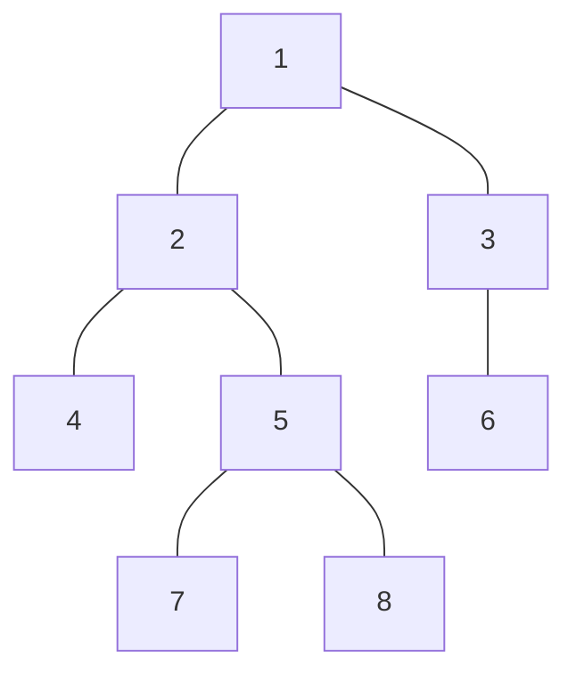

<Callout type="info">
  **이번 문서의 목표:** 트리의 정의와 용어를 정확히 구분하고, 입력 형식에 맞게 트리를 저장하며, DFS와 BFS로 부모·깊이·높이를 구할 수 있습니다.
</Callout>

## Tree 기본 구조

트리(tree)는 사이클이 없고 모든 정점이 연결된 무방향 그래프입니다. 서로 다른 두 정점을 잇는 단순 경로가 정확히 하나라는 정의와 같은 말입니다. 그래프의 정점과 간선 용어는 35편을 따릅니다.

이 문서 전체에서 쓰는 예제 트리입니다. 정점은 1부터 8까지이고 간선은 7개입니다.



- 정점은 노드(node)라고도 부릅니다.
- 트리의 간선은 방향이 없습니다. 방향이 생기는 것은 루트를 정한 뒤입니다(다음 절 이후).
- 정점이 하나뿐인 트리도 트리입니다. 간선이 0개입니다.
- 트리 여러 개가 따로 있는 그래프는 포레스트(forest)입니다. 연결 요소마다 트리입니다.
- 계층 구조(폴더, 조직도, 댓글 대댓글)가 문제에 나오면 트리로 모델링합니다.

## 트리의 성질

정점이 N개인 그래프 G가 트리이면 다음 성질을 모두 가집니다. 이 중 둘 이상의 조합으로 트리를 판정하기도 합니다.

| 성질 | 내용 |
|------|------|
| 간선 수 | 정확히 N - 1개 |
| 연결성 | 모든 정점이 서로 연결됨 |
| 사이클 | 없음 |
| 경로의 유일성 | 두 정점 사이의 단순 경로가 정확히 하나 |
| 간선 제거 | 아무 간선이나 지우면 두 개의 트리로 갈라진다 |
| 간선 추가 | 간선 하나를 더하면 사이클이 정확히 하나 생긴다 |

- 판정 공식: 연결이고 간선이 N - 1개이면 트리입니다. 사이클이 없고 간선이 N - 1개인 경우도 트리입니다. 간선 수만으로는 판정되지 않습니다.
- 정점이 2개 이상이면 리프(차수 1인 정점)가 적어도 2개 있습니다.
- 경로가 유일하므로 트리에서는 두 정점 사이의 거리를 "그 경로의 간선 수"로 정의하고, 경로를 찾으면 그것이 최단 경로입니다(자세히는 44편).

간선 수와 연결성으로 트리인지 검사하는 코드입니다.

```js
function isTree(n, edges) {
  if (edges.length !== n - 1) return false
  const adj = Array.from({ length: n + 1 }, () => [])
  for (const [a, b] of edges) {
    adj[a].push(b); adj[b].push(a)
  }
  const seen = new Array(n + 1).fill(false)
  const stack = [1]; seen[1] = true
  while (stack.length) {
    for (const u of adj[stack.pop()]) {
      if (!seen[u]) { seen[u] = true; stack.push(u) }
    }
  }
  return seen.slice(1).every(Boolean)
}
```

`isTree(4, [[1,2],[2,3],[1,3]])`은 간선 수가 3이라서 `false`입니다. `isTree(4, [[1,2],[3,4],[3,4]])`는 간선 수가 3이지만 1에서 닿는 정점이 둘뿐이라 `false`입니다.

## Root

루트(root)는 트리에서 기준으로 삼는 정점입니다. 무방향 트리는 어떤 정점이든 루트로 정할 수 있습니다. 루트를 정하면 모든 간선이 루트에서 멀어지는 방향을 얻고, 그 결과가 루트가 있는 트리(rooted tree)입니다.

- 루트에는 부모가 없습니다. 다른 모든 정점은 부모가 정확히 하나입니다.
- 문제가 "1번이 루트"라고 못 박는 경우가 많습니다. 정하지 않았다면 결과가 루트에 따라 달라지는지 확인합니다. 두 정점 사이의 거리와 지름은 루트와 무관하고, 깊이·높이·서브트리는 루트에 따라 달라집니다.
- 입력이 부모 배열로 주어지면 부모가 없는 정점(표시값 0 또는 -1)이 루트입니다.
- 예제 트리의 루트는 1입니다. 루트를 5로 잡으면 정점 2, 7, 8이 5의 자식이 되고 1은 2의 자식이 됩니다. 간선 집합은 그대로입니다.

같은 무방향 트리라도 루트를 다르게 정하면 부모와 자식의 관계가 달라집니다. 루트를 정해 관계를 만드는 과정은 44편에서 다룹니다(Rooting).

## Parent / Child

루트에서 정점 v로 가는 경로에서 v 바로 앞의 정점이 v의 부모(parent)이고, v는 그 정점의 자식(child)입니다. 부모와 자식은 간선으로 이어져 있습니다.

- 정점이 가진 자식의 수를 차수(degree)라 부릅니다. 무방향 그래프에서 말하는 차수(이웃의 수)와 구별합니다. 루트가 아닌 정점의 이웃 수는 자식 수 + 1입니다. 부모도 이웃이기 때문입니다.
- 부모가 같은 정점들은 형제(sibling)입니다. 예제에서 4와 5는 부모가 2인 형제입니다.
- 조상(ancestor)은 부모를 거듭 따라가 닿는 정점이고 후손(descendant)은 자식을 거듭 따라가 닿는 정점입니다. 정점 자신을 조상·후손에 포함하는지는 문제마다 다르므로 정의를 확인합니다.
- 인접 리스트로 저장한 무방향 트리에서는 `adj[v]`에 부모와 자식이 섞여 있습니다. 순회할 때 부모를 건너뛰어야 자식만 남습니다(DFS 절).

| 정점 | 1 | 2 | 3 | 4 | 5 | 6 | 7 | 8 |
|------|---|---|---|---|---|---|---|---|
| 부모 | 없음 | 1 | 1 | 2 | 2 | 3 | 5 | 5 |
| 자식 | 2, 3 | 4, 5 | 6 | 없음 | 7, 8 | 없음 | 없음 | 없음 |

**흔한 실수:** 무방향 인접 리스트를 부모·자식 구분 없이 재귀하는 것입니다. 부모로 되돌아가 무한 재귀가 됩니다. 현재 정점으로 올 때 쓴 부모를 인자로 넘겨서 건너뜁니다.

## Leaf

리프(leaf)는 자식이 없는 정점입니다. 단말 노드라고도 하며 자식이 있는 정점은 내부 노드(internal node)입니다. 예제의 리프는 4, 6, 7, 8입니다.

- 루트가 있는 트리에서 리프는 자식이 0개인 정점입니다. 정점이 둘 이상이면 루트는 리프가 아닙니다.
- 무방향 트리에서 리프는 이웃이 하나뿐인 정점(차수 1)입니다. 두 정의는 루트에서만 갈라집니다. 루트의 이웃이 하나뿐이면 무방향 기준으로는 리프이지만, 루트 기준으로는 자식이 있어서 리프가 아닙니다.
- 정점이 1개인 트리는 루트이면서 자식이 없으므로 그 정점이 리프입니다.

```js
const leaves = []
for (let v = 1; v <= n; v++) {
  const isLeaf = v === root ? adj[v].length === 0
                            : adj[v].length === 1
  if (isLeaf) leaves.push(v)
}
// 예제(root 1): [4, 6, 7, 8]
```

- 리프의 수를 세는 문제는 44편(Leaf Count)에서 다룹니다.

**흔한 실수:** 루트를 리프에 포함하는 것입니다. 루트의 이웃이 하나뿐인 트리에서 차수가 1인 정점을 모두 세면 루트가 섞여 들어갑니다. 루트 기준인지 무방향 기준인지 문제 문장을 확인합니다.

## Depth

깊이(depth)는 루트에서 그 정점까지 가는 경로의 간선 수입니다. 루트의 깊이는 0입니다. 같은 깊이의 정점들을 한 레벨(level)이라 부릅니다.

- 예제에서 깊이는 1이 0, 2·3이 1, 4·5·6이 2, 7·8이 3입니다.
- 깊이는 위에서 아래로 내려가며 정해집니다. 자식의 깊이는 부모의 깊이 + 1입니다.
- 간선 수가 아니라 정점 수로 세는 정의도 있습니다(루트의 깊이가 1). 문제가 어느 쪽인지 확인합니다. 이 과목은 간선 수로 쓰고 루트를 0으로 둡니다.

깊이를 구하는 코드는 DFS와 BFS 절에 있습니다. DFS는 부모에서 자식으로 내려가며 `depth[child] = depth[parent] + 1`로, BFS는 레벨 순서대로 같은 식으로 채웁니다.

## Height

높이(height)는 그 정점에서 후손인 리프까지 내려가는 가장 긴 경로의 간선 수입니다. 리프의 높이는 0이고, 트리의 높이는 루트의 높이입니다. 예제의 높이는 다음과 같습니다.

- 4, 6, 7, 8(리프)은 0, 5는 1, 3은 1, 2는 2, 1은 3입니다.
- 정점 v의 높이는 자식들의 높이 중 최댓값 + 1입니다. 자식이 없으면 0입니다.

$$
h(v) = \max_{c \in \text{children}(v)} (h(c) + 1), \quad h(\text{leaf}) = 0
$$

- 깊이는 위에서 아래로, 높이는 아래에서 위로 계산됩니다. 높이를 구하려면 자식을 먼저 끝내야 하므로 후위 순서가 필요합니다(DFS 절).

| 구분 | 계산 방향 | 순서 | 리프의 값 | 루트의 값 |
|------|-----------|------|-----------|-----------|
| 깊이 | 위에서 아래로 | 전위 | 정점마다 다름 | 0 |
| 높이 | 아래에서 위로 | 후위 | 0 | 트리의 높이 |

- 높이를 정점 수로 세는 정의(리프의 높이가 1)도 있습니다. 문제의 정의를 따릅니다.

## Subtree

서브트리(subtree)는 정점 v와 v의 모든 후손으로 이루어진 부분 트리입니다. v를 루트로 보고 아래만 잘라낸 트리입니다.

- 정점 v의 서브트리는 v 자신을 포함합니다.
- 리프의 서브트리는 리프 하나뿐이어서 크기가 1입니다. 루트의 서브트리는 트리 전체입니다.
- 서브트리 크기(size)는 서브트리에 속한 정점의 수이고, 자식들의 크기 합 + 1입니다. 구하는 방법은 44편(Subtree Size)에서 다룹니다.
- 서브트리는 부분 문제의 단위라서 트리 DP의 기본 상태가 됩니다. `f(v)`를 "v의 서브트리에 대한 답"으로 두고 자식들의 `f`로 구하는 식입니다(자세히는 67편).

예제 트리의 값을 한 표에 모으면 다음과 같습니다.

| 정점 | 1 | 2 | 3 | 4 | 5 | 6 | 7 | 8 |
|------|---|---|---|---|---|---|---|---|
| 깊이 | 0 | 1 | 1 | 2 | 2 | 2 | 3 | 3 |
| 높이 | 3 | 2 | 1 | 0 | 1 | 0 | 0 | 0 |
| 서브트리 크기 | 8 | 5 | 2 | 1 | 3 | 1 | 1 | 1 |

## 입력 형식별 트리 구성

트리는 입력 형식에 따라 두 가지로 주어집니다. 어느 쪽이든 인접 리스트로 만들어 두면 이후 코드가 같아집니다(입력 읽기는 08편).

### 간선 목록

N개의 정점과 N - 1개의 간선 `a b`가 주어집니다. 방향이 없으므로 양쪽에 모두 넣습니다. 루트는 문제가 정해 주며 대개 1입니다.

```js
const adj = Array.from({ length: n + 1 }, () => [])
for (const [a, b] of edges) {
  adj[a].push(b)
  adj[b].push(a)
}
```

- 정점 번호가 1부터이면 배열 크기를 N + 1로 잡고 0번을 비웁니다. 0부터이면 N입니다.
- `new Array(n + 1).fill([])`로 만들면 모든 칸이 같은 배열을 공유합니다. `Array.from`으로 칸마다 새 배열을 만듭니다(자세히는 05편).

### 부모 배열

정점 `i`의 부모 `parent[i]`를 나열합니다. 루트의 부모는 0이나 -1처럼 정점 번호가 아닌 값으로 표시합니다. 이 형식에서는 자식 방향 리스트를 만들면 충분합니다.

```js
// parent[i] = i의 부모, parent[1] = 0 (루트)
const children = Array.from({ length: n + 1 }, () => [])
for (let i = 1; i <= n; i++) {
  if (parent[i] > 0) children[parent[i]].push(i)
}
// 예제: children[5] = [7, 8], children[2] = [4, 5]
```

- 부모 배열은 이미 방향이 정해져 있습니다. 따라서 `children`만으로 순회할 수 있고 부모를 건너뛸 필요가 없습니다.
- 부모의 번호가 자식보다 작다고 가정하면 안 됩니다. 입력이 번호순이 아니면 `parent[i] > i`인 경우가 나옵니다. 그런 입력에서 번호 순서로 깊이를 구하면 틀립니다.
- 부모 배열에서 무방향 인접 리스트가 필요하면 `adj[parent[i]].push(i)`와 `adj[i].push(parent[i])`를 함께 넣습니다.
- 루트는 부모가 표시값인 정점이고 정확히 하나여야 트리입니다.

| 입력 | 방향 정보 | 저장 | 루트 |
|------|-----------|------|------|
| 간선 목록 | 없음 | 양방향 인접 리스트 | 문제가 지정 |
| 부모 배열 | 있음 | 자식 리스트 | 부모가 표시값인 정점 |

**흔한 실수:** 간선 목록에서 `a b`를 부모 → 자식으로 가정하는 것입니다. 문제가 "부모 자식 순서로 준다"고 명시하지 않으면 방향은 없습니다. 양쪽에 넣고 루트부터 내려가며 방향을 정합니다.

## Tree DFS

트리 DFS는 루트에서 시작해 한 자식의 서브트리를 끝까지 방문한 뒤 다음 자식으로 가는 순회입니다(DFS 일반은 36편). 트리에는 사이클이 없어서 방문 표시 배열이 필요 없고, 부모만 건너뛰면 됩니다.

재귀로 쓰면 가장 짧습니다. 방문 순서 두 가지가 나뉩니다.

- 전위(pre-order): 정점에 들어갈 때 처리합니다. 위에서 아래로 내려가는 값(깊이)을 구할 때 씁니다.
- 후위(post-order): 모든 자식을 끝낸 뒤 정점을 처리합니다. 아래에서 올라오는 값(높이, 서브트리 크기)을 구할 때 씁니다.

```js
function dfs(v, p) {
  depth[v] = p === 0 ? 0 : depth[p] + 1
  pre.push(v)                          // 전위: 들어갈 때
  for (const u of adj[v]) {
    if (u === p) continue              // 부모는 건너뛴다
    dfs(u, v)
    height[v] = Math.max(height[v], height[u] + 1)
  }
  post.push(v)                         // 후위: 나올 때
}
dfs(1, 0)
```

예제에서 `adj`의 이웃이 입력 순서일 때의 결과입니다.

| 순서 | 결과 |
|------|------|
| 전위 | 1, 2, 4, 5, 7, 8, 3, 6 |
| 후위 | 4, 7, 8, 5, 2, 6, 3, 1 |

- 부모 인자 `p`는 정점 번호가 1부터라서 루트에 0을 넘길 수 있습니다. 정점 번호에 0이 있으면 -1을 씁니다.
- 높이는 자식 호출이 끝난 뒤에 갱신하므로 후위에 해당합니다. `height`의 초기값은 0입니다.
- 시간과 공간은 O(N)입니다. 간선마다 양쪽에서 한 번씩 보므로 총 2(N - 1)번 확인합니다.

재귀 DFS는 트리가 일직선에 가깝게 깊어지면 호출 스택이 넘칩니다. Node.js 24에서 직접 실험했을 때 정점 1,000개짜리 일직선 트리는 통과했고 10,000개에서 `RangeError: Maximum call stack size exceeded`가 났습니다. 한계는 환경과 호출 시 스택 사용량에 따라 달라지므로 수치를 기준으로 삼으면 안 됩니다(자세히는 86편). 깊이가 크게 나올 수 있는 입력이면 반복문 DFS를 씁니다.

```js
function dfsOrder(adj, root) {
  const parent = new Array(adj.length).fill(0)
  const order = [], stack = [root]
  parent[root] = -1
  while (stack.length) {
    const v = stack.pop()
    order.push(v)
    for (const u of adj[v]) {
      if (u !== parent[v]) { parent[u] = v; stack.push(u) }
    }
  }
  return { order, parent }
}
```

- `order`는 전위 순서입니다. 스택에서 꺼낸 순서이므로 한 정점의 자식들은 입력과 반대 순서로 방문됩니다. 예제는 `[1, 3, 6, 2, 5, 8, 7, 4]`입니다. 입력 순서를 지키려면 자식을 거꾸로 넣습니다.
- `parent` 배열이 함께 나옵니다. 루트의 부모는 -1입니다.
- `order`를 뒤에서부터 훑으면 모든 정점에서 자식이 부모보다 먼저 나옵니다. 부모는 자식보다 `order`에서 앞에 있기 때문입니다. 이 성질로 후위 계산을 재귀 없이 합니다.

```js
const height = new Array(n + 1).fill(0)
for (let i = order.length - 1; i > 0; i--) {
  const v = order[i], p = parent[v]
  height[p] = Math.max(height[p], height[v] + 1)
}
// 예제: height = [-, 3, 2, 1, 0, 1, 0, 0, 0] (1번부터)
```

- 반복 `i > 0`은 `order[0]`이 루트라서 부모가 없는 것을 건너뜁니다.
- 깊이는 `order`를 앞에서부터 훑으며 `depth[v] = depth[parent[v]] + 1`로 구합니다.

**흔한 실수:** 후위가 필요한 계산(높이)을 전위 순서(`order`를 앞에서부터)로 하는 것입니다. 부모를 먼저 만나서 자식의 값이 아직 채워지지 않은 채 쓰입니다. 위에서 아래는 앞에서, 아래에서 위는 뒤에서부터 훑습니다.

## Tree BFS

트리 BFS는 루트에서 시작해 깊이가 같은 정점을 모두 방문한 뒤 다음 깊이로 내려가는 순회입니다(BFS 일반은 38편). 큐에 들어간 순서가 곧 레벨 순서입니다.

```js
function bfs(adj, root) {
  const depth = new Array(adj.length).fill(-1)
  const queue = [root]
  depth[root] = 0
  for (let head = 0; head < queue.length; head++) {
    const v = queue[head]
    for (const u of adj[v]) {
      if (depth[u] !== -1) continue    // 부모는 이미 방문됨
      depth[u] = depth[v] + 1
      queue.push(u)
    }
  }
  return { queue, depth }
}
```

- `queue`는 `shift` 대신 `head` 인덱스를 옮기며 읽습니다. `shift`는 앞의 요소를 모두 당겨서 O(N)이 될 수 있습니다(자세히는 20편).
- 트리에서는 `depth[u] !== -1`인 이웃이 부모뿐입니다. 방문 표시 배열을 따로 두지 않고 깊이 배열이 그 역할을 합니다.
- 예제의 `queue`는 `[1, 2, 3, 4, 5, 6, 7, 8]`이고 `depth`는 `[-1, 0, 1, 1, 2, 2, 2, 3, 3]`입니다(0번은 쓰지 않아 -1).
- 시간과 공간은 O(N)입니다.

레벨별로 묶어 처리해야 하면 큐의 현재 길이만큼 끊어서 읽습니다.

```js
const levels = []
let cur = [root]
const seen = new Array(n + 1).fill(false)
seen[root] = true
while (cur.length) {
  levels.push(cur)
  const next = []
  for (const v of cur) for (const u of adj[v]) {
    if (!seen[u]) { seen[u] = true; next.push(u) }
  }
  cur = next
}
// 예제: [[1], [2, 3], [4, 5, 6], [7, 8]]
```

| 구분 | DFS | BFS |
|------|-----|-----|
| 순서 | 한 갈래를 끝까지 | 깊이 순서로 |
| 자료구조 | 재귀 호출 또는 스택 | 큐 |
| 잘 맞는 계산 | 높이·서브트리 크기(후위), 경로 | 깊이, 레벨별 처리 |
| 깊은 트리 | 재귀는 호출 스택 한계 주의 | 영향 없음 |
| 시간 | O(N) | O(N) |

- 깊이만 구한다면 DFS와 BFS 어느 쪽도 같은 값입니다. 트리에서는 루트까지의 경로가 유일하기 때문입니다.
- 높이와 서브트리 크기는 자식 정보가 필요해서 DFS의 후위로 계산합니다. BFS로도 큐에 쌓인 순서를 거꾸로 훑으면 같은 결과를 얻습니다.

**흔한 실수:** BFS 큐에서 `queue.shift()`를 쓰는 것입니다. 정점이 수십만이면 느려질 수 있습니다. `head` 인덱스로 읽습니다.

## 핵심 정리

- 트리는 연결되고 사이클 없는 무방향 그래프이며, 정점 N개에 간선 N - 1개, 두 정점 사이 경로가 유일합니다.
- 루트를 정하면 부모·자식·리프·서브트리가 생기고, 깊이·높이·서브트리는 루트에 따라 달라집니다.
- 깊이는 루트에서 정점까지의 간선 수(루트 0), 높이는 정점에서 가장 먼 리프까지의 간선 수(리프 0)입니다.
- 간선 목록은 양방향 인접 리스트로, 부모 배열은 자식 리스트로 저장하고, 부모 번호가 자식보다 작다고 가정하지 않습니다.
- DFS는 부모만 건너뛰면 되고 깊이는 전위, 높이·서브트리 크기는 후위로 구하며, 깊은 트리는 반복문 DFS를 씁니다.
- BFS는 큐의 읽기 인덱스를 옮기며 레벨 순서로 깊이를 구합니다.

## 마무리 복습

<Quiz
  questionNumber={1}
  question="정점이 N개인 무방향 그래프가 트리가 되기 위한 필요충분조건으로 올바른 것은?"
  options={['간선이 N개이고 연결되어 있다', '간선이 N - 1개이고 연결되어 있다', '간선이 N - 1개이다', '사이클이 하나도 없다']}
  correctAnswer={2}
  explanation="트리는 연결이고 사이클이 없는 그래프이며, 이는 연결이면서 간선이 정확히 N - 1개인 것과 같습니다. 간선 수만으로는 부족합니다. 간선이 N - 1개여도 연결되지 않은 그래프가 있고, 사이클이 없다고만 하면 연결되지 않은 포레스트도 포함됩니다."
  optionExplanations={['간선이 N개이면 연결 그래프에 사이클이 정확히 하나 생겨 트리가 아니다', '정답. 연결이면서 간선이 N - 1개이면 트리이다', '간선이 N - 1개여도 사이클이 있고 연결되지 않은 그래프가 가능하다', '사이클이 없어도 연결되지 않으면 여러 트리로 이루어진 포레스트이다']}
/>

<Quiz
  questionNumber={2}
  question="1번을 루트로 하는 예제 트리에서 정점 5의 부모는 2이고 자식은 7과 8이다. 정점 5의 깊이, 높이, 서브트리 크기를 순서대로 나열한 것은?"
  options={['2, 1, 3', '3, 1, 3', '2, 2, 2', '2, 1, 2']}
  correctAnswer={1}
  explanation="루트 1에서 5까지는 1, 2, 5의 두 간선이라 깊이 2입니다. 5의 후손 리프 7과 8까지 한 간선이라 높이 1입니다. 서브트리는 5, 7, 8의 세 정점으로 크기 3입니다."
  optionExplanations={['정답. 깊이는 루트까지 간선 2개, 높이는 리프까지 1, 크기는 자신과 자식 둘을 합한 3이다', '깊이를 정점 수로 세면 3이지만 이 과목은 간선 수로 세서 루트가 0이다', '높이는 가장 먼 리프까지 간선 수라 1이고, 크기에는 정점 5 자신이 포함되어 3이다', '서브트리 크기는 5와 자식 7, 8을 모두 센 3이다']}
/>

<Quiz
  questionNumber={3}
  question="재귀 DFS로 부모·자식 구분이 없는 무방향 인접 리스트의 트리를 순회할 때 재귀 호출에 부모 정점을 함께 넘기는 이유는?"
  options={['방문 표시 배열의 크기를 줄이기 위해', '이웃 중 부모로 되돌아가 무한 재귀가 되는 것을 막기 위해', '높이를 계산하기 위해', '깊이를 0부터 세기 위해']}
  correctAnswer={2}
  explanation="무방향 인접 리스트에서 자식의 이웃에는 부모도 들어 있습니다. 부모를 건너뛰지 않으면 자식에서 다시 부모로 돌아가 같은 정점을 끝없이 오갑니다. 트리에는 사이클이 없으므로 부모만 건너뛰면 방문 표시 배열 없이 모든 정점을 한 번씩 방문합니다."
  optionExplanations={['부모 인자는 방문 표시 배열을 대체하지만 크기를 줄이는 것이 목적은 아니다', '정답. 부모를 건너뛰어야 되돌아가지 않아 모든 정점을 한 번씩만 방문한다', '높이는 자식 호출의 반환값으로 계산하며 부모 인자와 관계없다', '깊이는 부모의 깊이에 1을 더해 구하고 시작값은 따로 정한다']}
/>

## 참고 자료

- [Wikipedia — Tree (graph theory)](https://en.wikipedia.org/wiki/Tree_(graph_theory))
- [Wikipedia — Tree (abstract data type)](https://en.wikipedia.org/wiki/Tree_(abstract_data_type))
