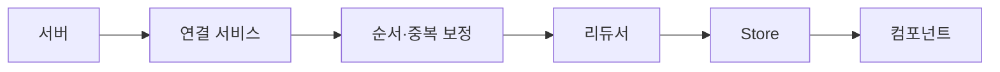

<Callout type="info">
  **이번 문서의 목표:** 폴링, SSE, WebSocket, WebTransport의 통신 모델과 지원 상태를 구분하고, 연결 상태 관리·재연결·순서 보정을 거쳐 실시간 이벤트를 상태 Store에 반영하는 방법을 설명할 수 있습니다.
</Callout>

## Polling

폴링(polling)은 클라이언트가 일정 간격으로 요청을 보내 변경이 있는지 묻는 방식입니다. 특별한 API가 필요 없고 `fetch`와 타이머만 쓰므로(자세히는 36편) 어떤 서버·프록시에서도 동작합니다.

```js
async function poll() {
  const url = '/api/notifications?since=' + lastId
  const res = await fetch(url)
  const items = await res.json()
  if (items.length) apply(items)
  setTimeout(poll, 5000) // 응답이 끝난 뒤 다음 요청을 예약
}
```

- 간격이 길면 지연이 늘고, 짧으면 변경이 없는 요청이 쌓여 서버 부하가 늘어납니다. 지연의 최대치는 간격과 같습니다.
- `setInterval` 대신 응답이 끝난 뒤 `setTimeout`으로 다음 요청을 예약하면 느린 응답이 겹쳐 쌓이지 않습니다.
- `since` 같은 커서를 보내 변경분만 받습니다. 매번 전체를 받으면 낭비입니다.
- 탭이 보이지 않을 때 간격을 늘리거나 멈추는 것은 60편의 Page Visibility로 판단합니다.
- 요청 취소와 재시도는 37편의 규칙을 따릅니다.

## Long Polling

롱 폴링(long polling)은 서버가 변경이 생길 때까지 응답을 보류했다가, 변경이 생기면 응답하는 방식입니다. 클라이언트는 응답을 받는 즉시 다음 요청을 보냅니다.

```js
async function longPoll() {
  while (running) {
    try {
      const res = await fetch('/api/events?after=' + lastId)
      if (res.status === 200) apply(await res.json())
    } catch {
      await sleep(3000) // 오류 때는 잠시 쉬고 다시 요청
    }
  }
}
```

- 변경이 생기면 곧바로 응답하므로 폴링보다 지연이 짧고 빈 요청이 적습니다.
- 서버나 프록시가 오래 걸리는 요청을 끊으므로 서버는 일정 시간 뒤 빈 응답(타임아웃)을 보내고, 클라이언트는 그 응답에도 다시 요청해야 합니다.
- 응답 하나에 이벤트 하나 이상이 실리고 매번 새 요청이므로 헤더 비용이 반복됩니다. 응답과 응답 사이에 생긴 이벤트를 놓치지 않으려면 `after` 같은 커서가 필수입니다.
- SSE와 WebSocket이 막힌 환경에서 쓰는 폴백입니다.

## Server-Sent Events

Server-Sent Events(SSE)는 HTTP 응답 하나를 열어 둔 채 서버가 이벤트를 계속 보내는 단방향 방식입니다. 브라우저 API는 `EventSource`이고 Baseline 2020입니다. 워커에서도 쓸 수 있습니다.

```js
const es = new EventSource('/api/stream')
es.onopen = () => console.log('open')
es.onmessage = (e) => console.log(e.data) // 이름 없는 이벤트
es.onerror = () => console.log('error')
es.close() // 연결을 닫고 재연결도 멈춤
```

- 요청은 항상 `GET`이고 응답의 `Content-Type`은 `text/event-stream`(UTF-8)입니다.
- 클라이언트에서 서버로 메시지를 보내는 기능은 없습니다. 보낼 때는 별도의 `fetch`를 씁니다.
- `readyState`는 `CONNECTING`(0), `OPEN`(1), `CLOSED`(2)입니다.
- 교차 출처로 쿠키를 보내려면 `new EventSource(url, { withCredentials: true })`입니다. 요청 헤더를 직접 지정할 수는 없습니다.
- `error` 이벤트는 연결이 열리지 못했거나 끊어졌을 때 발생하며 HTTP 상태 코드를 알려 주지 않습니다.
- 끊어지면 브라우저가 알아서 다시 연결하고, 상태 코드가 200이 아니거나 `Content-Type`이 다르면 실패로 끝나 다시 연결하지 않습니다. HTTP 204 응답은 재연결을 멈추게 하는 신호입니다.

### 이벤트 이름·id·retry·Last-Event-ID

응답 본문은 줄 단위 필드로 구성되고, 빈 줄이 이벤트 하나의 끝입니다.

```text
: keep-alive 주석
event: order
id: 42
retry: 5000
data: {"orderId": 7, "status": "paid"}

data: 이름 없는 메시지
```

| 필드 | 동작 |
|------|------|
| `data` | 메시지 내용. 여러 줄이면 줄바꿈으로 이어 붙임 |
| `event` | 이벤트 이름. 있으면 `addEventListener('order', ...)`로 받고, 없으면 `message` |
| `id` | 마지막 이벤트 ID를 설정. 이벤트의 `lastEventId`로 읽힘 |
| `retry` | 재연결 대기 시간(밀리초). 숫자만 인정 |
| 콜론으로 시작하는 줄 | 주석. 무시됨 |

- 재연결 대기 시간의 초깃값은 구현이 정하며 몇 초 정도입니다.
- 재연결할 때 마지막 ID가 비어 있지 않으면 요청에 `Last-Event-ID` 헤더가 붙습니다. 서버는 이 값 이후의 이벤트부터 다시 보내 끊긴 동안의 이벤트를 이어 줄 수 있습니다. 이어 주는 동작은 서버가 구현해야 합니다.
- 주석 줄을 15초 정도마다 보내면 프록시의 유휴 타임아웃으로 연결이 끊기는 것을 줄입니다.
- `id`를 보내지 않은 이벤트의 `lastEventId`는 직전에 설정된 값 그대로입니다.

```js
es.addEventListener('order', (e) => {
  const order = JSON.parse(e.data)
  console.log(e.lastEventId, order.status) // 42 'paid'
})
```

**흔한 실수:** 서버가 응답을 버퍼링해서 이벤트가 몰아서 도착하는 것입니다. 프록시나 압축 설정이 원인이며, 서버는 `Cache-Control: no-cache`를 보내고 필요하면 프록시 버퍼링을 끕니다.

### HTTP/1.1 연결 수 제한과 SSE

HTTP/1.1에서는 브라우저가 도메인 하나에 동시에 열 수 있는 연결이 6개로 제한됩니다. SSE 연결은 오래 열려 있으므로 같은 도메인의 탭마다 하나씩 차지해, 탭을 여럿 열면 다른 요청이 대기합니다. MDN은 Chrome과 Firefox에서 이 문제가 "수정하지 않음"으로 처리되었다고 적습니다.

- HTTP/2에서는 한 연결 안에서 동시 스트림을 협상하며 기본값은 대략 100입니다. SSE는 HTTP/2 이상에서 쓰는 것이 안전합니다.
- HTTP/1.1이어야 한다면 탭마다 연결하지 않고 하나만 연결해 나눠 씁니다. 같은 출처의 탭끼리는 BroadcastChannel로 전달하거나(자세히는 59편), 공유 워커에서 연결을 하나만 유지합니다(자세히는 55편).

## WebSocket

WebSocket은 HTTP 요청으로 시작해 하나의 연결을 양방향 메시지 통로로 바꾸는 프로토콜이자 API입니다. Baseline 2015이고 워커에서도 쓸 수 있습니다. 주소는 `ws://` 또는 `wss://`입니다. 운영 환경에서는 `wss://`를 씁니다.

```js
const ws = new WebSocket('wss://example.com/chat', ['v1'])
ws.addEventListener('open', () => ws.send('hello'))
ws.addEventListener('message', (e) => console.log(e.data))
ws.addEventListener('close', (e) => console.log(e.code))
ws.addEventListener('error', () => console.log('error'))
```

| `readyState` | 값 | 의미 |
|--------------|----|------|
| `CONNECTING` | 0 | 연결 중 |
| `OPEN` | 1 | 메시지 주고받기 가능 |
| `CLOSING` | 2 | 닫는 중 |
| `CLOSED` | 3 | 닫힘 |

- `send()`는 문자열, `ArrayBuffer`, 타입 배열, `Blob`을 보냅니다. 연결이 닫힌 뒤에 호출하면 전송되지 않고 `bufferedAmount`만 늘어납니다.
- 두 번째 인수는 서브프로토콜 이름이고 서버가 고른 값이 `ws.protocol`에, 협상된 확장이 `ws.extensions`에 들어옵니다.
- 요청 헤더를 임의로 지정할 수 없으므로 인증은 쿠키를 쓰거나 연결 뒤 첫 메시지로 처리합니다.
- 한 연결 안의 메시지는 보낸 순서대로 도착합니다.
- 메시지가 처리 속도보다 빨리 오는 경우를 조절하는 배압(backpressure)이 `WebSocket`에는 없어, 쌓이면 메모리 증가와 UI 멈춤이 생깁니다. 아래 `WebSocketStream`이 이를 다룹니다.
- 같은 출처의 탭마다 연결을 열면 서버 연결 수가 탭 수만큼 늘어납니다. 필요하면 워커 하나가 연결을 맡습니다(자세히는 54편).

### binaryType·bufferedAmount·close 코드

**binaryType**은 바이너리 메시지를 어떤 타입으로 받을지 정합니다. 기본값은 `'blob'`이고, `'arraybuffer'`로 바꾸면 바로 `DataView`나 타입 배열로 읽을 수 있습니다. 문자열 메시지는 이 값과 무관하게 문자열입니다.

```js
ws.binaryType = 'arraybuffer'
ws.onmessage = (e) => {
  if (typeof e.data === 'string') return handleText(e.data)
  const view = new DataView(e.data) // ArrayBuffer
  handleBinary(view.getUint8(0))
}
```

**bufferedAmount**는 `send()`로 큐에 넣었지만 아직 네트워크로 내보내지 못한 데이터의 바이트 수입니다(읽기 전용). 프로토콜 프레임 오버헤드는 포함하지 않습니다. 연결이 닫힌 뒤에는 `send()`를 호출할 때마다 계속 늘기만 하고 0으로 돌아가지 않습니다. 느린 네트워크에서 보내는 속도를 조절할 때 이 값을 봅니다.

```js
function sendSafe(data) {
  if (ws.readyState !== WebSocket.OPEN) return false
  if (ws.bufferedAmount > 1_000_000) return false // 1MB 밀림
  ws.send(data)
  return true
}
```

**close 코드**는 `ws.close(code, reason)`과 `close` 이벤트의 `event.code`, `event.reason`, `event.wasClean`으로 다룹니다.

| 코드 | 이름 | 의미 |
|------|------|------|
| 1000 | Normal Closure | 목적을 마치고 정상 종료 |
| 1001 | Going Away | 서버 종료 또는 페이지 이동 |
| 1002 | Protocol Error | 프로토콜 오류 |
| 1003 | Unsupported Data | 받을 수 없는 데이터 형식 |
| 1005 | No Status Received | 예약. 코드가 없었음 |
| 1006 | Abnormal Closure | 예약. 닫기 프레임 없이 끊김 |
| 1007 | Invalid Frame Payload Data | 예: 텍스트가 UTF-8이 아님 |
| 1008 | Policy Violation | 정책 위반 |
| 1009 | Message Too Big | 메시지가 너무 큼 |
| 1011 | Internal Error | 서버 내부 오류 |
| 1012 | Service Restart | 서버 재시작 |
| 1013 | Try Again Later | 일시적 과부하 |
| 1015 | TLS Handshake | 예약. TLS 핸드셰이크 실패 |

- `close()`에 쓸 수 있는 코드는 1000이거나 3000–4999입니다. 그 밖의 값은 `InvalidAccessError`입니다. 1005, 1006, 1015는 구현이 상태를 알리려고 쓰는 예약 코드라 직접 보낼 수 없습니다.
- 3000–3999는 라이브러리·프레임워크용(IANA 등록), 4000–4999는 애플리케이션끼리 정하는 사설 코드입니다. 예를 들어 4401을 "인증 만료"로 정해 두면 클라이언트가 재연결 대신 로그인 화면으로 보낼 수 있습니다.
- `reason`은 UTF-8로 123바이트를 넘으면 `SyntaxError`입니다. 한글은 글자당 3바이트이므로 글자 수로 세지 않습니다.
- `close()`를 부르기 전에 `send()`한 메시지는 버려지지 않고 모두 보낸 뒤에 닫기 핸드셰이크가 시작됩니다.
- 1006은 보통 네트워크가 끊겼거나 서버가 비정상 종료한 경우입니다. 재연결 대상입니다.

## WebSocketStream

WebSocketStream은 WebSocket을 Streams API(자세히는 38편)로 감싸 배압을 자동으로 처리하는 API입니다. Chromium 전용이며 실험적이고 표준에 포함되지 않은 미Baseline 기능이라 운영 환경에서는 `WebSocket`을 권장합니다.

```js
const wss = new WebSocketStream('wss://example.com/chat')
const { readable, writable } = await wss.opened
const writer = writable.getWriter()
await writer.write('ping')
const reader = readable.getReader()
const { value } = await reader.read() // 다음 메시지
```

- 연결이 열리면 `opened` Promise가 `readable`, `writable`, `protocol`, `extensions`를 돌려줍니다. 종료는 `closed` Promise의 코드·이유로 알고 `close()`로 닫습니다.
- 읽는 쪽이 느리면 스트림이 읽기를 늦추므로 메시지가 메모리에 무한히 쌓이지 않습니다.
- 지원하지 않는 브라우저를 위해 기능 감지(`'WebSocketStream' in self`) 후 `WebSocket`으로 폴백합니다.

## WebTransport

WebTransport는 HTTP/3(QUIC 기반)로 서버와 여러 스트림과 데이터그램을 주고받는 API입니다. Baseline 2026이며 Chrome·Edge 97, Firefox 114, Safari 26.4부터 지원합니다. 서버도 HTTP/3 WebTransport를 지원해야 합니다.

```js
const wt = new WebTransport('https://example.com:4999/wt')
await wt.ready
const dg = wt.datagrams.writable.getWriter()
await dg.write(new Uint8Array([1, 2, 3])) // 신뢰성 없는 전송
const s = await wt.createBidirectionalStream()
const w = s.writable.getWriter()
await w.write(new Uint8Array([4, 5, 6])) // 신뢰성 있는 전송
```

| 구분 | 신뢰성 | 용도 |
|------|--------|------|
| 스트림(양방향·단방향) | 신뢰성 있음, 스트림 안에서 순서 보장 | 메시지, 파일 |
| 데이터그램 | 손실될 수 있음 | 게임 상태, 위치 같은 최신 값만 중요한 데이터 |

- 스트림 여러 개를 동시에 열어도 한 스트림이 막히면 다른 스트림이 따라 막히지 않습니다(head-of-line blocking 없음). WebSocket은 연결 하나에 메시지가 순서대로 흘러서 앞 메시지가 막히면 뒤도 막힙니다.
- 연결은 `ready`로 열림을, `closed`로 닫힘을 알립니다. 서버가 곧 연결을 닫겠다는 신호는 `draining` Promise로 옵니다.
- 서버가 시작하는 스트림은 `incomingBidirectionalStreams`, `incomingUnidirectionalStreams`로 받고, 데이터그램은 `datagrams.readable`로 받습니다.
- QUIC의 연결 ID 덕분에 Wi-Fi와 모바일 데이터를 오가도 연결이 이어질 수 있습니다.
- 양방향 메시지만 필요하고 서버가 HTTP/3를 지원하지 않으면 WebSocket이 더 단순합니다.

## Connection State

연결 상태는 UI가 "지금 실시간 데이터를 믿어도 되는가"를 알려 주는 값입니다. 브라우저의 `readyState`는 연결 하나의 상태일 뿐이라 재연결 중, 오프라인, 인증 실패 같은 앱 수준 상태를 따로 정의합니다.

| 앱 상태 | 조건 | UI |
|---------|------|----|
| `connecting` | 처음 연결 시도 | 로딩 |
| `open` | 연결됨, 최근에 메시지 수신 | 정상 |
| `reconnecting` | 끊긴 뒤 재시도 대기·시도 중 | 오래된 데이터 표시 |
| `offline` | 네트워크 없음(자세히는 60편) | 오프라인 안내 |
| `closed` | 의도해서 닫음 또는 재시도 포기 | 수동 재연결 버튼 |

```js
function setState(next) {
  if (state === next) return
  state = next
  listeners.forEach((fn) => fn(state))
}
ws.addEventListener('open', () => setState('open'))
ws.addEventListener('close', () => setState('reconnecting'))
```

- 상태 전이는 한곳에서만 일으키고, 컴포넌트는 구독만 합니다(자세히는 31편).
- 사용자가 직접 닫은 경우와 끊긴 경우를 구분해야 의도한 종료 뒤에 재연결하지 않습니다. 플래그(`closedByUser`)를 둡니다.
- `error`와 `close`가 연달아 오는 경우가 있으므로, 재연결 시작은 `close`에서 한 번만 합니다.
- 연결이 열렸다는 사실만으로 데이터가 최신이라고 보지 않습니다. 재연결 직후에는 놓친 이벤트를 보충해야 합니다(아래 "메시지 순서·중복·누락 처리").

## 하트비트와 유휴 연결 감지

하트비트(heartbeat)는 연결이 살아 있는지 주기적으로 확인하는 메시지입니다. 연결이 조용히 끊겨도 브라우저가 바로 알지 못하는 경우가 있어서(Wi-Fi 전환, 프록시의 유휴 타임아웃 등) 필요합니다.

- WebSocket 프로토콜에는 ping·pong 제어 프레임이 있고 서버·브라우저가 자동으로 응답하지만, 이 프레임은 스크립트에 노출되지 않습니다. 그래서 JavaScript에서는 애플리케이션 수준의 `ping` 메시지를 직접 정의합니다.
- 서버가 일정 간격으로 `ping`을 보내고 클라이언트가 `pong`을 답하게 하거나, 반대로 클라이언트가 보내 응답이 없으면 끊긴 것으로 판단합니다.
- SSE에서는 서버가 15초 정도마다 주석 줄을 보내면 중간 장비가 유휴로 보고 끊는 일을 줄이고, 클라이언트는 마지막 수신 시각을 기준으로 감시합니다.

```js
let lastSeen = Date.now()
ws.addEventListener('message', () => {
  lastSeen = Date.now()
})
const timer = setInterval(() => {
  if (Date.now() - lastSeen > 30_000) ws.close(4000, 'idle')
  else if (ws.readyState === 1) ws.send('{"type":"ping"}')
}, 10_000)
```

- 위 코드는 10초마다 `ping`을 보내고, 30초 동안 아무것도 오지 않으면 직접 닫아 재연결 절차로 넘깁니다. 간격은 서버·프록시의 유휴 타임아웃보다 짧게 잡습니다.
- 연결을 닫을 때는 `clearInterval`로 타이머를 정리해야 새 연결과 겹치지 않습니다.
- 백그라운드 탭에서는 타이머가 느려질 수 있으므로(자세히는 08편) 타임아웃을 여유 있게 잡고, 탭이 다시 보일 때 연결 상태를 확인합니다(자세히는 60편).

**흔한 실수:** `readyState`가 `OPEN`이면 연결이 살아 있다고 믿는 것입니다. 네트워크가 사라져도 `OPEN`으로 남아 있다가 한참 뒤에 `close`가 오는 일이 있습니다.

## 재연결 전략

연결은 끊어진다고 가정하고, 끊긴 뒤 어떻게 다시 붙을지 정해 둡니다. SSE의 `EventSource`는 스스로 다시 연결하지만 WebSocket과 WebTransport는 직접 구현해야 합니다.

- **지수 백오프**: 실패할 때마다 대기 시간을 두 배로 늘리고 상한을 둡니다(예: 1초, 2초, 4초, ... 30초). 서버가 살아났을 때 모든 클라이언트가 동시에 몰리는 것을 막습니다. HTML 표준도 EventSource의 재연결에 지수 백오프를 허용합니다.
- **지터(jitter)**: 대기 시간에 무작위 값을 섞어 클라이언트들이 같은 시각에 재시도하지 않게 합니다.
- **성공하면 초기화**: 연결이 열리면 대기 시간을 처음 값으로 되돌립니다.
- **재시도하지 않을 종료**: 사용자가 닫은 경우, 인증 만료나 정책 위반처럼 다시 시도해도 같은 결과가 나오는 close 코드(예: 사설 코드 4401)는 재연결하지 않습니다.
- **오프라인 대기**: 네트워크가 없으면 시도하지 않고 `online` 이벤트를 기다립니다(자세히는 60편).

```js
function reconnect() {
  const base = Math.min(30_000, 1000 * 2 ** attempt)
  const delay = base / 2 + Math.random() * (base / 2)
  attempt++
  timer = setTimeout(connect, delay)
}
// 연결이 열리면 attempt = 0
```

- 재연결은 새 `WebSocket` 객체를 만드는 것입니다. 이전 객체의 리스너가 남아 새 연결과 섞이지 않도록 정리합니다. 이전 연결이 보낸 늦은 이벤트가 상태를 덮어쓰지 않게 연결마다 세대 번호를 둘 수도 있습니다.
- SSE는 서버가 `retry:` 필드로 대기 시간을 지정할 수 있고, 브라우저가 알아서 `Last-Event-ID`를 보냅니다. 서버가 200이 아닌 상태를 돌려주면 `EventSource`가 실패로 끝나 다시 연결하지 않으므로, 이때는 앱이 새 `EventSource`를 만들어 연결합니다.
- 재시도 횟수의 상한을 두고, 넘으면 `closed` 상태로 바꿔 사용자가 직접 재연결하게 합니다. 일반적인 요청 재시도 규칙은 37편에 있습니다.

## 메시지 순서·중복·누락 처리

한 연결 안에서 WebSocket 메시지는 순서대로 도착하지만, 연결이 끊겼다 이어지면 그 사이의 이벤트가 사라지거나 다시 올 수 있습니다. 서버가 같은 이벤트를 두 번 보내거나, 여러 경로(HTTP 응답과 푸시)로 같은 변경이 오기도 합니다.

| 문제 | 원인 | 대응 |
|------|------|------|
| 누락 | 끊긴 동안 발생한 이벤트, 데이터그램 손실 | 순번 간격 감지 후 보충 요청 |
| 중복 | 재연결 때 겹쳐 재전송, 재시도 | 이벤트 ID로 이미 처리했는지 확인 |
| 순서 뒤바뀜 | 여러 연결·경로, 데이터그램 | 순번이나 타임스탬프 비교 후 오래된 것 버림 |

- 서버가 이벤트마다 단조 증가하는 순번(`seq`) 또는 고유 ID를 붙입니다. 클라이언트는 마지막으로 처리한 값을 기억합니다.
- 받은 `seq`가 기대값보다 크면 중간이 빠진 것이므로 빠진 구간을 `fetch`로 다시 요청하거나(`/api/events?after=마지막 seq`) 전체 스냅샷을 받아 교체합니다.
- 받은 `seq`가 이미 처리한 값 이하이면 중복이므로 버립니다. 같은 이벤트를 두 번 적용해도 결과가 같도록 적용 방식을 멱등하게 만들면 더 안전합니다.
- SSE는 `id`와 `Last-Event-ID`로 서버가 이어 보내기를 구현할 수 있고, WebSocket은 재연결 직후 마지막 `seq`를 첫 메시지로 보내 같은 방식으로 이어 받습니다.
- WebTransport의 데이터그램은 손실과 순서 뒤바뀜이 정상 동작이므로 최신 값만 중요한 데이터에만 씁니다. 반드시 도착해야 하는 데이터는 스트림으로 보냅니다.
- 재연결 직후에는 이벤트 이어 받기와 스냅샷 요청이 겹칠 수 있습니다. 스냅샷에 담긴 `seq`를 기준으로 그 이하 이벤트를 버리면 정합성이 유지됩니다.

## 실시간 이벤트를 상태 Store에 반영

실시간 이벤트는 컴포넌트가 직접 받지 않고, 연결 서비스가 받아 상태 Store에 반영하게 합니다. 컴포넌트는 Store를 구독해 그려지기만 합니다(자세히는 31편, 32편).



```js
function handle(msg) {
  if (msg.seq <= store.lastSeq) return // 중복
  if (msg.seq > store.lastSeq + 1) return resync() // 누락
  store.dispatch({ type: msg.type, payload: msg.data })
  store.lastSeq = msg.seq
}
```

- 이벤트는 "무슨 일이 일어났다"는 사실로 다루고, Store의 변경 함수(리듀서)가 그 사실을 상태에 적용합니다. 이벤트 종류별 처리를 한곳에 모으면 연결 방식(SSE, WebSocket)을 바꿔도 Store와 컴포넌트는 그대로입니다.
- 이벤트가 초당 수십 개씩 오면 이벤트마다 렌더링하지 않고 모아서 반영합니다. 예를 들어 `requestAnimationFrame` 안에서 한 번에 적용합니다(자세히는 08편, 30편).
- 연결 상태(`connecting`, `reconnecting` 등)도 Store에 두어 UI가 "오래된 데이터" 표시를 할 수 있게 합니다.
- 낙관적 업데이트(요청 전에 화면을 먼저 바꿈)를 쓰면 서버가 돌려보내는 같은 변경 이벤트와 충돌하므로, 요청 ID를 이벤트에 실어 자신이 만든 변경은 한 번만 반영합니다.
- 컴포넌트가 사라질 때 구독을 해제하고, 구독자가 없으면 연결 자체를 닫는 정책도 연결 서비스가 맡습니다. 연결을 몇 개 쓸지(탭마다, 워커 하나)도 이 계층에서 결정합니다.
- 실시간 UI 전체 설계 사례는 84편에서 다룹니다.

## 핵심 정리

- 폴링은 구현이 가장 쉽고 지연이 간격만큼 생기며, 롱 폴링은 변경 시점까지 응답을 보류해 지연을 줄이고 타임아웃 뒤 다시 요청합니다.
- SSE는 서버에서 클라이언트로 가는 단방향 `GET` 스트림이고, `id`와 `Last-Event-ID`로 이어 받기를, `retry`로 재연결 간격을 다루며, HTTP/1.1에서는 도메인당 6개 연결 제한에 걸립니다.
- WebSocket은 양방향이고 `binaryType`, `bufferedAmount`로 데이터와 송신 큐를 다루며, close 코드는 1000과 3000–4999만 직접 보낼 수 있고, ping·pong 프레임은 스크립트에 노출되지 않아 하트비트는 앱 메시지로 구현합니다.
- WebSocketStream은 Chromium 전용 미Baseline이고 배압을 제공합니다. WebTransport는 Baseline 2026이며 HTTP/3 위에서 스트림과 데이터그램을 제공합니다.
- 연결은 끊어진다고 가정하고 앱 수준 연결 상태를 두며, 재연결에는 지수 백오프와 지터를 쓰고 재시도하지 않을 종료를 구분합니다.
- 재연결 뒤에는 순번과 ID로 중복을 버리고 누락을 보충한 다음 이벤트를 Store에 반영하며, 컴포넌트는 Store만 구독합니다.

## 마무리 복습

<Quiz
  questionNumber={1}
  question="EventSource를 쓰는 서버가 끊긴 동안의 이벤트를 이어서 보내려면 무엇이 필요한가?"
  options={['클라이언트가 retry 필드를 보내야 한다', '서버가 이벤트에 id를 붙이고 재연결 요청의 Last-Event-ID 헤더를 읽어 그 이후부터 보낸다', 'EventSource가 자동으로 모든 이벤트를 저장해 다시 재생한다', 'WebSocket으로 바꿔야만 가능하다']}
  correctAnswer={2}
  explanation="브라우저는 재연결할 때 마지막 이벤트 ID가 있으면 Last-Event-ID 헤더를 보냅니다. 이어 보내는 일은 서버가 구현해야 합니다. retry는 서버가 클라이언트에 알리는 재연결 대기 시간입니다."
  optionExplanations={['retry는 서버가 응답 본문에 적어 보내는 재연결 대기 시간(밀리초)이고 클라이언트가 보내지 않습니다.', 'id 필드와 Last-Event-ID 헤더를 서버가 활용하는 방식이 맞습니다.', 'EventSource는 이벤트를 저장하지 않고 마지막 ID만 헤더로 보냅니다.', 'SSE로도 id와 Last-Event-ID로 이어 받기를 구현할 수 있습니다.']}
/>

<Quiz
  questionNumber={2}
  question="WebSocket의 close 처리에 대한 설명으로 옳은 것은?"
  options={['close(1006)으로 비정상 종료를 알릴 수 있다', 'close()에 쓸 수 있는 코드는 1000이거나 3000에서 4999 사이이다', 'reason은 글자 수가 123자 이하이면 항상 안전하다', 'bufferedAmount는 연결이 닫히면 0이 된다']}
  correctAnswer={2}
  explanation="1000과 3000에서 4999 범위 밖의 코드를 넘기면 InvalidAccessError입니다. 1005, 1006, 1015는 구현이 상태를 알리는 예약 코드입니다. reason은 UTF-8로 123바이트 한도이고, 닫힌 뒤 bufferedAmount는 send 호출마다 늘기만 합니다."
  optionExplanations={['1006은 예약 코드라서 직접 보낼 수 없고 InvalidAccessError가 납니다.', '1000 또는 3000–4999만 허용된다는 설명이 맞습니다.', '한도는 글자 수가 아니라 UTF-8 바이트 수이며 한글은 글자당 3바이트입니다.', '닫힌 뒤에는 send를 호출할 때마다 값이 늘고 0으로 돌아가지 않습니다.']}
/>

<Quiz
  questionNumber={3}
  question="WebSocket 연결이 조용히 끊기는 것을 감지하는 방법으로 가장 적절한 것은?"
  options={['readyState가 OPEN인지 가끔 확인한다', '브라우저가 노출하는 ping 프레임을 JavaScript에서 보낸다', '앱 수준의 ping 메시지를 주고받고 일정 시간 수신이 없으면 연결을 닫아 재연결한다', 'bufferedAmount가 0이면 연결이 살아 있다고 판단한다']}
  correctAnswer={3}
  explanation="WebSocket의 ping과 pong 제어 프레임은 스크립트에 노출되지 않으므로 앱 메시지로 하트비트를 구현합니다. 네트워크가 사라져도 readyState는 한동안 OPEN으로 남을 수 있어서 마지막 수신 시각을 기준으로 타임아웃을 둡니다."
  optionExplanations={['OPEN이어도 실제로는 끊겨 있을 수 있어서 감지가 안 됩니다.', 'ping 프레임은 API로 노출되지 않아 스크립트에서 보낼 수 없습니다.', '앱 수준 하트비트와 수신 타임아웃이 올바른 방법입니다.', 'bufferedAmount는 송신 대기 바이트일 뿐 연결 생존과 무관합니다.']}
/>

## 참고 자료

- [MDN — Using server-sent events](https://developer.mozilla.org/en-US/docs/Web/API/Server-sent_events/Using_server-sent_events)
- [MDN — EventSource](https://developer.mozilla.org/en-US/docs/Web/API/EventSource)
- [HTML Standard — Server-sent events](https://html.spec.whatwg.org/multipage/server-sent-events.html)
- [MDN — WebSocket](https://developer.mozilla.org/en-US/docs/Web/API/WebSocket)
- [MDN — WebSocket.close()](https://developer.mozilla.org/en-US/docs/Web/API/WebSocket/close)
- [MDN — CloseEvent.code](https://developer.mozilla.org/en-US/docs/Web/API/CloseEvent/code)
- [WHATWG — WebSockets Standard](https://websockets.spec.whatwg.org/)
- [RFC 6455 — The WebSocket Protocol](https://www.rfc-editor.org/rfc/rfc6455)
- [MDN — WebSocketStream](https://developer.mozilla.org/en-US/docs/Web/API/WebSocketStream)
- [MDN — WebTransport API](https://developer.mozilla.org/en-US/docs/Web/API/WebTransport_API)
- [web-features 데이터 패키지 (Baseline 상태)](https://cdn.jsdelivr.net/npm/web-features/data.json)
