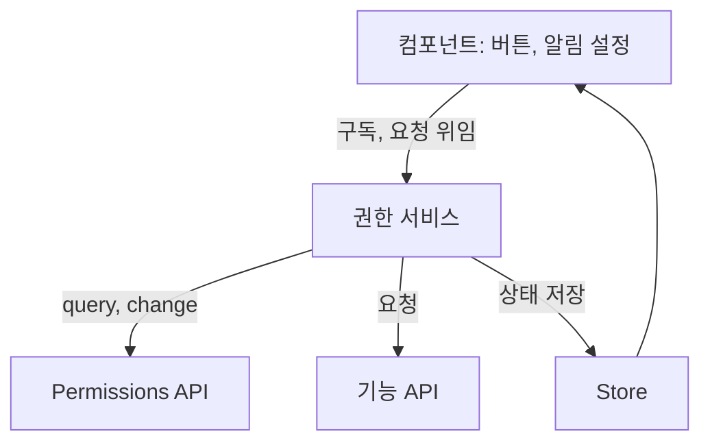

<Callout type="info">
  **이번 문서의 목표:** 권한의 세 상태와 요청 조건, 페이지의 가시성·연결·환경 변화를 감지하는 API의 동작과 한계를 구분하고, 이를 컴포넌트 경계에서 일관되게 관리하는 구조를 설명할 수 있습니다.
</Callout>

## Permissions API

Permissions API는 사용자가 기능(위치, 알림, 카메라 등)을 허용했는지 **물어보지 않고 조회**하는 API입니다. 지원 상태는 Baseline 2022이고 워커에서도 `navigator.permissions`로 쓸 수 있습니다.

```js
const status = await navigator.permissions.query({
  name: 'geolocation',
})
console.log(status.state) // 'granted' | 'denied' | 'prompt'
```

- `query()`는 권한 요청 창을 띄우지 않습니다. 현재 상태만 알려 줍니다.
- 권한을 요청하는 것은 각 기능의 API(`getCurrentPosition()`, `Notification.requestPermission()` 등)입니다.
- 지원하는 권한 이름은 브라우저마다 다릅니다. 이름을 알지 못하면 `query()`가 `TypeError`로 거부되므로 `try`/`catch`로 감쌉니다.
- 권한 이름 예: `geolocation`, `notifications`, `push`, `camera`, `microphone`, `clipboard-read`, `clipboard-write`, `persistent-storage`, `screen-wake-lock`, `midi`, `periodic-background-sync`.
- 권한을 스크립트에서 해제하는 메서드는 없습니다. 사용자가 브라우저 설정에서 바꿉니다.
- 조회 결과에는 Permissions Policy와 보안 컨텍스트 제약도 반영됩니다. 정책이 막은 기능은 사용자에게 묻지 않고 `denied`가 됩니다.

```js
async function getState(name) {
  try {
    const s = await navigator.permissions.query({ name })
    return s.state
  } catch {
    return 'unsupported' // 이 브라우저가 모르는 이름
  }
}
```

## 권한 상태와 change 이벤트

| 상태 | 의미 | 다음 동작 |
|------|------|-----------|
| `granted` | 허용됨 | 바로 기능 사용 |
| `denied` | 거부됨(사용자 또는 정책) | 요청해도 창이 뜨지 않음. 설정 안내 |
| `prompt` | 아직 결정하지 않음 | 요청하면 사용자에게 창이 표시됨 |

`PermissionStatus` 객체는 상태가 바뀌면 `change` 이벤트를 발생시킵니다. 사용자가 주소창이나 설정에서 권한을 바꾸면 페이지를 새로 고치지 않고도 알 수 있습니다.

```js
const status = await navigator.permissions.query({
  name: 'notifications',
})
status.addEventListener('change', () => {
  render(status.state) // 설정에서 바꾸면 즉시 반영
})
```

- 컴포넌트가 사라질 때는 `change` 리스너를 해제합니다(자세히는 07편).
- 알림은 `Notification.permission`이 `default`, `granted`, `denied`를 돌려주고, 이는 `prompt`, `granted`, `denied`에 대응합니다.

**흔한 실수:** 페이지가 열릴 때 한 번 조회한 값을 계속 믿는 것입니다. 상태는 사용자가 언제든 바꿀 수 있으므로 `change`를 구독하거나 사용 직전에 다시 확인합니다.

## 권한 요청 UX와 사용자 활성화 요구

권한 요청 창은 사용자가 방금 한 동작과 연결될 때 허용률이 높고, 브라우저도 그렇게 하도록 요구합니다.

사용자 활성화(user activation)는 사용자가 페이지와 상호작용했는지를 나타내는 상태이며 두 종류입니다.

| 종류 | 지속 | 확인 | 예 |
|------|------|------|----|
| 일시적 활성화(transient) | 짧은 시간만 유지, 일부 API가 소모 | `navigator.userActivation.isActive` | `window.open()`, 클립보드, `requestFullscreen()`, `navigator.share()` |
| 지속적 활성화(sticky) | 세션 동안 유지 | `navigator.userActivation.hasBeenActive` | `vibrate()`, 소리 자동 재생 |

- 활성화를 만드는 이벤트는 `keydown`(Esc 같은 예외 제외), `mousedown`, `pointerdown`(마우스일 때), `pointerup`(마우스가 아닐 때), `touchend`입니다. 스크립트가 만든 이벤트(`isTrusted`가 `false`)는 해당하지 않습니다.
- `Notification.requestPermission()`도 클릭 같은 사용자 조작 안에서 호출하라고 요구합니다(Firefox는 72부터 강제, 자세히는 57편).
- 페이지 로드 직후에 요청 창을 띄우지 않고, 기능이 필요해지는 순간(버튼 클릭)에 요청합니다.

권한 요청 UX의 순서는 다음과 같습니다.

1. `query()`로 상태를 확인합니다.
2. `granted`이면 바로 쓰고, `denied`이면 요청하지 않고 설정 방법을 안내합니다.
3. `prompt`이면 먼저 왜 필요한지 앱 안에서 설명하고, 사용자가 누른 버튼의 핸들러에서 요청합니다.
4. 거부되면 같은 요청을 반복하지 않고 대안 기능을 보여 줍니다.

```js
button.addEventListener('click', async () => {
  const result = await Notification.requestPermission()
  if (result === 'denied') showHowToEnableInSettings()
})
```

**흔한 실수:** 비동기 작업이나 `setTimeout` 뒤에 권한을 요청하는 것입니다. 일시적 활성화는 시간이 지나면 사라져 요청이 거부되거나 막힙니다.

## Permissions Policy와 iframe allow 속성

Permissions Policy는 문서와 그 안의 iframe이 어떤 기능을 쓸 수 있는지를 서버나 부모가 제한하는 장치입니다. 사용자 허용과는 별개의 층이며, 지원은 Chromium 중심의 미Baseline입니다. 예전 이름은 Feature Policy입니다.

두 가지로 지정합니다.

```text
Permissions-Policy: camera=(self), geolocation=()
```

```html
<iframe src="https://pay.example.com"
        allow="camera; fullscreen"></iframe>
```

| 허용 목록 값 | 의미 |
|-------------|------|
| `*` | 모든 출처 허용 |
| `()` | 모두 금지 |
| `self` | 같은 출처 문서만 |
| 출처 목록 | 지정한 출처만(`"https://a.example.com"`) |

- 응답 헤더 `Permissions-Policy`는 문서 전체에 적용되고, `iframe`의 `allow` 속성은 그 iframe에 기능을 위임합니다.
- 기능마다 기본 허용 목록이 있습니다(예: `*`, `self`, `none`). `allow`에 출처를 적지 않으면 기본값은 `src`이고, iframe의 `src` 출처에 적용됩니다.
- 정책은 상속되며 아래로 갈수록 좁아지기만 합니다. 부모가 막은 기능을 iframe이 다시 열 수 없습니다.
- 정책이 막은 기능은 Permissions API가 `denied`로 보고하고 사용자에게 묻지도 않습니다.
- 서드파티 위젯에는 필요한 기능만 `allow`로 주고, 문서 헤더에서는 쓰지 않는 기능을 `()`로 꺼 두는 것이 안전합니다.

**흔한 실수:** iframe 안의 카메라나 클립보드가 동작하지 않는 이유를 사용자 허용에서만 찾는 것입니다. 부모 문서 헤더나 `allow` 속성에서 막혀 있을 수 있습니다. 위젯 설계는 59편을 참고합니다.

## Clipboard Permission

클립보드 API(`navigator.clipboard`)는 읽기와 쓰기의 권한 규칙이 다릅니다(API 자체는 49편). 보안 컨텍스트(HTTPS)가 필요합니다.

| 동작 | Chromium | Firefox, Safari |
|------|----------|-----------------|
| 쓰기(`writeText`, `write`) | `clipboard-write` 권한이 활성 탭에 자동 부여됨 | 일시적 활성화 필요 |
| 읽기(`readText`, `read`) | `clipboard-read` 권한 요청 창 | 일시적 활성화에 더해 "붙여넣기" 메뉴 확인 |

- Permissions API의 `clipboard-read`, `clipboard-write` 이름은 Chromium에서만 조회할 수 있습니다. Firefox와 Safari는 이 이름을 지원하지 않으므로 `query()`가 `TypeError`를 던질 수 있어, 읽기 가능 여부를 미리 알려 주는 표시는 신뢰하지 않고 실제 호출의 성공 여부로 판단합니다.
- 다른 출처의 iframe에서 쓰려면 `allow="clipboard-read; clipboard-write"`가 필요합니다.
- 읽기 호출은 경우에 따라 문서에 포커스가 있어야 합니다.

```js
async function copy(text) {
  try {
    await navigator.clipboard.writeText(text)
    return true
  } catch {
    return false // 권한 없음, 활성화 없음, 포커스 없음
  }
}
```

- 복사 버튼은 클릭 핸들러 안에서 바로 `writeText()`를 호출합니다. 다른 비동기 작업을 먼저 하면 활성화가 사라질 수 있습니다.
- 사용자가 붙여넣기 동작을 했을 때는 `paste` 이벤트의 `clipboardData`로도 읽을 수 있습니다.
- 클립보드 읽기는 민감 정보 접근이므로 꼭 필요한 기능에서만 요청합니다.

## Notification Permission

알림 권한은 `Notification.permission`으로 읽고 `Notification.requestPermission()`으로 요청합니다(알림 API 자체는 57편).

| 값 | Permissions API 상태 | 의미 |
|----|---------------------|------|
| `default` | `prompt` | 아직 결정하지 않음. 알림은 표시되지 않음 |
| `granted` | `granted` | 허용 |
| `denied` | `denied` | 거부 |

```js
async function ensureNotifications() {
  if (!('Notification' in window)) return 'unsupported'
  if (Notification.permission !== 'default') {
    return Notification.permission
  }
  return Notification.requestPermission() // 클릭 안에서 호출
}
```

- `requestPermission()`은 Promise를 돌려주며 결과는 `granted`, `denied`, `default`입니다. 사용자가 창을 선택 없이 닫으면 `default`로 남을 수 있습니다.
- 푸시 구독을 하려면 알림 권한이 필요하고, Permissions API에서는 `push` 이름으로도 조회합니다(자세히는 57편).
- iOS에서는 홈 화면에 추가한 웹 앱에서만 알림을 받을 수 있고 요청은 사용자 조작 안에서 해야 합니다(자세히는 57편).
- `denied` 상태는 스크립트가 되돌릴 수 없으므로 UI에서 "브라우저 설정에서 알림을 허용해 주세요"처럼 안내합니다.
- 권한 요청 전에 앱 안에서 "알림 받기" 버튼을 먼저 보여 주면, 사용자가 거부했을 때 브라우저 수준의 `denied`가 되는 것을 피할 수 있습니다. 앱 버튼에서 거절한 경우는 앱이 스스로 기억합니다.

## Page Visibility

Page Visibility API는 페이지가 사용자에게 보이는지 알려 줍니다. Baseline 2015입니다.

```js
document.addEventListener('visibilitychange', () => {
  if (document.visibilityState === 'hidden') pauseWork()
  else resumeWork()
})
```

| 속성 | 값 |
|------|----|
| `document.visibilityState` | `'visible'`(보이는 탭, 최소화되지 않은 창) 또는 `'hidden'`(백그라운드 탭, 최소화, 화면 꺼짐) |
| `document.hidden` | `hidden`이면 `true` |

- `visibilitychange`는 `document`에서 발생합니다. 탭 전환, 창 최소화, 기기 화면 잠금, 다른 창이 가림 같은 때입니다.
- 숨겨졌을 때 폴링, 애니메이션, 타이머, 실시간 연결의 빈도를 낮추거나 멈추면 자원을 아낍니다(자세히는 58편).
- 상태 저장은 `unload`나 `beforeunload`가 아니라 `hidden`으로 바뀔 때 합니다. `visibilitychange`가 더 믿을 수 있는 신호입니다.
- 다시 `visible`이 되면 멈춘 작업을 이어 가고, 그 사이 놓친 데이터를 새로 가져옵니다.
- CSS로 숨긴 iframe은 이 이벤트를 일으키지 않습니다. 실제 가시성이 바뀔 때만 발생합니다.
- 화면에 보이는 요소 단위의 가시성은 `IntersectionObserver`가 담당합니다(자세히는 43편).

## Page Lifecycle의 freeze·resume

Page Lifecycle API는 브라우저가 탭을 얼리거나(freeze) 메모리에서 버리는(discard) 상황을 다룹니다. Chromium 전용(미Baseline)이며 Chrome 68에서 도입되었습니다.

| 상태 | 설명 |
|------|------|
| active | 보이고 포커스가 있음 |
| passive | 보이지만 포커스가 없음 |
| hidden | 보이지 않음 |
| frozen | 브라우저가 실행을 중단함. 타이머와 `fetch` 콜백이 돌지 않음 |
| terminated | 페이지가 언로드되어 메모리에서 지워지는 중 |
| discarded | 자원 절약을 위해 브라우저가 페이지를 내림. 코드가 돌지 않음 |

- `document`의 `freeze` 이벤트는 `frozen`으로 들어갈 때, `resume` 이벤트는 얼었던 페이지가 다시 실행될 때 발생합니다.
- `document.wasDiscarded`는 이 페이지가 버려졌다가 다시 로드된 것인지 알려 줍니다.
- `freeze`에서는 IndexedDB 연결, BroadcastChannel, WebRTC 연결, WebSocket, Web Locks를 닫거나 놓고, 폴링을 멈추고, 필요한 화면 상태를 `sessionStorage`에 저장합니다.
- `resume`에서는 닫았던 연결을 다시 열고 폴링을 다시 시작합니다.
- 오디오를 재생하거나 WebRTC를 쓰는 페이지는 브라우저가 얼리지 않습니다.
- `unload` 핸들러와 무조건적인 `beforeunload` 핸들러는 뒤로 가기 캐시(bfcache)를 막으므로 피합니다.

```js
document.addEventListener('freeze', () => {
  socket.close(1000, 'freeze')
  saveViewState()
})
document.addEventListener('resume', () => connect())
```

Firefox와 Safari에서는 `freeze`가 없으므로 같은 정리 코드를 `visibilitychange`(hidden)에서도 부르게 하고, 한 곳에서 중복 실행되어도 문제없게 만듭니다. 연결 정리와 재연결은 58편, 메모리 관점의 생명주기는 67편을 따릅니다.

## online / offline

`window`의 `online`과 `offline` 이벤트는 브라우저가 네트워크 연결 상태가 바뀌었다고 판단할 때 발생합니다. Baseline 2015이고 워커에서도 쓸 수 있습니다.

```js
window.addEventListener('offline', () => {
  showOfflineBanner()
})
window.addEventListener('online', () => {
  hideOfflineBanner()
  flushOutbox() // 쌓아 둔 요청을 다시 보냄
})
```

- `navigator.onLine`으로 현재 값을 읽습니다. `true`는 네트워크에 연결되어 있다는 뜻이고 `false`는 오프라인이라는 뜻입니다.
- 온라인으로 돌아오면 실패했던 요청을 다시 보내고(자세히는 37편), 실시간 연결을 다시 맺고(자세히는 58편), 오프라인 중 쌓은 변경을 서버와 맞춥니다.
- 오프라인 UI는 배너로 알리고, 가능한 기능은 계속 동작하게 합니다. 캐시와 저장소(자세히는 41편, 42편, 56편)로 읽기를 유지합니다.
- 브라우저의 Background Sync가 있는 환경에서는 그쪽에 재전송을 맡길 수 있습니다(자세히는 57편).

## navigator.onLine의 한계

`navigator.onLine`은 인터넷에 닿는지가 아니라 네트워크에 연결되어 있는지를 나타내며, 정확하지 않습니다.

- `false`는 확실히 오프라인입니다.
- `true`는 인터넷 접속을 보장하지 않습니다. 인터넷이 없는 LAN이나 가상 네트워크에 연결되어 있어도 `true`입니다.
- 브라우저와 OS마다 판단 방식이 다릅니다. 예를 들어 Windows에서는 특정 서버에 닿는지를 보는 경우가 있어 방화벽이나 VPN의 영향을 받습니다.
- 값은 브라우저가 연결 상태를 확인할 때(링크를 따라가거나 원격 페이지를 요청할 때)에야 갱신될 수 있습니다.

그래서 이 값만 보고 기능을 끄지 않습니다. `false`일 때만 확실한 신호로 쓰고, `true`일 때는 실제 요청의 성공 여부로 판단합니다.

```js
async function isReallyOnline() {
  if (!navigator.onLine) return false
  try {
    const res = await fetch('/ping', {
      method: 'HEAD',
      cache: 'no-store',
    })
    return res.ok
  } catch {
    return false
  }
}
```

- 요청에 시간 제한을 두고(자세히는 37편), 같은 출처의 가벼운 엔드포인트를 씁니다.
- 중요한 작업은 `onLine` 확인 없이 일단 요청하고 실패를 처리합니다. 사전 검사가 거짓 `false`를 주면 가능한 작업까지 막기 때문입니다.
- 앱 수준 연결 상태에 `offline`을 하나 두고 `online`·`offline` 이벤트와 요청 실패를 함께 입력으로 삼는 설계는 58편에 있습니다.

## matchMedia

`window.matchMedia(query)`는 CSS 미디어 쿼리를 JavaScript에서 평가해 `MediaQueryList`를 돌려줍니다. Baseline 2015입니다.

```js
const mql = window.matchMedia('(width <= 600px)')
console.log(mql.matches) // 뷰포트가 600px 이하이면 true
console.log(mql.media)   // '(width <= 600px)'
```

- `matches`는 현재 일치 여부이며, 조건이 바뀌면 값이 갱신됩니다.
- 미디어 특성은 괄호로 감싸야 합니다. `matchMedia('width < 600px')`처럼 괄호가 없으면 잘못된 쿼리입니다. `all`, `print`, `screen`, `and`, `or`, `not`, `only` 같은 키워드는 괄호 없이 씁니다.
- 잘못된 쿼리는 예외 없이 `matches`가 `false`인 객체가 됩니다.
- CSS로 처리할 수 있는 스타일 분기는 CSS 미디어 쿼리로 합니다. 스크립트 동작을 바꿔야 할 때(렌더링 방식 전환, 데이터 불러오기 기준)에 `matchMedia`를 씁니다.
- 컨테이너 크기에 따른 분기는 컨테이너 쿼리와 `ResizeObserver`가 맞습니다(자세히는 24편, 43편).

## MediaQueryList change 이벤트

`MediaQueryList`는 일치 여부가 바뀔 때 `change` 이벤트를 발생시킵니다. 이벤트 객체(`MediaQueryListEvent`)의 `matches`와 `media`로 새 상태를 읽습니다.

```js
const q = '(prefers-color-scheme: dark)'
const dark = window.matchMedia(q)
function apply(isDark) {
  const root = document.documentElement
  root.dataset.theme = isDark ? 'dark' : 'light'
}
apply(dark.matches)
dark.addEventListener('change', (e) => apply(e.matches))
```

- 이벤트 구독은 `addEventListener('change', ...)`가 권장 방식입니다. 예전의 `addListener()`는 쓰지 않습니다.
- 처음 값은 `matches`로 읽고, 이후 변화는 `change`로 받습니다. 둘 다 처리해야 합니다.
- 창 크기를 줄이는 동안 `resize` 이벤트를 쓰는 것보다 `change`가 일치 여부가 바뀔 때만 발생해 적게 호출됩니다.
- 쿼리마다 `MediaQueryList`가 하나씩 필요합니다. 컴포넌트가 사라질 때 `removeEventListener`로 해제합니다.
- 인쇄 상태도 `matchMedia('print')`로 감시할 수 있습니다(아래 "인쇄 이벤트").

## prefers-* 사용자 선호 미디어 특성

사용자가 OS나 브라우저에 설정한 선호를 알려 주는 미디어 특성입니다. CSS와 `matchMedia` 둘 다에서 쓰며, 사용자의 선택을 존중하는 기준입니다.

| 특성 | 값 | 의미 | 지원 |
|------|----|------|------|
| `prefers-color-scheme` | `light`, `dark` | 밝은 또는 어두운 색상 | Baseline 2020 |
| `prefers-reduced-motion` | `no-preference`, `reduce` | 움직임을 줄이길 원함 | Baseline 2020 |
| `prefers-contrast` | `no-preference`, `more`, `less`, `custom` | 대비를 높이거나 낮추길 원함 | Baseline 2022 |
| `prefers-reduced-transparency` | `no-preference`, `reduce` | 투명 효과를 줄이길 원함 | 미Baseline |
| `prefers-reduced-data` | `no-preference`, `reduce` | 데이터 사용을 줄이길 원함 | 미Baseline(실험적) |
| `forced-colors` | `none`, `active` | 브라우저가 색상 팔레트를 강제함(고대비 모드) | Baseline 2022 |
| `inverted-colors` | `none`, `inverted` | OS가 색상을 반전함 | 미Baseline(Safari) |

```js
const q = '(prefers-reduced-motion: reduce)'
const reduce = matchMedia(q)
if (reduce.matches) disableAutoplayAnimations()
```

- `prefers-reduced-motion: reduce`이면 큰 움직임, 시차 효과, 자동 재생 애니메이션을 줄이거나 끕니다.
- 선호는 사용자가 바꾸면 즉시 `change`로 알 수 있으므로 한 번만 읽지 않고 구독합니다.
- 같은 기능에 대한 사용자 설정(앱 안의 테마 선택)이 있으면 그 설정이 우선이고, 설정이 없을 때 이 선호를 기본값으로 씁니다. 테마 구성은 24편과 74편을 참고합니다.
- `display-mode`(설치된 앱 여부), `hover`, `pointer` 같은 다른 특성도 `matchMedia`로 읽을 수 있습니다. 입력 장치 구분은 09편, 설치 앱 표시 방식은 57편에서 다룹니다.

## 인쇄 이벤트

`window.print()`는 현재 문서의 인쇄 대화상자를 엽니다. Baseline 2023입니다. 문서가 로드 중이면 로드를 마친 뒤 열고, 대화상자가 열려 있는 동안 스크립트 실행이 멈추며 반환값은 없습니다.

`beforeprint`와 `afterprint`는 `window`에서 발생하는 이벤트로 Baseline 2019입니다.

| 이벤트 | 시점 |
|--------|------|
| `beforeprint` | 인쇄 또는 미리보기가 시작되기 직전. 사용자가 단축키로 연 경우도 포함, `window.print()` 호출도 포함 |
| `afterprint` | 인쇄가 끝나거나 대화상자가 닫힌 뒤 |

```js
window.addEventListener('beforeprint', () => {
  document.body.classList.add('printing')
  expandAllSections() // 접힌 영역을 펼침
})
window.addEventListener('afterprint', () => {
  document.body.classList.remove('printing')
  restoreSections()
})
```

- 스타일만 바꾸면 되는 경우는 CSS `@media print`가 더 간단하고 우선 선택지입니다. 이벤트는 DOM을 바꿔야 하는 경우(접힌 항목 펼치기, 지연 로딩 이미지 불러오기)에 씁니다.
- `beforeprint`에서 바꾼 것은 `afterprint`에서 반드시 되돌려야 합니다.
- `matchMedia('print')`의 `change` 이벤트로도 인쇄 모드 진입을 감지할 수 있습니다.

## 기능 권한을 컴포넌트 경계에서 관리

권한 로직을 컴포넌트마다 흩어 놓으면 요청 시점과 거부 처리가 제각각이 됩니다. 한 곳에 모으고 컴포넌트는 상태를 구독하게 설계합니다.



권한 서비스(또는 컨트롤러)의 책임은 다음과 같습니다.

- **조회와 구독**: 권한 이름별로 `PermissionStatus`를 한 번만 만들어 공유하고, `change`를 받아 Store나 이벤트로 알립니다(자세히는 31편, 25편).
- **지원 감지**: 이름을 모르는 브라우저(`TypeError`)와 API가 없는 브라우저를 `unsupported` 상태로 정규화합니다. 컴포넌트는 `granted`, `denied`, `prompt`, `unsupported` 네 값만 압니다.
- **요청 위임**: 컴포넌트는 "요청해 줘"만 호출하고, 서비스가 활성화 요구 조건을 확인한 뒤 기능 API를 호출합니다.
- **정책 확인**: iframe에 넣을 컴포넌트는 필요한 `allow` 속성을 문서로 알립니다.

컴포넌트 쪽 규칙은 다음과 같습니다.

- 컴포넌트 안에서 `getUserMedia`나 `requestPermission`을 직접 호출하지 않고 속성(`permission-state`)이나 이벤트(`permission-request`)로 경계를 만듭니다.
- 상태별 화면을 정의합니다: `granted`는 기능 UI, `prompt`는 설명과 요청 버튼, `denied`는 설정 안내, `unsupported`는 대체 기능.
- 요청 버튼은 사용자 클릭 핸들러에서 곧바로 서비스를 호출해 활성화가 끊기지 않게 합니다.
- 권한이 중간에 `denied`로 바뀌면(`change`) 진행 중인 기능(녹화, 위치 추적)을 정리하고 UI를 바꿉니다.
- 컴포넌트가 제거될 때 구독을 해제하며, 권한 서비스는 구독자가 없으면 `PermissionStatus` 참조를 놓습니다.

```js
class PermissionGate extends HTMLElement {
  #off = null
  connectedCallback() {
    const name = this.getAttribute('name')
    this.#off = permissions.watch(name, (s) => {
      this.dataset.state = s // CSS와 슬롯이 상태로 분기
    })
  }
  disconnectedCallback() { this.#off?.() }
}
```

- 같은 권한을 쓰는 컴포넌트가 여럿이어도 서비스가 하나라서 요청 창이 한 번만 뜨고 상태가 같게 유지됩니다.
- 페이지 상태 신호(가시성, 온라인, 선호 미디어 특성)도 같은 방식으로 서비스가 감시하고 Store에 올려, 컴포넌트가 직접 전역 이벤트를 듣지 않게 합니다. 이렇게 하면 테스트에서 상태를 쉽게 바꿔 끼울 수 있습니다.
- 권한이 필요한 기능은 점진적 향상으로, 권한이 없어도 핵심 기능은 쓸 수 있게 합니다(자세히는 71편).

## 핵심 정리

- Permissions API의 `query()`는 요청 창 없이 `granted`, `denied`, `prompt`를 조회하고, `change` 이벤트로 설정 변경을 알려 주며, 지원하지 않는 이름은 `TypeError`입니다.
- 권한 요청은 사용자 조작 직후(일시적 활성화)에 해야 하고, Permissions Policy나 iframe `allow`가 막으면 사용자에게 묻지 않고 `denied`입니다.
- 클립보드는 Chromium에서 쓰기 권한이 자동 부여되고 읽기는 요청 창이 뜨며, Firefox와 Safari는 활성화와 붙여넣기 확인으로 처리합니다. 알림은 `default`, `granted`, `denied`입니다.
- `visibilitychange`로 숨겨질 때 작업을 줄이고 상태를 저장하며, Chromium의 `freeze`와 `resume`에서는 연결과 락을 정리하고 복구합니다.
- `navigator.onLine`은 `false`만 확실하므로 `online`과 `offline` 이벤트는 힌트로 쓰고 실제 요청 결과로 판단합니다.
- `matchMedia`와 `change` 이벤트로 `prefers-*` 선호를 구독하고, 인쇄 때 DOM을 바꿔야 하면 `beforeprint`와 `afterprint`를 쓰며, 권한과 페이지 상태는 서비스 한곳에서 감시해 컴포넌트에 상태로 전달합니다.

## 마무리 복습

<Quiz
  questionNumber={1}
  question="navigator.permissions.query({ name: 'notifications' })에 대한 설명으로 옳은 것은?"
  options={['호출하면 알림 권한 요청 창이 표시된다', '결과의 state는 granted, denied, prompt 중 하나이다', '권한이 denied이면 revoke()로 되돌릴 수 있다', '모든 브라우저가 모든 권한 이름을 지원한다']}
  correctAnswer={2}
  explanation="query는 요청 창을 띄우지 않고 현재 상태만 granted, denied, prompt 중 하나로 돌려줍니다. 권한을 스크립트에서 해제하는 메서드는 없고, 지원하지 않는 이름은 TypeError로 거부됩니다."
  optionExplanations={['query는 상태 조회만 하고 요청 창을 띄우지 않습니다. 요청은 requestPermission이 합니다.', 'PermissionStatus의 state는 세 값 중 하나입니다.', '권한을 되돌리는 revoke 메서드는 없고 사용자가 브라우저 설정에서 바꿉니다.', '지원하지 않는 이름은 TypeError가 발생하므로 예외 처리가 필요합니다.']}
/>

<Quiz
  questionNumber={2}
  question="navigator.onLine이 true일 때 올바른 해석은?"
  options={['인터넷에 접속되어 있음이 보장된다', '네트워크에 연결되어 있지만 인터넷 접속은 보장되지 않는다', '서버가 응답할 것이 보장된다', 'offline 이벤트가 곧 발생한다']}
  correctAnswer={2}
  explanation="true는 인터넷이 없는 LAN이나 가상 네트워크에 연결된 경우에도 나올 수 있어서 인터넷 접속을 보장하지 않습니다. false만 확실한 오프라인 신호이므로 true일 때는 실제 요청의 성공 여부로 판단합니다."
  optionExplanations={['LAN이나 가상 네트워크만 연결되어도 true라서 인터넷 접속은 보장되지 않습니다.', '네트워크 연결은 의미하지만 인터넷과 서버 도달은 보장하지 않는다는 해석이 맞습니다.', '서버 응답 여부는 연결 상태와 별개이며 실제 요청으로만 알 수 있습니다.', 'offline 이벤트는 연결 상태가 바뀔 때 발생하며 true 자체와 관계가 없습니다.']}
/>

<Quiz
  questionNumber={3}
  question="부모 페이지가 카메라를 막는 Permissions-Policy를 보냈는데 iframe에 allow=camera를 지정하면 어떻게 되는가?"
  options={['iframe이 카메라를 쓸 수 있다', '사용자에게 권한 요청 창이 뜬다', '정책이 우선하여 기능이 막히고 Permissions API는 denied를 보고한다', 'iframe의 allow가 부모 정책을 덮어쓴다']}
  correctAnswer={3}
  explanation="Permissions Policy는 아래로 갈수록 좁아지기만 하므로 부모가 막은 기능을 iframe이 다시 열 수 없습니다. 정책이 막은 기능은 사용자에게 묻지도 않고 Permissions API가 denied로 보고합니다."
  optionExplanations={['부모 정책이 막은 기능은 iframe이 열 수 없습니다.', '정책이 막으면 사용자에게 묻지 않고 denied가 됩니다.', '정책 우선, 사용자에게 묻지 않음, denied 보고라는 설명이 맞습니다.', 'allow는 부모가 허용한 범위 안에서만 위임하며 부모 정책을 덮어쓰지 못합니다.']}
/>

## 참고 자료

- [MDN — Permissions API](https://developer.mozilla.org/en-US/docs/Web/API/Permissions_API)
- [MDN — User activation](https://developer.mozilla.org/en-US/docs/Web/Security/Defenses/User_activation)
- [MDN — Permissions Policy](https://developer.mozilla.org/en-US/docs/Web/HTTP/Guides/Permissions_Policy)
- [MDN — Clipboard API](https://developer.mozilla.org/en-US/docs/Web/API/Clipboard_API)
- [MDN — Notification API](https://developer.mozilla.org/en-US/docs/Web/API/Notification)
- [MDN — Page Visibility API](https://developer.mozilla.org/en-US/docs/Web/API/Page_Visibility_API)
- [Chrome for Developers — Page Lifecycle API](https://developer.chrome.com/docs/web-platform/page-lifecycle-api)
- [MDN — Navigator.onLine](https://developer.mozilla.org/en-US/docs/Web/API/Navigator/onLine)
- [MDN — Window.matchMedia()](https://developer.mozilla.org/en-US/docs/Web/API/Window/matchMedia)
- [MDN — @media (사용자 선호 미디어 특성)](https://developer.mozilla.org/en-US/docs/Web/CSS/@media)
- [MDN — beforeprint event](https://developer.mozilla.org/en-US/docs/Web/API/Window/beforeprint_event)
- [MDN — Window.print()](https://developer.mozilla.org/en-US/docs/Web/API/Window/print)
- [web-features 데이터 패키지 (Baseline 상태)](https://cdn.jsdelivr.net/npm/web-features/data.json)
