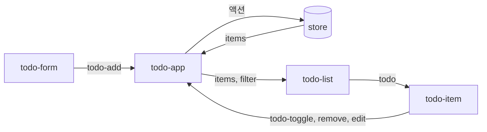

<Callout type="info">
  **이번 문서의 목표:** 세 가지 사례에서 컴포넌트를 나누는 기준, 상태를 어디에 두는지, 이벤트가 어떻게 흐르는지, 접근성과 입력 처리의 함정이 어디서 생기는지를 설명할 수 있습니다.
</Callout>

## 사례를 읽는 방법

세 사례는 81편의 `ReactiveElement`, 스토어, 82편의 서비스(`ctx`, `http`)를 쓰는 설계 사례입니다. 사례마다 같은 순서로 봅니다.

1. 컴포넌트 분해: 누가 무엇을 맡는가
2. 상태 소유와 데이터 흐름: 값은 어디에 있고 어느 방향으로 흐르는가
3. 핵심 코드: 설계 판단이 드러나는 부분만
4. 접근성과 입력 처리: 키보드, 포커스, 한글 입력(IME)

- 코드는 모두 축약본입니다. 스타일은 생략합니다.
- 컴포넌트는 Shadow DOM을 쓴다고 가정합니다. 입력 컨트롤 패턴은 78편, 구조와 오버레이는 79편, 데이터 목록은 80편에서 다뤘습니다.

## Vanilla Web Components Todo

프레임워크 없이 Todo 목록(추가, 완료 표시, 수정, 삭제, 필터, 남은 개수, 완료 항목 지우기)을 컴포넌트로 만드는 사례입니다.

### 컴포넌트 분해

| 컴포넌트 | 책임 | 상태 |
|----------|------|------|
| `todo-app` | 스토어 소유, 이벤트를 액션으로 변환, 필터 읽기 | 소유 |
| `todo-form` | 새 항목 입력 | 입력값만 |
| `todo-list` | 항목 목록을 `todo-item`으로 그림 | 없음(프로퍼티로 받음) |
| `todo-item` | 항목 하나의 표시와 수정 | 수정 중 여부만 |
| `todo-footer` | 남은 개수, 필터 링크, 완료 항목 지우기 | 없음 |

- 도메인을 아는 곳은 `todo-app`뿐입니다. 나머지는 값을 받고 이벤트를 올립니다(자세히는 33편의 층 구분).
- `todo-item`처럼 표시와 입력만 하는 컴포넌트는 스토어를 모릅니다. 그래서 단독으로 테스트하고 다른 목록에서 재사용합니다.

### 상태 소유와 데이터 흐름



- 값은 위에서 아래로 프로퍼티로, 변경 요청은 아래에서 위로 이벤트로 흐릅니다. 단방향입니다(자세히는 32편).
- 스토어는 이 기능만 쓰므로 앱 전역 `ctx.store`가 아니라 `todo-app`이 소유하는 기능 전용 스토어입니다. 같은 상태를 두 기능이 읽게 되면 그때 전역으로 올립니다.
- 필터는 URL의 해시(`#/active`)가 원본입니다. 새로고침하거나 링크를 공유해도 같은 필터가 유지됩니다. 해시만 바뀌는 이동은 81편의 라우터가 가로채지 않으므로 `todo-app`이 `hashchange`를 직접 듣습니다(자세히는 34편).
- 완료되지 않은 항목 수와 화면에 보일 목록은 저장하지 않고 `items`에서 매번 계산합니다. 저장하면 원본과 어긋납니다(자세히는 32편의 Derived Data).

### 스토어와 액션

```js
const patch = (s, id, p) => ({
  ...s,
  items: s.items.map((t) => {
    return t.id === id ? { ...t, ...p } : t
  }),
})
```

```js
const actions = {
  add: (s, text) => ({
    ...s,
    items: [...s.items, { id: newId(), text, done: false }],
  }),
  toggle: (s, id) => ({
    ...s,
    items: s.items.map((t) =>
      t.id === id ? { ...t, done: !t.done } : t),
  }),
  edit: (s, id, text) => patch(s, id, { text }),
  remove: (s, id) => ({
    ...s, items: s.items.filter((t) => t.id !== id),
  }),
}
```

- 모든 변경은 새 객체를 만듭니다. 바뀌지 않은 항목은 같은 참조를 유지하므로 `todo-item`은 자기 항목이 바뀐 경우에만 다시 그립니다.
- `id`는 `crypto.randomUUID()`로 만듭니다. 보안 컨텍스트(HTTPS 또는 localhost)에서만 있으므로 그 밖의 환경은 카운터로 대체합니다. `randomUUID()`는 Baseline 널리 지원(2022년 3월부터)입니다.
- 배열 인덱스를 `id`로 쓰면 삭제할 때 다른 항목의 `id`가 밀려 잘못된 항목이 지워집니다.

### 컨테이너: 연결

```js
class TodoApp extends ReactiveElement {
  static properties = {
    items: {},
    filter: { type: String, default: 'all' },
  }
  init() {
    this.store = createStore({ items: [] }, actions)
    persist(this.store, 'todo:v1')
  }
}
```

```js
connected() {
  const { act } = this.store
  this.bind(this.store, (s) => s.items, 'items')
  const on = (type, fn) => this.on(this.root, type, fn)
  on('todo-add', (e) => act.add(e.detail.text))
  on('todo-toggle', (e) => act.toggle(e.detail.id))
  on('todo-remove', (e) => act.remove(e.detail.id))
  on('todo-edit', (e) => {
    act.edit(e.detail.id, e.detail.text)
  })
  this.on(window, 'hashchange', () => this.#readHash())
  this.#readHash()
}
```

- 스토어는 처음 한 번만 만들어야 하므로 `init()`에, 구독과 리스너는 연결마다 필요하므로 `connected()`에 둡니다(자세히는 81편).
- 자식이 올린 이벤트는 `composed`라서 자식의 shadow를 넘어 `todo-app`의 shadow root에 닿습니다. root 한 곳에 리스너를 달면 항목이 몇 개든 리스너는 네 개입니다. 이벤트 위임입니다(자세히는 7편).
- 이벤트 이름은 `todo-toggle`처럼 의도를 나타냅니다. 자식은 무엇이 일어났는지만 알리고 어떻게 처리할지는 모릅니다.

### 목록 갱신

`todo-list`는 `items`와 `filter`를 받아 `li` 하나당 `todo-item` 하나를 만들고, 바뀐 것만 건드립니다. 항목을 `id`로 식별해 요소를 재사용합니다(자세히는 30편의 Keyed List Rendering).

```js
#sync(list) {
  const ul = this.$('ul')
  const keep = new Set(list.map((t) => t.id))
  for (const [id, li] of this.#rows) {
    if (keep.has(id)) continue
    li.remove()
    this.#rows.delete(id)
  }
  list.forEach((t, i) => {
    const li = this.#rows.get(t.id) ?? this.#create(t.id)
    li.firstElementChild.todo = t
    const at = ul.children[i] ?? null
    if (at !== li) ul.insertBefore(li, at)
  })
}
```

- 사라진 항목의 요소만 지우고, 있는 항목은 `todo` 프로퍼티만 갱신합니다. 수정 중인 항목의 입력 상태와 포커스가 다른 항목의 변경에 영향을 받지 않습니다.
- 위치가 이미 맞는 요소는 옮기지 않습니다. DOM에서 떼었다 붙이면 포커스를 잃기 때문입니다.
- 필터를 바꾸면 보일 목록이 달라져 요소가 지워지고 다시 만들어집니다. 수정 중에 필터를 바꾸는 일은 드물어서 허용합니다.

### 항목 컴포넌트

```js
class TodoItem extends ReactiveElement {
  static properties = {
    todo: {}, editing: { type: Boolean },
  }
  #fire(type, extra) {
    this.emit(type, { id: this.todo.id, ...extra })
  }
  init() {
    const on = (sel, type, fn) =>
      this.$(sel).addEventListener(type, fn)
    on('.check', 'change', () => this.#fire('todo-toggle'))
    on('.del', 'click', () => this.#fire('todo-remove'))
    on('.edit', 'click', () => { this.editing = true })
  }
}
```

- 항목의 모든 변경을 `#fire` 한 곳이 `id`와 함께 올립니다. 어느 항목인지는 이벤트가 들고 있어서 부모가 알 필요가 없습니다.
- 수정 입력에서 Enter는 저장, Escape는 취소, 포커스를 잃으면 저장입니다. 한글 조합 중의 Enter는 글자를 확정하는 키이므로 `e.isComposing`이면 저장하지 않습니다(자세히는 10편).
- 수정을 마치면 포커스를 수정 버튼으로 돌려줍니다. 입력이 사라지는 순간 포커스가 `body`로 떨어지는 것을 막습니다.

### 접근성과 포커스

- 체크박스는 네이티브 `input type="checkbox"`와 `label`을 씁니다. 역할과 키보드가 공짜입니다(자세히는 27편).
- 삭제 버튼은 아이콘이어도 `aria-label="삭제: 우유 사기"`처럼 대상을 포함한 이름을 줍니다. 목록에서 "삭제" 버튼이 여러 개 들리는 것을 막습니다.
- 항목을 지우면 포커스가 사라지므로 다음 항목, 없으면 이전 항목, 없으면 입력창으로 옮깁니다(자세히는 28편).
- 남은 개수는 `aria-live="polite"` 영역에 둡니다. 항목을 체크할 때마다 개수 변화가 스크린 리더에 전달됩니다.
- 해시 링크 필터에는 `aria-current="page"`를 붙입니다.

**흔한 실수:**

- 수정 모드를 `contenteditable`이나 더블클릭으로만 만드는 것입니다. 더블클릭은 키보드로 할 수 없어서 수정 버튼을 따로 둡니다.
- 항목마다 리스너를 달아서 항목이 늘수록 리스너와 정리 코드가 늘어나는 것입니다.

## 검색 + 자동완성 앱

입력창에 글자를 치면 서버가 추천 목록을 주고, 키보드나 마우스로 하나를 골라 이동하는 검색 상자 사례입니다. 만드는 쪽의 어려움은 요청이 아니라 상호작용에 있습니다. 비동기 응답의 순서, 키보드 조작, 포커스를 입력창에 둔 채 목록을 읽어 주는 접근성, 한글 조합입니다.

### 컴포넌트와 상태

| 대상 | 내용 |
|------|------|
| 컴포넌트 | `search-box` 하나. 입력창, 목록, 상태 안내를 같은 shadow 안에 둠 |
| 속성 | `value`(입력값), `items`(추천 목록), `open`, `active`(강조 인덱스), `status` |
| 서비스 | `ctx.http`(Fetch Client), 컨텍스트로 받음 |
| 출력 | `select` 이벤트(선택한 항목), 검색 제출은 폼의 기본 동작 |

- `status`는 `idle`, `loading`, `ready`, `empty`, `error` 중 하나입니다. 불리언을 나눠 두면 "로딩 중이면서 오류" 같은 불가능한 조합이 생깁니다(자세히는 39편).
- 입력창과 목록이 한 shadow 안에 있어야 합니다. `aria-controls`나 `aria-activedescendant`의 `id` 참조는 같은 트리 안에서만 동작하기 때문입니다(자세히는 21편, 27편).

### 접근성 구조

APG의 콤보박스 패턴은 입력창에 `combobox` 역할을 주고, 팝업은 `listbox`와 `option`으로 구성합니다. 포커스는 입력창에 둔 채 `aria-activedescendant`가 강조된 옵션을 가리킵니다.

```html
<input role="combobox" aria-autocomplete="list"
       aria-expanded="false" aria-controls="lb">
<ul id="lb" role="listbox" hidden></ul>
<div role="status" class="sr-only"></div>
```

| 속성 | 값과 갱신 |
|------|-----------|
| `aria-expanded` | 목록이 보이면 `true`, 숨기면 `false` |
| `aria-controls` | 목록의 `id` |
| `aria-autocomplete` | `list`: 목록에서 고르고 입력창은 자동으로 채우지 않음 |
| `aria-activedescendant` | 강조된 `option`의 `id`. 강조가 없으면 속성을 지움 |
| `aria-selected` | 강조된 `option`에 `true` |

- 상태 안내는 `role="status"`(암묵적 polite 라이브 영역)에 "결과 5개", "결과 없음" 같은 문장을 넣습니다. 목록이 열리는 것은 포커스가 안 움직여서 보조 기술이 알아채지 못하기 때문입니다.
- `aria-activedescendant`를 쓰면 포커스를 옮기지 않으므로 입력창에서 계속 글자를 칠 수 있습니다. 옵션을 `tabindex`로 포커스 가능하게 만들지 않습니다.

### 입력과 비동기 응답

```js
#changed() {
  const q = this.$('input').value.trim()
  this.value = q
  this.#run(q)               // 디바운스된 함수
}
```

```js
init() {
  const input = this.$('input')
  input.addEventListener('input', (e) => {
    if (!e.isComposing) this.#changed()
  })
  input.addEventListener('compositionend', () => {
    this.#changed()
  })
  input.addEventListener('keydown', (e) => this.#onKey(e))
  input.addEventListener('blur', () => (this.open = false))
}
```

- 한글은 조합 중에도 `input` 이벤트가 옵니다. 조합 중에는 무시하고 `compositionend`에서 한 번만 검색합니다. 두 이벤트의 순서는 브라우저마다 달라서 `isComposing` 검사와 `compositionend` 처리를 함께 둡니다(자세히는 10편).
- 검색은 디바운스합니다. 입력이 멈추고 약 250밀리초 뒤에 실행합니다(자세히는 39편).

```js
async #load(q) {
  this.#ac = new AbortController()
  const opt = { query: { q }, signal: this.#ac.signal }
  const items = await this.app.http.get('search', opt)
  this.#cache.set(q, items)
  return items
}
```

```js
async #search(q) {
  this.#ac?.abort()
  if (q.length < 2) return this.#set([], 'idle')
  const hit = this.#cache.get(q)
  if (hit) return this.#set(hit)
  this.status = 'loading'
  try {
    this.#set(await this.#load(q))
  } catch (e) {
    if (e.name !== 'AbortError') this.#set([], 'error')
  }
}
```

```js
#set(items, status = items.length ? 'ready' : 'empty') {
  this.items = items
  this.status = status
  this.active = -1
  this.open = status === 'ready'
}
```

- 새 검색을 시작하면 이전 요청을 먼저 취소합니다. 응답이 뒤바뀌어도 오래된 응답이 최신 목록을 덮을 수 없습니다. 취소로 거부된 요청은 오류가 아니므로 무시합니다(자세히는 37편, 39편).
- 두 글자 미만이면 요청하지 않고 목록을 비웁니다. 서버 부하와 의미 없는 추천을 함께 줄입니다.
- 같은 검색어의 결과는 `Map`에 둡니다. 지웠다가 다시 칠 때 요청이 나가지 않습니다. 크기에 상한을 두지 않으면 계속 자라므로 오래된 것부터 지웁니다(자세히는 67편).
- `this.app`은 연결 때 `consume(APP)`으로 받은 `ctx`입니다(자세히는 82편).

### 키보드와 마우스

```js
#onKey(e) {
  const move = (d) => this.#move(d)
  switch (e.key) {
    case 'ArrowDown': move(1); break
    case 'ArrowUp': move(-1); break
    case 'Enter':
      if (this.active < 0) return   // 기본 제출 허용
      this.#pick(this.active); break
    case 'Escape': this.open = false; break
    default: return
  }
  e.preventDefault()
}
```

| 키 | 동작 |
|----|------|
| 아래 화살표 | 목록이 닫혀 있으면 열고, 열려 있으면 다음 항목 강조. 끝에서 처음으로 |
| 위 화살표 | 이전 항목 강조 |
| Enter | 강조된 항목이 있으면 선택, 없으면 폼 제출 |
| Escape | 목록 닫기 |
| Home, End | 입력창의 캐럿 이동(가로채지 않음) |

- 화살표 키는 `preventDefault()`로 막아야 입력창의 캐럿이 처음이나 끝으로 튀지 않습니다.
- 마우스로 옵션을 누르면 입력창이 포커스를 잃어 `blur`가 목록을 닫고 `click`이 사라집니다. 목록에서 `pointerdown`의 기본 동작을 막아 포커스가 입력창에 남게 합니다(자세히는 9편).

```js
ul.addEventListener('pointerdown', (e) => {
  e.preventDefault()   // 입력창 포커스 유지
})
ul.addEventListener('click', (e) => {
  const li = e.target.closest('[role=option]')
  if (li) this.#pick(Number(li.dataset.i))
})
```

- 클릭도 위임으로 목록 하나에서 받습니다. 옵션이 바뀌어도 리스너는 그대로입니다.

### 목록 그리기와 강조

```js
function highlight(text, q) {
  const i = text.toLowerCase().indexOf(q.toLowerCase())
  if (i < 0) return [text]
  const mark = document.createElement('mark')
  mark.textContent = text.slice(i, i + q.length)
  return [text.slice(0, i), mark, text.slice(i + q.length)]
}
```

- 일치한 부분은 `mark` 요소를 `createElement`로 만들어 감쌉니다. 서버가 준 문자열을 `innerHTML`에 넣지 않습니다. 추천 문자열에 마크업이 들어 있어도 글자로만 보입니다(자세히는 5편, 63편).
- `li`마다 `id`(`o0`, `o1`)와 `data-i`를 붙이고, 강조가 바뀌면 `aria-selected`와 입력창의 `aria-activedescendant`를 함께 갱신합니다. 강조된 항목이 보이도록 `scrollIntoView({ block: 'nearest' })`를 부릅니다.
- 선택하면 `select` 이벤트를 올리고 목록을 닫습니다. 이동은 검색 상자가 하지 않고 듣는 쪽이 라우터로 처리합니다(자세히는 35편).
- 컴포넌트가 떼이면 디바운스 타이머와 진행 중인 요청을 정리합니다(`disconnected()`에서 `abort()`와 타이머 해제).

**흔한 실수:**

- 디바운스만 믿고 취소를 넣지 않는 것입니다. 디바운스는 요청 수를 줄일 뿐 응답 순서를 보장하지 않습니다.
- 목록을 `tabindex`로 포커스 가능하게 만들어 화살표를 누를 때마다 입력창이 포커스를 잃는 것입니다.
- 결과가 없을 때 목록을 그냥 닫아서 사용자가 무엇이 일어났는지 모르는 것입니다. "결과 없음"을 상태 영역에 알립니다.

## Custom Form Controls 세트

스위치, 별점, 태그 입력처럼 네이티브에 없는 컨트롤을 폼의 일부로 쓰게 하는 사례입니다. 폼 제출, 검증, 초기화, 비활성, 값 복원, 레이블 연결이 네이티브 컨트롤처럼 동작해야 합니다. 이 공통 부분을 기반 클래스 하나에 모으고 컨트롤은 서로 다른 부분만 구현합니다(자세히는 26편).

### 기반 클래스의 책임

| 책임 | 수단 |
|------|------|
| 폼 참여 | `static formAssociated = true`, `attachInternals()` |
| 제출 값 | `internals.setFormValue(value, state)` |
| 검증 | `internals.setValidity(flags, message, anchor)` |
| 초기화·비활성·복원 | `formResetCallback`, `formDisabledCallback`, `formStateRestoreCallback` |
| 역할과 상태 | `internals.role`, `internals.aria*`, `internals.states`(CustomStateSet) |
| 키보드·포커스 | `tabindex`, 키 처리 |

```js
class FormControl extends ReactiveElement {
  static formAssociated = true
  static properties = {
    name: { type: String, reflect: true },
    required: { type: Boolean, reflect: true },
  }
  internals = this.attachInternals()
  #off = false

  formDisabledCallback(disabled) {
    this.#off = disabled
    this.tabIndex = disabled ? -1 : 0
    this.internals.ariaDisabled = String(disabled)
  }
}
```

- `formDisabledCallback`은 요소의 `disabled` 속성뿐 아니라 조상 `fieldset`의 비활성에도 호출됩니다. 속성만 지켜보면 `fieldset` 비활성을 놓칩니다.
- 비활성일 때 포커스와 조작을 막는 일은 브라우저가 해 주지 않습니다. 컨트롤이 `#off`를 확인해 입력을 무시합니다.
- 기반 클래스의 `commit()`이 값과 검증을 항상 함께 갱신합니다.

```js
commit(value, state) {
  this.internals.setFormValue(value, state)
  const bad = this.problem(value)   // 오류 정보 또는 null
  this.internals.setValidity(
    bad ? bad.flags : {}, bad?.message, this.anchor,
  )
}
```

- 값이 바뀌는 모든 경로가 `commit()` 한 곳을 지납니다. 화면과 제출 값, 검증 상태가 어긋나지 않습니다.
- `setValidity`는 플래그가 있으면 메시지가 비어 있지 않아야 합니다. 유효하면 빈 객체를 줍니다(자세히는 12편, 26편).
- `anchor`는 오류 안내와 포커스가 향할 내부 요소입니다.
- 현재 값을 속성에 반영하지 않습니다(`checked`에는 `reflect`를 켜지 않습니다). 속성은 기본값, 프로퍼티는 현재 값으로 나눠야 `formResetCallback`이 기본값으로 되돌릴 수 있습니다. 상태 표시는 속성이 아니라 `:state()`로 합니다.

### 스위치

체크박스와 같은 값 규칙(켜지면 `value` 속성 또는 `on`, 꺼지면 제출 없음)에 `switch` 역할을 줍니다.

```js
class XSwitch extends FormControl {
  static properties = {
    ...FormControl.properties,
    checked: { type: Boolean },
  }
  connected() {
    this.internals.role = 'switch'
    this.tabIndex = 0
    this.on(this, 'click', () => this.toggle())
    this.on(this, 'keydown', (e) => this.#key(e))
  }
  // #key는 아래
}
```

```js
#key(e) {
  if (e.key !== ' ') return
  e.preventDefault()    // 스크롤 방지
  this.toggle()
}
```

```js
render() {
  const on = this.checked
  this.internals.ariaChecked = String(on)
  this.internals.states[on ? 'add' : 'delete']('checked')
  const val = this.getAttribute('value') ?? 'on'
  this.commit(on ? val : null)
}
formResetCallback() {
  this.checked = this.hasAttribute('checked')
}
```

- APG의 스위치는 Space로 토글하고 Enter는 선택입니다. 기본 동작(스크롤)을 막으려고 `preventDefault()`를 부릅니다.
- 접근 가능한 이름은 `label`이 줍니다. 폼 연결 커스텀 요소는 레이블 가능 요소라서 연결된 `label`의 텍스트가 이름이 되고, 상태가 바뀌어도 이름은 바뀌지 않아야 합니다(자세히는 27편).
- 켜짐 스타일은 `x-switch:state(checked)`로 씁니다. `CustomStateSet`은 Baseline 2024이고, `ElementInternals`는 Baseline 널리 지원(2023년 3월부터)입니다.
- `checked` 속성은 기본값이고 프로퍼티가 현재 값입니다. 사용자가 한 번 바꾼 뒤에는 속성 변경이 현재 값을 덮지 않도록 `#dirty` 플래그를 둡니다(자세히는 26편).

### 별점

```js
render() {
  const v = this.value ?? 0
  const i = this.internals
  i.role = 'slider'
  i.ariaValueMin = '0'
  i.ariaValueMax = '5'
  i.ariaValueNow = String(v)
  i.ariaValueText = `5점 중 ${v}점`
  this.commit(v ? String(v) : null)
}
```

- 별점은 `slider` 역할로 모델링합니다. 화살표 오른쪽·위는 증가, 왼쪽·아래는 감소, Home과 End는 최소와 최대입니다. 이 키 처리는 직접 구현합니다.
- 별 모양은 장식이므로 `aria-hidden`을 달고, 값은 `aria-valuenow`와 `aria-valuetext`가 전달합니다. 숫자만 읽히지 않도록 "5점 중 3점"처럼 `valuetext`를 줍니다.
- `required`이고 0점이면 `valueMissing`으로 검증이 실패합니다. 앵커는 컨트롤 자신입니다.
- 마우스는 별마다 `data-v`를 두고 위임으로 받아 값을 정합니다. 포인터 이동에 따른 미리보기 강조는 CSS `:hover`로 처리합니다.

### 태그 입력

값이 여러 개인 컨트롤입니다. 입력은 내부 네이티브 `input`에 맡기고, 폼 참여는 호스트가 맡습니다.

```js
render() {
  const fd = new FormData()
  for (const t of this.tags) fd.append(this.name, t)
  this.internals.setFormValue(fd, fd)
  const bad = this.required && !this.tags.length
  this.internals.setValidity(
    bad ? { valueMissing: true } : {},
    bad ? '태그를 하나 이상 입력하세요.' : '',
    this.$('input'),
  )
}
```

- 값을 `FormData`로 주면 그 안의 이름·값 쌍이 모두 제출됩니다. 이때 요소의 `name`은 쓰이지 않으므로 항목마다 `this.name`을 이름으로 직접 넣습니다. `state`에도 같은 `FormData`를 주면 `formStateRestoreCallback`에서 `getAll(this.name)`으로 복원합니다.
- 내부 `input`을 쓰면 한글 조합, 선택, 자동 완성을 네이티브가 처리합니다. 호스트는 `delegatesFocus`로 포커스를 내부 `input`에 넘깁니다(자세히는 28편).
- Enter와 쉼표는 태그를 추가하고, 입력이 비었을 때 Backspace는 마지막 태그를 지웁니다. 한글 조합 중에는 Enter를 가로채지 않습니다(`isComposing`).
- 태그 삭제 버튼에는 `aria-label="삭제: javascript"`처럼 대상 이름을 넣습니다. 추가와 삭제는 라이브 영역으로 알립니다.
- 검증 앵커를 내부 `input`으로 지정해 오류 안내가 입력창을 향하게 합니다.

### 세트의 공통 규칙

| 항목 | 규칙 |
|------|------|
| 값 | 제출 값은 문자열, `File`, `FormData`, `null` 중 하나. 값 없음은 `null` |
| 기본값 | 속성이 기본값, 프로퍼티가 현재 값. 초기화는 기본값으로 복귀 |
| 상태 표시 | `internals.states`와 `:state()`. 속성 반영 금지 |
| 접근성 | 역할은 `internals.role`, 값·상태는 `internals.aria*`, 이름은 `label` |
| 이벤트 | 값이 바뀌면 `input`과 `change`를 네이티브처럼 발생 |
| 검증 | `commit()`에서 값과 함께 갱신 |

- 컨트롤의 값이 바뀔 때 `input`과 `change` 이벤트를 직접 발생시킵니다. 이벤트를 듣는 폼 코드와 82편의 Form Controller가 네이티브 컨트롤과 같은 방식으로 동작합니다.
- 폼 연결 커스텀 요소의 값은 `FormData`와 `form.elements`, `form.checkValidity()`에 모두 나타납니다. 내부 `input`만 감싼 래퍼는 나타나지 않습니다(자세히는 26편).

**흔한 실수:**

- 값을 바꾸고 `setFormValue`를 부르지 않아 화면과 제출 값이 다른 것입니다.
- 현재 상태를 속성에 반영해서 폼 초기화가 기본값으로 못 돌아가는 것입니다.
- 역할만 주고 키보드를 구현하지 않아 마우스 없이는 쓸 수 없는 것입니다.

## 핵심 정리

- Todo: 변경 요청은 이벤트로 올리고 `todo-app`이 액션으로 바꾸며, 값은 프로퍼티로 내려가는 단방향 흐름입니다. 기능 전용 스토어는 그 기능이 소유하고, 필터는 URL 해시가 원본이며, 목록은 `id`로 요소를 재사용합니다.
- 자동완성: 입력창에 포커스를 둔 채 `aria-activedescendant`로 강조를 알리고, 입력창과 목록은 한 shadow 안에 둡니다. 디바운스로 요청을 줄이고 이전 요청 취소로 응답 순서 문제를 막습니다.
- 한글 입력은 `isComposing`과 `compositionend`를 함께 다루고, 추천 문자열은 `innerHTML`이 아니라 `createElement`와 텍스트로 그립니다.
- 폼 컨트롤 세트: 기반 클래스가 `formAssociated`, `setFormValue`, `setValidity`, 초기화·비활성·복원 콜백을 맡고, 값이 바뀌는 모든 경로가 `commit()` 한 곳을 지납니다.
- 속성은 기본값, 프로퍼티는 현재 값으로 나누고, 상태 표시는 `:state()`로 하며, 역할에 맞는 키보드 조작을 직접 구현합니다.

## 마무리 복습

<Quiz
  questionNumber={1}
  question="자동완성 입력창에서 화살표 키로 목록의 항목을 강조하는 동안 포커스는 어디에 있어야 하나요?"
  options={['강조된 option 요소로 옮겨 간다', '입력창에 그대로 있고 aria-activedescendant가 강조된 option을 가리킨다', 'listbox 요소로 옮겨 간다', '포커스는 body로 이동한다']}
  correctAnswer={2}
  explanation="APG 콤보박스 패턴은 DOM 포커스를 입력창에 유지한 채 aria-activedescendant로 보조 기술의 포커스를 목록 항목에 둡니다. 그래야 사용자가 목록을 탐색하면서도 계속 글자를 입력할 수 있습니다."
  optionExplanations={['포커스를 옮기면 입력창에서 계속 글자를 칠 수 없습니다.', '정답입니다. 포커스는 입력창에 있고 aria-activedescendant가 강조 항목을 가리킵니다.', 'listbox로 포커스를 옮기면 입력이 끊깁니다.', '포커스가 body로 떨어지면 키보드 조작이 불가능해집니다.']}
/>

<Quiz
  questionNumber={2}
  question="검색 컴포넌트가 입력을 디바운스하더라도 이전 요청을 취소해야 하는 이유로 가장 알맞은 것은?"
  options={['디바운스는 요청을 아예 보내지 않게 하므로', '디바운스는 요청 수만 줄일 뿐 요청들의 응답 순서를 보장하지 않으므로', '취소하지 않으면 fetch가 실행되지 않으므로', '취소해야 서버가 요청을 캐시하므로']}
  correctAnswer={2}
  explanation="디바운스는 입력이 멈춘 뒤에만 실행해 요청 횟수를 줄입니다. 그래도 연달아 나간 두 요청의 응답은 순서가 뒤바뀔 수 있습니다. 새 검색 때 이전 요청을 abort하면 오래된 응답이 최신 목록을 덮지 못합니다."
  optionExplanations={['디바운스는 지연 후 요청을 보내며 요청 자체를 없애지 않습니다.', '정답입니다. 응답 순서 뒤바뀜은 취소나 최신 판별로 막습니다.', '취소 여부와 fetch 실행은 무관합니다.', '취소는 서버 캐시와 관계가 없습니다.']}
/>

<Quiz
  questionNumber={3}
  question="폼 연결 커스텀 요소(스위치)의 checked 프로퍼티 변화를 checked 속성에 계속 반영하면 생기는 문제는?"
  options={['setFormValue가 호출되지 않는다', 'form.reset()으로 기본값(마크업의 checked)으로 되돌릴 기준이 사라진다', 'ElementInternals를 만들 수 없다', ':state() 선택자가 동작하지 않는다']}
  correctAnswer={2}
  explanation="속성은 기본값, 프로퍼티는 현재 값으로 나눠야 합니다. 현재 값을 속성에 계속 덮어쓰면 기본값 정보가 사라져 formResetCallback이 원래 상태로 되돌릴 수 없습니다. 상태 표시는 속성 대신 CustomStateSet과 :state()로 합니다."
  optionExplanations={['setFormValue 호출은 속성 반영과 무관합니다.', '정답입니다. 기본값이 현재 값으로 덮여 초기화 기준이 사라집니다.', 'ElementInternals 생성과 무관합니다.', ':state()는 CustomStateSet에 의존하며 속성과 무관합니다.']}
/>

## 참고 자료

- [W3C WAI-ARIA APG — Combobox Pattern](https://www.w3.org/WAI/ARIA/apg/patterns/combobox/)
- [W3C WAI-ARIA APG — Switch Pattern](https://www.w3.org/WAI/ARIA/apg/patterns/switch/)
- [W3C WAI-ARIA APG — Slider Pattern](https://www.w3.org/WAI/ARIA/apg/patterns/slider/)
- [MDN — ElementInternals](https://developer.mozilla.org/en-US/docs/Web/API/ElementInternals)
- [MDN — CustomStateSet](https://developer.mozilla.org/en-US/docs/Web/API/CustomStateSet)
- [MDN — Crypto: randomUUID()](https://developer.mozilla.org/en-US/docs/Web/API/Crypto/randomUUID)
- [MDN — FormData() constructor](https://developer.mozilla.org/en-US/docs/Web/API/FormData/FormData)
- [MDN — NavigateEvent](https://developer.mozilla.org/en-US/docs/Web/API/NavigateEvent)
