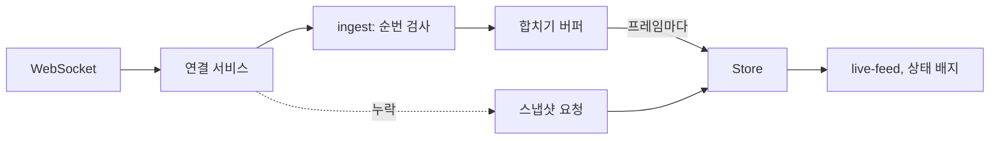

<Callout type="info">
  **이번 문서의 목표:** 위젯 단위의 데이터 로딩과 갱신 정책, URL과 스토어의 역할 분담, 실시간 메시지의 순서·합치기·접근성 처리를 설명하고, 각 설계 선택의 이유를 말할 수 있습니다.
</Callout>

## 사례를 읽는 방법

세 사례는 81편의 `ReactiveElement`·라우터·스토어, 82편의 서비스(`ctx`, `http`, `tasks`)와 부트스트랩 위에서 읽습니다. 실시간 연결의 프로토콜 수준 내용(재연결 백오프, 하트비트, 순번)은 58편에서 다뤘으므로 여기서는 UI 쪽 설계에 집중합니다.

- 코드는 모두 설계를 읽기 위한 축약본입니다. 스타일과 오류 처리는 줄였습니다.
- 사례마다 분해, 데이터 흐름, 핵심 코드, 접근성·성능 판단 순서로 봅니다.

## Dashboard 컴포넌트 시스템

여러 위젯(요약 타일, 차트, 표)을 격자에 배치하고, 위젯마다 데이터를 가져와 주기적으로 갱신하는 화면입니다. 어려움은 위젯이 많아질 때 생깁니다. 한 위젯의 실패가 전체를 막으면 안 되고, 안 보이는 위젯이 요청을 낭비하면 안 되며, 공통 필터가 모든 위젯에 일관되게 적용되어야 합니다.

### 컴포넌트 분해

| 컴포넌트 | 책임 |
|----------|------|
| `dash-grid` | 위젯 설정 목록을 받아 격자에 배치 |
| `dash-widget` | 위젯 틀: 제목, 동작 영역, 상태(로딩·오류·갱신 시각) 표시 |
| `stat-tile` | 숫자 하나와 증감 표시 |
| `line-chart` | SVG 선 그래프 |
| `data-table` | 정렬 가능한 표 |
| `filter-bar` | 기간 같은 공통 필터 입력 |

- 틀(`dash-widget`)과 내용(`stat-tile` 등)을 나눕니다. 로딩·오류 표시와 새로고침 버튼은 틀이 한 번만 구현하고, 내용 컴포넌트는 데이터를 받아 그리기만 합니다(자세히는 29편의 Wrapper와 Container/Presentational).
- 위젯 종류는 레지스트리(`type` 이름에서 태그 이름으로의 대응)에 등록하고, 격자는 설정 목록을 보고 `document.createElement(tag)`로 만듭니다. 위젯을 추가해도 격자 코드는 바뀌지 않습니다(자세히는 29편의 Component Registry).

```js
const widgets = [
  { id: 'rev', type: 'stat-tile', refresh: 30,
    src: 'metrics/revenue' },
  { id: 'trend', type: 'line-chart', span: 2,
    src: 'metrics/trend' },
  { id: 'top', type: 'data-table', src: 'metrics/top' },
]
```

### 위젯 계약

모든 위젯이 지키는 공통 인터페이스입니다.

| 항목 | 종류 | 뜻 |
|------|------|----|
| `src` | 속성 | 데이터를 가져올 경로 |
| `refresh` | 속성 | 갱신 주기(초). 0이면 한 번만 |
| `status` | 프로퍼티 | `idle`, `loading`, `ready`, `error` 중 하나 |
| `data` | 프로퍼티 | 마지막으로 받은 데이터 |
| `load()` | 메서드 | 지금 다시 불러옴 |
| `widget-error` | 이벤트 | 불러오기 실패를 알림 |

- 이 계약을 기반 클래스(`WidgetElement`)가 구현하고 위젯은 `render()`만 씁니다. 새 위젯이 로딩·취소·갱신 로직을 복사하지 않습니다.

### 위젯 기반 클래스: 불러오기

```js
class WidgetElement extends ReactiveElement {
  static properties = {
    src: { type: String },
    refresh: { type: Number, default: 0 },
    status: { type: String, default: 'idle' },
    data: {},
  }
  #ac = null
  #timer = 0
}
```

```js
async load() {
  this.#ac?.abort()
  this.#ac = new AbortController()
  this.status = 'loading'
  const opt = { signal: this.#ac.signal, query: this.query }
  try {
    this.data = await this.app.http.get(this.src, opt)
    this.status = 'ready'
  } catch (e) {
    if (e.name === 'AbortError') return
    this.status = 'error'
    this.emit('widget-error', { id: this.id, error: e })
  }
}
```

- 다시 불러올 때 이전 요청을 취소합니다. 필터가 연달아 바뀌어도 오래된 응답이 최신 데이터를 덮지 못합니다(자세히는 39편).
- 위젯마다 자기 `status`를 가집니다. 한 위젯이 `error`여도 나머지는 그대로 동작합니다. 전체 화면 오류를 한 곳에서 만들지 않고 위젯 단위 오류 경계로 만드는 선택입니다.
- 새로고침 중에는 `status`가 `loading`이어도 이전 `data`를 지우지 않습니다. 화면이 깜빡이며 비는 것을 막습니다.
- 마지막 성공 시각을 저장해 틀이 "12:03 기준"으로 표시합니다. 오류 상태에서도 오래된 데이터와 갱신 실패를 함께 보여 줍니다.

### 가시성에 따른 갱신 정책

화면 밖이거나 탭이 숨겨진 위젯이 계속 요청하면 낭비입니다. 갱신은 "보일 때만" 예약합니다.

```js
#schedule() {
  clearTimeout(this.#timer)
  if (!this.refresh || !this.#seen) return
  if (document.hidden) return
  this.#timer = setTimeout(async () => {
    await this.load()
    this.#schedule()
  }, this.refresh * 1000)
}
```

```js
connected() {
  this.#io = new IntersectionObserver(([en]) => {
    this.#seen = en.isIntersecting
    if (this.#seen && this.status === 'idle') this.load()
    this.#schedule()
  })
  this.#io.observe(this)
  this.on(document, 'visibilitychange', () => this.#onVis())
}
```

- `setInterval` 대신 한 번 실행하고 끝난 뒤 다음을 예약하는 `setTimeout`을 씁니다. 요청이 주기보다 오래 걸려도 요청이 겹쳐 쌓이지 않습니다(자세히는 08편).
- `IntersectionObserver`로 화면 안에 들어온 위젯만 처음 불러옵니다. 스크롤 아래의 위젯은 요청하지 않습니다(자세히는 43편).
- `visibilitychange`로 탭이 숨겨지면 예약을 멈추고, 다시 보이면 마지막 갱신이 주기보다 오래됐을 때 바로 불러온 뒤 예약을 이어 갑니다. 숨겨진 탭은 타이머가 느려지고 요청도 의미가 없습니다.
- 연결이 끊길 때 observer와 타이머를 정리합니다(`disconnected()`에서 `disconnect()`와 `clearTimeout`). 정리하지 않으면 떼어진 위젯이 계속 요청합니다(자세히는 67편).
- 실패가 이어질 때는 주기를 늘립니다. 서버가 어려울 때 모든 위젯이 같은 주기로 두드리지 않게 합니다(자세히는 37편).

### 공통 필터

기간 같은 필터는 위젯 하나의 상태가 아니라 여러 위젯이 읽는 상태이므로 스토어에 둡니다. 위젯은 필요한 조각만 구독합니다.

```js
// 위젯 기반 클래스의 connected() 안
const { store } = this.app
this.bind(store, (s) => s.filters.range, 'range')
```

- 구독으로 `range` 프로퍼티가 바뀌면 `updated()`에서 `load()`를 부릅니다. 위젯이 필터 입력 컴포넌트를 모르고, 필터 입력은 `store.act.setRange()`만 부릅니다.
- 위젯마다 `query`는 `range`를 요청 쿼리로 바꾼 값입니다. 필터는 URL 쿼리에도 반영하면 공유와 새로고침에 강해집니다(다음 사례).
- 필터가 바뀌는 순간 모든 위젯이 요청을 보냅니다. 같은 `src`와 쿼리를 쓰는 위젯이 여럿이면 리포지토리 계층이 진행 중인 요청을 공유해 한 번만 보냅니다(자세히는 37편의 중복 요청 방지).

### 차트: SVG와 접근성

차트는 데이터에서 좌표를 계산해 SVG로 그립니다. 요소 수가 수백 개를 넘으면 Canvas를 고려하지만, 선 그래프는 점 수를 줄여 SVG로 충분합니다(자세히는 52편, 53편).

```js
function linePath(pts, w, h) {
  const [x0, xr] = range(pts.map((p) => p.x))
  const [y0, yr] = range(pts.map((p) => p.y))
  return pts.map((p, i) => {
    const x = ((p.x - x0) / xr) * w
    const y = h - ((p.y - y0) / yr) * h
    return `${i ? 'L' : 'M'}${x} ${y}`
  }).join('')
}
```

- `range(values)`는 최솟값과 최대−최소 폭(0이면 1)을 돌려주는 작은 함수입니다. 좌표는 `viewBox`에 맞춘 값이라서 크기가 바뀌어도 SVG가 늘어납니다. 눈금과 글자를 다시 배치해야 하는 크기 변화에는 `ResizeObserver`로 폭을 읽어 다시 계산합니다(자세히는 43편).
- 점이 화면 픽셀 수보다 많으면 구간별 대표값으로 줄입니다. 그리지 못할 점을 만드는 데 시간을 쓰지 않습니다.
- 차트 SVG는 `role="img"`와 `aria-label`로 요약("최근 30일 매출, 최저 12, 최고 48")을 줍니다. 값을 자세히 보려는 사용자를 위해 같은 데이터를 표로 제공합니다. 색만으로 구분하지 않고 선 모양이나 직접 라벨을 함께 씁니다(자세히는 27편).
- 숫자 서식은 `Intl.NumberFormat`과 `Intl.DateTimeFormat`에 맡깁니다. 로케일에 맞는 천 단위 구분과 날짜가 자동으로 맞춰집니다.

### 반응형과 테마

- 위젯 크기는 뷰포트가 아니라 격자 칸에 따라 달라집니다. 위젯 틀에 컨테이너 쿼리(`container-type: inline-size`)를 걸면 칸이 좁을 때 범례를 숨기는 식으로 위젯 스스로 적응합니다(자세히는 24편).
- 격자는 `grid-template-columns: repeat(auto-fit, minmax(16rem, 1fr))`처럼 칸 수를 CSS가 정합니다. 위젯의 `span`은 `grid-column: span 2`에 대응합니다.
- 색과 간격은 CSS 사용자 정의 속성(`--chart-1`, `--dash-gap`)으로 열어 두어 다크 모드와 테마가 shadow 경계를 넘어 들어옵니다(자세히는 23편, 74편).
- 갱신 때 값이 바뀌는 애니메이션은 `prefers-reduced-motion`을 따릅니다.

**흔한 실수:**

- 위젯마다 `setInterval`을 쓰고 정리하지 않아 위젯이 사라져도 요청이 계속 나가는 것입니다.
- 필터 값을 위젯마다 복사해 두어 위젯별로 다른 기간을 보여 주는 것입니다. 원본은 스토어 한 곳입니다.
- 한 위젯의 오류를 던져서 대시보드 전체가 빈 화면이 되는 것입니다.

## SPA Router + Store 앱

주문 목록, 주문 상세, 설정 화면이 있는 앱입니다. 81편의 라우터와 스토어가 어떻게 맞물리는지, URL이 맡을 상태와 스토어가 맡을 상태를 어떻게 나누는지가 설계의 핵심입니다.

### 상태의 소유 구분

| 상태 | 소유 | 이유 |
|------|------|------|
| 현재 화면, 상세 대상 id | URL 경로 | 링크 공유, 새로고침, 뒤로 가기 |
| 목록의 필터·정렬·페이지 | URL 쿼리 | 위와 같음 |
| 서버에서 온 엔티티 | 스토어(`entities`) | 여러 화면이 공유, 캐시 |
| 로그인 사용자 | 스토어(`session`) | 앱 전체가 읽음 |
| 열린 사이드바, 입력 중인 값 | 컴포넌트 내부 | 한 화면에 한정, 공유할 이유 없음 |

- 기준은 "주소만으로 같은 화면을 복원할 수 있어야 하는가"입니다. 그렇다면 URL, 아니면 스토어나 컴포넌트입니다. URL에 있는 상태를 스토어에 복사하면 원본이 둘이 되어 어긋납니다(자세히는 32편의 Source of Truth, 34편).
- 라우터와 스토어는 서로를 모릅니다. 페이지가 라우트 컨텍스트(경로 값, 쿼리)를 읽고, 데이터가 필요하면 스토어와 서비스를 부릅니다.

### 같은 라우트 안의 변경

81편의 라우터는 이동마다 페이지를 새로 만듭니다. 필터를 바꾸려고 쿼리만 바뀌는 이동에서도 페이지가 새로 만들어지면 스크롤, 입력 포커스, 이미 그린 목록이 날아갑니다. 같은 라우트면 페이지는 두고 컨텍스트만 갱신하도록 라우터를 확장합니다.

```js
async #show(url, signal) {
  const hit = this.match(url)
  const cur = this.#outlet.firstElementChild
  if (cur?.localName === hit.route.tag) {
    cur.routeContext = hit    // 같은 페이지: 컨텍스트만 갱신
    document.title = hit.route.title
    return
  }
  // 이하 81편의 렌더 과정
}
```

- `routeContext`는 반응형 프로퍼티이므로 페이지가 쿼리 변화를 `updated()`에서 감지해 목록을 다시 불러옵니다. 경로 값이 `/orders/1`에서 `/orders/2`로 바뀌는 경우도 같은 방식입니다.
- 필터를 바꿀 때는 `navigation.navigate(url, { history: 'replace' })`로 기록을 쌓지 않을 수도 있고, 다른 의미의 이동이면 `push`합니다. 검색어를 한 글자씩 칠 때마다 `push`하면 뒤로 가기가 쓸모없어집니다.
- 쿼리 문자열은 키를 정렬해 직렬화하면 같은 필터가 같은 캐시 키가 됩니다(`new URLSearchParams(...)`로 정렬한 `toString()`).

### 준비 대기와 스크롤

`navigate` 핸들러가 `e.scroll()`을 부르는 시점에 목록이 비어 있으면 복원할 위치가 없습니다. 페이지가 `ready` 약속을 노출하고 라우터가 짧게 기다립니다.

```js
const page = document.createElement(tag)
page.routeContext = hit
await this.#swap(() => this.#outlet.replaceChildren(page))
await Promise.race([page.ready, delay(500)])
```

- `page.ready`는 첫 데이터를 그린 뒤 이행됩니다. 없으면(`undefined`) `Promise.race`가 바로 끝납니다. 500밀리초를 넘기면 기다리지 않고 진행합니다. 느린 서버가 이동을 붙잡지 않게 합니다.
- 기다린 뒤 `e.scroll()`을 부르면 뒤로 가기에서 이전 스크롤 위치가, 새 이동에서는 맨 위 또는 프래그먼트 위치가 적용됩니다(자세히는 35편).
- 이동 직후 포커스는 본문(`main`)으로 옮깁니다. 이는 81편의 `#mount`가 이미 합니다.

### 화면 전환 애니메이션

```js
#swap(update) {
  const q = '(prefers-reduced-motion: reduce)'
  const calm = matchMedia(q)
  const vt = document.startViewTransition?.bind(document)
  if (!vt || calm.matches) return update()
  return vt(update).updateCallbackDone
}
```

- 같은 문서 안의 View Transition은 Baseline 2025입니다. `document.startViewTransition(콜백)`이 현재 화면을 찍어 두고 콜백으로 DOM을 바꾼 뒤 전환합니다. 지원하지 않거나 움직임을 줄이도록 설정한 사용자에게는 애니메이션 없이 바로 바꿉니다(자세히는 47편).
- 전환 중에 다시 호출하면 앞의 전환은 중단됩니다. 빠르게 연타하는 이동에서도 화면이 일관되게 마지막 이동으로 정리됩니다.

### 엔티티 스토어 구조

```js
const initial = {
  session: null,
  orders: { byId: {}, lists: {} },
  ui: {},
}
// lists[key] = { ids: [1, 2], status: 'ready', at: 시각 }
```

- 서버가 준 객체는 `byId`에 한 번만 저장하고, 목록은 `id` 배열만 가집니다. 같은 주문이 목록과 상세에 따로 있어 어긋나는 일이 없고, 상세에서 고친 값이 목록에도 반영됩니다(자세히는 32편의 상태 정규화).
- `lists`의 키는 정렬한 쿼리 문자열입니다. 필터별로 목록이 따로 캐시되어 뒤로 가기 때 즉시 보여 줍니다.
- 갱신 시각 `at`으로 캐시가 낡았는지 판단합니다. 낡았으면 보여 주면서 다시 불러옵니다.

### 목록과 상세: 보여 주면서 갱신

```js
async #load(id) {
  const cached = this.app.store.get().orders.byId[id]
  if (cached) this.order = cached           // 즉시 표시
  const { signal } = this.#ac = new AbortController()
  const { http, store } = this.app
  const fresh = await http.get(`orders/${id}`, { signal })
  store.act.upsert('orders', [fresh])
}
```

- 캐시가 있으면 즉시 그리고, 뒤에서 최신 값을 받아 교체합니다(stale-while-revalidate, 자세히는 37편). 스토어 구독이 `order` 프로퍼티를 갱신해서 화면이 바뀝니다.
- 상세 화면을 떠나면 진행 중인 요청을 취소합니다. `routeContext`가 바뀌어 `/orders/2`로 가면 이전 요청의 응답이 새 화면을 덮지 않게 먼저 `abort()`합니다.

### 낙관적 수정

```js
async rename(id, name) {
  const { store, http } = this.app
  const prev = store.get().orders.byId[id]
  store.act.patch('orders', id, { name })   // 먼저 반영
  try {
    await http.put(`orders/${id}`, { name })
  } catch (e) {
    store.act.patch('orders', id, prev)     // 실패하면 되돌림
    throw e
  }
}
```

- 서버 응답을 기다리지 않고 화면을 먼저 바꿉니다. 실패하면 이전 값으로 복구하고 오류를 위로 던져 82편의 작업 실행기가 사용자에게 알립니다(자세히는 39편).
- 이전 값을 통째로 들고 있으므로 중간에 다른 변경이 끼는 경우에는 복구가 부정확해집니다. 같은 항목에 대한 변경은 하나씩 순서대로 처리합니다.

### 인증과 되돌아가기

로그인이 필요한 라우트는 `guard`가 `'/login?next=...'`를 돌려주고, 로그인 뒤 `next`로 돌아갑니다. `next`는 사용자가 바꿀 수 있는 입력이므로 같은 출처의 경로만 받습니다.

```js
function safeNext(raw) {
  const u = new URL(raw ?? '/', location.origin)
  if (u.origin !== location.origin) return '/'
  return u.pathname + u.search
}
// 로그인 성공 후
const to = safeNext(query.get('next'))
navigation.navigate(to, { history: 'replace' })
```

- `new URL(raw, location.origin)`으로 해석한 뒤 출처를 비교하면 `//evil.com` 같은 우회를 막습니다. 검사 없이 `next`로 이동하는 코드는 열린 리디렉션 취약점입니다(자세히는 62편, 63편).
- 로그인 이동은 `replace`로 해서 뒤로 가기에 로그인 화면이 남지 않게 합니다.
- 로그아웃하면 스토어의 `session`과 엔티티 캐시를 모두 비웁니다. 이전 사용자의 데이터가 남지 않게 합니다.

**흔한 실수:**

- 필터를 스토어에만 두어 새로고침하면 필터가 사라지는 것입니다.
- 이동마다 페이지를 새로 만들어 쿼리 변경에도 스크롤과 포커스를 잃는 것입니다.
- 목록과 상세에 같은 엔티티를 따로 저장해 한쪽을 고쳐도 다른 쪽이 낡은 값을 보여 주는 것입니다.

## WebSocket 실시간 UI

주문이 들어오고 상태가 바뀔 때마다 서버가 밀어 주는 이벤트를 화면에 반영하는 사례입니다. 어려운 점은 연결 자체보다 이벤트가 UI에 닿는 경로에 있습니다. 초당 수십 건의 이벤트가 렌더링을 마비시키지 않아야 하고, 끊겼다 이어질 때 데이터가 어긋나지 않아야 하며, 스크린 리더 사용자를 이벤트로 압도하지 않아야 합니다.

### 구성



| 구성 요소 | 책임 |
|-----------|------|
| 연결 서비스 | 연결, 재연결, 구독 관리, 연결 상태 알림 |
| `ingest` | 순번 검사로 중복·누락 감지, 버퍼에 쌓기 |
| 합치기 버퍼 | 같은 대상의 이벤트는 마지막 것만 남기고, 프레임마다 스토어에 한 번 반영 |
| 스토어 | 엔티티와 연결 상태의 원본 |
| UI | 스토어를 구독해 그리기만 함 |

- 컴포넌트는 `WebSocket`을 직접 만들지 않고 스토어만 구독합니다. 연결 방식(WebSocket, SSE)이 바뀌어도 UI는 그대로입니다(자세히는 58편).
- 연결 서비스는 앱 수준 서비스이므로 82편의 부트스트랩에서 만들어 `ctx.realtime`에 둡니다.

### 메시지 규약

```js
{ "type": "upsert", "seq": 41, "id": "o-7",
  "data": { "status": "paid" } }
{ "type": "append", "seq": 42,
  "data": { "text": "o-7 결제 완료" } }
```

| 종류 | 의미 | 적용 방식 |
|------|------|-----------|
| `upsert` | 대상의 최신 상태 | 같은 `id`는 마지막 것만 의미가 있음(합칠 수 있음) |
| `append` | 로그에 덧붙일 사건 | 모두 순서대로 필요함(합칠 수 없음) |

- 이 구분이 설계의 중심입니다. 시세나 상태처럼 최신 값만 중요한 이벤트는 프레임 안에서 합쳐 버려도 정보가 줄지 않습니다. 로그는 합칠 수 없으므로 개수 상한을 둡니다.
- 모든 메시지에 단조 증가하는 `seq`가 붙어 있다고 가정합니다(자세히는 58편의 순서·중복·누락).

### 연결과 구독

```js
function connect() {
  const my = ++gen
  onState('connecting')
  ws = new WebSocket(url)
  ws.addEventListener('open', () => onOpen(my))
  ws.addEventListener('message', (e) => {
    if (my === gen) onMessage(JSON.parse(e.data))
  })
  ws.addEventListener('close', (e) => {
    if (my === gen) retry(e)
  })
}
```

```js
function onOpen(my) {
  if (my !== gen) return
  attempt = 0
  onState('open')
  for (const topic of topics.keys()) {
    send({ type: 'sub', topic })
  }
}
```

- `gen`은 연결마다 올리는 세대 번호입니다. 재연결 뒤에 이전 연결이 늦게 보낸 이벤트가 새 연결 상태를 덮는 것을 막습니다.
- `open`이 되면 구독 중인 주제를 모두 다시 보냅니다. 재연결은 서버 입장에서 새 연결이라 구독이 사라져 있습니다.
- `retry`는 지수 백오프와 지터로 다시 연결하고, 사용자가 닫았거나 인증 만료 코드(예: 4401)면 재시도하지 않고 `closed`로 알립니다(자세히는 58편).

```js
function subscribe(topic) {
  const n = topics.get(topic) ?? 0
  topics.set(topic, n + 1)
  if (n === 0) send({ type: 'sub', topic })
  let done = false
  return () => {
    if (done) return
    done = true
    const left = topics.get(topic) - 1
    if (left > 0) return topics.set(topic, left)
    topics.delete(topic)
    send({ type: 'unsub', topic })
  }
}
```

- 주제마다 구독자 수를 셉니다. 첫 구독자가 생길 때만 서버에 구독을 요청하고, 마지막 구독자가 해제할 때 구독을 해제합니다. 같은 주제를 여러 컴포넌트가 써도 서버에는 한 번만 요청합니다.
- 컴포넌트는 `connected()`에서 `subscribe()`하고 반환된 해제 함수를 연결 신호의 `abort`에 겁니다. 해제 함수는 두 번 불러도 한 번만 동작합니다.
- 연결이 열려 있지 않을 때의 `send`는 조용히 버립니다. 구독은 `topics`에 남아 있으므로 `open`에서 다시 보냅니다.

### 수신: 순번 검사와 합치기

```js
let lastSeq = 0
const upserts = new Map()   // id → 마지막 메시지
let logs = []

export function ingest(m) {
  if (m.seq <= lastSeq) return                // 중복
  if (m.seq > lastSeq + 1) return resync()    // 누락
  lastSeq = m.seq
  if (m.type === 'upsert') upserts.set(m.id, m)
  else logs.push(m)
  schedule()
}
```

```js
function schedule() {
  if (scheduled) return
  scheduled = true
  if (document.hidden) setTimeout(flush, 1000)
  else requestAnimationFrame(flush)
}
```

```js
function flush() {
  scheduled = false
  const ups = [...upserts.values()]
  const lg = logs.splice(0)
  upserts.clear()
  store.set((s) => applyAll(s, ups, lg))
}
```

- 이벤트는 쌓기만 하고, 스토어 갱신은 프레임당 한 번입니다. 초당 100건이 와도 렌더는 화면 주사율 이하로 일어납니다(자세히는 8편, 30편).
- `upserts`가 `Map`이므로 같은 `id`의 중간 이벤트는 마지막 것이 덮어씁니다. 쌓이는 양이 이벤트 수가 아니라 서로 다른 대상 수로 제한됩니다.
- 숨겨진 탭에서는 `requestAnimationFrame`이 멈추므로 `setTimeout`으로 1초마다 반영합니다. 안 보이는 화면을 위해 메모리만 쌓이는 것을 막습니다. `append`는 합칠 수 없어서 상한을 넘으면 오래된 것부터 버립니다.
- 누락(`seq` 간격)을 감지하면 `resync()`가 스냅샷을 받아 스토어를 교체하고 `lastSeq`를 스냅샷의 `seq`로 맞춥니다. 스냅샷을 받는 동안 도착한 이벤트는 버퍼에 두었다가 `seq`가 스냅샷 이하인 것은 버립니다(자세히는 58편).

### 스토어 반영과 연결 상태

- 이벤트는 `entities.orders.byId`를 갱신하는 같은 액션(`upsert`)을 통해 반영합니다. HTTP 응답과 푸시가 같은 경로로 스토어에 들어가므로 화면은 출처를 구분하지 않습니다.
- 연결 상태(`connecting`, `open`, `reconnecting`, `offline`, `closed`)도 스토어의 값입니다. 헤더의 배지가 이 값을 구독합니다. 연결이 끊겼을 때는 데이터가 낡았을 수 있다는 표시를 합니다(자세히는 58편의 Connection State).
- 낙관적 수정이 서버의 같은 변경 이벤트와 겹치면 두 번 반영될 수 있습니다. 요청 때 보낸 ID가 이벤트에 실려 오면 자신이 만든 변경으로 보고 건너뜁니다.

### UI와 접근성

```html
<section aria-labelledby="feed-title">
  <h2 id="feed-title">실시간 주문</h2>
  <button aria-pressed="false">일시 정지</button>
  <ol role="log" aria-label="주문 이벤트" aria-live="off">
  </ol>
  <p role="status" class="sr-only"></p>
</section>
```

- 목록은 `role="log"`입니다. 이 역할은 암묵적으로 `aria-live="polite"`라서 항목이 덧붙을 때마다 읽힙니다. 초당 여러 건이 오면 스크린 리더가 감당하지 못하므로 `aria-live="off"`로 꺼 두고 요약만 따로 알립니다.
- 요약은 `role="status"` 영역에 "새 이벤트 12건"처럼 몇 초마다 한 번만 갱신합니다. 이벤트 하나하나를 읽어 주는 것보다 사용자가 원할 때 목록을 탐색하게 합니다.
- 일시 정지 버튼은 `aria-pressed`로 상태를 알립니다. 정지 중에는 버퍼에만 쌓고 목록을 갱신하지 않습니다. 읽던 항목이 계속 밀려 올라가는 문제를 사용자가 제어할 수 있어야 합니다.
- 목록의 최대 개수를 정하고 오래된 항목을 지웁니다. 계속 쌓이면 DOM이 커져 느려집니다. 개수가 많아질 수 있으면 보이는 부분만 그리는 목록으로 바꿉니다(자세히는 80편).
- 새 항목이 올 때 사용자가 목록을 위로 스크롤해 읽는 중이면 자동으로 아래로 내리지 않고 "새 이벤트 N건" 버튼으로 알립니다.

### 탭 숨김과 오프라인

- 탭이 숨겨진 채 오래 지나면 연결을 닫는 정책을 둘 수 있습니다. 다시 보이면 연결하고 스냅샷으로 맞춥니다. 서버 연결과 배터리를 아끼지만 순간 알림은 늦습니다. 알림이 중요한 앱이면 연결을 유지하거나 푸시 알림을 씁니다(자세히는 57편).
- `offline` 이벤트에서 상태를 `offline`으로 바꾸고 재연결 타이머를 멈춥니다. `online`이 오면 지연 없이 바로 연결합니다(자세히는 60편).
- 탭이 여럿이면 연결도 탭 수만큼 늘어납니다. 서버 부담이 크면 `SharedWorker`나 `BroadcastChannel`로 한 탭이 연결을 맡게 설계할 수 있습니다(자세히는 55편, 59편).

**흔한 실수:**

- 메시지마다 스토어를 갱신해 렌더가 폭주하는 것입니다.
- 합칠 수 있는 이벤트와 없는 이벤트를 구분하지 않아 로그를 합치거나 시세를 쌓아 두는 것입니다.
- `role="log"`를 그대로 두고 초당 수십 건을 덧붙여 스크린 리더 사용자가 화면을 쓸 수 없게 만드는 것입니다.
- 재연결 뒤 구독을 다시 보내지 않아 연결은 열렸는데 이벤트가 오지 않는 것입니다.

## 핵심 정리

- Dashboard는 틀(`dash-widget`)과 내용을 나누고 레지스트리와 설정으로 배치하며, 위젯 기반 클래스가 불러오기·취소·갱신 정책을 맡습니다. 위젯마다 `status`를 두어 한 위젯의 실패가 전체로 번지지 않게 합니다.
- 갱신은 보일 때만 합니다. `IntersectionObserver`로 화면 안의 위젯만 불러오고, `visibilitychange`로 숨겨진 탭의 폴링을 멈추며, 다음 호출은 앞 호출이 끝난 뒤 `setTimeout`으로 예약합니다.
- 주소만으로 화면을 복원해야 하는 상태는 URL, 공유 데이터는 정규화한 스토어, 한 화면의 일시 상태는 컴포넌트가 소유합니다. 같은 라우트의 쿼리 변경은 페이지를 유지하고 `routeContext`만 갱신합니다.
- 페이지가 `ready`를 노출해 라우터가 스크롤 복원 전에 잠깐 기다리고, 전환은 View Transition으로 하되 미지원·움직임 감소에서는 바로 바꿉니다. 로그인 후 `next`는 같은 출처의 경로만 받습니다.
- 실시간 UI는 연결 서비스, 순번 검사, 합치기 버퍼, 프레임당 한 번의 스토어 반영, 구독하는 UI로 이어지며, 합칠 수 있는 이벤트(`upsert`)와 없는 이벤트(`append`)를 구분합니다.
- 스크린 리더에는 이벤트마다 읽어 주지 않고 요약을 주기적으로 알리며, 연결 상태는 스토어의 값으로 표시합니다.

## 마무리 복습

<Quiz
  questionNumber={1}
  question="대시보드 위젯의 주기적 갱신을 setInterval 대신 요청이 끝난 뒤 setTimeout으로 다음 호출을 예약하는 방식으로 구현하는 가장 큰 이유는?"
  options={['setTimeout이 setInterval보다 정확하기 때문에', '요청이 주기보다 오래 걸려도 요청이 겹쳐 쌓이지 않기 때문에', 'setInterval은 숨겨진 탭에서 동작하지 않기 때문에', 'setTimeout은 정리할 필요가 없기 때문에']}
  correctAnswer={2}
  explanation="setInterval은 이전 요청이 끝났는지와 상관없이 주기마다 실행되어 느린 서버에서 요청이 쌓일 수 있습니다. 요청이 끝난 뒤에 다음을 예약하면 한 번에 하나만 진행됩니다. setTimeout도 컴포넌트가 사라질 때 clearTimeout으로 정리해야 합니다."
  optionExplanations={['정확도가 선택 이유가 아닙니다.', '정답입니다. 앞 요청이 끝난 뒤에 예약하므로 겹치지 않습니다.', '숨겨진 탭에서도 타이머는 동작하며 느려질 뿐입니다.', 'setTimeout도 정리가 필요합니다.']}
/>

<Quiz
  questionNumber={2}
  question="목록 화면의 필터·정렬·페이지 상태를 스토어가 아니라 URL 쿼리에 두는 가장 알맞은 이유는?"
  options={['쿼리 문자열이 스토어보다 빠르기 때문에', '주소만으로 같은 화면을 복원할 수 있어 공유, 새로고침, 뒤로 가기가 자연스럽기 때문에', '스토어는 객체를 저장할 수 없기 때문에', '라우터가 쿼리를 자동으로 암호화하기 때문에']}
  correctAnswer={2}
  explanation="URL에 있는 상태는 링크 공유, 새로고침, 뒤로 가기에서 그대로 복원됩니다. 같은 값을 스토어에 복사하면 원본이 둘이 되어 어긋날 수 있으므로 URL을 원본으로 두고 화면이 그것을 읽게 합니다."
  optionExplanations={['속도 때문이 아닙니다.', '정답입니다. 주소로 화면을 복원하고 원본을 하나로 유지합니다.', '스토어는 객체를 저장할 수 있습니다.', '쿼리는 암호화되지 않습니다.']}
/>

<Quiz
  questionNumber={3}
  question="실시간 이벤트 중 upsert(대상의 최신 상태)는 프레임 안에서 같은 id끼리 마지막 것만 남겨도 되는데 append(로그)는 그럴 수 없는 이유는?"
  options={['append 메시지에는 seq가 없기 때문에', 'upsert는 최신 값만 의미가 있어 중간 값을 버려도 정보가 줄지 않지만 append는 모든 사건이 순서대로 필요하기 때문에', 'append는 WebSocket으로 보낼 수 없기 때문에', 'upsert는 항상 한 건씩만 도착하기 때문에']}
  correctAnswer={2}
  explanation="상태나 시세처럼 최신 값만 중요한 이벤트는 같은 id의 중간 값을 버려도 최종 화면이 같으므로 합칠 수 있습니다. 로그는 각 사건이 의미가 있어서 합치면 정보가 사라지므로 개수 상한으로 관리합니다."
  optionExplanations={['둘 다 순번을 가질 수 있습니다.', '정답입니다. 최신 값만 필요한 것과 모든 사건이 필요한 것의 차이입니다.', '메시지 종류와 전송 방식은 무관합니다.', 'upsert도 연달아 여러 건 도착합니다.']}
/>

## 참고 자료

- [MDN — WebSocket](https://developer.mozilla.org/en-US/docs/Web/API/WebSocket)
- [MDN — Document: visibilitychange event](https://developer.mozilla.org/en-US/docs/Web/API/Document/visibilitychange_event)
- [MDN — Document: startViewTransition()](https://developer.mozilla.org/en-US/docs/Web/API/Document/startViewTransition)
- [MDN — ARIA: log role](https://developer.mozilla.org/en-US/docs/Web/Accessibility/ARIA/Reference/Roles/log_role)
- [MDN — NavigateEvent](https://developer.mozilla.org/en-US/docs/Web/API/NavigateEvent)
- [MDN — URL() constructor](https://developer.mozilla.org/en-US/docs/Web/API/URL/URL)
