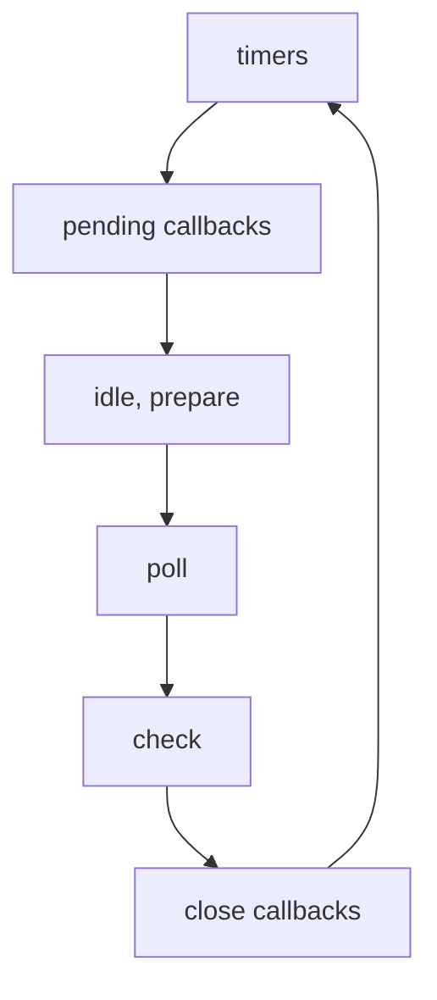

<Callout type="info">
  **이번 문서의 목표:** 콜스택·힙·큐가 각각 무엇을 담는지 구분하고, 이벤트 루프가 한 바퀴 도는 단계의 순서와 단계마다 실행되는 콜백의 종류를 설명할 수 있습니다.
</Callout>

## 콜스택

콜스택(call stack)은 지금 실행 중인 함수 호출을 쌓아 두는 후입선출(LIFO) 구조입니다. 함수를 호출하면 그 호출의 정보(지역 변수, `this`, 실행 위치)를 담은 프레임이 위에 쌓이고, 함수가 반환하면 프레임이 빠집니다.

```js
function c() { return new Error('x').stack }
function b() { return c() }
function a() { return b() }
console.log(a())
// at c → at b → at a → at 모듈 최상위 (위가 가장 최근 호출)
```

에러의 `stack` 문자열은 에러를 만든 시점의 콜스택을 그대로 보여 줍니다.

- 콜스택은 스레드마다 하나이고, JavaScript가 도는 메인 스레드에는 하나뿐입니다. 한 번에 한 함수만 실행됩니다.
- 이벤트 루프는 콜스택이 완전히 비어야 다음 콜백을 꺼냅니다. 콜백 하나는 끝까지 실행되고(run-to-completion), 중간에 다른 콜백이 끼어들지 않습니다.
- 스택 크기에는 한계가 있습니다. 끝나지 않는 재귀는 한계에 닿아 `RangeError: Maximum call stack size exceeded`를 냅니다.

```js
function f() { f() }
try { f() } catch (e) { console.log(e.name) } // RangeError
```

## 힙

힙(heap)은 객체, 배열, 함수, 클로저 같은 값이 만들어져 저장되는 큰 메모리 영역입니다. 변수는 힙의 객체를 가리키는 참조를 담습니다. 힙의 메모리는 V8의 가비지 컬렉터가 관리해서, 더는 참조되지 않는 객체를 자동으로 회수합니다.

| 항목 | 콜스택 | 힙 |
|------|--------|-----|
| 담는 것 | 함수 호출 프레임 | 객체·배열·함수 등 |
| 구조 | 쌓고 빼는 순서가 정해짐 | 구조 없는 큰 영역 |
| 정리 | 반환하면 프레임이 빠짐 | 가비지 컬렉션 |
| 한계에 닿으면 | `RangeError`(스택 초과) | `JavaScript heap out of memory`(프로세스 종료) |

```js
const before = process.memoryUsage().heapUsed
const list = Array.from({ length: 1e5 }, (_, i) => ({ i }))
const after = process.memoryUsage().heapUsed
console.log(after > before) // true (객체가 힙에 쌓임)
```

- 힙이 한계에 닿으면 `FATAL ERROR: Reached heap limit Allocation failed - JavaScript heap out of memory`와 함께 프로세스가 종료됩니다. 에러로 잡을 수 없습니다.
- 한계는 `--max-old-space-size=SIZE`(MiB 단위)로 바꿉니다. 기본값은 시스템에 따라 달라집니다.
- `process.memoryUsage()`는 06편에서 다룹니다. 메모리 누수 분석은 Node.js 고급 과목에서 다룹니다.

**흔한 실수:** 스택 초과와 힙 초과를 혼동하는 것입니다. 스택 초과는 호출이 너무 깊을 때 던져지는 잡을 수 있는 에러이고, 힙 초과는 메모리를 다 쓴 것이라 프로세스가 죽습니다.

## 태스크 큐

태스크 큐(task queue)는 나중에 실행할 콜백을 순서대로 기다리게 하는 대기열입니다. 타이머가 만료되거나 I/O가 끝나면 그 콜백이 큐에 들어가고, 이벤트 루프가 콜스택이 빈 것을 확인하고 하나씩 꺼내 실행합니다.

Node.js에는 큐가 하나가 아니라 이벤트 루프의 단계마다 선입선출(FIFO) 큐가 있습니다. 한 바퀴는 다음 단계를 차례로 지납니다.



| 단계 | 큐에 들어가는 콜백 |
|------|--------------------|
| timers | `setTimeout`, `setInterval` |
| pending callbacks | 다음 반복으로 미뤄진 일부 시스템 I/O 콜백 |
| idle, prepare | 내부 전용 |
| poll | 새 I/O 이벤트의 콜백(파일·네트워크) |
| check | `setImmediate` |
| close callbacks | 일부 `'close'` 이벤트 |

- Node.js는 시작하면 입력 스크립트를 먼저 실행하고, 그 안에서 등록된 타이머·비동기 호출·`process.nextTick`을 처리한 뒤 이벤트 루프에 들어갑니다.
- 한 단계는 자기 큐를 비우거나 시스템이 정한 콜백 수 한도에 닿으면 다음 단계로 넘어갑니다.
- 한 바퀴를 마칠 때 남은 작업이 없으면 루프가 끝나고 프로세스가 종료됩니다.
- 한 콜백이 오래 걸리면 그 단계와 뒤 단계의 모든 콜백이 기다립니다(자세히는 04편).

## 마이크로태스크 큐

마이크로태스크 큐(microtask queue)는 Promise의 `then`·`catch`·`finally` 핸들러와 `queueMicrotask`로 예약한 콜백이 들어가는 큐입니다. 태스크 큐보다 우선합니다.

- 콜스택이 비면 이벤트 루프가 다음 태스크로 가기 전에 마이크로태스크 큐를 끝까지 비웁니다. 비우는 도중 새로 들어온 마이크로태스크도 같은 차례에 실행합니다.
- Node.js에는 `process.nextTick` 전용의 nextTick 큐가 따로 있습니다. nextTick 큐를 비운 직후에 마이크로태스크 큐를 비웁니다(자세히는 04편).
- 두 큐는 이벤트 루프의 어느 단계 안에 있는 것이 아닙니다. 단계 안의 콜백 하나가 끝날 때마다 비워집니다.

```js
setTimeout(() => {
  console.log('t1')
  Promise.resolve().then(() => console.log('p1'))
}, 0)
setTimeout(() => console.log('t2'), 0)
// t1 p1 t2 (같은 timers 단계의 콜백 사이에서도 비워짐)
```

`t1` 콜백이 끝나자마자 `p1`이 실행되고, 그다음에 같은 단계의 `t2`가 실행됩니다.

**흔한 실수:** 마이크로태스크 안에서 계속 새 마이크로태스크를 만드는 것입니다. 큐가 영원히 비지 않으면 이벤트 루프가 다음 단계로 못 가서 타이머와 I/O 콜백이 실행되지 않습니다. `process.nextTick`을 재귀로 호출해도 I/O가 굶습니다.

## timers 단계

timers 단계는 만료된 `setTimeout`과 `setInterval` 콜백을 실행하는 단계입니다.

- 지정한 시간은 정확한 실행 시각이 아니라 그 시간이 지난 뒤에 실행될 수 있다는 기준선입니다. 운영체제의 스케줄링이나 다른 콜백 때문에 늦어질 수 있습니다.
- 시간이 지났더라도 이벤트 루프가 timers 단계에 도달해야 실행됩니다. 앞선 콜백이 길면 그만큼 밀립니다.

```js
const start = Date.now()
setTimeout(() => console.log(Date.now() - start), 100)
while (Date.now() - start < 300) {} // 300ms 동기 작업
// 약 300 (100이 아님)
```

- poll 단계는 대기 시간을 가장 가까운 타이머 시각까지로 잡아서, 타이머가 시간에 맞게 깨어나도록 합니다.
- libuv 1.45.0(Node.js 20)부터는 매 반복에서 timers가 poll 단계 뒤에도 실행됩니다. 이전에는 poll 앞에서만 실행됐습니다. 호환을 위해 루프에 들어가기 전에도 한 번 실행합니다. 이 변화로 `setImmediate`와 타이머의 상호작용이 일부 달라졌습니다.
- `setTimeout(fn, 0)`이 실제로 0ms가 아닌 이유와 `setInterval`은 04편에서 다룹니다.

## pending callbacks 단계

pending callbacks 단계는 이전 반복에서 미뤄진 시스템 작업의 콜백을 실행하는 단계입니다. 대부분의 I/O 콜백은 poll 단계에서 실행되지만, 일부는 다음 반복으로 미뤄져 여기서 실행됩니다.

- 예: TCP 소켓이 연결을 시도하다 `ECONNREFUSED`를 받을 때, 일부 유닉스 계열 시스템은 오류 보고를 이 단계로 미룹니다.
- 바로 뒤의 idle, prepare 단계는 내부 전용이라서 코드와 관계가 없습니다.

## poll 단계

poll 단계는 새 I/O 이벤트를 가져와 그 콜백을 실행하는 단계이며, 이벤트 루프가 필요하면 여기서 멈추고 기다립니다. 두 가지 일을 합니다.

1. 얼마나 오래 막고 I/O를 기다릴지 계산합니다.
2. poll 큐의 이벤트를 처리합니다.

처리 규칙은 큐 상태에 따라 갈립니다.

| poll 큐 | 조건 | 동작 |
|---------|------|------|
| 비어 있지 않음 | - | 큐가 빌 때까지, 또는 시스템 한도까지 콜백을 동기로 하나씩 실행 |
| 비어 있음 | `setImmediate`가 예약됨 | poll을 끝내고 check 단계로 이동 |
| 비어 있음 | `setImmediate`가 없음 | 새 콜백이 들어오기를 기다렸다가 바로 실행 |

- 큐가 비면 이벤트 루프는 시간이 된 타이머가 있는지 봅니다. 있으면 timers 단계로 돌아가 그 콜백을 실행합니다.
- 예약된 작업이 없을 때 poll에서 기다리는 동안 CPU를 쓰지 않습니다. 대기 시간은 가장 가까운 타이머까지이고, 타이머가 없으면 I/O가 올 때까지 기다립니다.
- 파일 읽기 완료, 소켓으로 들어온 데이터의 콜백이 이 단계에서 실행됩니다. 타이머, `setImmediate`, close 콜백은 poll에서 실행되지 않습니다.

## check 단계

check 단계는 `setImmediate`로 예약한 콜백을 poll 단계 직후에 실행하는 단계입니다. `setImmediate`는 libuv의 별도 API로, poll이 끝난 뒤 실행되도록 예약합니다.

```js
import { readFile } from 'node:fs'

readFile(import.meta.filename, () => {
  setTimeout(() => console.log('timeout'), 0)
  setImmediate(() => console.log('immediate'))
})
// immediate, timeout (항상 이 순서)
```

- I/O 콜백(poll 단계) 안에서 예약하면 `setImmediate`가 항상 먼저 실행됩니다. 바로 뒤가 check 단계이고 timers는 한 바퀴 돌아야 오기 때문입니다.
- 메인 모듈 최상위에서 예약하면 `setTimeout(fn, 0)`과 `setImmediate`의 순서는 실행할 때마다 달라질 수 있습니다. 프로세스의 성능에 좌우됩니다(자세히는 04편).
- `setImmediate`의 이름과 달리 `process.nextTick`이 더 즉시 실행됩니다(자세히는 04편).

## close callbacks 단계

close callbacks 단계는 갑자기 닫힌 핸들의 `'close'` 이벤트 콜백을 실행하는 단계입니다. 예를 들어 `socket.destroy()`로 소켓을 강제로 닫으면 `socket.on('close', ...)` 콜백이 여기서 실행됩니다.

- 그 밖의 `'close'` 이벤트는 `process.nextTick`으로 발생합니다.
- 한 바퀴의 마지막 단계이고, 끝나면 다시 timers 단계로 돌아갑니다.

## 브라우저 이벤트 루프와의 차이

브라우저와 Node.js 모두 단일 스레드의 이벤트 루프로 콜백을 하나씩 실행하고, 콜백은 끝까지 실행됩니다. 구조가 다릅니다.

| 항목 | 브라우저 | Node.js |
|------|----------|---------|
| 정의하는 곳 | HTML 표준의 이벤트 루프 처리 모델 | libuv 구현과 Node.js 문서 |
| 큐 구조 | 태스크 소스별 여러 태스크 큐 + 마이크로태스크 큐 | 단계별 큐 + nextTick 큐 + 마이크로태스크 큐 |
| 마이크로태스크 비우는 시점 | 태스크 하나가 끝날 때마다(마이크로태스크 체크포인트) | 단계 안의 콜백 하나가 끝날 때마다 |
| 렌더링 | 루프 안에 화면 갱신 단계가 있음 | 없음 |
| 처리 대상 | 클릭 같은 사용자 입력, 타이머, 네트워크 | 파일·네트워크 I/O, 타이머 |
| `setImmediate`, `process.nextTick` | 표준에 없음 | 있음 |
| 할 일이 없으면 | 탭이 열려 있는 한 대기 | 프로세스 종료 |

같은 코드가 두 환경에서 같은 순서로 출력되는 경우가 많습니다.

```js
console.log(1)
setTimeout(() => console.log(2), 0)
Promise.resolve().then(() => console.log(3))
console.log(4)
// 1 4 3 2 (동기 코드, 마이크로태스크, 타이머 순)
```

- 차이가 드러나는 곳은 Node 전용 API(`setImmediate`, `process.nextTick`)와 단계 구조(poll, check)입니다. 브라우저에서 배운 순서 규칙 중 동기 코드 → 마이크로태스크 → 타이머는 Node.js에서도 맞습니다.
- Node.js에는 화면 갱신이 없어서 렌더링 사이에 코드를 끼우는 `requestAnimationFrame` 같은 개념도 없습니다.
- 브라우저의 상세 모델은 Web APIs 과목에서 다룹니다.

## 핵심 정리

- 콜스택은 실행 중인 호출을 쌓는 LIFO 구조이고(초과하면 `RangeError`), 힙은 객체가 저장되는 가비지 컬렉션 영역입니다(초과하면 프로세스 종료).
- 이벤트 루프는 콜스택이 빌 때 큐에서 콜백을 하나씩 꺼내 끝까지 실행합니다. Node.js는 단계마다 FIFO 큐가 있습니다.
- 한 바퀴는 timers → pending callbacks → idle, prepare → poll → check → close callbacks 순서입니다. 타이머는 poll 뒤에도 실행됩니다(libuv 1.45.0, Node.js 20부터).
- poll 단계에서 대부분의 I/O 콜백이 실행되고 필요하면 여기서 기다립니다. `setImmediate`는 check 단계, `socket.destroy()` 같은 close 콜백은 close callbacks 단계에서 실행됩니다.
- nextTick 큐와 마이크로태스크 큐는 단계 사이가 아니라 콜백 하나가 끝날 때마다 비워지며, 브라우저와 달리 Node.js에는 렌더링 단계가 없고 할 일이 없으면 종료됩니다.

## 마무리 복습

<Quiz
  questionNumber={1}
  question="fs.readFile의 콜백 안에서 setTimeout(fn, 0)과 setImmediate(fn)을 함께 예약했을 때의 실행 순서는?"
  options={['setTimeout 콜백이 먼저 실행된다', 'setImmediate 콜백이 먼저 실행된다', '실행할 때마다 순서가 달라진다', '둘 다 실행되지 않는다']}
  correctAnswer={2}
  explanation="readFile 콜백은 poll 단계에서 실행되고, poll 바로 뒤가 check 단계이므로 setImmediate가 먼저 실행됩니다. timers 단계는 한 바퀴를 돌아야 오기 때문에 setTimeout이 뒤입니다. 순서가 달라질 수 있는 경우는 메인 모듈 최상위에서 예약할 때입니다."
  optionExplanations={['timers 단계는 poll과 check 뒤에 오므로 늦습니다.', '정답입니다. I/O 콜백 안에서는 check 단계가 먼저 옵니다.', '최상위에서 예약할 때의 이야기이며 I/O 콜백 안에서는 항상 같은 순서입니다.', '둘 다 예약된 콜백이므로 실행됩니다.']}
/>

<Quiz
  questionNumber={2}
  question="다음 설명 중 옳은 것은?"
  options={['스택 초과와 힙 초과는 모두 try/catch로 잡을 수 있다', '스택 초과는 RangeError로 던져지고, 힙 초과는 프로세스가 종료된다', '힙은 함수 호출 프레임을 쌓는 LIFO 구조이다', '콜스택은 단계마다 하나씩 있다']}
  correctAnswer={2}
  explanation="스택이 한계를 넘으면 RangeError(Maximum call stack size exceeded)가 던져지고 잡을 수 있습니다. 힙이 한계에 닿으면 FATAL ERROR와 함께 프로세스가 종료됩니다. LIFO로 호출 프레임을 쌓는 것은 콜스택이고, 큐가 단계마다 있는 것이지 콜스택은 메인 스레드에 하나입니다."
  optionExplanations={['힙 초과는 잡을 수 없습니다.', '정답입니다.', '호출 프레임을 쌓는 LIFO는 콜스택입니다.', '단계마다 있는 것은 큐이고 콜스택은 하나입니다.']}
/>

<Quiz
  questionNumber={3}
  question="Node.js 이벤트 루프의 한 바퀴 단계 순서로 옳은 것은?"
  options={['timers, poll, pending callbacks, check, close callbacks', 'timers, pending callbacks, idle/prepare, poll, check, close callbacks', 'poll, timers, check, pending callbacks, close callbacks', 'check, timers, poll, pending callbacks, close callbacks']}
  correctAnswer={2}
  explanation="순서는 timers, pending callbacks, idle/prepare, poll, check, close callbacks이고 다시 timers로 돌아갑니다. setTimeout은 timers, I/O 콜백은 poll, setImmediate는 check, 강제로 닫힌 핸들의 close 이벤트는 close callbacks 단계입니다."
  optionExplanations={['poll이 pending callbacks 앞에 놓였습니다.', '정답입니다.', 'poll과 timers의 순서가 바뀌었습니다.', 'check가 맨 앞에 놓였습니다.']}
/>

## 참고 자료

- [Node.js Learn — The Node.js Event Loop](https://nodejs.org/en/learn/asynchronous-work/event-loop-timers-and-nexttick)
- [libuv — Design overview (The I/O loop)](https://docs.libuv.org/en/v1.x/design.html)
- [Node.js API — process (nextTick, queueMicrotask과의 비교)](https://nodejs.org/api/process.html)
- [Node.js API — Command-line options (--max-old-space-size)](https://nodejs.org/api/cli.html)
- [MDN — JavaScript execution model](https://developer.mozilla.org/en-US/docs/Web/JavaScript/Reference/Execution_model)
- [HTML Standard — Event loops](https://html.spec.whatwg.org/multipage/webappapis.html#event-loops)
