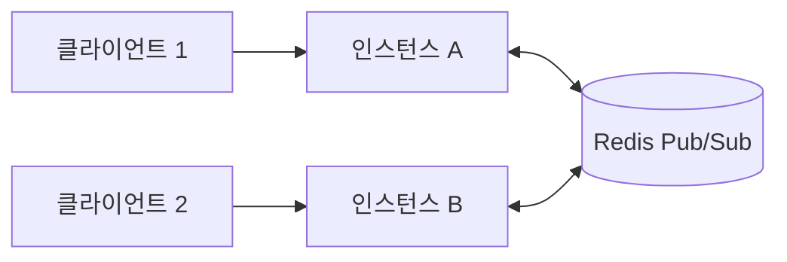

<Callout type="info">
  **이번 문서의 목표:** WebSocket 연결이 HTTP 업그레이드로 시작되는 과정을 설명하고, ws·Socket.IO·SSE 중 용도에 맞는 것을 고르며, 하트비트·재연결·인증·다중 인스턴스 확장 방법을 구분할 수 있습니다.
</Callout>

## 업그레이드 핸드셰이크

WebSocket은 하나의 TCP 연결 위에서 서버와 클라이언트가 언제든 메시지를 주고받는 양방향 프로토콜입니다. 요청과 응답이 짝을 이루는 HTTP와 달리 서버가 먼저 보낼 수 있습니다. 연결은 일반 HTTP `GET` 요청으로 시작해 프로토콜을 바꾸는 방식(업그레이드)으로 맺습니다(RFC 6455).

```text
GET /chat HTTP/1.1
Host: example.com
Upgrade: websocket
Connection: Upgrade
Sec-WebSocket-Key: dGhlIHNhbXBsZSBub25jZQ==
Sec-WebSocket-Version: 13
Origin: https://app.example.com

HTTP/1.1 101 Switching Protocols
Upgrade: websocket
Connection: Upgrade
Sec-WebSocket-Accept: s3pPLMBiTxaQ9kYGzzhZRbK+xOo=
```

| 헤더 | 방향 | 뜻 |
|------|------|----|
| `Upgrade: websocket`, `Connection: Upgrade` | 요청·응답 | HTTP에서 WebSocket으로 프로토콜을 바꾸자는 요청과 수락 |
| `Sec-WebSocket-Key` | 요청 | 클라이언트가 무작위로 만든 16바이트 값의 base64 |
| `Sec-WebSocket-Accept` | 응답 | 키에 고정 GUID를 붙여 SHA-1 해시한 뒤 base64로 인코딩한 값 |
| `Sec-WebSocket-Version` | 요청 | 13 |
| `Origin` | 요청 | 브라우저가 보내는 출처. 서버가 검사해야 함 |
| `Sec-WebSocket-Protocol` | 요청·응답 | 선택 사항. 서브프로토콜 협상 |

- 서버가 `101 Switching Protocols`로 응답하면 그 TCP 연결은 더 이상 HTTP가 아니라 WebSocket 프레임을 주고받습니다. 클라이언트는 상태 코드와 `Sec-WebSocket-Accept`가 기대한 값과 같은지 검증합니다.
- `Sec-WebSocket-Accept`는 `Sec-WebSocket-Key`에 고정 GUID `258EAFA5-E914-47DA-95CA-C5AB0DC85B11`을 이어 붙여 SHA-1 해시하고 base64로 인코딩해서 만듭니다. 위 예의 키를 `node:crypto`로 계산하면 위와 같은 `s3pPLMBiTxaQ9kYGzzhZRbK+xOo=`가 나옵니다.
- 업그레이드는 HTTP 단계이므로 Node의 `http` 서버는 `upgrade` 이벤트로 이 요청을 넘깁니다. 인증은 이 이벤트에서 소켓을 넘기기 전에 합니다(아래 "인증").
- 연결 이후의 메시지는 프레임 단위입니다. 데이터는 텍스트(opcode 1)와 바이너리(opcode 2), 제어 프레임은 ping·pong·close입니다. 클라이언트가 서버로 보내는 프레임은 마스킹해야 하고 서버가 보내는 프레임은 마스킹하지 않습니다.
- TCP와 달리 WebSocket은 메시지 경계를 보존합니다. 한 번 보낸 메시지는 한 번의 `message`로 도착하므로 19편의 프레임 나누기를 직접 하지 않아도 됩니다.
- `ws://`는 평문, `wss://`는 TLS 위의 WebSocket입니다(HTTPS와 같은 관계). 운영에서는 `wss://`를 씁니다.

**흔한 실수:** 로드 밸런서나 리버스 프록시가 `Upgrade`와 `Connection` 헤더를 전달하지 않아 연결이 업그레이드되지 못하는 것입니다. 프록시 설정에서 WebSocket 업그레이드를 허용하고 유휴 제한 시간(idle timeout)을 확인합니다(06편).

## ws

`ws`는 Node.js용 WebSocket 서버·클라이언트 라이브러리입니다(npm 패키지명 `ws`, 2026-10 기준 8.x). 프로토콜만 구현하는 얇은 라이브러리이고 룸이나 재연결 같은 기능은 직접 만듭니다.

```js
import { WebSocketServer } from 'ws'

const wss = new WebSocketServer({ port: 8080 })

wss.on('connection', (ws) => {
  ws.on('error', console.error)
  ws.on('message', (data, isBinary) => {
    ws.send(`echo: ${data}`)   // data는 Buffer
  })
})
```

- 연결마다 `connection` 이벤트로 `WebSocket` 객체(`ws`)가 옵니다. `message` 이벤트의 `data`는 `Buffer`이고, `isBinary`가 텍스트인지 바이너리인지 알려 줍니다.
- 연결 객체에 `error` 리스너를 항상 등록합니다. 없으면 처리되지 않은 `error` 이벤트로 프로세스가 죽을 수 있습니다.
- `ws.send()`는 연결이 `OPEN`일 때만 유효합니다. `readyState`가 `WebSocket.OPEN`인지 확인한 뒤 보냅니다.
- 연결 종료는 둘로 나뉩니다. `ws.close(code, reason)`은 닫기 핸드셰이크를 시작해 정상 종료하고, `ws.terminate()`는 소켓을 즉시 파괴합니다.
- `maxPayload` 옵션은 허용하는 최대 메시지 크기이고 기본값이 100 MiB입니다. 채팅 같은 용도에는 훨씬 작게 제한합니다. 큰 메시지로 메모리를 소진시키는 공격을 막는 설정입니다.
- 압축(`perMessageDeflate`)은 서버에서 기본으로 꺼져 있습니다. 문서는 성능과 메모리 비용이 크므로 정말 필요할 때만 켜라고 권합니다.
- HTTP 서버와 같은 포트를 쓰려면 `new WebSocketServer({ server })`로 기존 HTTP(S) 서버를 넘깁니다. 업그레이드 요청을 직접 제어하려면 `noServer: true`로 두고 `server.on('upgrade')`에서 `wss.handleUpgrade()`를 호출합니다.

브로드캐스트는 `wss.clients`를 순회합니다.

```js
function broadcast(wss, data) {
  for (const client of wss.clients) {
    if (client.readyState === WebSocket.OPEN) {
      client.send(data)
    }
  }
}
```

- `ws`에는 방(room)이 없으므로 "특정 사용자 그룹에게만"은 `Map`이나 `Set`으로 직접 관리합니다.
- 느린 클라이언트에 계속 `send`하면 서버 메모리에 쌓입니다. `ws.bufferedAmount`를 확인하거나 한도를 넘는 연결을 끊습니다.
- `ws`는 `ws` 클라이언트와 브라우저의 표준 `WebSocket`, Node 내장 `WebSocket`과 모두 통신합니다. 표준 프로토콜이기 때문입니다.

## Socket.IO

Socket.IO는 이벤트 기반 양방향 통신 라이브러리입니다. WebSocket 구현이 아닙니다. 공식 문서는 패킷에 메타데이터를 덧붙이므로 일반 WebSocket 클라이언트가 Socket.IO 서버에 접속할 수 없고, 반대도 안 된다고 명시합니다. 서버(`socket.io`)와 클라이언트(`socket.io-client`)를 함께 씁니다.

```js
import { createServer } from 'node:http'
import { Server } from 'socket.io'

const httpServer = createServer()
const io = new Server(httpServer, { cors: { origin: '*' } })

io.on('connection', (socket) => {
  socket.join('room:1')
  socket.on('chat', (msg, ack) => {
    io.to('room:1').emit('chat', msg)   // 방 전체에 전달
    ack('received')                     // 보낸 쪽에 응답
  })
})
httpServer.listen(3000)
```

| 기능 | 설명 |
|------|------|
| 이벤트 이름 | 문자열 이벤트에 JSON 값을 실어 보냄(`emit('chat', obj)`) |
| 룸 | `socket.join(room)`, `io.to(room).emit(...)`으로 그룹 전송 |
| 네임스페이스 | 하나의 연결로 논리적 채널을 나눔(멀티플렉싱) |
| 확인 응답(acknowledgement) | 받는 쪽이 콜백으로 응답하고, 타임아웃을 설정할 수 있음 |
| 자동 재연결 | 끊김을 하트비트로 감지하고 지수 백오프로 재접속 |
| 패킷 버퍼링 | 끊긴 동안의 메시지를 모았다가 재연결 후 전송 |
| 폴백 | WebSocket이 막히면 HTTP 롱 폴링으로 연결 |

- 공식 문서의 현재 버전은 4.x이고 npm `socket.io`의 최신은 4.8.4입니다.
- 서버는 `new Server(httpServer, options)`로 만듭니다. 브라우저의 다른 출처에서 접속하면 `cors` 옵션을 설정합니다(CORS는 09편).
- 확인 응답은 보내는 쪽의 마지막 인자로 콜백을 주고, 받는 쪽 핸들러의 마지막 인자로 받은 콜백을 호출하는 방식입니다.
- Socket.IO를 쓰는 이유는 룸·재연결·확인 응답을 직접 구현하지 않기 위해서입니다. 반대로 표준 WebSocket 클라이언트(모바일, 다른 언어, IoT)와 통신해야 하면 `ws`를 씁니다.
- Express와 함께 쓸 때도 `http.createServer(app)`로 HTTP 서버를 만들어 Socket.IO에 넘깁니다(13편).

**흔한 실수:** Socket.IO 서버에 일반 `new WebSocket(url)`로 접속하려는 것입니다. 프로토콜이 달라서 연결되지 않습니다.

## Node 내장 WebSocket 클라이언트

Node.js에는 브라우저와 같은 `WebSocket` 클래스가 전역으로 들어 있습니다. 서버 코드에서 외부 WebSocket 서비스에 접속할 때 별도 패키지가 필요 없습니다.

```js
const ws = new WebSocket('wss://echo.example.com')

ws.addEventListener('open', () => ws.send('hi'))
ws.addEventListener('message', (event) => {
  console.log(event.data)   // 'hi' (텍스트는 문자열)
  ws.close()
})
ws.addEventListener('close', (e) => console.log(e.code))
```

- 문서의 기준으로 v21.0.0과 v20.10.0에 추가되었고, v22.0.0에서 CLI 플래그 없이 쓸 수 있게 됐으며, v22.4.0부터 더 이상 실험적이지 않습니다. Node 24와 26에서는 그대로 쓰면 됩니다.
- 브라우저의 표준 API와 같은 형태입니다. `onopen`, `onmessage`, `onclose`, `onerror`와 `addEventListener`를 쓰고 `ws` 패키지의 `.on('message')` 방식과 다릅니다.
- 텍스트 메시지의 `event.data`는 문자열입니다. 바이너리는 `binaryType`에 따라 `Blob` 또는 `ArrayBuffer`로 받습니다.
- 서버가 업그레이드를 거부하거나 연결에 실패하면 `error` 후 `close` 이벤트가 옵니다. 직접 실행해 보면 닫기 코드는 비정상 종료를 뜻하는 `1006`이었습니다.
- 표준 API라서 `ping`·`pong` 제어 프레임을 직접 보내는 메서드가 없고, 연결 헤더를 자유롭게 지정할 수 없습니다. 이런 제어가 필요하면 `ws` 클라이언트를 씁니다.
- 자동 재연결은 없습니다. 끊기면 새 `WebSocket`을 만들어야 합니다(아래 "하트비트와 재연결").

## SSE

SSE(Server-Sent Events)는 HTTP 응답 하나를 열어 둔 채 서버가 클라이언트로 이벤트를 계속 보내는 단방향 방식입니다. 클라이언트는 `EventSource`로 받습니다. 서버에서 클라이언트로만 흐르므로 알림, 진행률, 실시간 피드에 맞고 클라이언트가 서버로 보낼 때는 별도의 일반 HTTP 요청을 씁니다.

```js
import { createServer } from 'node:http'

createServer((req, res) => {
  res.writeHead(200, {
    'Content-Type': 'text/event-stream',
    'Cache-Control': 'no-cache',
  })
  const timer = setInterval(() => {
    res.write('event: tick\ndata: {"n":1}\n\n')
  }, 1000)
  req.on('close', () => clearInterval(timer))
}).listen(3000)
```

- 응답의 `Content-Type`은 `text/event-stream`이고 UTF-8입니다. 이벤트는 빈 줄로 구분합니다.
- 이벤트의 필드는 다음과 같습니다.

| 필드 | 뜻 |
|------|----|
| `data:` | 메시지 내용. 여러 줄이면 줄바꿈으로 이어 붙음 |
| `event:` | 이벤트 이름. 이름이 있으면 `addEventListener(이름)`으로 받음 |
| `id:` | 이벤트 ID. 재연결 때 서버에 알려 줌 |
| `retry:` | 재연결 대기 시간(밀리초) |
| `:` 로 시작하는 줄 | 주석. 연결 유지용으로 씀 |

- 브라우저의 `EventSource`는 연결이 끊기면 자동으로 다시 연결합니다. 마지막으로 받은 `id`를 `Last-Event-ID` 요청 헤더로 보내므로 서버가 그 이후 이벤트부터 이어서 보낼 수 있습니다.
- 클라이언트가 떠나면 요청의 `close` 이벤트가 발생합니다. 여기서 타이머와 구독을 정리하지 않으면 끊어진 연결에 계속 쓰게 됩니다.
- 장점은 일반 HTTP이므로 프록시·인증·쿠키·압축 등 기존 HTTP 인프라를 그대로 쓰고, 재연결과 이벤트 ID가 내장된 점입니다.
- 제약은 단방향이라는 점, `EventSource`가 요청 헤더를 지정하지 못한다는 점, HTTP/1.1에서는 브라우저가 도메인당 동시 연결을 6개로 제한한다는 점입니다. HTTP/2에서는 기본 100개의 동시 스트림을 허용합니다(HTTP/2는 07편).
- 중간 프록시가 응답을 버퍼링하면 이벤트가 지연됩니다. 주기적으로 주석 줄(`: keepalive`)을 보내 연결을 유지하고 프록시 설정에서 버퍼링을 끕니다.
- Node 24의 전역 `EventSource`는 실험적 기능이라 `--experimental-eventsource` 플래그가 있어야 켜집니다. 서버에서 SSE를 받는 용도에는 `fetch`의 스트림 응답을 쓰는 편이 안전합니다(스트림 응답은 07편).

| 기준 | WebSocket | SSE |
|------|-----------|-----|
| 방향 | 양방향 | 서버에서 클라이언트로 단방향 |
| 프로토콜 | HTTP 업그레이드 후 별도 프레임 | 일반 HTTP 응답 |
| 재연결 | 직접 구현 | 브라우저가 자동으로 처리 |
| 데이터 | 텍스트, 바이너리 | 텍스트(UTF-8) |
| 어울리는 곳 | 채팅, 게임, 협업 편집 | 알림, 진행률, 실시간 피드 |

## 하트비트와 재연결

TCP 연결은 케이블이 뽑히거나 NAT·프록시가 조용히 연결을 버려도 양쪽이 모를 수 있습니다. 그래서 하트비트(heartbeat)로 주기적으로 상대의 생존을 확인하고, 끊겼다고 판단하면 정리하거나 다시 연결합니다. 프록시와 로드 밸런서는 유휴 연결을 일정 시간 뒤 끊으므로 하트비트는 연결 유지 용도도 겸합니다.

ws의 서버 하트비트는 `ping` 제어 프레임을 주기적으로 보내고 `pong`이 오지 않으면 연결을 끊는 방식입니다. 공식 문서의 패턴은 이렇습니다.

```js
wss.on('connection', (ws) => {
  ws.isAlive = true
  ws.on('pong', () => { ws.isAlive = true })
})

const timer = setInterval(() => {
  for (const ws of wss.clients) {
    if (!ws.isAlive) { ws.terminate(); continue }
    ws.isAlive = false
    ws.ping()
  }
}, 30_000)
wss.on('close', () => clearInterval(timer))
```

- `pong`은 `ping`을 받으면 스펙에 따라 자동으로 응답됩니다. 서버가 `ping`을 보내고 다음 주기까지 `pong`이 없으면 죽은 연결로 보고 `terminate()`합니다.
- 끊어진 연결에는 `close()`가 아니라 `terminate()`를 씁니다. `close()`는 상대의 응답을 기다리는 닫기 핸드셰이크라 죽은 연결에서는 오래 걸립니다.
- 클라이언트도 서버의 `ping`이 오지 않으면 끊겼다고 판단할 수 있습니다. 마지막 `ping` 수신 후 주기보다 조금 긴 시간이 지나면 `terminate()`합니다.
- 브라우저의 표준 `WebSocket` API는 `ping`·`pong` 프레임을 보내거나 받는 수단이 없습니다. 브라우저 클라이언트에는 애플리케이션 레벨 메시지(`{"type":"ping"}`)로 하트비트를 구현합니다.
- Socket.IO는 하트비트와 자동 재연결(지수 백오프)이 내장되어 있습니다.

표준 `WebSocket`에는 재연결이 없으므로 직접 만듭니다. 핵심은 지수 백오프와 지터입니다.

```js
function connect(attempt = 0) {
  const ws = new WebSocket(url)
  ws.onopen = () => { attempt = 0 }
  ws.onclose = () => {
    const base = Math.min(30_000, 1000 * 2 ** attempt)
    const wait = base / 2 + Math.random() * base / 2
    setTimeout(() => connect(attempt + 1), wait)
  }
}
```

- 재시도 간격을 시도 횟수에 따라 늘리고(지수 백오프) 상한을 둡니다. 서버가 재시작할 때 모든 클라이언트가 같은 순간에 재접속해 서버를 다시 쓰러뜨리는 것을 막으려고 무작위 값(지터)을 섞습니다.
- 연결이 성공하면 시도 횟수를 0으로 되돌립니다.
- 재연결 후에는 끊긴 동안의 메시지를 놓쳤을 수 있습니다. 마지막으로 받은 메시지 ID를 서버에 알리고 그 이후를 다시 받거나, 재연결 직후 상태를 HTTP로 다시 불러옵니다. SSE의 `Last-Event-ID`가 같은 문제의 내장 해법입니다.
- 서버를 배포하거나 종료할 때는 연결에 close 프레임(코드 1001 등)을 보내 클라이언트가 재연결하게 합니다(종료 절차는 25편).

**흔한 실수:** 서버 종료 신호를 받고 `server.close()`만 호출하는 것입니다. 열린 WebSocket 연결은 서버를 계속 붙잡으므로 각 연결에 `close()`를 보내 정리해야 합니다.

## 다중 인스턴스 확장

WebSocket 연결은 한 서버 프로세스의 메모리에 있습니다. 인스턴스가 둘 이상이면 인스턴스 A에 붙은 사용자에게 인스턴스 B에서 발생한 이벤트를 전달할 수 없습니다. 인스턴스 사이에 메시지를 중계하는 계층이 필요하고, 가장 흔한 방법은 Redis Pub/Sub입니다(자세히는 18편).



Socket.IO는 Redis 어댑터(`@socket.io/redis-adapter`)로 이것을 해결합니다. 한 서버가 `io.to(room).emit()`을 호출하면 자기 소켓에 보내면서 Redis 채널에 발행하고, 다른 인스턴스가 받아 자기 소켓에 전달합니다.

```js
import { createClient } from 'redis'
import { Server } from 'socket.io'
import { createAdapter } from '@socket.io/redis-adapter'

const url = process.env.REDIS_URL
const pubClient = createClient({ url })
const subClient = pubClient.duplicate()
await Promise.all([
  pubClient.connect(),
  subClient.connect(),
])

const adapter = createAdapter(pubClient, subClient)
const io = new Server({ adapter })
io.listen(3000)
```

- 발행용과 구독용 연결을 따로 만듭니다. 구독 중인 연결은 다른 명령을 못 쓰기 때문입니다(18편). `duplicate()`가 그 용도입니다.
- Redis 7.0 이상에서는 샤딩된 Pub/Sub를 쓰는 `createShardedAdapter`도 있습니다.
- Redis 어댑터는 메시지를 저장하지 않고 전달만 합니다. Redis Pub/Sub는 at-most-once이므로 인스턴스가 끊긴 동안의 이벤트는 사라집니다.
- 어댑터를 써도 스티키 세션은 필요합니다. HTTP 롱 폴링은 한 세션의 요청이 여러 번 나뉘어 오므로 같은 인스턴스로 가야 하고, 그렇지 않으면 서버가 모르는 세션이라 HTTP 400으로 실패합니다. 로드 밸런서의 IP 해시나 쿠키 기반 라우팅으로 고정합니다. 롱 폴링을 끄고 WebSocket만 쓰면 한 연결만 유지하므로 스티키 세션이 필요 없습니다.
- 공식 문서는 Redis 안의 Pub/Sub 메시지가 서명·암호화·인증되지 않는다고 경고합니다. Redis는 신뢰할 수 있는 내부 네트워크에 두고 접근을 제한합니다.
- 어댑터 대안으로 MongoDB, Postgres, 클러스터 어댑터, 클라우드 메시징 서비스가 있습니다.

`ws`를 쓸 때는 같은 구조를 직접 만듭니다. 각 인스턴스가 채널을 구독하고, 메시지가 오면 자기 클라이언트에게 전달합니다.

```js
await sub.subscribe('chat', (message) => {
  for (const client of wss.clients) {
    if (client.readyState === WebSocket.OPEN) {
      client.send(message)
    }
  }
})
// 클라이언트 메시지를 받으면 로컬 전송 대신 redis.publish('chat', ...)
```

- 클라이언트의 메시지를 곧바로 로컬에 보내지 말고 Redis에 발행해 모든 인스턴스(자기 자신 포함)가 같은 경로로 받게 하면 중복과 순서 차이가 줄어듭니다.
- 접속자 수와 온라인 상태처럼 인스턴스를 가로지르는 상태는 인스턴스 메모리가 아니라 Redis에 둡니다(18편의 Set이나 Hash).
- 연결 수가 늘면 파일 디스크립터 한도와 메모리가 먼저 병목입니다. 연결당 메모리를 계측하고 인스턴스당 연결 수 상한을 둡니다.

## 인증

WebSocket은 인증을 프로토콜에서 정해 주지 않습니다. 업그레이드가 끝나면 이후 메시지에는 HTTP 헤더가 없으므로 인증은 핸드셰이크 단계나 연결 직후에 처리합니다. 브라우저의 `WebSocket` 생성자는 헤더를 지정할 수 없다는 점이 선택지를 정합니다.

| 방법 | 방식 | 주의 |
|------|------|------|
| 쿠키 | 핸드셰이크 요청에 브라우저가 쿠키를 자동으로 실음. 세션 ID를 서버가 검증 | `Origin` 검사 필수(CSWH). `SameSite`와 `Secure` 설정(09편) |
| 쿼리 문자열 토큰 | `wss://host/?token=...` | URL이 로그와 프록시 기록에 남음. 수명이 짧은 일회용 티켓만 사용 |
| 연결 후 첫 메시지 | 연결 뒤 토큰을 담은 첫 메시지를 보내고 서버가 검증 | 인증 전에는 다른 메시지를 처리하지 않음. 일정 시간 내 인증이 없으면 끊음 |
| Socket.IO `auth` | 클라이언트가 `io({ auth: { token } })`로 전달 | 서버는 `io.use` 미들웨어에서 `socket.handshake.auth`로 검증 |

```js
server.on('upgrade', (req, socket, head) => {
  const user = authenticate(req)   // 쿠키·티켓 검증, 직접 구현
  if (!user) {
    socket.write('HTTP/1.1 401 Unauthorized\r\n\r\n')
    socket.destroy()
    return
  }
  wss.handleUpgrade(req, socket, head, (ws) => {
    wss.emit('connection', ws, req, user)
  })
})
```

- 위는 ws 문서가 권장하는 구조입니다. `verifyClient` 옵션은 문서에서 권장하지 않는 방식이며, `upgrade` 이벤트에서 인증하고 통과한 연결만 `handleUpgrade`로 넘깁니다. 거부는 업그레이드 전에 HTTP 응답(401)으로 합니다.
- CORS는 WebSocket에 적용되지 않습니다. 브라우저는 다른 출처에서도 WebSocket 연결을 맺고 `Origin` 헤더만 실어 보냅니다. 서버가 `Origin`을 허용 목록과 대조하지 않으면 다른 사이트의 스크립트가 로그인한 사용자의 쿠키로 연결을 열 수 있고, 이것이 Cross-Site WebSocket Hijacking(CSWH)입니다. 허용되지 않은 출처는 403으로 거부합니다.
- `Origin`은 브라우저가 붙이는 값이라 비브라우저 클라이언트는 임의로 쓸 수 있고, Node 내장 클라이언트는 이 헤더를 보내지 않았습니다. `Origin` 검사는 브라우저 공격을 막는 장치이지 인증을 대신하지 않습니다.
- Socket.IO는 미들웨어에서 인증하며 거부하면 클라이언트에 `connect_error`가 갑니다.

```js
io.use((socket, next) => {
  const token = socket.handshake.auth.token
  verifyToken(token)
    .then((user) => { socket.data.user = user; next() })
    .catch(() => next(new Error('not authorized')))
})
```

- 토큰이 만료돼도 열려 있는 연결은 끊기지 않습니다. 인증 정보의 수명을 연결 수명과 맞추려면 만료 시각에 연결을 끊거나 주기적으로 재검증합니다(토큰은 10편).
- 인증은 연결 시점뿐 아니라 메시지 단위의 인가도 필요합니다. 사용자가 다른 사용자의 룸에 들어가거나 이벤트를 보낼 권한이 있는지 서버가 매번 확인합니다.
- 인증을 통과하지 못한 연결이 계속 열려 있으면 자원을 점유하므로 연결 후 일정 시간 안에 인증하지 않으면 끊습니다.
- 메시지 속도 제한도 둡니다. 연결 한 개가 초당 수천 건을 보내 서버를 막지 못하도록 연결별 카운터로 제한합니다(18편).

## 핵심 정리

- WebSocket은 `Upgrade: websocket` 요청에 서버가 `101 Switching Protocols`로 답하며 시작되고, `Sec-WebSocket-Accept`는 키에 고정 GUID를 붙여 SHA-1과 base64로 만든다.
- `ws`는 표준 프로토콜만 구현한 얇은 서버·클라이언트 라이브러리이고, 연결마다 `error` 리스너와 `maxPayload` 제한이 필요하다.
- Socket.IO는 룸·확인 응답·자동 재연결을 가졌지만 WebSocket 구현이 아니라 일반 클라이언트와 통신하지 못하며, Node 22.4 이상의 전역 `WebSocket`은 브라우저 표준 API다.
- SSE는 `text/event-stream` 응답으로 서버에서 클라이언트로만 보내고 `Last-Event-ID`로 재연결하며, 양방향이 필요하면 WebSocket을 쓴다.
- 하트비트는 `ping`과 `pong`으로 죽은 연결을 `terminate()`하고, 재연결은 지수 백오프와 지터로 직접 구현하며 재연결 후 놓친 메시지를 복구한다.
- 다중 인스턴스는 Redis Pub/Sub(Socket.IO는 Redis 어댑터와 스티키 세션)로 메시지를 중계하고, 인증은 `upgrade` 단계나 `io.use`에서 하며 `Origin` 검사로 CSWH를 막는다.

## 마무리 복습

<Quiz
  questionNumber={1}
  question="WebSocket 연결을 맺을 때 서버가 정상적으로 수락하면 보내는 응답은?"
  options={['200 OK 와 Content-Type: websocket', '101 Switching Protocols 와 Upgrade: websocket, Sec-WebSocket-Accept 헤더', '301 Moved Permanently 와 새 ws 주소', '204 No Content 와 Sec-WebSocket-Key 헤더']}
  correctAnswer={2}
  explanation="WebSocket은 HTTP GET 요청에 Upgrade 헤더를 실어 시작하고, 서버가 수락하면 101 Switching Protocols와 Upgrade, Connection 헤더, 그리고 요청의 Sec-WebSocket-Key에서 계산한 Sec-WebSocket-Accept로 응답합니다. 클라이언트는 이 값이 맞는지 검증한 뒤 연결을 엽니다. Sec-WebSocket-Key는 요청 헤더이고 응답에는 Accept가 옵니다."
  optionExplanations={['200 응답은 일반 HTTP 응답이며 프로토콜 전환이 일어나지 않습니다.', '정답입니다. 101 상태와 Upgrade, Sec-WebSocket-Accept가 수락의 표지입니다.', '301은 리다이렉트이며 WebSocket 수락과 무관합니다.', 'Sec-WebSocket-Key는 클라이언트 요청 헤더이고 204 응답은 수락이 아닙니다.']}
/>

<Quiz
  questionNumber={2}
  question="쿠키로 로그인한 사용자를 위한 ws 서버를 운영합니다. 다른 사이트의 스크립트가 사용자의 쿠키로 WebSocket 연결을 여는 것(CSWH)을 막기 위한 올바른 조치는?"
  options={['CORS 설정만 하면 WebSocket에도 적용되므로 충분하다', '업그레이드 요청의 Origin 헤더를 허용 목록과 대조하고 허용되지 않은 출처는 403으로 거부한다', 'maxPayload를 줄인다', 'ping을 30초마다 보낸다']}
  correctAnswer={2}
  explanation="브라우저의 WebSocket 연결에는 CORS가 적용되지 않고 Origin 헤더만 실립니다. 서버가 Origin을 검사하지 않으면 다른 출처 페이지가 사용자의 쿠키로 연결을 만들 수 있으므로 업그레이드 단계에서 Origin을 허용 목록과 비교해 거부해야 합니다. maxPayload는 메시지 크기 제한, ping은 생존 확인으로 이 공격과 관계가 없습니다."
  optionExplanations={['WebSocket은 CORS 대상이 아닙니다. 서버가 직접 Origin을 검사해야 합니다.', '정답입니다. 업그레이드 시점의 Origin 검사가 CSWH 방어의 기본입니다.', 'maxPayload는 큰 메시지로 인한 메모리 소진을 막는 설정입니다.', 'ping은 죽은 연결을 찾는 하트비트이며 출처 검증이 아닙니다.']}
/>

<Quiz
  questionNumber={3}
  question="Socket.IO 서버를 인스턴스 3대로 늘렸더니 한 인스턴스에서 보낸 룸 브로드캐스트가 다른 인스턴스에 붙은 사용자에게 전달되지 않습니다. 해결 방법은?"
  options={['각 인스턴스의 maxPayload를 늘린다', 'Redis 어댑터를 설정해 인스턴스 사이에서 Pub/Sub로 이벤트를 중계하고, 롱 폴링을 쓴다면 스티키 세션도 설정한다', '클라이언트를 일반 WebSocket으로 바꾼다', 'Redis 연결을 하나만 만들어 발행과 구독에 같이 쓴다']}
  correctAnswer={2}
  explanation="연결은 각 인스턴스의 메모리에 있어서 다른 인스턴스의 소켓에는 직접 보낼 수 없습니다. Redis 어댑터가 Pub/Sub로 브로드캐스트를 다른 인스턴스에 전달합니다. 또한 HTTP 롱 폴링을 쓰면 한 세션의 요청이 같은 인스턴스로 가야 하므로 스티키 세션이 필요합니다. 구독 중인 Redis 연결은 다른 명령을 쓰지 못하므로 발행과 구독 연결을 나눠야 합니다."
  optionExplanations={['maxPayload는 메시지 크기 제한이며 인스턴스 간 전달과 무관합니다.', '정답입니다. 어댑터로 인스턴스 간 중계를 하고 롱 폴링에는 스티키 세션을 설정합니다.', 'Socket.IO와 일반 WebSocket은 프로토콜이 달라 바꿔서 해결되지 않고 다중 인스턴스 문제도 그대로입니다.', '구독 상태의 연결은 다른 명령을 쓰지 못하므로 발행용과 구독용을 나눠야 합니다.']}
/>

## 참고 자료

- [RFC 6455 — The WebSocket Protocol](https://datatracker.ietf.org/doc/html/rfc6455)
- [MDN — Writing WebSocket servers](https://developer.mozilla.org/en-US/docs/Web/API/WebSockets_API/Writing_WebSocket_servers)
- [MDN — Using server-sent events](https://developer.mozilla.org/en-US/docs/Web/API/Server-sent_events/Using_server-sent_events)
- [ws — README](https://github.com/websockets/ws/blob/master/README.md)
- [ws — API 문서](https://github.com/websockets/ws/blob/master/doc/ws.md)
- [Node.js — Globals (WebSocket, EventSource)](https://nodejs.org/api/globals.html)
- [Node.js — Command-line options](https://nodejs.org/api/cli.html)
- [Socket.IO — Introduction](https://socket.io/docs/v4/)
- [Socket.IO — Server initialization](https://socket.io/docs/v4/server-initialization/)
- [Socket.IO — Middlewares](https://socket.io/docs/v4/middlewares/)
- [Socket.IO — Using multiple nodes](https://socket.io/docs/v4/using-multiple-nodes/)
- [Socket.IO — Redis adapter](https://socket.io/docs/v4/redis-adapter/)
