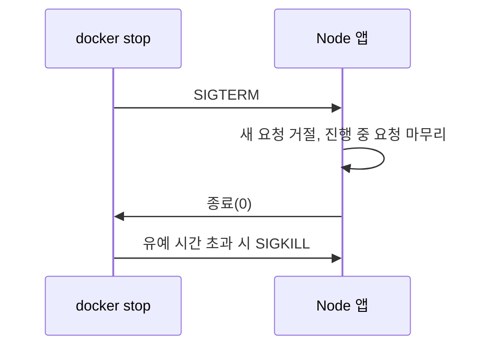

<Callout type="info">
  **이번 문서의 목표:** Node.js 앱을 서버나 컨테이너에 올리기 전에 실행 진입점, 설정 주입, 상태 확인, 로그, 종료 처리, 빌드 결과를 점검해 운영 실행 구성을 갖출 수 있습니다.
</Callout>

## 엔트리

엔트리(entry)는 `node`가 가장 먼저 실행하는 파일입니다. 운영에서는 이 파일의 경로를 한 곳에 정해 두고 모든 실행 명령이 같은 파일을 가리키게 합니다.

```bash
node server.js   # 파일을 직접 지정
node .           # package.json의 main 필드를 따름
```

- `node .`은 `package.json`의 `main` 필드가 가리키는 파일을 실행합니다. 직접 실험에서 `main`과 `exports`를 함께 두자 `main`의 파일이 실행됐습니다. `exports`만 있고 `main`이 없으면 `node .`은 오류로 끝났습니다.
- `exports`는 다른 패키지가 이 패키지를 가져올 때의 공개 경로를 정하는 필드입니다. 앱의 실행 진입점과는 별개입니다.
- 엔트리 파일은 작게 둡니다. 설정을 읽고, 앱 객체를 만들고, 포트를 열고, 종료 시그널을 처리하는 일만 합니다. 앱 생성과 `listen()`을 다른 파일로 나누면 테스트가 서버를 띄우지 않고 앱만 가져올 수 있습니다.
- `package.json`의 `"type": "module"`이면 `.js` 파일은 ES Modules로 실행됩니다. `engines` 필드로 필요한 Node.js 버전을 적어 두고 실행 환경의 버전과 맞는지 배포 전에 확인합니다.
- 작업 디렉터리에 따라 상대 경로가 달라지지 않도록 파일 경로는 `import.meta.dirname` 같은 모듈 기준 값으로 만듭니다.

```json
{
  "type": "module",
  "main": "server.js",
  "engines": { "node": ">=24" }
}
```

**흔한 실수:** 개발 PC에서는 `node src/index.js`로 돌리고 서버는 `main`이 없는 상태에서 `node .`을 쓰는 것입니다. 개발과 운영의 시작 명령을 `package.json`의 `scripts`로 통일합니다.

## npm start

`npm start`는 `package.json`의 `scripts.start`에 적힌 명령을 실행하는 npm 명령입니다. `scripts.start`가 없으면 npm은 `node server.js`를 실행합니다. 이 기본 동작은 `node .`이 `main`을 쓰는 것과 다릅니다.

```json
{
  "scripts": {
    "start": "node server.js",
    "dev": "node --watch server.js"
  }
}
```

- 운영 시작 명령은 `start`, 개발용은 `dev`처럼 이름을 나누는 관례를 따릅니다. 배포 도구와 플랫폼이 `npm start`를 기본 시작 명령으로 가정하는 경우가 많습니다.
- `npm start`는 npm 프로세스가 쉘을 거쳐 `node`를 자식으로 실행하는 구조입니다. 프로세스 한 겹이 더 생기고, 컨테이너에서는 종료 시그널이 앱까지 가지 못할 수 있습니다. docker-node 모범 사례 문서는 컨테이너에서 `CMD ["node", "index.js"]`로 직접 실행하면 프로세스 수가 줄고 `SIGTERM`과 `SIGINT`가 npm에 삼켜지지 않고 Node.js 프로세스로 전달된다고 안내합니다(자세히는 아래 "컨테이너에서 시그널").
- `node --run start`는 npm 없이 `package.json`의 스크립트를 실행합니다. Node.js 22.0.0에서 추가됐습니다. `npm run`과 같지 않아서 `pre`·`post` 스크립트를 실행하지 않고, `--env-file`로 읽은 환경변수는 그 명령에 적용되지 않는다고 문서에 적혀 있습니다. 직접 실험에서 `--env-file`에 적은 변수를 `--run`으로 실행한 스크립트에서 읽으면 `undefined`였습니다.
- 운영 서버에 의존성을 설치할 때는 `npm ci --omit=dev`로 개발 의존성을 뺍니다. `omit`의 기본값은 `NODE_ENV`가 `production`일 때 `dev`입니다. `omit`에 `dev`가 포함되면 npm은 모든 수명 주기 스크립트에 `NODE_ENV=production`을 설정합니다(`npm ci`는 07편의 락파일 설명 참고).

**흔한 실수:** `start` 스크립트에 `nodemon`이나 `--watch`를 넣는 것입니다. 개발용 명령은 `dev`로 분리합니다(아래 "운영에서 watch를 켜지 않음").

## 프로세스 매니저 개념

프로세스 매니저(process manager)는 Node.js 프로세스를 대신 실행하고, 죽으면 다시 띄우고, 로그와 상태를 관리하는 상위 프로세스입니다. Node.js 프로세스는 처리되지 않은 예외로 종료되면 스스로 되살아나지 않으므로 누군가 다시 실행해 줘야 합니다.

| 방식 | 역할 | 예 |
|------|------|----|
| 프로세스 매니저 | 앱 재시작, 클러스터 실행, 로그 수집 | PM2 |
| OS의 init 시스템 | 서버 부팅 때 서비스 실행과 재시작 | systemd |
| 컨테이너 런타임·오케스트레이터 | 컨테이너가 죽으면 재시작 | Docker, ECS, Kubernetes |

- Express 공식 문서는 PM2 같은 프로세스 매니저가 예전에 인기 있었지만 프로세스 관리에는 init 시스템 사용을 권장한다고 적습니다. 앱이 죽으면 프로세스 매니저가 다시 띄우고, OS가 재시작하면 init 시스템이 프로세스 매니저를 다시 띄우는 구성도 문서가 설명합니다.
- 컨테이너 환경에서는 컨테이너가 곧 프로세스 단위입니다. 오케스트레이터가 재시작과 개수 조절을 맡으므로 컨테이너 안에 PM2를 또 두는 것은 보통 불필요합니다(자세히는 03편, 09편).
- 프로세스 매니저 한 개가 재시작 정책을 가지면 충돌이 반복될 때 무한 재시작이 됩니다. 재시작 횟수 제한이나 대기 시간을 두고, 반복 충돌은 알림으로 사람이 보게 합니다.
- 클러스터링을 쓰려면 앱이 상태를 프로세스 안에 두지 않아야 합니다. PM2 문서도 세션과 웹소켓 연결 같은 로컬 데이터를 프로세스 안에 저장하지 말라고 합니다.

**흔한 실수:** 프로세스 매니저를 쓰면 크래시가 해결됐다고 보는 것입니다. 재시작은 증상을 가릴 뿐이므로 크래시 원인은 로그로 추적합니다.

## 환경변수 주입

환경변수 주입은 DB 주소, 포트, 키 같은 배포마다 다른 설정을 코드 밖에서 프로세스에 전달하는 방식입니다. 코드는 `process.env`로 읽습니다.

```js
const port = Number(process.env.PORT ?? 3000)
const dbUrl = process.env.DATABASE_URL
if (!dbUrl) throw new Error('DATABASE_URL is required')
```

- 환경변수 값은 항상 문자열입니다. `PORT`가 `'3000'` 문자열이므로 숫자는 직접 변환하고, 불리언은 `'true'` 문자열 비교로 처리합니다.
- 필수 값이 없으면 시작 단계에서 즉시 실패시킵니다. 요청이 들어온 뒤에 `undefined`로 터지는 것보다 배포 직후에 드러나는 편이 낫습니다.
- Node.js 24는 `.env` 파일을 읽는 기능을 내장합니다.

```bash
node --env-file=.env server.js
node --env-file=.env --env-file=.prod.env server.js
node --env-file-if-exists=.env server.js
```

| 항목 | 규칙 |
|------|------|
| `--env-file=file` | 파일의 값을 `process.env`에 넣음. 파일이 없으면 오류 |
| `--env-file-if-exists=file` | 파일이 없어도 오류를 내지 않음(v22.9.0에 추가) |
| 여러 개 지정 | 뒤의 파일이 앞의 파일의 같은 변수를 덮어씀 |
| 환경에 이미 있는 값 | 환경변수가 파일 값보다 우선 |
| `process.loadEnvFile(path)` | 코드에서 파일을 읽음. 기본 경로는 `./.env` |

- `--env-file`과 `--env-file-if-exists`, `process.loadEnvFile()`은 Node.js 24.10.0부터 실험 기능이 아닙니다.
- 직접 실험에서 `PORT=8080 node --env-file=.env ...`로 실행하자 파일에 `PORT=3000`이 있어도 8080이 읽혔습니다. 값은 `string` 타입이었습니다.
- 파일 형식은 한 줄에 `KEY=value`, `#` 뒤는 주석, 값을 따옴표로 감싸면 따옴표는 제거되고 여러 줄 값도 지원됩니다.
- 로컬 개발에는 `.env` 파일을, 운영에는 플랫폼의 환경변수 설정(컨테이너 환경변수, 비밀값 서비스)을 씁니다. `.env`는 저장소에 커밋하지 않습니다(자세히는 07편).
- `NODE_ENV`는 Node.js 자체가 아닌 라이브러리가 읽는 관례적 변수입니다. Express는 `production`이면 뷰 템플릿과 CSS를 캐시하고 오류 메시지를 덜 자세히 내며, 문서는 이 설정만으로 앱 성능이 3배까지 좋아질 수 있다고 적습니다. npm도 `NODE_ENV`를 보고 설치 대상을 바꿉니다.
- 설정을 `development`, `staging`처럼 묶은 환경 이름으로 분기하기보다 변수 하나하나를 독립된 값으로 두는 편이 확장하기 쉽다고 12-Factor는 설명합니다.

**흔한 실수:** 환경변수를 매 요청마다 `process.env`에서 읽는 것입니다. 시작할 때 한 번 읽고 검증해 설정 객체로 만든 뒤 그 객체를 씁니다.

## 헬스체크

헬스체크(health check)는 로드 밸런서와 오케스트레이터가 앱이 살아 있는지, 요청을 받을 수 있는지 주기적으로 묻는 HTTP 경로입니다. 보통 `/healthz`, `/readyz` 같은 이름을 씁니다.

```js
let ready = false
app.get('/healthz', (req, res) => res.sendStatus(200))
app.get('/readyz', (req, res) =>
  res.sendStatus(ready ? 200 : 503))
// DB 연결 등 초기화가 끝나면 ready = true
```

Kubernetes 문서는 세 가지 검사를 구분합니다.

| 검사 | 묻는 것 | 실패하면 |
|------|---------|----------|
| liveness | 이 컨테이너를 재시작해야 하는가(교착 상태 등) | 컨테이너를 재시작 |
| readiness | 지금 트래픽을 받을 수 있는가 | 서비스의 대상에서 제외, 재시작은 안 함 |
| startup | 앱이 시작을 끝냈는가 | 이 검사가 성공할 때까지 다른 검사를 실행하지 않음 |

- liveness는 가볍게 만듭니다. 이벤트 루프가 응답할 수 있는지만 확인합니다. 여기서 DB 연결까지 확인하면 DB 장애 때 모든 인스턴스가 재시작되어 상황이 나빠집니다.
- readiness는 DB·캐시 연결, 초기 로딩 같은 의존 대상이 준비됐는지 반영합니다. 종료가 시작되면 먼저 503을 돌려 새 트래픽이 오지 않게 한 뒤 기존 요청을 마칩니다.
- 헬스체크 경로는 인증과 로그에서 제외하고 응답을 작게 둡니다. 자주 호출됩니다.
- Docker는 `HEALTHCHECK` 지시어로 컨테이너 안에서 주기적으로 명령을 실행해 상태를 판단합니다(자세히는 09편).
- 프로브 설정과 알림 기준은 11편에서 다룹니다.

**흔한 실수:** 헬스체크가 `200`을 반환하는 것과 서비스가 정상인 것을 같게 보는 것입니다. 이벤트 루프가 정상이어도 DB가 끊겨 있으면 readiness가 실패해야 합니다.

## 로그는 stdout

로그를 stdout(표준 출력)으로 쓰는 것은 앱이 로그 파일을 직접 관리하지 않고 이벤트를 출력 스트림에 쏟아 내고, 수집은 실행 환경에 맡기는 방식입니다. 12-Factor는 앱이 출력 스트림의 라우팅이나 저장을 신경 쓰지 않으며 각 프로세스가 이벤트 스트림을 버퍼 없이 stdout에 쓰라고 정합니다.

- 개발 중에는 터미널에서 바로 보고, 운영에서는 실행 환경이 모든 프로세스의 스트림을 수집해 분석·보관 위치로 보냅니다. 앱은 그 위치를 알 필요가 없습니다.
- 컨테이너에서는 stdout과 stderr를 런타임이 수집하므로(`docker logs` 등) 파일에 쓰면 컨테이너와 함께 사라지거나 디스크를 채웁니다. 로그 회전도 앱이 아니라 플랫폼이 합니다.
- `process.stdout` 쓰기는 연결 대상에 따라 동기·비동기가 달라집니다.

| 연결 대상 | Windows | POSIX |
|-----------|---------|-------|
| 파일 | 동기 | 동기 |
| 터미널(TTY) | 비동기 | 동기 |
| 파이프·소켓 | 동기 | 비동기 |

- 동기 쓰기는 완료될 때까지 이벤트 루프를 막습니다. Express 문서는 `console.log()`가 터미널이나 파일로 갈 때 동기이므로 운영에는 적합하지 않다고 설명하고, 앱 활동 로그에는 Pino 같은 로깅 라이브러리를, 디버그에는 `debug` 모듈을 쓰라고 권합니다.
- 운영 로그는 한 줄에 JSON 하나인 구조화 로그가 검색과 집계에 유리합니다. 요청 단위 상관 ID와 레벨 운영은 11편에서 다룹니다.
- `process.exit()`를 호출하면 비동기로 쓰던 로그가 사라질 수 있습니다. 종료는 정상 흐름으로 합니다.
- 시크릿과 개인정보는 로그에 남기지 않습니다(자세히는 07편).

**흔한 실수:** 컨테이너 안에서 `app.log` 파일을 만들어 쓰는 것입니다. 컨테이너를 교체하면 로그가 사라지고 `docker logs`에도 나오지 않습니다.

## PID 1

PID 1은 컨테이너(PID 네임스페이스) 안에서 처음 실행되는 프로세스입니다. 리눅스는 이 프로세스를 init 역할로 다루며 일반 프로세스와 다른 규칙을 적용합니다.

man 페이지(pid_namespaces)에 따르면 다음과 같습니다.

- PID 1은 네임스페이스 안의 다른 프로세스가 보내는 시그널 중 PID 1이 핸들러를 등록한 것만 받습니다. 핸들러가 없는 시그널은 기본 동작(종료)이 일어나지 않습니다.
- 부모가 먼저 죽어 고아가 된 프로세스는 PID 1이 입양합니다. 자식 프로세스의 종료 상태를 거둬 가지 않으면 좀비로 남습니다.
- PID 1이 종료하면 커널이 그 네임스페이스의 모든 프로세스를 `SIGKILL`로 종료합니다.

Node.js 앱이 PID 1이 되면 이 규칙이 그대로 적용됩니다. docker-node 문서는 Node.js가 PID 1로 실행되도록 설계되지 않아 컨테이너 안에서 예상치 못한 동작이 생길 수 있다고 경고합니다.

- Node.js는 `SIGTERM`과 `SIGINT`에 기본 처리기를 가집니다. 처리기는 터미널 모드를 복원하고 `128 + 시그널 번호`로 즉시 종료합니다. 리스너를 등록하면 이 기본 동작이 사라지므로 정리 작업을 직접 해야 합니다.
- 앱이 자식 프로세스를 만들면(자세히는 01편) 앱이 PID 1일 때 자식 정리 책임이 앱에 생깁니다. 자식 종료를 기다리지 않으면 좀비가 쌓일 수 있습니다.
- 그래서 init 역할을 대신하는 작은 프로그램을 PID 1로 두는 방법이 쓰입니다. Docker 1.13 이후의 `docker run --init` 옵션이 앱을 가벼운 init 시스템으로 감싸 줍니다(tini 등은 09편).
- 쉘 형식의 `CMD npm start` 같은 지시어는 앱이 아니라 쉘이 PID 1이 됩니다. Dockerfile 문서는 쉘 형식이 `/bin/sh -c`의 하위 명령으로 실행되어 시그널을 전달하지 않고, 실행 파일이 PID 1이 되지 못한다고 설명합니다.

```dockerfile
CMD ["node", "server.js"]
# 배열(exec) 형식: node가 PID 1이 되어 시그널을 직접 받음
```

**흔한 실수:** `CMD node server.js`처럼 배열이 아닌 문자열로 쓰는 것입니다. 쉘이 중간에 끼어 `docker stop`의 시그널이 앱에 닿지 않습니다.

## 컨테이너에서 시그널

컨테이너를 멈추면 런타임은 먼저 종료 시그널을 보내고, 정해진 시간이 지나면 강제로 죽입니다. `docker stop`은 컨테이너의 메인 프로세스에 `SIGTERM`을 보내고 유예 시간이 지나면 `SIGKILL`을 보냅니다. 리눅스 컨테이너의 기본 유예 시간은 10초입니다. `--signal`로 시그널을, `--timeout`으로 유예 시간을 바꿀 수 있습니다.



앱은 `SIGTERM`을 받아 연결을 정리하고 스스로 종료해야 합니다. 유예 시간 안에 못 끝내면 `SIGKILL`로 강제 종료되어 요청과 쓰기 작업이 잘립니다(자세히는 중급 25편).

```js
process.on('SIGTERM', () => {
  server.close(() => process.exit(0)) // 새 연결 중단
  server.closeIdleConnections()       // 유휴 keep-alive 정리
})
```

- `server.close()`는 새 연결을 받지 않게 하고 진행 중인 요청이 끝나면 콜백을 호출합니다. `server.closeIdleConnections()`(v18.2.0 추가)는 요청 없이 열려 있는 keep-alive 연결을 닫아 종료가 막히지 않게 합니다. 직접 실험에서 이 흐름은 정상 종료(종료 코드 0)로 끝났습니다.
- 종료 처리 전체(DB 풀 닫기, 큐 소비 중지, 타임아웃 보호)는 앱의 책임입니다. 위 코드는 HTTP 서버만 다룹니다.
- 종료 처리 시간은 유예 시간보다 짧아야 합니다. 오래 걸리는 앱은 유예 시간을 늘립니다.
- 시그널 처리기에서 SIGTERM 외에 SIGINT도 같이 등록하면 로컬 Ctrl+C와 컨테이너 종료를 같은 경로로 처리합니다. `SIGUSR1`은 Node.js가 디버거 시작용으로 예약한 시그널입니다.
- Windows에서는 `SIGTERM`을 지원하지 않습니다. 리스너만 등록할 수 있습니다.
- 앞 절의 PID 1과 `CMD` 형식을 지켜야 이 시그널이 앱에 도착합니다.

**흔한 실수:** 시그널 처리기에서 `process.exit(0)`을 바로 호출하는 것입니다. 진행 중이던 요청이 끊깁니다. 서버를 닫고 완료를 기다린 뒤 종료합니다.

## 빌드가 필요한 경우

빌드는 소스를 Node.js가 실행할 수 있는 결과물로 바꾸는 단계입니다. 순수 JavaScript(ES Modules) 서버는 빌드 없이 소스를 그대로 실행합니다. 다음 경우에 빌드가 필요합니다.

| 경우 | 이유 |
|------|------|
| 타입 검사 | Node.js 타입 스트리핑은 타입을 검사하지 않고 지울 뿐. 검사는 `tsc`가 함 |
| `tsconfig.json` 의존 기능 | Node.js는 `tsconfig.json`을 읽지 않아서 `paths` 같은 기능이 동작하지 않음 |
| 지울 수 없는 TypeScript 문법 | `enum`, 매개변수 프로퍼티는 코드 생성이 필요해 기본 모드에서 실행 불가. `--experimental-transform-types`가 필요 |
| `node_modules` 안의 TypeScript | Node.js는 `node_modules` 아래의 TypeScript 파일 처리를 거부 |
| 번들링이 필요한 배포 | 서버리스 같이 파일 하나로 묶어야 하는 환경(자세히는 10편) |

- Node.js 24의 타입 스트리핑은 `.ts` 파일에서 지울 수 있는 타입 문법을 공백으로 바꿔 실행하는 기능이고, v24.12.0부터 Stable입니다. 개발과 간단한 서버에는 충분하지만, 운영에서 타입 검사와 전체 TypeScript 기능이 필요하면 빌드합니다(자세히는 15편).
- 빌드 결과는 `dist/` 같은 폴더에 두고, `main`과 시작 명령이 그 결과물을 가리키게 합니다. 운영 컨테이너에는 결과물과 운영 의존성만 담습니다.
- 12-Factor는 빌드·릴리스·실행 단계를 엄격히 분리하라고 합니다. 운영 서버에서 소스를 받아 빌드하지 않고 CI에서 한 번 빌드한 산출물을 그대로 배포합니다(자세히는 09편).
- 빌드가 있으면 `package.json`에 `build` 스크립트와 타입 검사 스크립트(`tsc --noEmit`)를 두고 CI에서 실행합니다.

```json
{
  "scripts": {
    "build": "tsc",
    "start": "node dist/server.js"
  }
}
```

**흔한 실수:** 로컬에서 타입 스트리핑으로 돌아간다고 타입 검사까지 되는 줄 아는 것입니다. 타입 오류가 있어도 실행은 되므로 `tsc --noEmit`을 CI에서 따로 돌립니다.

## 소스맵

소스맵(source map)은 변환된 코드의 위치를 원본 소스의 위치로 되돌려 주는 대응 파일입니다. TypeScript를 JavaScript로 바꾸면 에러 스택이 변환된 코드의 줄 번호를 가리키는데, 소스맵이 있으면 원본 위치로 보여 줄 수 있습니다.

```bash
node --enable-source-maps dist/server.js
```

- `--enable-source-maps`는 소스맵을 캐시하고, 스택 트레이스를 가능한 한 원본 소스 기준으로 보고합니다. 문서는 최선의 노력(best effort)이라고 적습니다.
- `NODE_OPTIONS=--enable-source-maps` 환경변수로도 켤 수 있어서 시작 명령을 바꾸지 못하는 환경에서 씁니다.
- `Error.stack`에 접근할 때 지연이 생길 수 있다고 문서가 밝힙니다. 에러를 자주 만들고 스택을 읽는 코드가 많은 서비스는 영향을 측정합니다.
- `Error.prepareStackTrace`를 덮어쓰면 소스맵 변환이 적용되지 않을 수 있습니다. 덮어쓰는 함수 안에서 원래 함수를 호출해 결과를 이어 받아야 합니다.
- 컴파일러 쪽에서 소스맵 파일(`.map`)을 만들도록 켜야 합니다. TypeScript는 `tsconfig.json`의 `sourceMap` 옵션을 씁니다.
- 소스맵에는 원본 소스 정보가 들어 있을 수 있습니다. 서버 측에서는 이미지에 포함해 두고 웹에서 공개 접근이 되지 않게 합니다. 에러 추적 서비스(Sentry 등)에 업로드해 변환 위치를 복원하는 방식도 있습니다(자세히는 11편).
- PM2의 `pm2-runtime`은 소스맵을 자동으로 찾는 기능을 제공한다고 문서에 적혀 있습니다.

**흔한 실수:** 빌드 산출물에 `.map` 파일을 빼고 배포한 뒤 운영 에러 스택이 변환된 줄 번호로만 나오는 것입니다. 소스맵을 만들고 함께 배포하거나 에러 추적 서비스에 올립니다.

## node --watch

`node --watch`는 감시 중인 파일이 바뀌면 Node.js 프로세스를 자동으로 다시 시작하는 개발용 실행 모드입니다. Node.js 22.0.0과 20.13.0에서 Stable이 됐습니다.

```bash
node --watch server.js
node --watch-path=./src server.js
```

| 항목 | 내용 |
|------|------|
| 기본 감시 대상 | 엔트리와 `require`·`import`로 불러온 모듈 |
| `--watch-path` | 감시할 경로를 직접 지정. 암묵적으로 `--watch`를 켬. macOS와 Windows에서만 지원, 그 외 플랫폼은 `ERR_FEATURE_UNAVAILABLE_ON_PLATFORM` |
| `--watch-preserve-output` | 재시작할 때 화면을 지우지 않음 |
| `--watch-kill-signal` | 재시작 때 보내는 시그널을 바꿈. v24.4.0 추가, Stability 1.1(Active Development) |

- 파일 경로가 반드시 있어야 합니다. 경로 없이 실행하면 종료 코드 9로 끝납니다.
- `--check`, `--eval`, `--interactive`, REPL과는 함께 쓸 수 없습니다. `--run`과도 함께 쓸 수 없고 `--run`이 우선해서 감시 모드가 무시됩니다.
- 직접 실험에서 파일에 한 줄을 추가하자 `Restarting 'w.mjs'`가 출력되고 새 PID로 다시 실행됐습니다.
- `nodemon` 같은 외부 도구 없이 개발 서버 재시작을 해결합니다.
- 환경변수 파일과 함께 쓰면 `node --watch --env-file=.env server.js`처럼 씁니다.

**흔한 실수:** `--watch`를 쓰면 브라우저까지 새로 고침될 것으로 기대하는 것입니다. 서버 프로세스만 재시작합니다.

## 운영에서 watch를 켜지 않음

운영 환경에서는 파일 감시와 자동 재시작을 쓰지 않습니다. 운영 서버의 파일은 배포 때만 바뀌어야 하고, 실행 중에 바뀐 파일이 곧바로 서비스를 재시작시키면 안 됩니다.

- 의도하지 않은 재시작이 생깁니다. 로그 파일, 업로드, 임시 파일이 감시 경로에 있으면 변경될 때마다 서비스가 끊깁니다.
- 파일 감시 자체가 자원을 씁니다. 감시할 파일이 많으면 부하가 됩니다.
- 코드가 배포 절차를 거치지 않고 바뀝니다. 서버에서 직접 수정한 파일이 곧바로 반영되면 변경 이력과 재현이 어렵습니다.
- 재시작은 정상 종료(graceful shutdown) 절차 없이 일어날 수 있어 진행 중이던 요청이 끊깁니다.
- 컨테이너는 이미지가 불변입니다. 코드를 바꾸려면 새 이미지를 배포합니다.
- PM2의 `watch` 옵션도 같은 이유로 운영에서는 끕니다(PM2 설정은 아래 절).
- `start` 스크립트는 `node server.js`, `dev` 스크립트에만 `--watch`를 둡니다.

```json
{
  "scripts": {
    "dev": "node --watch --env-file=.env server.js",
    "start": "node server.js"
  }
}
```

**흔한 실수:** 운영 Dockerfile의 `CMD`에 개발용 스크립트(`npm run dev`)를 그대로 쓰는 것입니다. 시작 명령이 개발용인지 운영용인지 배포 전에 확인합니다.

## PM2 설정 파일

PM2 설정 파일(ecosystem 파일)은 PM2가 실행할 앱과 옵션을 선언해 두는 파일입니다. 명령줄 옵션을 매번 입력하지 않고 같은 구성으로 실행합니다.

```js
// ecosystem.config.cjs
module.exports = {
  apps: [{
    name: 'api',
    script: './server.js',
    instances: 2,
    exec_mode: 'cluster',
    max_memory_restart: '300M',
    env: { NODE_ENV: 'development', PORT: 3101 },
    env_production: { NODE_ENV: 'production', PORT: 3101 },
  }],
}
```

```bash
pm2 start ecosystem.config.cjs --env production
```

| 속성 | 뜻 |
|------|----|
| `name`, `script`, `args` | 앱 이름, 실행 파일, 인자 |
| `instances`, `exec_mode` | 프로세스 수와 실행 방식(`fork` 기본값, `cluster`). `instances: 'max'`이면 CPU 수만큼 |
| `max_memory_restart` | 메모리가 이 값을 넘으면 재시작(예: `'150M'`) |
| `env`, `env_production` | 기본 환경변수와 `--env production`일 때 덮어쓰는 환경변수 |
| `watch` | 파일 변경 때 재시작. 운영에서는 끔 |
| `autorestart` | 크래시 때 자동 재시작. 기본 true |
| `cwd`, `interpreter` | 실행 디렉터리, 실행기(기본 node) |
| `error_file`, `out_file`, `log_date_format` | 로그 파일 경로와 시간 형식 |

- 직접 실험(PM2 7.0.4, Node.js 24)에서 위 파일로 2개 인스턴스가 클러스터 모드로 실행됐고 `--env production`을 주자 `NODE_ENV`가 `production`으로 설정됐습니다.
- `package.json`에 `"type": "module"`이 있으면 `module.exports`를 쓰는 `ecosystem.config.js`가 ES Module로 읽혀 오류가 났습니다. 확장자를 `.cjs`로 바꾸자 동작했습니다. 이 때문에 위 예의 파일명을 `.cjs`로 썼습니다.
- 클러스터 모드에서 `pm2 reload`는 프로세스를 하나씩 순환시켜 다운타임 없이 재시작하고, `pm2 restart`는 즉시 종료 후 시작합니다. 앱은 무상태여야 합니다(자세히는 03편).
- 컨테이너에서는 데몬으로 도는 `pm2` 대신 포그라운드로 도는 `pm2-runtime`을 씁니다. 이는 시그널 전달과 컨테이너 주 프로세스 유지를 위한 것입니다. `CMD ["pm2-runtime", "ecosystem.config.cjs"]`처럼 씁니다.
- 로그를 파일로 쓰는 옵션은 위 "로그는 stdout" 원칙과 충돌할 수 있습니다. 컨테이너에서는 파일 경로를 두지 않고 stdout으로 둡니다.
- 앞에서 다룬 대로 컨테이너 환경이면 PM2 없이 오케스트레이터에 맡기는 구성도 흔합니다. VM 한 대에 여러 앱을 직접 운영할 때 PM2의 효용이 큽니다.

**흔한 실수:** 서버에서 `pm2 start app.js -i max`로 임시 실행하고 설정 파일을 남기지 않는 것입니다. 재배포 때 같은 구성을 재현할 수 없으니 설정 파일을 저장소에 둡니다.

## 12-Factor 요약

12-Factor App은 서비스형 앱을 만들고 배포할 때 지킬 12가지 원칙입니다. 이 편에서 다룬 항목이 여럿 포함돼 있습니다.

| 요소 | 원칙 | 이 편의 대응 |
|------|------|--------------|
| I. Codebase | 버전 관리되는 코드베이스 하나, 여러 배포 | 같은 저장소에서 개발·운영 배포 |
| II. Dependencies | 의존성을 명시하고 격리 | `package.json`과 락파일, `npm ci` |
| III. Config | 설정을 환경에 저장 | 환경변수 주입, `--env-file` |
| IV. Backing services | 백엔드 서비스를 붙였다 뗄 수 있는 자원으로 취급 | DB·캐시 주소를 환경변수로 교체 |
| V. Build, release, run | 빌드와 실행 단계를 엄격히 분리 | 빌드 산출물만 배포 |
| VI. Processes | 하나 이상의 무상태 프로세스로 실행 | 클러스터와 프로세스 매니저 |
| VII. Port binding | 포트 바인딩으로 서비스 노출 | `PORT` 환경변수로 `listen` |
| VIII. Concurrency | 프로세스 모델로 확장 | 프로세스 수를 늘려 스케일 아웃 |
| IX. Disposability | 빠른 시작과 정상 종료로 견고하게 | 시그널 처리, graceful shutdown |
| X. Dev/prod parity | 개발·스테이징·운영을 최대한 비슷하게 | 같은 이미지, 같은 Node.js 버전 |
| XI. Logs | 로그를 이벤트 스트림으로 취급 | stdout 로그 |
| XII. Admin processes | 관리 작업을 일회성 프로세스로 실행 | 마이그레이션을 별도 명령으로 실행 |

- 설정은 코드와 엄격히 분리합니다. 코드베이스를 언제든 공개해도 자격 증명이 새지 않으면 설정이 제대로 분리된 것이라는 판단 기준을 12-Factor가 제시합니다.
- 표의 마지막 열은 이 문서의 해석입니다. 원칙의 원문 제목과 요지는 12factor.net에서 확인한 것입니다.

## 핵심 정리

- 엔트리는 한 곳으로 정하고, 운영 시작 명령은 컨테이너에서 `CMD ["node", "server.js"]` 같은 배열 형식으로 직접 실행합니다. `npm start`의 기본 동작은 `node server.js`입니다.
- 설정은 환경변수로 주입하고(`--env-file`, 환경에 있는 값이 우선), 필수 값은 시작 때 검증합니다. 로그는 stdout으로 쓰고 수집은 실행 환경에 맡깁니다.
- 헬스체크는 liveness(가볍게)와 readiness(의존 대상 반영)를 나눕니다.
- 컨테이너는 `SIGTERM`을 보낸 뒤 유예 시간(기본 10초)이 지나면 `SIGKILL`을 보냅니다. PID 1은 핸들러를 등록한 시그널만 받으므로 앱이 `SIGTERM`을 처리해 정상 종료해야 합니다.
- TypeScript는 타입 검사와 `tsconfig` 기능이 필요하면 빌드하고, 에러 스택에는 `--enable-source-maps`를 씁니다.
- `--watch`와 PM2 `watch`는 개발용이고 운영에서는 끕니다. PM2는 ecosystem 파일로 구성을 선언합니다.

## 마무리 복습

<Quiz
  questionNumber={1}
  question="컨테이너의 시작 명령을 쉘 형식이 아닌 배열(exec) 형식으로 쓰라고 권하는 이유로 맞는 것은?"
  options={['쉘이 환경변수를 자동으로 치환해 주기 때문이다', 'node 프로세스가 직접 PID 1이 되어 docker stop의 SIGTERM을 바로 받기 때문이다', 'npm이 의존성을 자동으로 설치하기 때문이다', '배열 형식이어야 로그가 stdout으로 출력되기 때문이다']}
  correctAnswer={2}
  explanation="exec(배열) 형식은 쉘을 거치지 않아 실행 파일이 PID 1이 되고 시그널을 직접 받습니다. 쉘 형식이나 npm start는 쉘과 npm 프로세스가 중간에 끼어 SIGTERM이 앱에 전달되지 않거나 삼켜질 수 있습니다. 로그 출력 위치와 의존성 설치는 이 형식과 관계가 없습니다."
  optionExplanations={['배열 형식은 오히려 쉘을 쓰지 않아 환경변수 치환이 일어나지 않습니다.', '정답입니다. 쉘 없이 node가 PID 1이 되어 종료 시그널을 직접 받습니다.', '의존성 설치는 빌드 단계에서 npm ci로 하며 CMD와 무관합니다.', 'stdout 출력은 앱의 로그 방식으로 정해지고 CMD 형식과 관계가 없습니다.']}
/>

<Quiz
  questionNumber={2}
  question="PORT=8080 node --env-file=.env server.js 로 실행했습니다. .env 파일에는 PORT=3000이 적혀 있습니다. process.env.PORT의 값은?"
  options={['숫자 3000', '문자열 3000', '문자열 8080', '숫자 8080']}
  correctAnswer={3}
  explanation="같은 변수가 환경과 파일에 모두 있으면 환경에 있는 값이 우선하므로 8080이 됩니다. 환경변수 값은 항상 문자열이라서 숫자가 아니라 문자열 8080입니다. 숫자가 필요하면 Number로 직접 변환합니다."
  optionExplanations={['파일 값은 환경 값보다 우선순위가 낮고 값도 문자열입니다.', '환경에 이미 있는 PORT가 파일 값보다 우선합니다.', '정답입니다. 환경에 있는 값이 우선이고 process.env 값은 문자열입니다.', '환경변수 값은 숫자 타입이 아니라 문자열입니다.']}
/>

<Quiz
  questionNumber={3}
  question="운영 환경에서 파일 변경 감시 후 자동 재시작(node --watch, PM2 watch)을 켜지 않는 이유로 가장 알맞은 것은?"
  options={['Node.js 24에서 --watch가 제거되었기 때문이다', '로그나 업로드 같은 파일 변경에도 서비스가 의도치 않게 재시작되고 배포 절차 밖에서 코드가 바뀌기 때문이다', '--watch가 항상 Stable이 아니기 때문이다', '파일 감시 중에는 포트를 열 수 없기 때문이다']}
  correctAnswer={2}
  explanation="운영에서는 파일이 배포 때만 바뀌어야 합니다. 감시 경로의 파일이 바뀔 때마다 정상 종료 절차 없이 재시작되면 진행 중이던 요청이 끊기고, 서버에서 직접 고친 코드가 배포 이력 없이 반영됩니다. --watch는 Node.js 22.0.0부터 Stable이며 제거되지 않았습니다."
  optionExplanations={['--watch는 제거되지 않았고 Node.js 22.0.0부터 Stable입니다.', '정답입니다. 의도치 않은 재시작과 배포 절차 우회가 문제입니다.', '--watch는 Stable입니다. 이 점이 이유가 아닙니다.', '감시 중에도 포트는 정상적으로 열립니다.']}
/>

## 참고 자료

- [Node.js — CLI: --watch, --env-file, --enable-source-maps, --run](https://nodejs.org/api/cli.html)
- [Node.js — process: 시그널 이벤트, 프로세스 I/O, loadEnvFile](https://nodejs.org/api/process.html)
- [Node.js — Modules: TypeScript (type stripping)](https://nodejs.org/api/typescript.html)
- [Node.js — http: server.closeIdleConnections](https://nodejs.org/api/http.html)
- [npm — npm start](https://docs.npmjs.com/cli/v11/commands/npm-start)
- [npm — config (omit)](https://docs.npmjs.com/cli/v11/using-npm/config)
- [npm — npm ci](https://docs.npmjs.com/cli/v11/commands/npm-ci)
- [PM2 — Ecosystem File](https://pm2.keymetrics.io/docs/usage/application-declaration/)
- [PM2 — Cluster Mode](https://pm2.keymetrics.io/docs/usage/cluster-mode/)
- [PM2 — Docker integration (pm2-runtime)](https://pm2.keymetrics.io/docs/usage/docker-pm2-nodejs/)
- [Express — Production best practices: performance and reliability](https://expressjs.com/en/advanced/best-practice-performance.html)
- [docker-node — Best Practices](https://github.com/nodejs/docker-node/blob/main/docs/BestPractices.md)
- [Docker — docker container stop](https://docs.docker.com/reference/cli/docker/container/stop/)
- [Docker — Dockerfile reference (shell and exec form)](https://docs.docker.com/reference/dockerfile/)
- [Linux man-pages — pid_namespaces(7)](https://man7.org/linux/man-pages/man7/pid_namespaces.7.html)
- [Kubernetes — Liveness, Readiness, and Startup Probes](https://kubernetes.io/docs/concepts/configuration/liveness-readiness-startup-probes/)
- [The Twelve-Factor App](https://12factor.net/)
- [The Twelve-Factor App — III. Config](https://12factor.net/config)
- [The Twelve-Factor App — XI. Logs](https://12factor.net/logs)
