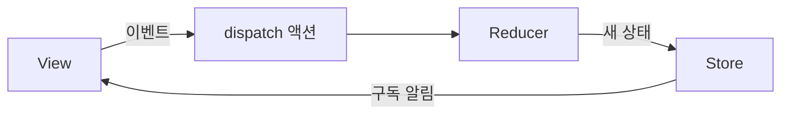

<Callout type="info">
  **이번 문서의 목표:** Redux Toolkit으로 스토어·슬라이스·비동기 로직·메모이제이션 셀렉터를 구성하고, 레거시 Redux 코드를 읽으며, Jotai의 atom 모델을 Zustand·Redux Toolkit과 비교해 선택 기준을 설명할 수 있습니다.
</Callout>

## Redux 세 원칙과 단방향 흐름

Redux는 앱의 전역 상태를 하나의 스토어에 두고, 정해진 규칙으로만 바꾸게 하는 라이브러리입니다. 규칙은 세 가지입니다.

| 원칙 | 내용 |
|------|------|
| 단일 진실 공급원 | 전역 상태는 하나의 스토어 안의 객체 트리로 둔다 |
| 상태는 읽기 전용 | 상태를 바꾸는 유일한 방법은 일어난 일을 설명하는 객체(액션)를 보내는 것이다 |
| 순수 함수로 변경 | 액션이 상태를 어떻게 바꾸는지는 순수한 리듀서로 쓴다 |

상태가 바뀌는 길은 한 방향입니다.



- 액션은 `type` 필드를 가진 일반 객체입니다. `{ type: 'todos/todoAdded', payload: 'milk' }`처럼 씁니다.
- 리듀서는 `(state, action) => newState` 형태입니다. 이전 상태와 액션만으로 계산하고, 원본을 바꾸지 않으며, 비동기 작업이나 부수 효과를 넣지 않습니다.
- 스토어는 `getState()`와 `dispatch()`를 가진 객체이고, 상태가 바뀌면 구독한 UI에 알립니다.
- 셀렉터는 스토어 상태에서 필요한 값을 뽑는 함수입니다.

같은 구조의 Reducer 설계는 02편에서 다뤘습니다. Redux는 그 구조를 앱 전체의 스토어로 키운 것입니다. 상태 라이브러리를 비교하는 틀은 23편에 있습니다.

## configureStore

`configureStore`는 스토어를 만드는 Redux Toolkit의 함수이며, 기본 설정이 이미 갖춰져 있습니다. Redux Toolkit은 현재 2.x입니다.

```ts
import { configureStore } from '@reduxjs/toolkit'
import counterReducer from './counterSlice'

export const store = configureStore({
  reducer: { counter: counterReducer },
})

export type RootState = ReturnType<typeof store.getState>
export type AppDispatch = typeof store.dispatch
```

`reducer`에 객체를 주면 슬라이스 리듀서들이 자동으로 하나로 합쳐집니다. 객체의 키가 상태 트리의 키가 됩니다. 아무 옵션을 주지 않아도 다음이 적용됩니다.

- 비동기 로직을 위한 `redux-thunk` 미들웨어가 들어갑니다.
- 개발 모드에서 실수로 상태를 직접 바꾸는 것과, 상태나 액션에 직렬화할 수 없는 값을 넣는 것을 경고하는 미들웨어가 들어갑니다.
- Redux DevTools 확장 프로그램이 설치돼 있으면 연결됩니다.

React에서 쓰려면 `react-redux` 패키지의 `Provider`로 앱을 감싸 스토어를 내려줍니다.

```tsx
import { Provider } from 'react-redux'
import { store } from './store'

root.render(
  <Provider store={store}>
    <App />
  </Provider>,
)
```

미들웨어를 더할 때는 기본 목록에 이어 붙입니다. `middleware: (getDefault) => getDefault().concat(extra)`처럼 쓰며, 이렇게 하지 않고 배열을 새로 주면 기본 미들웨어가 빠집니다.

## createSlice와 Immer

`createSlice`는 상태 한 조각의 이름, 초기 상태, 리듀서 함수들을 받아 슬라이스 리듀서와 액션 생성 함수를 함께 만들어 줍니다.

```ts
import { createSlice } from '@reduxjs/toolkit'
import type { PayloadAction } from '@reduxjs/toolkit'

const counterSlice = createSlice({
  name: 'counter',
  initialState: { value: 0 },
  reducers: {
    increment: (state) => { state.value += 1 },
    addBy: (state, action: PayloadAction<number>) => {
      state.value += action.payload
    },
  },
})
export const { increment, addBy } = counterSlice.actions
export default counterSlice.reducer
```

- 액션 타입은 `이름/리듀서키`로 만들어집니다. `increment()`의 결과는 `{ type: 'counter/increment', payload: undefined }`입니다.
- 인자를 넘기면 `payload`가 됩니다. `addBy(5)`는 `payload`가 5인 액션을 만듭니다.
- 리듀서 안에서는 상태를 직접 바꾸는 것처럼 쓸 수 있습니다. 내부에서 Immer가 상태의 임시 복사본(draft)에 가해진 변경을 감지해, 원본은 두고 새 불변 상태를 만들기 때문입니다.
- 새 값을 직접 반환해도 됩니다. 다만 draft를 바꾸면서 동시에 새 값을 반환하면 에러입니다. 둘 중 하나만 합니다.

```ts
// 객체 교체는 return으로
reset: () => ({ value: 0 }),
// ❌ state = { value: 0 } (지역 변수만 바뀜, 반영 안 됨)
```

**흔한 실수:** Immer는 `createSlice`와 `createReducer` 안에서만 작동합니다. 이 밖에서 상태를 직접 바꾸면 실제로 원본이 바뀌어 버그가 됩니다. 비동기 액션에 반응하는 리듀서는 `reducers`가 아니라 `extraReducers`에 씁니다(다음 절).

## useSelector와 useDispatch

`useSelector`는 스토어 상태에서 값을 읽고, `useDispatch`는 액션을 보내는 `dispatch` 함수를 돌려줍니다.

```tsx
import { useDispatch, useSelector } from 'react-redux'
import type { RootState, AppDispatch } from './store'

function Counter() {
  const value = useSelector(
    (s: RootState) => s.counter.value,
  )
  const dispatch = useDispatch<AppDispatch>()
  const onClick = () => dispatch(increment())
  return <button onClick={onClick}>{value}</button>
}
```

- 셀렉터는 상태가 바뀔 때마다 실행되고, 이전 반환값과 `===`로 비교해 다를 때만 컴포넌트가 다시 렌더링됩니다.
- 그래서 필요한 값만 좁게 뽑아야 합니다. `useSelector((s) => s.counter)`처럼 큰 덩어리를 받으면 그 안의 무엇이 바뀌어도 렌더링됩니다.
- 타입을 매번 붙이는 대신 한 번만 지정한 훅을 만들어 씁니다. `useDispatch.withTypes<AppDispatch>()`, `useSelector.withTypes<RootState>()`로 `useAppDispatch`, `useAppSelector`를 만듭니다.

**흔한 실수:** 셀렉터 안에서 `filter`, `map`처럼 새 배열이나 객체를 만들어 돌려주는 것입니다. 호출마다 참조가 달라서 어떤 액션이 오든 렌더링됩니다. 해결은 `createSelector`입니다(아래 절).

## createAsyncThunk

`createAsyncThunk`는 Promise를 돌려주는 함수를 받아, 요청의 시작·성공·실패를 알리는 액션을 자동으로 보내는 thunk를 만듭니다. thunk는 액션 대신 함수를 `dispatch`할 수 있게 해 주는 방식입니다.

```ts
import { createAsyncThunk } from '@reduxjs/toolkit'

export const fetchUser = createAsyncThunk(
  'users/fetchById',
  async (userId: number, { signal }) => {
    const url = `/api/users/${userId}`
    const res = await fetch(url, { signal })
    return res.json() // fulfilled의 payload가 됨
  },
)
```

- 첫 인자는 액션 타입 접두사이고, 여기서 `users/fetchById/pending`, `/fulfilled`, `/rejected` 세 타입이 만들어집니다.
- 콜백은 `(arg, thunkAPI)`를 받습니다. `thunkAPI`에는 `dispatch`, `getState`, `signal`, `rejectWithValue` 등이 있습니다.
- 반환값은 `fulfilled` 액션의 `payload`가 되고, 던져진 에러는 `rejected` 액션이 됩니다.

세 액션은 슬라이스의 `extraReducers`에서 처리합니다.

```ts
extraReducers: (builder) => {
  builder
    .addCase(fetchUser.pending, (s) => {
      s.status = 'loading'
    })
    .addCase(fetchUser.fulfilled, (s, a) => {
      s.status = 'idle'
      s.entity = a.payload
    })
    .addCase(fetchUser.rejected, (s) => {
      s.status = 'failed'
    })
}
```

- 컴포넌트에서 결과를 직접 받으려면 `await dispatch(fetchUser(1)).unwrap()`을 씁니다. 성공하면 payload를 돌려주고, 실패하면 에러를 던집니다. `unwrap()`이 없으면 실패해도 Promise는 거부되지 않습니다.
- 서버가 보낸 에러 본문을 `payload`에 담으려면 콜백에서 `return rejectWithValue(body)`를 씁니다.
- 옵션의 `condition(arg, { getState })`이 `false`를 돌려주면 요청이 시작되지 않아, 이미 로딩 중일 때의 중복 호출을 막을 수 있습니다.
- `dispatch(...)`가 돌려주는 값의 `abort()`로 진행 중인 요청을 취소할 수 있고, `signal`을 `fetch`에 넘기면 실제 요청도 중단됩니다.

서버 데이터를 가져와 캐시하는 일에는 thunk로 상태·에러·재요청을 모두 직접 짜야 합니다. 이 부담을 줄이는 것이 다음 절의 RTK Query입니다.

## RTK Query 개요

RTK Query는 Redux Toolkit에 들어 있는 선택 기능으로, 서버 데이터의 요청·캐시·갱신을 선언적으로 처리합니다. 서버 상태 개념은 26편, 같은 역할의 별도 라이브러리는 27편과 28편에서 다룹니다.

```ts
import { createApi, fetchBaseQuery }
  from '@reduxjs/toolkit/query/react'
```

```ts
export const api = createApi({
  reducerPath: 'api',
  baseQuery: fetchBaseQuery({ baseUrl: '/api' }),
  tagTypes: ['Post'],
  endpoints: (build) => ({
    getPosts: build.query<Post[], void>({
      query: () => '/posts',
      providesTags: ['Post'],
    }),
    // addPost 엔드포인트는 아래 블록
  }),
})
```

```ts
// endpoints 안에 이어지는 변경 엔드포인트
addPost: build.mutation<Post, NewPost>({
  query: (body) => ({
    url: '/posts', method: 'POST', body,
  }),
  invalidatesTags: ['Post'],
}),
```

```ts
export const {
  useGetPostsQuery,   // 조회 훅
  useAddPostMutation, // 변경 훅
} = api
```

- `createApi`로 엔드포인트를 정의하면 엔드포인트마다 훅이 만들어집니다. `getPosts`는 `useGetPostsQuery`가 됩니다.
- 조회 훅은 `data`, `isLoading`(첫 요청 중), `isFetching`(어떤 요청이든 진행 중), `error` 등을 돌려줍니다.
- 변경 훅은 `[트리거 함수, 상태]` 배열을 돌려줍니다. 트리거에 `.unwrap()`을 붙이면 결과를 직접 받거나 에러를 잡을 수 있습니다.
- 태그로 캐시를 무효화합니다. 조회가 `providesTags`로 태그를 선언하고, 변경이 `invalidatesTags`로 같은 태그를 무효화하면 해당 조회가 자동으로 다시 요청됩니다.
- 스토어에 연결해야 작동합니다. 리듀서를 `[api.reducerPath]: api.reducer`로 넣고, 미들웨어에 `api.middleware`를 더합니다.

```ts
configureStore({
  reducer: { [api.reducerPath]: api.reducer },
  middleware: (getDefault) =>
    getDefault().concat(api.middleware),
})
```

`setupListeners(store.dispatch)`를 호출하면 포커스 복귀·네트워크 재연결 때의 재요청 옵션(`refetchOnFocus`, `refetchOnReconnect`)이 작동합니다.

## createSelector

`createSelector`는 입력 셀렉터들의 결과가 바뀔 때만 변환 함수를 다시 실행하고, 그렇지 않으면 이전 결과를 그대로 돌려주는 메모이제이션 셀렉터를 만듭니다. Redux Toolkit이 Reselect 라이브러리에서 다시 내보내는 함수입니다.

```ts
import { createSelector } from '@reduxjs/toolkit'

const selectTodos = (s: RootState) => s.todos.items
const selectFilter = (s: RootState) => s.todos.filter

export const selectVisibleTodos = createSelector(
  [selectTodos, selectFilter],
  (todos, filter) =>
    todos.filter((t) => t.status === filter),
)
// 입력이 같으면 같은 배열 참조를 반환
```

- 입력 셀렉터가 상태에서 값을 꺼내고, 마지막 함수가 그 값들로 파생 값을 계산합니다.
- 입력 결과가 이전과 `===`로 같으면 계산을 건너뛰고 캐시된 결과를 돌려줍니다. 결과 참조가 유지되므로 `useSelector`가 불필요한 렌더링을 일으키지 않습니다.
- 인자가 필요하면 입력 셀렉터에서 두 번째 인자를 받습니다. 예: `[selectItems, (state, category: string) => category]`.
- Reselect 5부터 기본 메모이제이션은 `weakMapMemoize`입니다. 인자 조합마다 캐시를 따로 유지합니다.

메모이제이션이 필요한 경우는 새 배열이나 객체를 만들어 돌려주는 파생일 때입니다. `state.todos`를 그대로 꺼내거나 `state.todos[id]`로 하나를 찾는 셀렉터는 참조가 그대로라서 메모이제이션할 이유가 없습니다. 셀렉터는 슬라이스 파일에 리듀서와 함께 두는 것이 관례이며, 이름은 `selectXxx`로 짓습니다.

## Redux DevTools

Redux DevTools는 브라우저 확장 프로그램으로, 보낸 액션과 그에 따른 상태 변화를 시간 순서대로 보여 줍니다.

- 액션 목록에서 항목을 고르면 그 시점의 상태 전체, 이전 상태와의 차이, 액션 내용을 볼 수 있습니다.
- 과거 시점으로 되돌려 UI가 어떻게 보이는지 확인하는 시간 여행 디버깅을 할 수 있습니다.
- `configureStore`는 `devTools` 옵션이 기본 `true`라서 설정 없이 연결됩니다. 끄려면 `false`, 이름·추적 옵션을 주려면 객체를 넘깁니다.

```ts
configureStore({
  reducer,
  devTools: { name: 'my-app' }, // 프로덕션 비활성: false
})
```

DevTools에 상태가 그대로 노출되므로 토큰 같은 민감한 값은 상태에 두지 않거나, 옵션으로 전송 전에 걸러 냅니다. 리듀서가 순수해야 액션 기록으로 상태를 재현할 수 있다는 점이 DevTools의 전제입니다.

## 레거시 Redux 읽는 법

오래된 코드베이스에는 Redux Toolkit 이전 방식이 남아 있습니다. 읽을 때 알아야 할 것은 네 가지 패턴입니다.

| 레거시 | 요즘 대응 |
|--------|-----------|
| 액션 타입 상수와 액션 생성 함수를 손으로 작성 | `createSlice`가 자동 생성 |
| `switch (action.type)` 리듀서와 스프레드·`map`을 이용한 불변 갱신 | `createSlice`의 리듀서와 Immer |
| `createStore(rootReducer, applyMiddleware(thunk))` | `configureStore` |
| `connect(mapStateToProps, mapDispatchToProps)(Component)` | `useSelector`, `useDispatch` |

```js
// 레거시 리듀서
function todos(state = [], action) {
  switch (action.type) {
    case 'ADD_TODO':
      return [...state, { text: action.text, done: false }]
    default:
      return state // 모르는 액션은 상태를 그대로 반환
  }
}
```

- 리듀서의 `state = []`는 초기 상태이고, `default`는 처리하지 않는 액션을 무시하는 분기입니다.
- `combineReducers({ todos, filter })`는 `configureStore`의 `reducer` 객체와 같은 일을 합니다.
- `connect`는 컴포넌트를 감싸서 `mapStateToProps`가 돌려준 객체를 props로 주입하고, `mapDispatchToProps`가 액션 전송 함수를 props로 줍니다. React-Redux 9.3.0부터 deprecated이지만 계속 작동하며 제거할 계획은 없다고 공식 문서가 밝힙니다. 훅 API를 권장하고, 기존 코드는 `legacy_connect` 별칭으로 표시 없이 쓸 수 있습니다.
- `redux` 코어 패키지의 `createStore`도 deprecated 표시가 붙지만 계속 작동하고 제거되지 않습니다. 이 표시는 `configureStore`로 옮기라는 시각적 신호일 뿐 런타임 경고는 없습니다. 같은 이유로 `legacy_createStore`라는 별칭이 있습니다.
- 모던 Redux로 옮길 때는 한꺼번에 바꿀 필요가 없습니다. 레거시 리듀서는 `configureStore`의 `reducer`에 그대로 넣을 수 있어서 슬라이스를 하나씩 바꿀 수 있습니다.

## Jotai

Jotai는 상태를 작은 단위인 atom으로 쪼개고 atom끼리 조합하는 라이브러리입니다. 단일 스토어에 객체를 쌓는 Redux·Zustand와 달리 아래에서 위로 쌓는 방식입니다. 현재 v3입니다(2026-09 발표). `useAtom`, `useAtomValue`, `useSetAtom`의 시그니처와 동작은 v2와 같습니다.

### atom

`atom(초기값)`은 기본 atom을 만들고, 값은 컴포넌트에서 `useAtom`으로 `useState`처럼 읽고 씁니다.

```tsx
import { atom, useAtom } from 'jotai'

const countAtom = atom(0) // atom 정의일 뿐 값은 스토어가 가짐

function Counter() {
  const [count, setCount] = useAtom(countAtom)
  const inc = () => setCount((c) => c + 1)
  return <button onClick={inc}>{count}</button>
}
```

- atom 객체는 값을 담지 않는 설정 객체이고, 값은 스토어에 있습니다. atom의 참조가 곧 키이므로 렌더링 안에서 매번 새로 만들면 안 됩니다. 모듈 최상위에 두거나 `useMemo`로 고정합니다.
- 필요한 쪽만 쓰는 훅이 있습니다. `useAtomValue`는 읽기만, `useSetAtom`은 쓰기만 하며, 쓰기만 하는 컴포넌트는 값이 바뀌어도 다시 렌더링되지 않습니다.
- `Provider`는 선택입니다. 없으면 기본 스토어를 쓰고(provider-less mode), 서로 다른 하위 트리에 별도 상태가 필요할 때 `Provider`로 감쌉니다.

### 파생 atom

다른 atom을 읽어 계산하는 atom입니다. `atom(read, write)`의 인자 위치로 세 형태를 구분합니다.

```ts
const priceAtom = atom(10)
```

```ts
// 읽기 전용: 의존 atom이 바뀌면 다시 계산
const doubleAtom = atom((get) => get(priceAtom) * 2)

// 쓰기 전용: 첫 인자를 null로
const discountAtom = atom(
  null,
  (get, set, amount: number) => {
    set(priceAtom, (p) => p - amount)
  },
)
```

```ts
// 읽기·쓰기 겸용
const halfAtom = atom(
  (get) => get(priceAtom) / 2,
  (get, set, v: number) => set(priceAtom, v * 2),
)
```

- `get`으로 읽는 순간 의존 관계가 등록되고, 읽을 때마다 갱신됩니다. 의존하는 atom이 바뀐 컴포넌트만 렌더링되므로 Zustand·Redux처럼 셀렉터를 직접 쓰지 않아도 렌더링이 최적화됩니다.
- 쓰기 함수의 인자는 `get`, `set`, 그리고 `useSetAtom`의 setter에 넘긴 값입니다. 한 번의 쓰기로 여러 atom을 갱신하는 액션 역할을 합니다.
- 읽는 컴포넌트가 없어지면 그 atom의 값은 스토어에서 정리됩니다.

### 비동기 atom

read 함수를 `async`로 쓰면 비동기 atom이 됩니다.

```ts
const userIdAtom = atom(1)

const userAtom = atom(async (get, { signal }) => {
  const id = get(userIdAtom)
  const res = await fetch(`/api/users/${id}`, { signal })
  return res.json()
})
```

- `userIdAtom`이 바뀌면 `userAtom`이 다시 실행됩니다. 두 번째 인자의 `signal`을 `fetch`에 넘기면 의존 값이 바뀌어 이전 요청이 필요 없어질 때 취소됩니다.
- `useAtomValue(userAtom)`은 값이 올 때까지 컴포넌트를 Suspense로 중단시킵니다. 로딩은 `Suspense`의 fallback(11편), 실패는 Error Boundary(13편)가 맡습니다.
- v3의 `useAtomValue`는 React 19에서 `use`로 Promise를 읽어 중단하고(15편), React 18에서도 같은 동작으로 대체됩니다.
- read 함수 안의 `get`은 Promise를 풀어 주지 않습니다. 비동기 atom을 다른 파생 atom에서 읽으려면 `await get(userAtom)`으로 기다립니다.
- 중단시키지 않고 값만 쓰고 싶으면 `jotai/utils`의 `unwrap`으로 감쌉니다.

```ts
import { unwrap } from 'jotai/utils'

const syncUserAtom = unwrap(
  userAtom,
  (prev) => prev ?? null,
)
// 대기 중에는 이전 값(없으면 null), 에러는 그대로 던져짐
```

v3에서 `loadable`은 제거됐고, `unwrap`으로 같은 동작을 직접 구현하라고 안내합니다. `atomFamily`는 `jotai-family` 패키지로 분리됐습니다.

**흔한 실수:** 비동기 atom을 서버 상태 캐시로 쓰는 것입니다. atom은 캐시 수명, 재요청, 무효화를 관리하지 않습니다. 서버 데이터는 TanStack Query 같은 도구에 맡기는 편이 낫습니다(26편).

## Zustand·Redux Toolkit·Jotai 비교표

| 항목 | Zustand | Redux Toolkit | Jotai |
|------|---------|---------------|-------|
| 상태 구조 | 하나의 스토어 객체 | 하나의 스토어, 슬라이스로 분할 | 작은 atom을 조합 |
| 갱신 방식 | `set`으로 상태 객체 갱신 | 액션 `dispatch` 후 리듀서 | atom 쓰기 함수 |
| 렌더링 최적화 | 셀렉터를 직접 작성 | 셀렉터를 직접 작성 | atom 의존성이 자동 추적 |
| Provider | 필요 없음 | 필요함 | 선택 |
| 보일러플레이트 | 적음 | 많은 편 | 적음 |
| 비동기 | 액션 안에서 직접 | `createAsyncThunk`, RTK Query | 비동기 atom |
| 개발 도구 | `devtools` 미들웨어로 연결 | Redux DevTools 기본 연결 | 별도 도구·확장 |
| 어울리는 경우 | 단순한 전역 상태 | 큰 팀, 복잡한 상태 전이, 기존 Redux | 조각난 상태, 의존 관계가 많은 파생 값 |

- 구분 기준은 상태를 어떻게 모양 잡느냐입니다. 하나의 거대한 객체로 보면 Zustand나 Redux, 독립된 조각들의 그래프로 보면 Jotai가 자연스럽습니다.
- Redux는 액션 로그와 시간 여행 디버깅, 규칙이 강제하는 일관성이 장점이고 그만큼 코드가 늘어납니다. 새로 시작하는 프로젝트의 소규모 전역 상태에는 Zustand나 Jotai가 간결합니다(Zustand는 24편).
- 이 중 어느 것도 서버 데이터 캐시를 대신하지 않습니다. 서버 상태는 TanStack Query나 RTK Query가 맡고, 그 위에 남은 클라이언트 상태만 위 세 가지로 관리하는 구성이 흔합니다(22편).

## 핵심 정리

- Redux는 단일 스토어, 액션으로만 변경, 순수 리듀서라는 세 원칙과 단방향 흐름이 핵심입니다.
- Redux Toolkit은 `configureStore`(thunk·DevTools 기본 포함), `createSlice`(Immer로 직접 변경하는 문법), `createAsyncThunk`, `createSelector`로 보일러플레이트를 줄입니다.
- `useSelector`는 반환값을 `===`로 비교하므로 새 참조를 만드는 파생에는 `createSelector`를 씁니다. 서버 데이터는 RTK Query의 태그 무효화로 다룹니다.
- 레거시의 `switch` 리듀서, `createStore`, `connect`는 계속 작동하며, 같은 일을 하는 모던 API로 하나씩 옮길 수 있습니다.
- Jotai는 atom의 참조를 키로 쓰고, 파생·비동기 atom을 조합하며, 의존성 추적으로 렌더링을 자동 최적화합니다. 현재 v3입니다.
- 선택은 상태 모양과 팀 규모로 정하고, 서버 상태는 별도 도구로 분리합니다.

## 마무리 복습

<Quiz
  questionNumber={1}
  question="createSlice의 리듀서 안에서 state.value += 1 처럼 상태를 직접 바꾸는 것처럼 써도 되는 이유는?"
  options={['Redux가 상태 객체를 항상 동결해서 변경이 무시되기 때문', 'Immer가 임시 복사본의 변경을 감지해 새 불변 상태를 만들기 때문', 'configureStore가 리듀서를 비동기로 실행하기 때문', 'useSelector가 변경을 되돌리기 때문']}
  correctAnswer={2}
  explanation="createSlice와 createReducer는 내부에서 Immer를 사용합니다. draft에 가해진 변경을 감지해 원본은 그대로 두고 새 불변 상태를 만듭니다. 이 밖에서 직접 바꾸면 실제로 원본이 변해 버그가 됩니다."
  optionExplanations={['동결이 아니라 Immer의 draft 방식입니다. 개발 모드의 직접 변경 감지는 별개 기능입니다.', 'Immer의 draft 방식 덕분입니다.', '리듀서 실행 방식과 무관하며 리듀서는 동기 순수 함수입니다.', 'useSelector는 상태를 읽는 훅일 뿐 변경과 관계가 없습니다.']}
/>

<Quiz
  questionNumber={2}
  question="useSelector 안에서 todos 배열에 filter를 호출해 결과를 그대로 반환하면 어떤 문제가 생기고, 해결책은 무엇인가?"
  options={['에러가 발생한다. 해결책은 useDispatch를 쓰는 것이다', '호출마다 새 배열이 만들어져 어떤 액션에도 렌더링된다. 해결책은 createSelector로 메모이제이션하는 것이다', '항상 오래된 값을 읽는다. 해결책은 Provider를 두 번 감싸는 것이다', '렌더링되지 않는다. 해결책은 connect를 쓰는 것이다']}
  correctAnswer={2}
  explanation="useSelector는 반환값을 이전 값과 비교해 다를 때 렌더링합니다. filter는 매번 새 배열을 만들어 참조가 달라지므로 불필요한 렌더링이 생기고, createSelector는 입력이 같으면 같은 참조를 돌려줍니다."
  optionExplanations={['에러가 아니라 렌더링 낭비 문제이고 dispatch와 무관합니다.', '새 참조 생성이 원인이고 createSelector가 해결책입니다.', '오래된 값을 읽는 문제가 아니며 Provider 중복은 해결책이 아닙니다.', '오히려 불필요하게 렌더링되고 connect는 deprecated된 방식입니다.']}
/>

<Quiz
  questionNumber={3}
  question="Jotai의 비동기 atom을 useAtomValue로 읽는 컴포넌트에서 데이터가 도착하기 전에 일어나는 일은?"
  options={['undefined를 반환하고 계속 렌더링한다', '컴포넌트가 Suspense로 중단되어 가장 가까운 Suspense의 fallback이 보인다', '자동으로 에러가 던져진다', '스토어가 초기화된다']}
  correctAnswer={2}
  explanation="비동기 atom을 useAtomValue로 읽으면 값이 올 때까지 컴포넌트가 중단되어 상위 Suspense의 fallback이 표시됩니다. 중단 없이 쓰려면 jotai/utils의 unwrap으로 감쌉니다."
  optionExplanations={['undefined 반환은 unwrap으로 감쌌을 때의 동작입니다.', '기본 동작이 Suspense 중단입니다.', '에러는 요청이 실패했을 때 던져지며 대기 중에는 아닙니다.', '스토어 초기화와는 관계가 없습니다.']}
/>

## 참고 자료

- [Redux — Three Principles](https://redux.js.org/understanding/thinking-in-redux/three-principles)
- [Redux Essentials — Redux Overview and Concepts](https://redux.js.org/tutorials/essentials/part-1-overview-concepts)
- [Redux Toolkit — Getting Started](https://redux.js.org/toolkit/introduction/getting-started)
- [Redux Essentials — App Structure](https://redux.js.org/tutorials/essentials/part-2-app-structure)
- [Redux Toolkit — createAsyncThunk](https://redux.js.org/toolkit/api/createAsyncThunk)
- [Redux — RTK Query Basics](https://redux.js.org/tutorials/essentials/part-7-rtk-query-basics)
- [Redux — Deriving Data with Selectors](https://redux.js.org/usage/deriving-data-selectors)
- [Redux — Configuring Your Store](https://redux.js.org/usage/configuring-your-store)
- [Redux — Why Redux Toolkit is How To Use Redux Today](https://redux.js.org/introduction/why-rtk-is-redux-today)
- [Redux — createStore (deprecated)](https://redux.js.org/api/createstore)
- [React Redux — connect](https://redux.js.org/react-redux/api/connect)
- [Jotai — atom](https://jotai.org/docs/core/atom)
- [Jotai — useAtom](https://jotai.org/docs/core/use-atom)
- [Jotai — Provider](https://jotai.org/docs/core/provider)
- [Jotai — Async utilities](https://jotai.org/docs/utilities/async)
- [Jotai — Migrating to v3](https://jotai.org/docs/guides/migrating-to-v3)
- [Jotai — Comparison](https://jotai.org/docs/basics/comparison)
- [Zustand — Comparison](https://zustand.docs.pmnd.rs/learn/getting-started/comparison)
