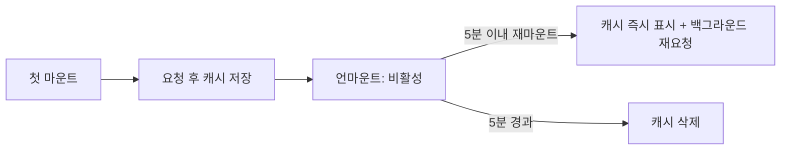

<Callout type="info">
  **이번 문서의 목표:** 서버 상태가 왜 별도의 도구로 다뤄지는지 설명하고, 서버 상태 관리가 풀어야 하는 문제(가져오기·캐시·중복 제거·재검증·변경·낙관적 업데이트·페이지네이션)를 구분할 수 있습니다.
</Callout>

## 서버 상태와 클라이언트 상태

서버 상태(server state)는 서버에 저장돼 있고, 클라이언트는 그 사본만 가진 데이터입니다. 모달이 열렸는지, 입력창에 무엇을 쳤는지 같은 클라이언트 상태와는 성질이 다릅니다. TanStack Query 문서는 서버 상태를 다음과 같이 규정합니다.

- 내가 소유하거나 통제하지 않는 원격 위치에 저장되어 있다.
- 가져오고 갱신하려면 비동기 API가 필요하다.
- 내가 모르는 사이에 다른 사람이 바꿀 수 있다.
- 조심하지 않으면 화면의 데이터가 오래된 것이 될 수 있다.

화면에 있는 값은 원본이 아니라 어느 시점에 찍은 스냅샷입니다. 그래서 언제 다시 가져올지, 같은 데이터를 여러 번 가져오지 않으려면 어떻게 할지, 바뀐 뒤 화면을 어떻게 맞출지가 문제가 됩니다. 이 문제들을 `useState`와 Redux 같은 클라이언트 상태 도구로 직접 풀면 코드가 길어집니다. 상태 종류별 도구 배치는 22편에서 다뤘습니다.

## Fetching

Fetching은 서버에서 데이터를 가져와 화면 상태로 만드는 일입니다. 서버 상태 도구 없이 하는 기본 방식은 `useEffect` 안에서 `fetch`를 호출하는 것입니다.

```tsx
useEffect(() => {
  let ignore = false
  fetchResults(query).then((json) => {
    if (!ignore) setResults(json)
  })
  return () => { ignore = true }
}, [query])
```

- `query`가 `h`, `he`, `hel`로 빠르게 바뀌면 요청이 여러 개 나가고, 응답이 도착하는 순서는 보장되지 않습니다. 오래된 응답이 나중에 도착해 화면을 덮는 경쟁 상태(race condition)가 생기므로, 정리 함수에서 `ignore` 플래그를 세워 무시해야 합니다.
- 로딩·에러 상태, 재시도, 요청 취소도 직접 짜야 합니다.
- react.dev는 Effect로 가져올 때의 한계를 세 가지로 듭니다. 캐시가 없고, 부모가 끝나야 자식이 요청을 시작하는 네트워크 워터폴이 생기며, 서버 렌더링 HTML에 데이터를 담을 수 없습니다.
- 그래서 프레임워크의 내장 기능이나 React Query, useSWR 같은 클라이언트 캐시 라이브러리를 쓰라고 권합니다.

서버 상태 도구는 이 일을 선언으로 바꿉니다. 키와 가져오는 함수만 주면 로딩·에러·데이터 상태와 아래 절의 기능들이 따라옵니다.

```tsx
const { isPending, error, data } = useQuery({
  queryKey: ['todos'],
  queryFn: fetchTodos,
})
```

- `queryKey`는 이 데이터의 이름표이고 캐시의 열쇠입니다.
- `queryFn`은 데이터를 돌려주는 Promise 함수입니다.
- 사용법은 27편에서 자세히 다룹니다.

## Caching

캐싱은 가져온 데이터를 키별로 보관해 두었다가, 같은 키를 다시 요청하면 네트워크 대신 보관본을 먼저 보여 주는 것입니다. 화면 전환 뒤 돌아왔을 때 로딩 없이 바로 데이터가 보입니다.

- 캐시는 키 하나가 데이터 하나에 대응합니다. 같은 키를 쓰는 컴포넌트는 같은 캐시를 공유하므로, 한 곳에서 갱신되면 모두 갱신됩니다.
- 캐시는 영원하지 않습니다. 쓰는 컴포넌트가 모두 사라진 항목은 비활성(inactive)이 되고, 일정 시간이 지나면 메모리에서 제거됩니다. TanStack Query는 기본 5분입니다(`gcTime`).
- 보관본을 얼마나 믿을지 정하는 것이 신선도입니다(아래 Stale Data).



**흔한 실수:** 서버 데이터를 `useState`나 전역 스토어로 복사해 두는 것입니다. 복사본은 서버가 바뀌어도 갱신되지 않아 두 곳의 값이 어긋납니다. 서버 데이터는 캐시를 단일 출처로 두고, 화면에서 읽기만 합니다.

## Deduplication

중복 제거는 같은 키로 동시에 들어온 요청을 하나로 합치는 것입니다. 한 화면에 같은 데이터를 쓰는 컴포넌트가 여러 개 있어도 요청은 한 번만 나갑니다.

- 컴포넌트마다 `useQuery({ queryKey: ['user', 1], ... })`를 호출해도 진행 중인 요청 하나를 모두가 기다립니다.
- 그래서 데이터가 필요한 컴포넌트가 직접 훅을 호출하게 하고, 부모에서 props로 내려주려고 요청 위치를 끌어올리지 않아도 됩니다.
- SWR도 같은 키를 쓰는 여러 컴포넌트가 하나의 요청만 일으키는 자동 요청 중복 제거를 기능으로 제시합니다.
- 합쳐지는 범위는 동시에 진행 중인 요청입니다. 이미 끝난 데이터를 다시 가져올지는 신선도가 정합니다.

## Revalidation

재검증(revalidation)은 캐시에 있는 데이터가 아직 서버와 같은지 다시 요청해 확인하고 갱신하는 일입니다. 사용자는 기존 데이터를 보는 동안 뒤에서 조용히 일어납니다.

시작 시점은 크게 세 가지입니다.

| 시점 | 예 |
|------|----|
| 이벤트 | 컴포넌트가 새로 마운트됨, 창이 다시 포커스를 받음, 네트워크가 재연결됨 |
| 시간 | 일정 주기마다(폴링) |
| 직접 지시 | 변경 후 관련 캐시를 무효화(invalidate) |

- TanStack Query는 데이터가 오래된 상태일 때 새 인스턴스 마운트, 창 포커스, 네트워크 재연결에서 자동으로 다시 가져옵니다.
- 무효화는 해당 데이터를 즉시 오래된 것으로 표시하고, 화면에 쓰이는 쿼리는 백그라운드로 다시 가져옵니다. 키 앞부분이 일치하는 쿼리를 한꺼번에 무효화할 수 있습니다.

```tsx
queryClient.invalidateQueries({ queryKey: ['todos'] })
// 'todos'로 시작하는 모든 키가 stale이 되고
// 화면에 쓰이는 쿼리는 다시 요청됨
```

SWR 라이브러리도 노트북이 절전에서 깨거나 탭을 전환하면 자동으로 데이터를 갱신하는 재검증을 기능으로 내세웁니다.

## Stale Data

오래된 데이터(stale data)는 서버와 다를 수 있다고 간주하는 캐시 데이터입니다. 서버 상태 도구는 데이터를 보여 주지 않는 대신, 오래됐더라도 일단 보여 주고 뒤에서 갱신하는 쪽을 택합니다.

- 캐시 항목은 신선(fresh) 상태와 오래됨(stale) 상태를 오갑니다. 신선한 동안은 다시 요청하지 않고, 오래되면 재검증 시점에 요청합니다.
- 얼마 동안 신선으로 칠지는 설정입니다. TanStack Query에서 `staleTime`의 기본값은 0이라, 가져온 직후부터 오래된 것으로 칩니다. 그래서 같은 키의 새 컴포넌트가 마운트되면 캐시를 즉시 보여 주면서 바로 재요청합니다.
- `staleTime`을 늘리면 그 시간 동안 재요청이 사라지고, 변하지 않는 데이터에는 크게 줄입니다.
- `staleTime`과 `gcTime`은 다른 개념입니다. 앞은 다시 요청해야 하는지의 기준이고, 뒤는 쓰이지 않는 캐시를 언제 지울지의 기준입니다(27편).
- 사용자가 낡은 값을 봐도 되는지는 데이터마다 다릅니다. 재고 수량과 약관 문서는 허용 범위가 다르므로 한 값으로 통일하지 않습니다.

## Mutation

뮤테이션(mutation)은 서버의 데이터를 만들고 바꾸고 지우는 요청입니다. 조회(query)와 달리 같은 요청을 자동으로 반복하거나 캐시에서 되돌려 줄 수 없고, 사용자 동작 한 번이 요청 한 번입니다.

```tsx
const mutation = useMutation({
  mutationFn: (todo: NewTodo) => postTodo(todo),
  onSuccess: () => {
    queryClient.invalidateQueries({ queryKey: ['todos'] })
  },
})
mutation.mutate({ title: 'milk' })
```

- 뮤테이션 훅은 대기·성공·실패 상태를 줍니다. 상태 이름은 `isIdle`, `isPending`, `isError`, `isSuccess`입니다.
- 변경이 끝나면 서버와 어긋난 캐시를 맞춰야 합니다. 방법은 둘입니다. 관련 쿼리를 무효화해 다시 가져오거나, 응답으로 캐시를 직접 갱신합니다.
- 무효화는 간단하고 정확합니다. 응답으로 직접 갱신하면 요청이 한 번 줄어들지만 서버의 계산 결과를 클라이언트가 흉내 내야 할 수 있습니다.
- 뮤테이션은 기본적으로 실패해도 자동 재시도하지 않습니다.
- 자세한 사용법은 28편입니다.

## Optimistic Update

낙관적 업데이트(optimistic update)는 서버 응답을 기다리지 않고 성공을 가정해 화면을 먼저 바꾸는 방식입니다. 좋아요 버튼이나 체크박스에서 반응이 즉시 보이게 합니다.

순서는 항상 같습니다.

1. 변경 요청을 보내면서, 화면(또는 캐시)을 성공했을 때의 모습으로 먼저 바꾼다.
2. 성공하면 서버의 결과와 맞춘다(보통 다시 가져옴).
3. 실패하면 원래 모습으로 되돌린다(롤백).

TanStack Query 문서가 소개하는 구현은 두 가지입니다.

| 방식 | 내용 | 적합한 경우 |
|------|------|-------------|
| UI에서 처리 | 뮤테이션이 대기 중인 동안 `variables`로 임시 항목을 렌더링 | 낙관적 결과가 한 곳에만 보일 때. 롤백 코드가 필요 없다 |
| 캐시에서 처리 | `onMutate`에서 캐시를 먼저 고치고, 실패하면 저장해 둔 이전 값으로 복원 | 여러 화면에 동시에 반영돼야 할 때 |

React 자체의 `useOptimistic`도 같은 일을 합니다(8편). 캐시 방식의 단계별 코드는 28편입니다.

**흔한 실수:** 되돌리기를 만들지 않는 것입니다. 실패했는데 화면이 성공 상태로 남으면 사용자는 저장된 줄 압니다. 또 실패 사유를 알려 주지 않고 값만 되돌리면 혼란스러우므로 에러 안내를 함께 둡니다.

## Pagination

페이지네이션은 큰 목록을 쪼개 한 번에 한 쪽씩 가져오는 방식입니다. 서버 상태에서는 페이지마다 별개의 캐시 항목이 됩니다.

```tsx
const { data, isPlaceholderData } = useQuery({
  queryKey: ['projects', page],
  queryFn: () => fetchProjects(page),
  placeholderData: keepPreviousData,
})
```

- 키에 페이지 번호가 들어가므로 페이지를 바꾸면 새 쿼리로 취급됩니다. 한 번 본 페이지로 돌아가면 캐시에서 바로 나옵니다.
- 아무 처리가 없으면 페이지를 넘길 때마다 성공 상태에서 로딩 상태로 떨어졌다가 돌아와, 화면이 깜빡입니다.
- `placeholderData: keepPreviousData`를 주면 새 페이지가 올 때까지 이전 페이지의 데이터를 보여 줍니다. 이때 `isPlaceholderData`가 `true`이므로 다음 쪽 버튼을 잠시 비활성화하는 데 씁니다.
- 서버 방식은 두 가지입니다. 페이지 번호나 오프셋을 받는 방식은 임의의 쪽으로 이동할 수 있고, 커서를 받는 방식은 중간에 데이터가 추가·삭제돼도 중복이나 누락이 적습니다.

## Infinite Query

무한 쿼리(infinite query)는 "더 보기"와 무한 스크롤처럼 쪽을 이어 붙이며 누적하는 목록을 위한 쿼리입니다. 페이지네이션이 한 쪽씩 교체하는 것과 달리 앞서 가져온 쪽을 그대로 두고 뒤에 이어 붙입니다.

```tsx
const q = useInfiniteQuery({
  queryKey: ['projects'],
  queryFn: ({ pageParam }) => fetchProjects(pageParam),
  initialPageParam: 0,
  getNextPageParam: (last) => last.nextCursor,
})
```

- `initialPageParam`은 첫 쪽의 파라미터이고, `getNextPageParam`은 마지막 쪽의 응답에서 다음 파라미터를 계산해 돌려줍니다. 더 없으면 `undefined`를 돌려줍니다.
- 결과는 쪽 단위 배열인 `data.pages`로 오고, `fetchNextPage`, `hasNextPage`, `isFetchingNextPage`로 더 가져오기를 제어합니다.
- `fetchNextPage`를 이미 요청이 진행 중일 때 부르면 갱신 중인 데이터를 덮어쓸 위험이 있어, 진행 중이 아닐 때만 호출합니다.
- 메모리를 아끼려면 `maxPages`로 보관할 쪽 수를 제한할 수 있습니다.
- 스크롤 끝을 감지하는 방법은 21편, 구현은 28편에서 다룹니다.

## TanStack Query 계열과 SWR

서버 상태 라이브러리는 위 문제들을 풀어 주는 도구이며 대표적인 것이 TanStack Query와 SWR입니다.

| 항목 | TanStack Query | SWR |
|------|----------------|-----|
| 조회 훅 | `useQuery`, `useInfiniteQuery` | `useSWR` |
| 변경 | `useMutation`을 기본 제공 | `useSWRMutation` |
| 캐시 키 | 배열 `queryKey` | 문자열 등 키(보통 URL) |
| 반환값 | `isPending`, `error`, `data` | `isLoading`, `error`, `data` |

- TanStack Query는 2026-10 기준 v5이고, 이 과정은 v5를 기준으로 합니다. React용 패키지 이름은 `@tanstack/react-query`이며 React 18 이상을 지원합니다.
- SWR은 `useSWR(key, fetcher)` 한 줄로 시작하는 단순한 형태가 특징이고, 수동으로 실행하는 원격 변경에는 `useSWRMutation`을 제공합니다.
- RTK Query(25편)도 같은 역할을 Redux 스토어 안에서 합니다. Redux를 이미 쓰는 프로젝트에서는 별도 도구를 추가하지 않고 선택할 수 있습니다.
- 채용 공고에서 데이터 패칭 라이브러리로 가장 자주 요구되는 것이 TanStack Query입니다(과정 소개 기준). 이 과정은 27편과 28편에서 이를 다룹니다.

## stale-while-revalidate의 출처

stale-while-revalidate(SWR)는 라이브러리 이름이기 전에 HTTP 캐시 전략입니다. RFC 5861이 `Cache-Control` 응답 헤더의 확장으로 정의했고, SWR 라이브러리 문서도 이름의 뜻을 이 전략으로 설명합니다.

```http
Cache-Control: max-age=600, stale-while-revalidate=30
```

- `max-age=600`은 600초 동안 응답이 신선하다는 뜻입니다.
- `stale-while-revalidate=30`은 신선 기간이 끝난 뒤 30초 동안은 오래된 응답을 그대로 쓰게 하되 뒤에서 재검증하라는 뜻입니다. 캐시가 낡은 응답을 즉시 돌려주고 비동기로 갱신하므로, 클라이언트는 재검증의 지연을 느끼지 못합니다.
- 같은 RFC의 `stale-if-error`는 원본 서버가 오류를 낼 때 지정한 시간 동안 오래된 응답을 대신 쓰게 합니다.

서버 상태 라이브러리가 하는 일은 같은 발상을 브라우저 메모리 안 앱 단위 캐시에 옮긴 것입니다. 캐시된 값을 즉시 보여 주고(stale), 뒤에서 다시 가져와(revalidate) 값이 다르면 교체합니다. 다만 HTTP 헤더는 서버가 정하는 브라우저·CDN 캐시이고, 라이브러리의 `staleTime`은 클라이언트 코드가 정하는 별개의 설정이라 서로 대체하지 않으며 함께 작동합니다.

## 핵심 정리

- 서버 상태는 원격에 있고 비동기로 접근하며 내가 모르게 바뀔 수 있어, 화면의 값은 항상 스냅샷입니다.
- Effect로 직접 가져오면 경쟁 상태를 막는 정리, 캐시, 중복 제거, 재시도를 모두 직접 짜야 합니다.
- 서버 상태 도구는 캐시와 중복 제거, 오래된 데이터 표시와 백그라운드 재검증, 무효화를 제공합니다.
- 변경은 뮤테이션이고, 끝난 뒤 캐시를 무효화하거나 직접 갱신하며, 낙관적 업데이트는 먼저 반영하고 실패하면 롤백합니다.
- 페이지네이션은 이전 데이터를 유지해 깜빡임을 막고, 무한 쿼리는 쪽을 이어 붙이며 누적합니다.
- stale-while-revalidate는 RFC 5861의 HTTP 캐시 전략이고, TanStack Query와 SWR이 같은 발상을 앱 캐시에 적용합니다.

## 마무리 복습

<Quiz
  questionNumber={1}
  question="서버 상태를 클라이언트 상태와 구별하는 가장 중요한 특징은?"
  options={['값이 숫자나 문자열로만 이루어진다', '원격에 있는 데이터의 스냅샷이어서 다른 사용자의 변경으로 오래된 값이 될 수 있다', '컴포넌트가 사라지면 자동으로 삭제된다', '반드시 Redux 스토어에만 보관해야 한다']}
  correctAnswer={2}
  explanation="서버 상태는 내가 통제하지 않는 원격에 저장되고 비동기 API로 접근하며 다른 사람이 바꿀 수 있습니다. 그래서 캐시, 재검증, 오래된 데이터 처리가 필요합니다."
  optionExplanations={['값의 타입과는 무관합니다.', '서버 상태의 정의에 해당하는 특징입니다.', '캐시 제거는 서버 상태의 정의가 아니라 라이브러리의 가비지 컬렉션 설정입니다.', '보관 위치에 정해진 규칙은 없고 서버 상태 도구의 캐시를 쓰는 편이 일반적입니다.']}
/>

<Quiz
  questionNumber={2}
  question="TanStack Query에서 staleTime의 기본값이 0일 때, 이미 캐시가 있는 같은 키를 쓰는 컴포넌트가 새로 마운트되면 일어나는 일은?"
  options={['캐시를 무시하고 로딩 화면만 보여 준다', '요청 없이 캐시 데이터만 계속 보여 준다', '캐시 데이터를 즉시 보여 주면서 백그라운드로 다시 요청한다', '캐시를 삭제하고 에러를 낸다']}
  correctAnswer={3}
  explanation="staleTime이 0이면 가져온 직후부터 오래된 데이터로 취급합니다. 새 인스턴스가 마운트되면 캐시를 즉시 돌려주고 동시에 백그라운드 재요청을 실행해, 완료되면 화면을 갱신합니다."
  optionExplanations={['캐시가 있으면 로딩 대신 캐시를 먼저 보여 줍니다.', '오래된 데이터는 마운트 시 재요청 대상입니다.', 'stale-while-revalidate 방식의 동작입니다.', '캐시 삭제는 사용하는 컴포넌트가 없는 상태가 gcTime만큼 지속된 뒤의 일입니다.']}
/>

<Quiz
  questionNumber={3}
  question="페이지네이션 목록에서 페이지를 넘길 때 화면이 로딩 상태로 깜빡이는 것을 막는 TanStack Query의 방법은?"
  options={['queryKey에서 페이지 번호를 뺀다', 'placeholderData에 keepPreviousData를 지정해 이전 페이지 데이터를 유지한다', 'gcTime을 0으로 설정한다', 'useMutation으로 페이지를 가져온다']}
  correctAnswer={2}
  explanation="페이지마다 키가 바뀌면 새 쿼리가 되어 성공과 로딩 상태를 오가며 깜빡입니다. placeholderData의 keepPreviousData는 새 데이터가 오기 전까지 이전 데이터를 보여 주고 isPlaceholderData로 상태를 알려 줍니다."
  optionExplanations={['키에서 페이지를 빼면 모든 페이지가 같은 캐시를 써서 잘못된 데이터가 보입니다.', '이전 데이터를 유지하는 올바른 방법입니다.', 'gcTime은 캐시 삭제 시점이라 깜빡임과 직접 관련이 없습니다.', '조회에는 useQuery를 쓰고 useMutation은 데이터를 변경하는 요청에 씁니다.']}
/>

## 참고 자료

- [TanStack Query — Overview](https://tanstack.com/query/latest/docs/framework/react/overview)
- [TanStack Query — Important Defaults](https://tanstack.com/query/latest/docs/framework/react/guides/important-defaults)
- [TanStack Query — Caching](https://tanstack.com/query/latest/docs/framework/react/guides/caching)
- [TanStack Query — Query Invalidation](https://tanstack.com/query/latest/docs/framework/react/guides/query-invalidation)
- [TanStack Query — Mutations](https://tanstack.com/query/latest/docs/framework/react/guides/mutations)
- [TanStack Query — Optimistic Updates](https://tanstack.com/query/latest/docs/framework/react/guides/optimistic-updates)
- [TanStack Query — Paginated Queries](https://tanstack.com/query/latest/docs/framework/react/guides/paginated-queries)
- [TanStack Query — Infinite Queries](https://tanstack.com/query/latest/docs/framework/react/guides/infinite-queries)
- [React — You Might Not Need an Effect](https://react.dev/learn/you-might-not-need-an-effect)
- [SWR — Getting Started](https://swr.vercel.app/docs/getting-started)
- [RFC 5861 — HTTP Cache-Control Extensions for Stale Content](https://datatracker.ietf.org/doc/html/rfc5861)
- [MDN — Cache-Control](https://developer.mozilla.org/en-US/docs/Web/HTTP/Reference/Headers/Cache-Control)
