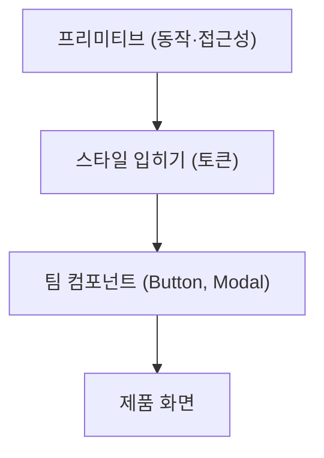

<Callout type="info">
  **이번 문서의 목표:** Headless 컴포넌트가 무엇을 맡고 무엇을 맡기지 않는지 설명하고, 구현 형태 네 가지와 주요 라이브러리를 상황에 맞게 고를 수 있습니다.
</Callout>

## UI 로직과 스타일 분리

UI 로직은 상태, 이벤트 처리, 키보드 조작, 포커스 관리, ARIA 속성처럼 화면 모양과 무관한 동작입니다. 스타일은 색, 간격, 애니메이션처럼 모양을 정하는 부분입니다. 둘을 따로 두면 같은 동작에 다른 디자인을 입힐 수 있습니다.

Dialog 하나에도 이 둘이 섞여 있습니다.

| 구분 | 내용 |
|------|------|
| 로직 | 열림·닫힘 상태, Esc로 닫기, 포커스 가두기와 복귀, 배경 비활성화, `role`과 `aria-*` |
| 스타일 | 배경 딤 색, 모서리 둥글기, 등장 애니메이션, 크기 |

- 로직과 스타일이 한 컴포넌트에 묶이면 디자인이 바뀔 때마다 동작 코드를 건드려야 합니다.
- 반대로 스타일을 덮어쓰는 방식(props로 색을 받는 방식)은 라이브러리가 예상한 범위까지만 바꿀 수 있습니다.
- 분리하면 로직은 한 번만 만들고 검증하며, 디자인 시스템마다 모양만 새로 입힙니다.

분리의 경계는 "DOM 구조와 클래스를 누가 정하느냐"입니다. 로직 쪽이 DOM을 정하면 스타일을 입힐 자리가 좁아집니다.

## Behavior Hook

Behavior Hook은 UI 동작을 Hook으로 꺼낸 것입니다. 상태와 핸들러를 만들고, 요소에 그대로 펼쳐 쓸 props를 돌려줍니다. 마크업은 쓰는 쪽이 정합니다.

```tsx
function useDisclosure(initial = false) {
  const [open, setOpen] = useState(initial)
  const id = useId()
  return {
    open,
    toggle: () => setOpen((o) => !o),
    getTriggerProps: () => ({
      'aria-expanded': open,
      'aria-controls': id,
      onClick: () => setOpen((o) => !o),
    }),
    getPanelProps: () => ({ id, hidden: !open }),
  }
}
```

```tsx
function Faq() {
  const d = useDisclosure()
  return (
    <>
      <button {...d.getTriggerProps()}>질문</button>
      <div {...d.getPanelProps()}>답변</div>
    </>
  )
}
```

- 이렇게 요소에 펼칠 props를 돌려주는 함수를 prop getter라고 부릅니다. 사용자가 자기 핸들러를 넘기면 getter 안에서 합쳐 주는 것이 관례입니다.
- React Aria의 저수준 API가 이 형태입니다. 이벤트를 가로채고 동작을 덮어쓰고 DOM 요소를 바꿀 수 있는 대신 연결은 직접 합니다(공식 문서 기준).
- 단점은 연결 책임이 쓰는 쪽에 있다는 점입니다. getter를 빼먹으면 접근성 속성이 빠집니다.

**흔한 실수:** `hidden` 대신 조건부 렌더링으로 패널을 지우면 `aria-controls`가 가리키는 요소가 사라집니다. 패널을 항상 렌더링할지, 닫힐 때 참조를 끊을지 정해야 합니다.

## Headless Component

Headless Component는 동작과 접근성을 갖췄지만 스타일이 없는 컴포넌트입니다. Hook이 아니라 컴포넌트로 제공해서 DOM 구조까지 라이브러리가 책임집니다. Radix Primitives는 자신을 접근성과 커스터마이징에 집중한 저수준 UI 컴포넌트 라이브러리로 소개하고, 기본 스타일 없이 배포됩니다(공식 문서).

```tsx
<Dialog.Root>
  <Dialog.Trigger>열기</Dialog.Trigger>
  <Dialog.Portal>
    <Dialog.Overlay className="overlay" />
    <Dialog.Content className="content">
      <Dialog.Title>제목</Dialog.Title>
      <Dialog.Description>설명</Dialog.Description>
    </Dialog.Content>
  </Dialog.Portal>
</Dialog.Root>
```

- `className`을 어떤 방식(CSS, CSS-in-JS, 유틸리티 클래스)으로 채워도 동작은 같습니다.
- 라이브러리가 렌더링하는 기본 요소를 바꾸고 싶으면 합성 수단이 필요합니다. Radix는 `asChild`, Base UI는 `render` prop입니다(자세히는 10편, 11편).
- Radix는 `asChild`를 쓰면 기본 요소 대신 자식 요소를 복제해 필요한 props와 이벤트 핸들러를 넘깁니다. 자식 컴포넌트는 받은 props를 DOM 노드에 펼치고 `ref`를 전달해야 합니다. React 19에서는 `ref`가 일반 props라서 함수 컴포넌트가 받아 그대로 넘기면 됩니다(자세히는 중급 03편).

**Hook과 컴포넌트의 선택:** 마크업을 직접 정해야 하면 Hook, 접근성이 걸린 DOM 구조를 맡기고 싶으면 컴포넌트가 낫습니다. 구조가 복잡한 위젯(Dialog, Menu, Combobox)일수록 컴포넌트가 실수를 줄입니다.

## Render Props

Render Props는 렌더링 일부를 함수로 받는 패턴입니다. Headless 컴포넌트에서는 내부 상태를 함수 인자로 노출해서 쓰는 쪽이 모양을 정하게 합니다(자세히는 11편).

```tsx
<Disclosure>
  {({ open, toggle }) => (
    <button onClick={toggle}>
      {open ? '접기' : '펼치기'}
    </button>
  )}
</Disclosure>
```

- 상태에 따라 내용이 달라져야 할 때 유용합니다. `open`일 때만 아이콘을 돌리는 식입니다.
- React Aria Components는 각 부분에 상태, 렌더 props, 슬롯을 제공합니다(공식 문서). Base UI의 `render`는 요소 대신 함수를 받을 수 있고, 함수는 props와 state를 인자로 받습니다.
- Hook이 생긴 뒤로 순수 로직 공유는 Hook이 대신합니다. Render Props는 요소를 바꿔 끼워야 하는 경우에 남습니다.

## Compound API

Compound API는 `Root`, `Trigger`, `Content`처럼 여러 부분을 조합하는 형태로 Headless 컴포넌트를 제공하는 방식입니다. Root가 상태를 Context로 공유하고 부분들이 그것을 읽습니다(자세히는 12편).

- Radix Dialog는 `Root`, `Trigger`, `Portal`, `Overlay`, `Content`, `Title`, `Description`, `Close`로 이루어집니다. Tabs는 `Root`, `List`, `Trigger`, `Content`입니다.
- 부분을 원하는 곳에 배치할 수 있고, 필요 없는 부분은 빼면 됩니다.
- 이 부분들을 한 번 묶어 우리 시스템의 API로 감싸는 것이 디자인 시스템 작업의 기본입니다. Radix 문서도 프리미티브 부분을 상위 컴포넌트로 추상화하는 방식을 안내합니다.

```tsx
// 부분을 감싸 팀 전용 API로 만든다
export function Modal({ title, children, ...rest }) {
  return (
    <Dialog.Root {...rest}>
      <Dialog.Portal>
        <Dialog.Overlay className="overlay" />
        <Dialog.Content className="content">
          <Dialog.Title>{title}</Dialog.Title>
          {children}
        </Dialog.Content>
      </Dialog.Portal>
    </Dialog.Root>
  )
}
```

## State Machine

복잡한 위젯의 상태는 불리언 여러 개보다 상태 머신으로 보는 편이 안전합니다. 상태 머신은 가능한 상태와 이벤트에 따른 전이를 미리 정해 두는 모델입니다(자세히는 중급 02편).

Combobox를 불리언으로 모델링하면 `isOpen`, `isTyping`, `isLoading`이 서로 모순되는 조합이 생깁니다. 상태 하나로 모델링하면 불가능한 조합이 사라집니다.

```ts
type ComboState = 'closed' | 'open' | 'loading'
type ComboEvent = 'TYPE' | 'LOADED' | 'ESC' | 'SELECT'

function next(s: ComboState, e: ComboEvent): ComboState {
  if (e === 'ESC' || e === 'SELECT') return 'closed'
  if (s === 'closed' && e === 'TYPE') return 'loading'
  if (s === 'loading' && e === 'LOADED') return 'open'
  return s
}
```

- 이 `next`를 `useReducer`에 넣으면 라이브러리 없이도 상태 머신이 됩니다.
- XState는 상태 머신과 액터 모델을 다루는 라이브러리이며 `createMachine`, `createActor`, React용 `@xstate/react`(`useMachine`, `useActor`)를 제공합니다. 현재 주 버전은 v5입니다(공식 문서).
- 전이를 표로 적을 수 있다는 점이 장점입니다. 테스트가 "이 상태에서 이 이벤트가 오면 이 상태"로 단순해지고, 접근성 속성(`aria-expanded` 등)도 상태에서 파생됩니다.
- 위젯 하나에 상태가 둘 이하이면 `useState`로 충분합니다. 상태 머신은 허용되지 않는 전이가 버그로 이어지는 위젯에서 값을 합니다.

## Design System Primitive

프리미티브는 디자인 시스템의 맨 아래층으로, 접근성과 동작은 갖췄지만 모양은 아직 없는 부품입니다. 그 위에 토큰과 스타일을 얹어 팀의 컴포넌트를 만듭니다(자세히는 22편).



- 프리미티브 계층을 외부 라이브러리가 맡으면 팀은 가장 어렵고 틀리기 쉬운 부분(포커스, 키보드, ARIA)을 직접 만들지 않아도 됩니다.
- 팀 컴포넌트는 프리미티브를 감싸되 props 이름과 변형(variant)을 팀 규칙으로 통일합니다(자세히는 10편).
- 프리미티브를 교체할 가능성이 있으면 앱 코드가 라이브러리를 직접 import하지 않고 팀 컴포넌트만 쓰게 합니다.

## 접근성 책임

Headless 라이브러리는 접근성 중 위젯 동작 부분을 맡고, 나머지는 쓰는 쪽이 맡습니다.

| 라이브러리가 맡는 것 | 쓰는 쪽이 맡는 것 |
|----------------------|-------------------|
| `role`과 `aria-*` 속성 | 의미 있는 라벨 텍스트, 아이콘 버튼의 이름 |
| 키보드 조작(화살표, Esc, Home과 End) | 위젯을 쓸 자리가 맞는지(링크인지 버튼인지) |
| 포커스 이동과 복귀 | 색 대비, 포커스 표시가 보이는 스타일 |
| 모달의 배경 비활성화 | 콘텐츠의 제목 구조와 언어 |

- Radix는 `aria`와 `role` 속성, 포커스 관리, 키보드 조작을 처리한다고 밝힙니다. 예를 들어 AlertDialog가 열리면 포커스가 Cancel 버튼으로 이동합니다.
- Radix Dialog는 `Title`과 `Description`을 요구합니다. 화면에 보이기 싫으면 `VisuallyHidden`으로 감쌉니다.
- `asChild`나 `render`로 요소를 바꾸면 접근성 책임도 넘어옵니다. Radix 문서는 `Tooltip.Trigger`로 바꾼 요소가 포커스를 받고 포인터와 키보드 이벤트에 반응해야 한다고 적습니다.
- 테스트는 쓰는 쪽 몫입니다(자세히는 20편).

**흔한 실수:** 라이브러리를 쓰면 접근성이 자동으로 끝난다고 믿는 것입니다. `div`에 `asChild`로 버튼 동작을 입히고 포커스를 못 받게 만드는 경우가 대표적입니다.

## 라이브러리 비교

Headless 계열 주요 라이브러리를 공식 문서에 적힌 범위로 비교하면 다음과 같습니다.

| 라이브러리 | 형태 | 특징 |
|------------|------|------|
| Radix UI(Primitives) | 컴포넌트, Compound API | 스타일 없음, `asChild` 합성, 기본은 비제어이며 제어도 가능. `radix-ui` 통합 패키지 또는 개별 패키지 |
| React Aria | 훅·Context·컴포넌트 세 단계 | 스타일 없음, 국제화(30개 이상 언어 번역, 13개 달력 체계, RTL), 터치·마우스·키보드 상호작용 정교화 |
| Base UI | 컴포넌트, Compound API | MUI 팀의 스타일 없는 컴포넌트. 패키지 `@base-ui/react`, 2025-12-11에 v1.0 정식 |
| Headless UI | 컴포넌트 | Tailwind Labs 제작. React와 Vue 지원, Tailwind CSS와 함께 쓰도록 설계 |

- React Aria는 높은 단계의 React Aria Components, 중간 단계의 Context 기반 API, 낮은 단계의 Hook API를 모두 제공합니다. 필요한 만큼 낮은 단계로 내려가 통제를 늘릴 수 있습니다.
- Base UI는 트리 쉐이킹이 되어 가져다 쓴 컴포넌트만 번들에 들어갑니다.
- 고르는 기준은 세 가지입니다. 다룰 위젯이 제공되는가, 국제화·터치 같은 요건이 있는가, 스타일 방식(Tailwind 등)과 맞는가.
- 선택이 어렵다면 요구 위젯 목록을 먼저 적고 각 라이브러리의 컴포넌트 목록과 대조합니다. 라이브러리 간 API 이름과 부분 구성은 다릅니다.

## shadcn/ui의 구조

shadcn/ui는 공식 문서가 스스로 "컴포넌트 라이브러리가 아니라 컴포넌트 라이브러리를 만드는 방법"이라고 설명하는 코드 배포 방식입니다. npm 패키지를 설치하는 대신 CLI로 컴포넌트 소스 코드를 내 프로젝트에 가져와서 직접 고칩니다. 사용법 자체는 UI Libraries 과목에서 다룹니다.

- 구조는 3층입니다. 아래는 Headless 프리미티브, 가운데는 스타일(Tailwind CSS)을 입힌 컴포넌트 코드, 위는 내 프로젝트가 소유한 복사본입니다.
- 프리미티브가 Radix 하나로 고정되지 않습니다. 현재 공식 문서의 Dialog와 Tabs 페이지는 Base UI, React Aria, Radix UI 세 가지 구현을 함께 제시합니다.
- 설치 명령은 `pnpm dlx shadcn@latest add dialog`처럼 컴포넌트 이름을 지정하는 형태입니다.
- 소스를 소유하므로 접근성 동작은 프리미티브에, 모양과 API는 내 코드에 있습니다. 프리미티브 업데이트는 의존성이 처리하고, 복사한 스타일 코드는 직접 관리합니다.

Command 컴포넌트는 Headless 라이브러리 위가 아니라 서드파티 cmdk 위에 만들어졌다고 문서에 적혀 있습니다. 컴포넌트마다 바탕이 되는 라이브러리가 다를 수 있다는 뜻입니다.

## TanStack Table

TanStack Table은 데이터 그리드를 위한 Headless 엔진입니다. 상태, 타입이 있는 API, 행 처리 로직을 제공하고 마크업·스타일·시각 컴포넌트는 제공하지 않습니다(공식 문서).

- 정렬, 페이지네이션, 필터링(열·전역), 그룹화, 행 확장, 행·셀 선택, 열 고정, 열 순서와 숨김, 크기 조절을 맡습니다.
- 클라이언트에서 행을 처리하거나, 서버가 처리한 행을 받아 렌더링할 수 있습니다.
- React 어댑터는 `@tanstack/react-table`이고 React 18 이상에서 동작하며 핵심 API는 `useReactTable`, `getCoreRowModel`, `flexRender`입니다.

```tsx
const table = useReactTable({
  data,
  columns,
  getCoreRowModel: getCoreRowModel(),
})
// table이 행과 헤더 모델을 돌려준다
// 렌더링은 table, tr, td를 직접 쓴다
```

- 앞서 본 Behavior Hook과 같은 구조입니다. 로직은 Hook이 맡고, `table` 요소의 모양과 접근성 마크업은 직접 정합니다.
- 데이터 화면에서의 쓰임은 15편 Data Table에서 이어집니다.

## 핵심 정리

- Headless는 로직(상태·키보드·포커스·ARIA)을 맡고 스타일과 모양을 맡기지 않는 방식입니다.
- 형태는 Hook(prop getter), 컴포넌트, Render Props, Compound API 네 가지이며 구조가 복잡한 위젯일수록 컴포넌트가 안전합니다.
- 상태가 많은 위젯은 상태 머신으로 모델링하면 불가능한 상태 조합이 사라집니다.
- 프리미티브는 디자인 시스템의 맨 아래층이고, 팀 컴포넌트가 이를 감쌉니다.
- 접근성의 위젯 동작은 라이브러리가, 라벨·대비·요소 선택은 쓰는 쪽이 책임집니다.
- shadcn/ui는 프리미티브 위에 스타일 코드를 복사해 주는 방식이고, TanStack Table은 테이블 로직만 제공하는 Headless 엔진입니다.

## 마무리 복습

<Quiz
  questionNumber={1}
  question="Headless 컴포넌트 라이브러리가 일반적으로 맡는 것은?"
  options={['색상과 간격 같은 시각 디자인', '상태, 키보드 조작, 포커스 관리, ARIA 속성', '아이콘 이미지와 글꼴 파일', '앱 전체의 라우팅']}
  correctAnswer={2}
  explanation="Headless는 화면 모양을 제외한 동작과 접근성 로직을 제공합니다. 색, 간격, 글꼴 같은 시각 요소는 쓰는 쪽이 정합니다."
  optionExplanations={['시각 디자인은 Headless가 맡지 않는 부분입니다.', '정답입니다. 로직과 접근성 속성이 Headless의 몫입니다.', '아이콘과 글꼴은 스타일 영역이라 라이브러리가 제공하지 않습니다.', '라우팅은 UI 위젯의 영역이 아닙니다.']}
/>

<Quiz
  questionNumber={2}
  question="Radix에서 asChild로 기본 요소를 다른 요소로 바꿀 때 책임이 쓰는 쪽으로 넘어오는 것은?"
  options={['번들 크기', '접근성과 필요한 상호작용 지원(예를 들어 포커스를 받을 수 있는지)', 'React 버전 호환성', '라이브러리의 상태 관리 방식']}
  correctAnswer={2}
  explanation="asChild는 자식 요소를 복제해 props와 이벤트 핸들러를 넘깁니다. 바꾼 요소가 포커스와 포인터·키보드 이벤트를 지원하는지는 쓰는 쪽이 보장해야 합니다."
  optionExplanations={['번들 크기는 요소를 바꾼다고 책임이 이동하지 않습니다.', '정답입니다. Radix 문서는 Tooltip.Trigger로 바꾼 요소가 포커스와 이벤트에 반응해야 한다고 적습니다.', '버전 호환성은 asChild와 무관합니다.', '상태 관리는 라이브러리가 계속 맡습니다.']}
/>

<Quiz
  questionNumber={3}
  question="TanStack Table에 대한 설명으로 옳은 것은?"
  options={['table 요소의 스타일을 포함해 완성된 표 컴포넌트를 제공한다', '정렬·필터·페이지네이션 같은 로직과 상태를 제공하고 마크업과 스타일은 제공하지 않는다', 'shadcn/ui를 통해서만 사용할 수 있다', 'Radix UI의 하위 패키지다']}
  correctAnswer={2}
  explanation="TanStack Table은 데이터 그리드를 위한 Headless 엔진으로, 상태와 행 처리 로직을 제공하고 마크업과 스타일은 개발자가 만듭니다."
  optionExplanations={['스타일과 시각 컴포넌트를 제공하지 않습니다.', '정답입니다. 로직만 제공하는 Headless 엔진입니다.', '독립 라이브러리이며 shadcn/ui 없이도 씁니다.', 'Radix와 무관한 별개 라이브러리입니다.']}
/>

## 참고 자료

- [Radix Primitives — Introduction](https://www.radix-ui.com/primitives/docs/overview/introduction)
- [Radix Primitives — Accessibility](https://www.radix-ui.com/primitives/docs/overview/accessibility)
- [Radix Primitives — Composition](https://www.radix-ui.com/primitives/docs/guides/composition)
- [Radix Primitives — Dialog](https://www.radix-ui.com/primitives/docs/components/dialog)
- [Radix Primitives — Alert Dialog](https://www.radix-ui.com/primitives/docs/components/alert-dialog)
- [React Aria](https://react-aria.adobe.com/)
- [Base UI — Quick start](https://base-ui.com/react/overview/quick-start)
- [Base UI — Composition](https://base-ui.com/react/handbook/composition)
- [Base UI — Releases](https://base-ui.com/react/overview/releases)
- [Headless UI](https://headlessui.com/)
- [shadcn/ui — Introduction](https://ui.shadcn.com/docs)
- [shadcn/ui — Dialog](https://ui.shadcn.com/docs/components/dialog)
- [shadcn/ui — Command](https://ui.shadcn.com/docs/components/command)
- [TanStack Table](https://tanstack.com/table/latest)
- [TanStack Table — React 설치](https://tanstack.com/table/latest/docs/installation)
- [XState 문서](https://stately.ai/docs/xstate)
