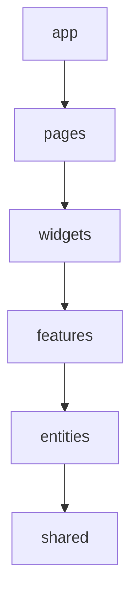

<Callout type="info">
  **이번 문서의 목표:** 코드를 기술 종류가 아니라 기능 단위로 나누고, 계층별 책임과 의존 방향을 정해 경계를 lint로 지키는 구조를 설명할 수 있습니다.
</Callout>

## Feature 폴더

Feature 폴더는 한 기능에 필요한 파일을 한곳에 모으는 구조입니다. 파일을 종류(components, hooks, utils)로 모으지 않고 기능(cart, auth, product)으로 모읍니다.

```text
# 종류별 구조
src/components/CartList.tsx
src/hooks/useCart.ts
src/api/cart.ts

# 기능별 구조
src/features/cart/CartList.tsx
src/features/cart/useCart.ts
src/features/cart/api.ts
```

- 종류별 구조는 파일이 늘면 기능 하나를 고칠 때 여러 폴더를 오가게 됩니다. 기능별 구조는 한 폴더만 봅니다.
- 기능을 지울 때 폴더 하나를 지우면 됩니다. 어디서 쓰이는지 추적하기도 쉽습니다.
- 기능 폴더의 안쪽은 규모에 따라 평평하게 두거나 역할별 하위 폴더로 나눕니다. 처음부터 하위 폴더를 만들지 않습니다.
- 두 기능이 같은 코드를 쓰기 시작하면 위치를 정해야 합니다. 그 기준이 아래 계층 규칙입니다.

**흔한 실수:** `features` 폴더 안에 기능 대신 `components`, `hooks`를 또 만들어 종류별 구조를 한 단계 아래에 복제하는 것입니다.

## UI와 Domain 분리

UI는 화면을 그리는 코드이고, 도메인은 서비스의 규칙과 데이터를 다루는 코드입니다. 도메인 규칙이 컴포넌트 안에 있으면 재사용과 테스트가 어렵습니다.

```tsx
// ❌ 컴포넌트 안에 규칙이 있다
function Price({ item }) {
  const total = item.qty * item.price * (item.vip ? 0.9 : 1)
  return <span>{total}원</span>
}
```

```tsx
// ✅ 규칙은 순수 함수로, 컴포넌트는 표시만
export const calcTotal = (i: Item) =>
  i.qty * i.price * (i.vip ? 0.9 : 1)

function Price({ item }) {
  return <span>{calcTotal(item)}원</span>
}
```

- 도메인 코드는 React를 import하지 않는 순수 함수와 타입으로 두는 것이 이상적입니다. 컴포넌트 없이 단위 테스트가 됩니다.
- UI 컴포넌트는 값을 받아 그리고 이벤트를 올립니다. 어떤 규칙으로 계산했는지 모릅니다.
- 도메인 규칙이 바뀌면 도메인 파일만, 디자인이 바뀌면 UI 파일만 수정합니다.

## Page

Page는 URL 하나에 대응하는 최상위 화면입니다. 하는 일은 조립입니다. 필요한 Feature 컴포넌트를 배치하고 URL 파라미터와 레이아웃을 연결합니다.

```tsx
function ProductPage() {
  const { id } = useParams()
  return (
    <PageLayout>
      <ProductDetail id={id} />
      <ReviewList productId={id} />
    </PageLayout>
  )
}
```

- Page 안에 비즈니스 로직과 스타일을 길게 쓰지 않습니다. 길어지면 Feature 컴포넌트로 내립니다.
- Page는 계층에서 위쪽이라 Feature를 가져다 쓸 수 있고, Feature가 Page를 import하면 안 됩니다.
- Page끼리도 서로 import하지 않습니다. 공유하고 싶은 코드는 한 계층 아래로 내립니다.
- 라우팅 방식(파일 기반, 설정 기반)은 프레임워크마다 다릅니다(자세히는 18편, 24편).

## Feature Component

Feature Component는 한 기능의 동작을 담은 컴포넌트입니다. 데이터를 가져오고, 상태를 연결하고, 하위 UI를 조립합니다.

- 예를 들어 `AddToCartButton`은 `useCart`를 호출하고, 클릭 시 담기를 실행하고, 결과를 토스트로 알립니다.
- Feature 컴포넌트는 기능 하나의 맥락을 알고 있어서 다른 기능에서 그대로 재사용하지 않습니다. 재사용하려면 맥락을 걷어낸 UI만 Shared로 내립니다.
- 반대로 맥락이 없는 `Button`, `Modal`을 Feature 안에 두면 다른 기능이 쓰려고 할 때 Feature끼리 의존하게 됩니다.

구분하는 질문은 하나입니다. "이 컴포넌트가 이 서비스의 용어(장바구니, 주문)를 아는가?" 안다면 Feature, 모른다면 Shared 후보입니다.

## Shared Component

Shared Component는 어느 기능에도 속하지 않는 범용 UI입니다. 서비스 용어를 모르고, props로만 동작합니다.

- 예: `Button`, `Input`, `Modal`, `Tooltip`, `Table`. Headless 프리미티브를 감싼 디자인 시스템 컴포넌트가 여기에 놓입니다(자세히는 13편, 22편).
- Shared는 계층의 맨 아래입니다. 어느 계층이든 import할 수 있고, Shared는 위 계층을 import하지 않습니다.
- 두 번째로 쓰이는 순간 올리지 않습니다. 같은 모양이 세 번 나타나고 요구가 같다는 것이 확인된 뒤에 올립니다. 너무 일찍 올리면 props가 늘어 비대해집니다.
- Shared는 어떤 기능도 몰라야 하므로 `if (feature === 'cart')` 같은 분기가 들어가면 잘못된 위치입니다.

## Custom Hook

Custom Hook은 상태와 Effect를 묶어 재사용하는 단위입니다(자세히는 기초 26편). 아키텍처 관점에서는 위치가 중요합니다.

| 종류 | 예 | 위치 |
|------|----|------|
| 범용 Hook | `useDebounce`, `useMediaQuery` | Shared |
| 기능 Hook | `useCart`, `useLogin` | 해당 Feature 폴더 |
| 화면 전용 Hook | 한 컴포넌트에서만 쓰는 폼 상태 | 그 컴포넌트 옆 |

- Hook은 도메인 함수를 호출하고 React 상태와 연결하는 접착층입니다. 규칙 자체는 Service에 둡니다.
- Hook이 JSX를 반환하지 않게 합니다. 화면을 반환하면 컴포넌트입니다.
- 이름은 기능이 드러나게 짓습니다. `useData`처럼 무엇을 하는지 알 수 없는 이름은 피합니다.

## Service Layer

Service Layer는 도메인 규칙을 순수 함수로 모은 층입니다. 계산, 변환, 검증, 서버 응답을 화면용 모델로 바꾸는 매핑이 여기에 들어갑니다.

```ts
export function toCartItem(dto: CartItemDto): CartItem {
  return {
    id: dto.item_id,
    name: dto.item_name,
    total: dto.unit_price * dto.quantity,
  }
}
```

- 서버가 쓰는 필드 이름(`snake_case`)과 화면이 쓰는 모델을 이 층에서 변환하면, 서버 응답이 바뀌어도 변환 함수만 고칩니다.
- React, 상태 라이브러리, `fetch`를 import하지 않으므로 입력과 출력만으로 테스트됩니다.
- 작은 앱에서는 이 층을 따로 만들지 않고 Feature 폴더 안의 `lib` 파일 정도로 둡니다. 규칙이 생길 때 분리합니다.

## State Layer

State Layer는 기능이 유지하는 상태를 담는 층입니다. 상태의 종류에 따라 도구가 갈립니다(자세히는 중급 22편).

| 상태 종류 | 도구 | 관련 편 |
|-----------|------|---------|
| 서버에서 온 데이터 | TanStack Query | 중급 27편, 28편 |
| 여러 컴포넌트가 공유하는 클라이언트 상태 | Zustand, Context | 중급 24편 |
| URL에 담을 상태(필터, 페이지) | 라우터의 쿼리 | 중급 29편 |
| 한 컴포넌트의 입력 | `useState` | 기초 09편 |

- 서버 데이터를 Zustand 같은 스토어에 복사해 두지 않습니다. 캐시와 갱신은 서버 상태 도구가 맡습니다.
- 상태 정의는 기능 폴더 안에 둡니다. 전역 스토어 하나에 모든 기능을 넣으면 기능 경계가 무너집니다.
- 컴포넌트는 스토어나 쿼리를 직접 만지지 않고 기능 Hook을 통해 읽습니다. 저장소를 바꿔도 Hook의 반환 형태만 지키면 컴포넌트는 그대로입니다.

## API Layer

API Layer는 서버와의 통신을 한곳에 모은 층입니다. URL, 메서드, 헤더, 요청·응답 타입, 에러 처리가 여기에 있습니다.

```ts
export async function fetchCart(): Promise<CartItemDto[]> {
  const res = await fetch('/api/cart')
  if (!res.ok) throw new Error(`cart ${res.status}`)
  return res.json()
}
```

- 컴포넌트가 `fetch`를 직접 호출하지 않습니다. URL이 바뀌거나 인증 헤더가 추가될 때 한 곳만 고칩니다.
- API 함수는 서버 응답(DTO) 타입을 반환하고, 화면 모델로의 변환은 Service가 맡습니다.
- 공통 부분(기본 URL, 인증 헤더, 에러 규칙)은 Shared의 API 클라이언트에 두고, 기능별 엔드포인트는 각 Feature 폴더에 둡니다(자세히는 18편).
- 이 함수를 `queryFn`에 넣어 서버 상태 도구와 연결합니다.

## Feature Boundary

Feature Boundary는 기능 사이에 긋는 경계입니다. 한 기능이 다른 기능의 내부 파일을 직접 가져다 쓰지 못하게 하는 규칙입니다.

- 각 Feature는 밖에 공개할 것만 모은 입구 파일(보통 `index.ts`)을 가집니다. 다른 곳은 입구만 import합니다.
- Feature끼리의 의존은 최소화합니다. A가 B를 알면 B를 고칠 때 A가 영향을 받습니다. 같은 계층의 기능이 서로를 import하면 순환 의존이 생기기 쉽습니다.
- 두 기능이 정말 협력해야 하면 상위 계층(Page)이 둘을 조립하고 값을 전달합니다. 기능 사이에는 props와 콜백만 오갑니다.

```text
# ❌ 다른 기능의 내부를 직접 import
import { calc } from '@/features/cart/lib/calc'

# ✅ 입구 파일로만 import
import { calcTotal } from '@/features/cart'
```

## Feature-Sliced Design

Feature-Sliced Design(FSD)은 프론트엔드 프로젝트를 계층(layer), 슬라이스(slice), 세그먼트(segment)로 나누는 구조 방법론입니다. 위 개념을 규칙으로 굳힌 것에 가깝습니다.

계층은 위에서 아래로 다음과 같습니다(공식 문서).

| 계층 | 역할 |
|------|------|
| app | 라우팅, 진입점, 전역 스타일, Provider |
| processes | 페이지에 걸친 복잡한 시나리오(공식 문서가 deprecated로 표기) |
| pages | 한 화면 또는 중첩 라우팅의 큰 구획 |
| widgets | 한 사용 사례를 완결하는 큰 UI 덩어리 |
| features | 비즈니스 가치가 있는 기능 구현을 재사용하는 단위 |
| entities | 사용자, 상품 같은 비즈니스 개체 |
| shared | 프로젝트와 무관하게 재사용하는 코드 |

- 슬라이스는 비즈니스 도메인으로 나눈 단위입니다. 같은 계층의 슬라이스는 서로를 사용할 수 없습니다.
- 세그먼트는 목적별 묶음입니다. 공식 문서의 대표 이름은 `ui`, `api`, `model`(스키마·스토어·비즈니스 로직), `lib`, `config`입니다.
- app과 shared는 슬라이스 없이 세그먼트를 바로 가지며, 나머지 계층은 슬라이스 안에 세그먼트를 둡니다.

```text
src/
  app/
  pages/product/ui, model
  features/add-to-cart/ui, api, model, index.ts
  entities/product/ui, model, api, index.ts
  shared/ui, lib, api
```

- 위 개념과의 대응: Page는 pages, Feature Component는 features, Shared Component는 shared/ui, API Layer는 `api` 세그먼트, State와 Service는 `model` 세그먼트가 가깝습니다.
- 규모가 작은 프로젝트에 모든 계층을 다 쓸 필요는 없습니다. 필요한 계층만 도입해도 규칙은 같습니다.

## 의존 방향 규칙과 import 경계 lint

핵심 규칙은 모듈이 자기 계층보다 엄격하게 아래에 있는 계층에서만 import할 수 있다는 것입니다(FSD 공식 문서). 위 계층을 import하거나 같은 계층의 다른 슬라이스를 import하면 위반입니다.



- 화살표는 import 가능한 방향입니다. 거꾸로는 불가능합니다.
- 규칙은 사람이 기억하지 않고 도구가 검사합니다. 방법은 세 가지입니다.

| 도구 | 하는 일 |
|------|---------|
| ESLint `no-restricted-imports` | 지정한 경로 패턴 import를 금지한다. 내부 경로 직접 import 차단에 쓴다 |
| eslint-plugin-boundaries | 요소 유형(계층)을 정의하고 유형 사이에 허용하는 import 관계를 규칙으로 정한다 |
| Steiger | FSD 전용 린터. `public-api`, `no-cross-imports`, `forbidden-imports` 등 규칙을 제공한다 |

`no-restricted-imports`는 `patterns`의 `group`에 gitignore 방식 와일드카드를 받아 깊은 경로를 막을 수 있습니다.

```js
{
  rules: {
    'no-restricted-imports': ['error', {
      patterns: [{
        group: ['@/features/*/*'],
        message: '기능은 index 파일로만 import한다',
      }],
    }],
  },
}
```

- 기능 폴더 안에서는 상대 경로로 가져오고, 기능 밖에서는 절대 경로 별칭으로 가져오게 하면 위 규칙이 안쪽 import를 막지 않습니다. FSD 문서도 슬라이스 안은 상대 경로, 슬라이스 사이는 절대 경로를 권합니다.
- Steiger는 `npx steiger ./src`로 실행하며 `--watch` 옵션을 지원합니다.
- lint는 CI에서도 실행해야 합니다. 에디터 자동 import가 내부 파일 경로를 제안해서 위반이 쉽게 들어옵니다. FSD 문서도 자동 import가 공개 API를 우회할 수 있어 린터를 권합니다.

**흔한 실수:** 규칙만 문서화하고 lint로 강제하지 않는 것입니다. 경계는 한 번 무너지면 되돌리는 비용이 큽니다.

## Barrel 파일 문제

Barrel 파일은 여러 모듈을 한 파일에서 다시 내보내는 `index.ts`입니다. 공개 API 입구로 쓰면 좋지만 잘못 쓰면 문제가 생깁니다.

```ts
// features/cart/index.ts
export { CartList } from './ui/CartList'
export { useCart } from './model/useCart'
export type { CartItem } from './model/types'
```

FSD 공식 문서가 지적하는 문제는 다음과 같습니다.

- 와일드카드 재내보내기 `export * from './ui/Comment'`는 무엇이 공개되는지 보이지 않게 하고, 의도하지 않은 내부 요소까지 노출해 다른 곳이 그것에 의존하게 만듭니다. 공개할 이름을 하나씩 적습니다.
- 순환 import는 파일이 서로를 import해 고리를 이루는 상태입니다. 같은 슬라이스 안에서는 barrel을 거치지 않고 상대 경로로 직접 import하면 피할 수 있습니다.
- 트리 쉐이킹 문제는 특히 `shared/ui`와 `shared/lib`에서 생깁니다. 모든 컴포넌트를 하나의 barrel에서 내보내면 번들에서 안 쓰는 코드가 빠지지 않을 수 있습니다. 문서의 해법은 컴포넌트마다 별도의 입구 파일을 두는 것입니다.
- 같은 계층의 슬라이스 사이에 정말 필요한 연결은 `@x` 표기(`entities/A/@x/B`)로 별도 입구를 둡니다.

기능 폴더의 입구 하나는 유지하되, 그 안은 이름을 명시한 재내보내기로 쓰고, 큰 Shared 묶음은 쪼갭니다.

## 핵심 정리

- 파일은 종류별이 아니라 기능별 폴더로 모으고, 서비스 용어를 아는 코드는 Feature에, 모르는 범용 코드는 Shared에 둡니다.
- 도메인 규칙은 React를 모르는 순수 함수(Service)로, 서버 통신은 API 층으로, 상태는 종류에 맞는 State 도구로 나눕니다.
- Page는 조립만 하고, Feature는 입구 파일로만 외부에 공개하며, 의존은 위에서 아래로만 흐릅니다.
- FSD는 app·pages·widgets·features·entities·shared 계층과 슬라이스·세그먼트로 이 규칙을 정식화한 방법론입니다.
- 의존 규칙은 ESLint(`no-restricted-imports`, eslint-plugin-boundaries)나 Steiger로 강제합니다.
- barrel 파일은 이름을 명시해 내보내고, 와일드카드·순환 import·트리 쉐이킹 문제에 주의합니다.

## 마무리 복습

<Quiz
  questionNumber={1}
  question="FSD의 import 규칙으로 옳은 것은?"
  options={['모듈은 자기보다 위 계층의 모듈만 import할 수 있다', '같은 계층의 다른 슬라이스끼리 자유롭게 import할 수 있다', '모듈은 자기 계층보다 엄격하게 아래에 있는 계층에서만 import할 수 있다', 'shared 계층은 모든 계층을 import할 수 있다']}
  correctAnswer={3}
  explanation="FSD는 계층을 app, pages, widgets, features, entities, shared 순으로 두고, 모듈은 엄격하게 아래 계층만 import하도록 정합니다. 같은 계층의 슬라이스끼리도 서로 사용하지 못합니다."
  optionExplanations={['위 계층을 import하면 의존 방향이 거꾸로 되어 규칙 위반입니다.', '같은 계층의 슬라이스는 서로 사용할 수 없다고 문서에 명시되어 있습니다.', '정답입니다. 아래 계층으로만 의존이 흐릅니다.', 'shared는 맨 아래 계층이라 위 계층을 import하지 않습니다.']}
/>

<Quiz
  questionNumber={2}
  question="Feature Component와 Shared Component를 구분하는 가장 실용적인 기준은?"
  options={['파일의 크기', '컴포넌트가 서비스의 도메인 용어와 맥락을 아는가', '컴포넌트가 Hook을 쓰는가', '스타일을 CSS로 작성했는가']}
  correctAnswer={2}
  explanation="장바구니나 주문 같은 서비스 맥락을 아는 컴포넌트는 Feature, 맥락 없이 props로만 동작하는 범용 UI는 Shared입니다. 크기, Hook 사용 여부, 스타일 방식은 기준이 되지 않습니다."
  optionExplanations={['크기는 위치를 정하는 기준이 아닙니다.', '정답입니다. 도메인 맥락을 아는지가 기준입니다.', 'Shared 컴포넌트도 Hook을 쓸 수 있습니다.', '스타일 작성 방식과 계층은 무관합니다.']}
/>

<Quiz
  questionNumber={3}
  question="Barrel 파일 사용 시 FSD 공식 문서가 경고하는 문제가 아닌 것은?"
  options={['와일드카드 재내보내기가 의도하지 않은 내부 요소를 노출한다', '파일이 서로를 import하는 순환 import가 생길 수 있다', 'shared의 큰 barrel 하나가 트리 쉐이킹을 방해할 수 있다', 'index 파일은 TypeScript에서 사용할 수 없다']}
  correctAnswer={4}
  explanation="FSD 문서는 와일드카드 재내보내기, 순환 import, shared의 트리 쉐이킹 문제, 자동 import의 공개 API 우회를 지적합니다. index 파일은 TypeScript에서도 문제없이 쓰이므로 마지막 보기는 사실이 아닙니다."
  optionExplanations={['문서가 지적하는 문제입니다.', '문서가 지적하는 문제입니다.', '문서가 지적하는 문제입니다. 컴포넌트별 입구 파일을 권합니다.', '정답입니다. index 파일은 TypeScript에서 사용할 수 있습니다.']}
/>

## 참고 자료

- [Feature-Sliced Design — Overview](https://feature-sliced.design/docs/get-started/overview)
- [Feature-Sliced Design — Public API](https://feature-sliced.design/docs/reference/public-api)
- [Steiger (FSD 린터)](https://github.com/feature-sliced/steiger)
- [ESLint — no-restricted-imports](https://eslint.org/docs/latest/rules/no-restricted-imports)
- [eslint-plugin-boundaries](https://github.com/javierbrea/eslint-plugin-boundaries)
